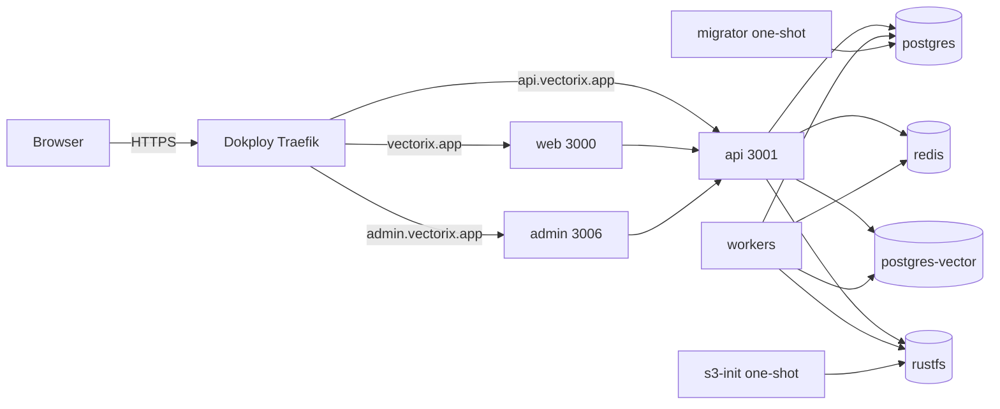

# Deploy Vectorix to vectorix.app with Dokploy (Swarm services)

This directory offers two ways to deploy Vectorix with Dokploy:

- **Template** ([`template/`](template/)): a Dokploy template that generates every secret and creates the three domains for you. Import it in one step; see [Dokploy template](#dokploy-template). It deploys as a Compose service, and you can switch the service to Stack afterwards.
- **Hand-written Stack** ([`vectorix-stack.yml`](vectorix-stack.yml) and [`production.env.example`](production.env.example)): ten Swarm services with explicit Traefik labels and data-node placement, for a Dokploy **Docker Compose** service of type **Stack** (`docker stack deploy`). The rest of this guide describes this option.

Images come from `pxdv.be/vectorix/{web,admin,api,workers,migrator,postgres-vector}` and are published for `linux/amd64` and `linux/arm64`. Set `VECTORIX_TAG` to an immutable `sha-<commit>` tag. The first manual publication is `sha-1aebd954f0295fb2f64bb353137381cf06993ecc` (`main` at `1aebd95`); it predates `VECTORIX_TRUSTED_PROXIES` support, which images from `76ca3ed` onwards honor.

The Stack was validated with `docker stack config`, and the template was started locally with Docker Compose (see below). Neither has been deployed to a Dokploy server yet; record the first production acceptance in [the build log](../../docs/build-task-log.md).

## Topology



Only web, admin and api join `dokploy-network` and are routed by Traefik. Databases, Redis and RustFS stay on the stack's `internal` overlay network.

## 1. Prerequisites

1. **DNS**: point `vectorix.app`, `api.vectorix.app` and `admin.vectorix.app` (A/AAAA records) at the Dokploy manager node.
2. **CPU**: on x86 nodes, `postgres-vector` (pgvectorscale) requires AVX2 and FMA. Check with `grep -o -w 'avx2\|fma' /proc/cpuinfo | sort -u`. Virtual machines may need host CPU passthrough. ARM64 is supported. See [RAG infrastructure](../../docs/rag-infrastructure.md).
3. **Registry**: in Dokploy, _Settings → Registry_, add `pxdv.be` with an account that can pull `vectorix/*`. Every Swarm node must be able to pull.
4. **Data node**: Docker volumes are local to one node, so stateful services are pinned to a labelled node:

    ```bash
    docker node update --label-add vectorix.data=true <node-name>
    ```

    On a single-node Swarm, label the manager.

## 2. Secrets

Generate one independent value per variable. Hex values need no URL encoding inside the generated connection strings:

```bash
for v in POSTGRES_PASSWORD REDIS_PASSWORD VECTOR_POSTGRES_PASSWORD VECTOR_PROVISIONER_PASSWORD VECTOR_RUNTIME_PASSWORD S3_ACCESS_KEY_ID S3_SECRET_ACCESS_KEY BETTER_AUTH_SECRET ENCRYPTION_SECRET; do echo "$v=$(openssl rand -hex 32)"; done
```

**Back up `ENCRYPTION_SECRET` off the server.** It encrypts organization provider credentials and derives source-receipt signing keys; losing it makes those credentials unrecoverable.

The database and vector role passwords only initialize empty volumes. Changing them later does not rotate existing roles.

Set `VECTORIX_TRUSTED_PROXIES` to the subnet of `dokploy-network`:

```bash
docker network inspect dokploy-network --format '{{(index .IPAM.Config 0).Subnet}}'
```

Without it, authentication rate limits would see Traefik's address for every client. See [authentication rate limiting](../../docs/auth-rate-limiting.md).

## 3. Create the service in Dokploy

1. _Projects → New project_ "Vectorix", then _Create Service → Compose_.
2. Compose type: **Stack**.
3. Source: _Raw_. Paste `vectorix-stack.yml`, or point Dokploy at this repository path.
4. _Environment_: paste `production.env.example` with the values from step 2, mail settings (Resend **or** SMTP), and at least one embedding provider unless every organization configures its own in the dashboard.
5. _Domains_: add nothing. The Traefik routers are in the stack's `deploy.labels`, using Dokploy's `letsencrypt` resolver, its `redirect-to-https@file` middleware and an HSTS middleware.
6. _Deploy_.

If services start with empty `${…}` values, the Dokploy version does not pass _Environment_ to `docker stack deploy`. Check with `docker service inspect <stack>_api --format '{{json .Spec.TaskTemplate.ContainerSpec.Env}}'` and upgrade Dokploy.

## 4. First start

Swarm ignores `depends_on`, so the first deployment converges on its own in a few minutes:

- `postgres`, `redis`, `postgres-vector` and `rustfs` start. On its empty volume, `postgres-vector` installs its extensions and creates the `vectorix_indexer` and `vectorix_runtime` roles.
- `migrator` applies the Prisma migrations and completes. It restarts on failure until the database accepts connections.
- `s3-init` creates the private `vectorix-documents` bucket if missing and completes.
- `api` and `workers` may restart once or twice until the migrations have run.

Checks:

```bash
docker stack services <stack>
docker service logs <stack>_migrator --tail 20    # "All migrations have been successfully applied."
docker service logs <stack>_s3-init --tail 5
curl -fsS https://api.vectorix.app/health
curl -fsS https://api.vectorix.app/ready          # database and Redis reachable
```

## 5. First superadmin

1. Open `https://vectorix.app/sign-up`, create your account, then your organization.
2. Grant superadmin access through SQL. The `pnpm admin:grant` script is not shipped in the images:

    ```bash
    docker exec -it $(docker ps -qf name=<stack>_postgres) \
      psql -U vectorix -d vectorix -c "UPDATE \"user\" SET \"isSuperAdmin\" = true WHERE email = 'you@example.com';"
    ```

3. Open `https://admin.vectorix.app`.
4. For an invitation-only instance, set `ALLOW_ACCOUNT_CREATION=false` (and optionally `ALLOW_ORGANIZATION_CREATION=false`), then redeploy.

## 6. Updates

1. Publish new images. The _Docker images_ workflow publishes tested `sha-<commit>` tags from `main` once the `PXDV_REGISTRY_USERNAME` and `PXDV_REGISTRY_PASSWORD` repository secrets are configured. Its BuildKit pushes need a registry proxy that allows uploads longer than about 60 seconds.
2. Set `VECTORIX_TAG=sha-<new commit>` in _Environment_ and deploy.
3. The migrator reapplies migrations idempotently. `api`, `web` and `admin` roll out with `start-first` and roll back on failure.
4. Read the release notes in the [README](../../README.md) and [build log](../../docs/build-task-log.md); some migrations require API and workers to be updated together.

## 7. Backups

A restore needs, together:

- the application database (`vectorix`);
- the vector database (`vectorix_vectors` on `postgres-vector`);
- the `vectorix-documents` bucket;
- `ENCRYPTION_SECRET`.

Schedule `pg_dump` runs (Dokploy _Schedules_ or a cron job on the data node) and bucket copies to external storage before opening access. The tested restore procedure is in [full-store restore acceptance](../../docs/rag-restore-acceptance.md).

## Notes

- **Cookies**: `ROOT_DOMAIN=vectorix.app` shares the session cookie across `vectorix.app`, `admin.vectorix.app` and `api.vectorix.app`. Do not host any other, less trusted service under `*.vectorix.app`; it would receive the session cookie.
- **Origins**: `TRUSTED_ORIGINS` lists web, admin and the API origin (for the Scalar playground). The cookie RPC/REST CSRF guard relies on it; see [cookie CSRF protection](../../docs/http-cookie-csrf.md).
- **Uploads**: originals can reach 25 MiB, and the API accepts a 26 MiB envelope. Traefik does not limit request bodies by default; do not add a more restrictive buffering middleware.
- **Embeddings**: Ollama is not part of the stack. Use a hosted provider (OpenAI, Mistral, Cohere, Voyage) or a separate Ollama server set as `VECTORIX_DEFAULT_OLLAMA_ENDPOINT`. Extra organization destinations go in `VECTORIX_EMBEDDING_ALLOWED_ENDPOINTS`.
- **PDF and DOCX**: the workers image includes Poppler and `prlimit`; nothing else is required.

## Dokploy template

[`template/`](template/) follows the [Dokploy templates format](https://github.com/Dokploy/templates/blob/canary/CONTRIBUTING.md):

- `docker-compose.yml`: the same ten services. Startup ordering uses `depends_on` conditions: the migrator and bucket initializer must complete before API and workers start.
- `template.toml`: generated secrets (`${hash:N}` produces hex, so connection strings need no encoding and `ENCRYPTION_SECRET` is valid), the full environment, and the `web`, `api.` and `admin.` domains.
- `meta.json`, `logo.svg` and `instructions.md`: catalog metadata and post-install steps.

To import it into your Dokploy instance:

1. Generate the import string:

    ```bash
    node deploy/dokploy/template/build-import.mjs
    ```

2. In Dokploy, choose _Create Service → Compose → Advanced → Import_ and paste the string.
3. Before deploying, edit the template variables: set `main_domain = "vectorix.app"` and `scheme = "https"`. Fill the mail settings and at least one embedding provider key in the environment. With the defaults, Dokploy generates an `sslip.io` host and the stack serves a working HTTP preview on it, because `api.` and `admin.` subdomains of that host resolve too.
4. Deploy. Then, in _Domains_, enable HTTPS (Let's Encrypt) on the three domains.
5. Optionally switch the service type to Stack to run it as Swarm services. Swarm ignores the `depends_on` conditions; the one-shot services retry `on-failure` until the databases accept connections.

Prerequisites are the same as for the hand-written Stack: DNS, AVX2/FMA on x86, `pxdv.be` pull access on the server, and backups of `ENCRYPTION_SECRET` with both databases and the RustFS volume. Set `VECTORIX_TRUSTED_PROXIES` to the subnet of `dokploy-network`.

The template could also be contributed to the public Dokploy catalog. That would require public images or a public registry.
