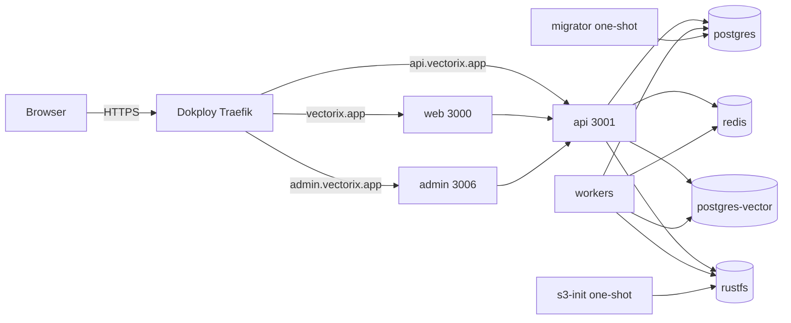

# Deploy Vectorix to vectorix.app with Dokploy (Swarm services)

This directory holds a production stack for a Dokploy **Docker Compose** service of type **Stack** (`docker stack deploy`):

- [`vectorix-stack.yml`](vectorix-stack.yml): ten Swarm services.
- [`production.env.example`](production.env.example): every variable the stack expects in Dokploy's _Environment_ tab.

Images come from `pxdv.be/vectorix/{web,admin,api,workers,migrator,postgres-vector}`. Set the initially empty `VECTORIX_TAG` to one tested `sha-<commit>` tag available for all six services. Verify that every image manifest supports each Swarm node architecture before deployment: the current workflow tests and publishes its runner architecture; a separate multi-architecture publication is not established by that workflow. The older manual publication recorded in the build log predates authentication proxy support and later security changes; it is not the default for a new deployment.

This stack was validated with `docker stack config`. It has not yet been deployed to a server; record the first production acceptance in [the build log](../../docs/build-task-log.md).

## Topology



Only web, admin and api join `dokploy-network` and are routed by Traefik. Databases, Redis and RustFS stay on the stack's `internal` overlay network.

## 1. Prerequisites

1. **DNS**: point `vectorix.app`, `api.vectorix.app` and `admin.vectorix.app` (A/AAAA records) at the Dokploy manager node.
2. **CPU**: on x86 nodes, `postgres-vector` (pgvectorscale) requires AVX2 and FMA. Check with `grep -o -w 'avx2\|fma' /proc/cpuinfo | sort -u`. Virtual machines may need host CPU passthrough. ARM64 is supported. See [RAG infrastructure](../../docs/rag-infrastructure.md).
3. **Registry**: in Dokploy, _Settings → Registry_, add `pxdv.be` with an account that can pull `vectorix/*`. Ensure the generated Stack deployment command includes `--with-registry-auth` so worker nodes receive pull authorization. See [Dokploy private Stack registries](https://docs.dokploy.com/docs/core/docker-compose).
4. **Data node**: Docker volumes are local to one node, so stateful services are pinned to a labelled node:

    ```bash
    docker node update --label-add vectorix.data=true <node-name>
    ```

    Label exactly one data node, including the manager on a single-node Swarm. Multiple matching nodes can schedule local volumes on different hosts and do not provide replicated storage.

## 2. Secrets

Generate one independent value per variable. Hex values need no URL encoding inside the generated connection strings:

```bash
for v in POSTGRES_PASSWORD REDIS_PASSWORD VECTOR_POSTGRES_PASSWORD VECTOR_PROVISIONER_PASSWORD VECTOR_RUNTIME_PASSWORD S3_ACCESS_KEY_ID S3_SECRET_ACCESS_KEY BETTER_AUTH_SECRET ENCRYPTION_SECRET; do echo "$v=$(openssl rand -hex 32)"; done
```

**Back up the encryption keyring off the server.** `ENCRYPTION_SECRET` is the current write key and derives source-receipt signing keys. Versioned-key releases also read retired keys from optional `ENCRYPTION_PREVIOUS_SECRETS` (at most sixteen comma-separated 64-hex values, at most 4,096 configuration characters); the stack explicitly passes it to all four application runtimes. An Environment-tab variable that is not referenced by the stack is not automatically injected. Keep every current or retired key needed by live ciphertext **or retained backups**; losing a required key makes the corresponding encrypted credentials unrecoverable. Follow the selected release's rotation/verification procedure before removing any retired key; changing the current key alone is not a safe rotation.

The database and vector role passwords only initialize empty volumes. Changing them later does not rotate existing roles. Required image and secret variables use `${VAR:?…}` so rendering aborts before deployment when a value is empty. Other operator settings still require review.

Set `VECTORIX_TRUSTED_PROXIES` to the subnet of `dokploy-network`:

```bash
docker network inspect dokploy-network --format '{{(index .IPAM.Config 0).Subnet}}'
```

Without it, authentication rate limits would see Traefik's address for every client. See [authentication rate limiting](../../docs/auth-rate-limiting.md).

## 3. Create the service in Dokploy

1. _Projects → New project_ "Vectorix", then _Create Service → Compose_.
2. Compose type: **Stack**.
3. Source: _Raw_. Paste `vectorix-stack.yml`, or point Dokploy at this repository path.
4. _Environment_: paste `production.env.example` with the values from step 2, mail settings (Resend **or** SMTP), and at least one embedding provider unless every organization configures its own in the dashboard.
5. _Domains_: add nothing. The Traefik routers are in the stack's `deploy.labels`, using Dokploy's `letsencrypt` resolver, its `redirect-to-https@file` middleware and an HSTS middleware. The Traefik Swarm provider must be active and attached to the same external `dokploy-network` overlay. Both the current `traefik.swarm.network` label and the older `traefik.docker.network` label select that exact overlay for compatibility; verify the deployed proxy configuration rather than assuming its version. See [Traefik Swarm network selection](https://doc.traefik.io/traefik/reference/routing-configuration/other-providers/swarm/).
6. _Deploy_.

Before deployment, verify that Dokploy resolves the environment into the Stack definition. Docker Stack does not load a Compose `.env` file automatically; missing required values must abort rendering. Use a Dokploy version or reviewed deployment command that supplies the variables explicitly. Inspect configuration privately: rendered manifests and container environments contain secrets. See [Docker Stack interpolation](https://docs.docker.com/compose/how-tos/environment-variables/variable-interpolation).

## 4. First start

Swarm does not order these services by `depends_on`. Migration and bucket initialization are independent tasks; they do not gate HTTP routing. Keep the new instance out of public traffic until both complete and the application checks pass:

- `postgres`, `redis`, `postgres-vector` and `rustfs` start. On its empty volume, `postgres-vector` installs its extensions and creates the `vectorix_indexer` and `vectorix_runtime` roles.
- `migrator` applies the Prisma migrations and completes. It restarts on failure until the database accepts connections.
- `s3-init` creates the private `vectorix-documents` bucket if missing and completes.
- `api` and `workers` can start before migrations complete. A running container or `/health` response does not establish schema readiness; do not assume that automatic restarts enforce this order.

Checks:

```bash
docker stack services <stack>
docker service logs <stack>_migrator --tail 20    # "All migrations have been successfully applied."
docker service logs <stack>_s3-init --tail 5
curl -fsS https://api.vectorix.app/health
curl -fsS https://api.vectorix.app/ready          # database and Redis reachable
```

## 5. First superadmin

1. Open `https://vectorix.app/sign-up`, create your account, then your organization.
2. Grant superadmin access through SQL. The `pnpm admin:grant` script is not shipped in the images:

    ```bash
    docker exec -it $(docker ps -qf name=<stack>_postgres) \
      psql -U vectorix -d vectorix -c "UPDATE \"user\" SET \"isSuperAdmin\" = true WHERE email = 'you@example.com';"
    ```

3. Open `https://admin.vectorix.app`.
4. For an invitation-only instance, set `ALLOW_ACCOUNT_CREATION=false` (and optionally `ALLOW_ORGANIZATION_CREATION=false`), then redeploy.

## 6. Updates

1. Read the release-specific [README](../../README.md) and [build log](../../docs/build-task-log.md) before changing a running instance. Review migration and ciphertext compatibility with every running reader and writer. Container rollback does not undo migrations or encrypted data writes.
2. Publish all six images under one tested commit tag. The _Docker images_ workflow publishes its tested runner architecture from `main` once `PXDV_REGISTRY_USERNAME` and `PXDV_REGISTRY_PASSWORD` are configured. Verify registry manifests and node architecture support separately. The previously reported proxy upload timeout must be resolved before relying on direct BuildKit publication.
3. Choose the rollout procedure **before** updating `VECTORIX_TAG`. The configured `start-first` policy suits only releases explicitly compatible with all running processes. For an incompatible reader/writer release, put the instance into maintenance, stop and drain **all** web/admin/API/worker replicas, and back up stores and keys. The first versioned-encryption rollout requires capable readers everywhere before any new writer resumes.
4. Before applying the new tag for an incompatible release, prepare a reviewed maintenance Stack variant that sets `deploy.update_config.order: stop-first` and `deploy.update_config.failure_action: pause` for API, web and admin, replacing their automatic `rollback` action. Prevent any automated or manual return to pre-v2 binaries after v2 writes. Those per-service options alone are **not** the safety boundary: every old reader and writer must already be stopped/drained across the entire deployment.
5. Keep all runtimes stopped while the new migrator completes successfully. Establish the v2-capable reader base everywhere, then resume the four application runtimes with the same tested tag and admit new writes only after every old reader/writer is gone. Once v2 ciphertext exists, an old-binary rollback is not a recovery procedure; a separately reviewed compatible data/key restore is needed. For an explicitly compatible release, use its reviewed migration ordering and rollout policy. Independent one-shot services do not enforce that ordering.
6. Verify migrator and bucket task completion, readiness and a dashboard upload/index/search smoke test before resuming traffic. A container healthcheck alone does not prove migration or product readiness.

## 7. Backups

A restore needs, together:

- the application database (`vectorix`);
- the vector database (`vectorix_vectors` on `postgres-vector`);
- the `vectorix-documents` bucket;
- `ENCRYPTION_SECRET` and every retired key in `ENCRYPTION_PREVIOUS_SECRETS` still required by that backup.

Schedule `pg_dump` runs (Dokploy _Schedules_ or a cron job on the data node) and bucket copies to external storage before opening access. The tested restore procedure is in [full-store restore acceptance](../../docs/rag-restore-acceptance.md).

## Notes

- **Cookies**: `ROOT_DOMAIN=vectorix.app` shares the session cookie across `vectorix.app`, `admin.vectorix.app` and `api.vectorix.app`. Do not host any other, less trusted service under `*.vectorix.app`; it would receive the session cookie.
- **Origins**: `TRUSTED_ORIGINS` lists web, admin and the API origin (for the Scalar playground). The cookie RPC/REST CSRF guard relies on it; see [cookie CSRF protection](../../docs/http-cookie-csrf.md).
- **Uploads**: originals can reach 25 MiB, and the API accepts a 26 MiB envelope. Traefik does not limit request bodies by default; do not add a more restrictive buffering middleware.
- **Embeddings**: Ollama is not part of the stack. Use a hosted provider (OpenAI, Mistral, Cohere, Voyage) or a separate Ollama server set as `VECTORIX_DEFAULT_OLLAMA_ENDPOINT`. Extra organization destinations go in `VECTORIX_EMBEDDING_ALLOWED_ENDPOINTS`.
- **PDF and DOCX**: the workers image includes Poppler and `prlimit`; nothing else is required.
