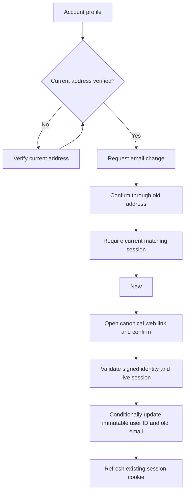
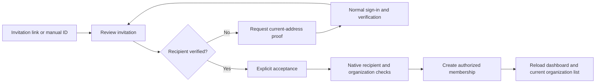

# Account email ownership and invitation confirmation

Status: **delivered in [PR #65](https://github.com/SimonLoir/vectorix/pull/65)**. This slice addresses issues #9/#53 and the related mail/confirmation boundaries in #25/#58. Existing unverified accounts can still sign in and use their current memberships. There is no verification backfill or global sign-in gate.

## Runtime requirements

Account-security mail uses the platform configuration, shared with system notifications through `@repo/emails`. A configured Resend key selects Resend; otherwise SMTP is selected. Invalid selected configuration never falls back to another provider. SMTP requires a host, an integer port from 1 to 65535 (default 587), and either both authentication fields or neither. The selected provider's sender is used, with the documented `noreply@example.com` fallback. Secret bytes are preserved. SMTP connection/socket timeouts are 10/30 seconds. Delivery errors are sanitized and do not cause a provider switch.

Set a stable `BETTER_AUTH_SECRET` of at least 32 characters and a valid canonical `VECTORIX_WEB_URL`. Existing `WEB_URL`/`APP_URL` fallback precedence and deployment path-prefix rules are retained. Links go to the configured web `verify-email` page; request Host, Origin and forwarding headers cannot choose their destination. Return paths are restricted to the account page or one bounded invitation identifier. No new environment variable is introduced.

After session admission and the current-address prerequisite, missing or invalid configuration refuses verification/change-email actions with a finite unavailable error. For a request admitted by native origin/callback validation, an unverified change returns `EMAIL_VERIFICATION_CURRENT_ADDRESS_REQUIRED` before mail configuration, even when mail is absent; native security validation can reject earlier. Password reset also preflights the shared mail configuration before account lookup or token creation. General sign-in does not depend on SMTP. A native email-change request's generic success means the request was accepted, not that a provider delivered it: Better Auth can swallow callback delivery failures. The interface must not claim mailbox delivery from that result. Notification preferences, durable delivery receipts and bounded worker retries retain their existing behavior.

## Verification and email changes

The account page separates name changes from address changes. It displays the current verification state and offers current-address verification/resend. An unverified account must prove its current address before requesting a change. Every change then requires confirmation through the old address and proof of possession of the new address; the old address remains current until the final step. All proofs require normal authentication to the same account before redemption; a mail link cannot create a session or bypass the normal password/passkey/2FA flow.

Proofs reuse Better Auth's native signed token format and public signing/verification APIs. Every mailed stage binds an immutable user ID, a protocol version and an allowed return path. Binding a native token and deriving its next stage preserve or shorten that token's expiry; a new resend request issues a fresh one-hour proof. Tokens are bounded and never displayed as text or logged; they travel only in the verification and allowlisted sign-in resume URLs. Unbound tokens and unsupported versions are rejected.

`packages/auth/src/email-ownership/handler.ts` intercepts native verification before its handler. The framework's normal email-change redemption can create a session without one, and its separate email lookup/update cannot express the required immutable-target predicate. The replacement performs no session creation. Both change-request admission and change-proof redemption require the current address to be verified, including previously issued direct-new-address proofs. `persistence.ts` rechecks the live session and updates with `id AND oldEmail` inside a Prisma transaction; a concurrent rename/reassignment cannot retarget the write. Provider I/O stays outside that transaction. The existing session cookie is refreshed through Better Auth's cookie helper.

This is not a claim of fresh authentication, revocation of other sessions or single-use JWTs. Ordinary verification is idempotent while its identity still matches. A completed address change makes a proof for the previous address stale; concurrent requests and address collisions fail without modifying another account.

## Invitations

`requireEmailVerificationOnInvitation` is explicit. Native invitation get/accept/reject require the exact recipient's verified address. Possession of an invitation ID does not establish mailbox ownership. Authorized organization invitation metadata remains available under the existing permissions; existing memberships are unchanged.

Both a shared invitation URL and the manual-ID entry point lead to a review page. Page load does not join an organization. The user reviews and explicitly accepts, or verifies their current address and returns to the same invitation first. Users without an organization can access the exact account and invitation pages without the mandatory onboarding dialog; other pages retain it. Missing, expired, foreign-recipient, unavailable and permission states use complete English, French and Belgian Dutch messages.

The confirmation explains that native acceptance creates membership and selects that organization as the active workspace. After a confirmed response, a full navigation to `/dashboard` refreshes tenant and membership caches. Better Auth invalidates its active-organization/session atoms on acceptance, but its organization list can otherwise retain the previous empty result and incorrectly display onboarding.

## Integration entry points

- `packages/emails/src/system-mail-configuration.ts` and `system-mail.ts`: shared runtime configuration and safe transport errors; see the [package guide](../packages/emails/README.md).
- `packages/auth/src/password-reset-email.ts` and `auth.ts`: reset-mail reuse, uniform preflight, explicit invitation policy and native callbacks.
- `packages/auth/src/email-ownership/`: configuration, signed claims, localized messages, immutable mutation and the verification handler.
- `packages/dashboard-core/src/lib/email-ownership.ts`: browser-safe return-path, finite error and response-outcome helpers.
- `apps/web/app/dashboard/account/`, `apps/web/app/verify-email/` and `apps/web/app/dashboard/accept-invitation/`: profile, explicit verification and invitation review.
- `apps/web/components/app-sidebar.tsx` and `packages/dashboard-core/src/components/team-switcher/team-switcher.tsx`: bounded onboarding display exception for the exact account and invitation pages.
- `apps/api/src/email-ownership-integration.ts`: real native HTTP, loopback SMTP and disposable PostgreSQL journeys.

## Acceptance recipe and current evidence

Prerequisites are production API/web builds, owned disposable `_test` stores, a controlled local SMTP receiver restricted to synthetic recipients, a configured canonical web URL and stable test auth secret. No real mailbox, hosted credential or application database is needed.

Verify the account's current-address state, resend, captured-mail link and explicit proof confirmation. Request an address change; confirm that the old address remains until the necessary old/new mailbox steps finish. Sign out before opening a link, sign in normally (including 2FA when enabled), then resume it. Check a wrong account, expired/tampered token, missing mail configuration and repeated submission. Review an invitation without joining, verify the recipient when needed, then explicitly accept. Check all three locales and reload persistence. Retain safe screenshots and response evidence, then clean only owned resources.

Final automated validation passes 86 Node tests plus 11 utility tests, including seven browser-safe return-path/error/outcome regressions, 23 workspace type-check tasks, 23 lint tasks and four production builds. Scoped API types/lint and web types/lint/build also pass after the final corrections. Existing lint warnings and one new controlled SMTP state-machine complexity warning remain. The disposable catalog passes all 258 tests, including twelve new native HTTP/local SMTP journeys, fresh/upgrade/repeat migrations and schema parity. Two intermediate fixture failures were corrected without weakening assertions: an empty native 403 is not JSON, and native hostile-callback validation can precede the ownership hook.

The new journeys cover legacy unverified login/membership, unverified change requests and previously issued direct-new proofs, matching/missing/revoked sessions, both old/new change stages, invalid/expired/unbound tokens, late address collision, pending native 2FA and exact-recipient invitation list/get/accept/reject. A real PostgreSQL transaction reassigns the old address while HTTP redemption waits; the immutable predicate refuses the write and leaves the replacement account unchanged. No schema or migration is added.

### Actual dashboard acceptance — 23 October 2026

Production API/workers/web and controlled loopback SMTP run against fresh owned disposable stores. The first run verifies the current address in French, confirms a change through the old inbox while the current address stays unchanged, then opens the new-address proof after signing out. Normal English password sign-in returns to the same proof without redeeming it. Explicit confirmation changes the address; the verified new address persists after reload.

Browser testing finds and fixes two complete-journey defects: mandatory zero-organization onboarding overlays invitation/account recovery, and successful native acceptance leaves the organization-list atom cached as empty. The exact-page onboarding display exception and confirmed-success full navigation are independently reviewed and rebuilt before further acceptance.

A second fresh run checks the manual-ID Join entry point, account recovery without an organization, and the shared invitation link. English and Belgian Dutch headings/messages react to language changes; Belgian Dutch persists across navigation. Current-address verification returns to the same invitation, which shows the actual organization, recipient and role before acceptance. Read-only database checkpoints prove verification alone leaves zero memberships, one pending invitation and no active organization. Explicit acceptance creates exactly the intended member and active organization; the stale-list UI defect is corrected afterward.

The final fresh run repeats shared-link sign-in, real SMTP verification, return to the same invitation and explicit acceptance. Before acceptance, a read-only checkpoint again confirms zero memberships and no active organization. After the click, exactly one member with the intended `member` role, one accepted invitation and one matching active-organization session exist, with zero documents, collections and API keys. The dashboard displays the selected organization, retains it after an explicit reload and has no onboarding dialog. The final tab has zero console warnings/errors. The synthetic session signs out normally, French is restored and all temporary tabs close.

Every owned process, store and volume is removed, including the initial preparation that stopped on a build-tree drift before migration/account creation. Private raw mail and synthetic login fixtures are removed; safe screenshots and count-only checkpoints remain in the ignored cache. Local SMTP acceptance does not establish Resend connectivity or external mailbox delivery. Browser 2FA, new signup, malformed proofs, outages and races remain **NOT_RUN in the browser**; their stated coverage above is automated. Existing unrelated account-security subpanels still contain French copy, and the old invitation-creation success dialog has a static seven-day expiry message that differs from the table's relative “in 1 day” label; those observed issues are separate follow-up work. Capacity remains waiting for the requested hardware.

Delivered by squash `2591516558cb530f748e1a093014b68a7b53154b` at 17:35:54 UTC on 23 October 2026. Exact head `f107934db80fe54bd8259d99bd94c591c76b5319` passes [catalog CI](https://github.com/SimonLoir/vectorix/actions/runs/39995070674) at 17:34:14 UTC and [all-six-image CI](https://github.com/SimonLoir/vectorix/actions/runs/39995070589) at 17:33:21 UTC before merge. Issues #9, #53, #25 and #58 are closed. This confirms image testing; it is not a claim of registry publication.
