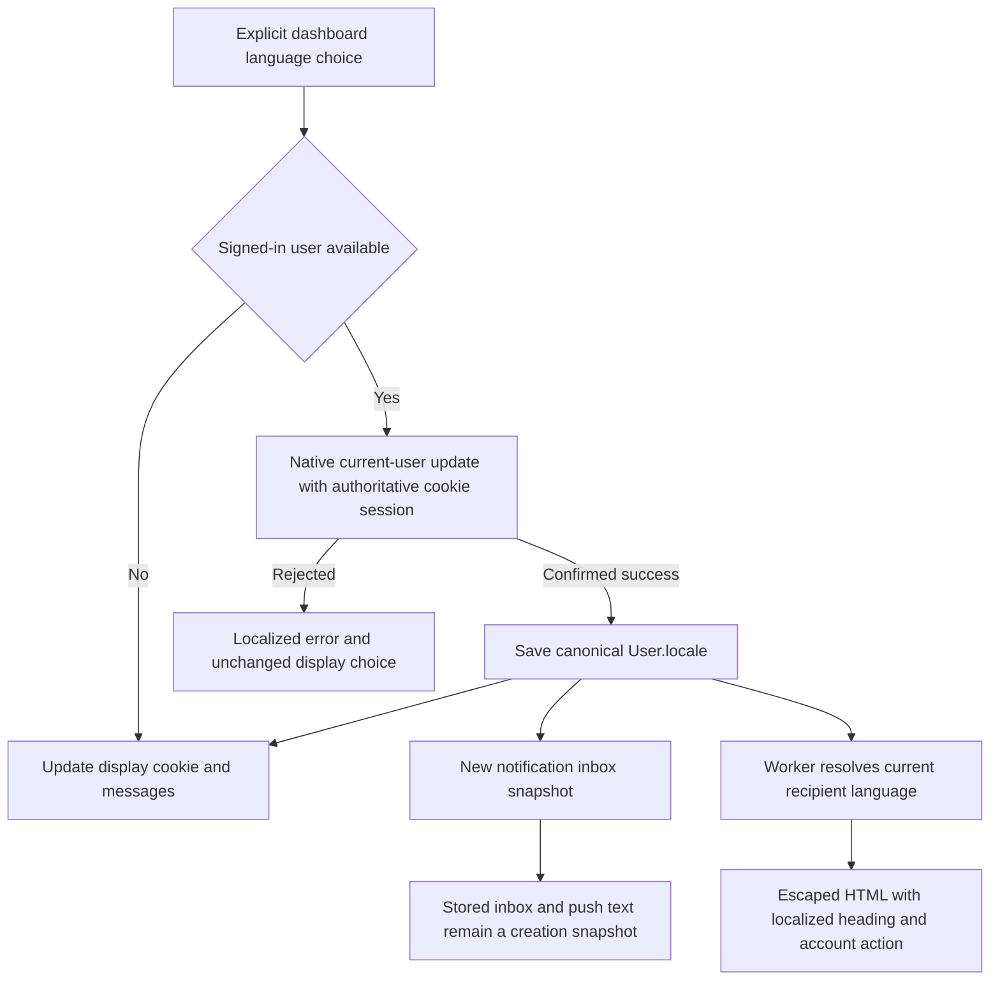

# Account, member and notification localization

This implementation slice addresses issue #22. The implementation and local production acceptance are complete; pull-request delivery and exact-head CI remain pending. Actual results are recorded below. It does not complete the remaining RAG capacity milestone, which waits for the requested compute upgrade.

## Language flow

The [shared resolver](../packages/i18n/src/locale.ts) normalizes regional English, French and Dutch preferences, including `en-US` and `en-GB`, to EN/FR/nl-BE. Unsupported or missing preferences fall back to English. Weighted browser preferences honor positive quality values and stable ties. Cookie decoding and all language inputs are bounded. Dashboard compatibility imports remain in [dashboard-core](../packages/dashboard-core/src/i18n/locale.ts); workers do not import Next.js or React to select a language.

The web and admin selectors explicitly save a signed-in user's language through Better Auth `update-user` before changing the display cookie. Concurrent selections are serialized. A rejected update leaves the display unchanged and shows a finite localized error. An anonymous visitor, including a failed session read with no user data, can change the display cookie only; that path makes no account-save claim. Merely opening a page never overwrites an account preference. Display selection on a new device still resolves its cookie/browser preferences; this slice does not add automatic account-to-cookie synchronization.

[Native field metadata](../packages/auth/src/user-locale-fields.ts) exposes only the existing locale column, with canonical `en`, `fr`, `nl-BE` inputs. New native accounts default to English; existing rows, including legacy French/null/regional preferences, are not backfilled. [Admission](../packages/auth/src/user-locale.ts) requires an authoritative cookie session for explicit locale writes and rejects client-assigned locale on email signup. Organization/API-key authority cannot grant personal-session access. Native identity binding and sensitive-field input restrictions remain in place. There is no database migration or versioned RAG contract change.

## Account and member interfaces

Account security uses localized password, passkey, active-session and deletion cards, finite errors, bounded confirmation dialogs and explicit loading/empty states. Password values are reset only after confirmed success, and the native `revokeOtherSessions` behavior remains enabled. Passkey/session lists render ten rows per page; their existing native list endpoints still return the full authorized list, so this is a rendering bound rather than server pagination.

Member roles, invitation forms, remove/cancel confirmations and shared clipboard feedback use complete EN/FR/nl-BE messages. Built-in roles are translated; organization-defined role names remain unchanged. Invitation creation displays the actual returned `expiresAt` with the active locale and configured provider time zone. It does not promise a fixed duration. Feedback says the invitation/link was created and can be shared for review and acceptance; no invitation-mail delivery is claimed. Existing organization permissions and recipient acceptance rules remain unchanged.

## Mail and notification semantics

[Inbox creation](../packages/routers/utils/src/utils/notifications/enqueue.ts) resolves the saved recipient language through the shared helper. Device, IP and timestamp facts remain frozen event text. Existing inbox and push snapshots are not rewritten when a preference changes. [Email rendering](../apps/workers/src/notifications/email.ts) instead uses the current recipient language at delivery time for its subject, heading, account action and HTML `lang`. Event facts and the configured account URL are escaped; a historical title used as a body fallback is omitted rather than repeated in another language.

The [worker](../apps/workers/src/notifications/process.ts) retains durable leases, bounded retries, deduplication and current membership/delivery-preference checks. Changing language does not enable a disabled transport or change an organization boundary. Platform Resend/SMTP configuration remains unchanged; hosted providers are not simulated in production.

Password-reset and email-ownership messages use the same resolver: request display cookie, saved user language when available, weighted browser preference, then English. Their existing destination, proof and canonical URL guards remain in place. Each HTML message declares its language. A cookie selects display text and is not authorization.

## Dashboard acceptance recipe

Use production web/admin/API/workers, a bounded loopback SMTP capture restricted to synthetic `example.test` recipients, and fresh disposable `_test` stores. Do not use application data, external recipients, browser API-key creation or credential-changing browser actions.

1. Sign in normally to an owned synthetic account. Change EN/FR/nl-BE using the dashboard selector; verify reactive account headings/security controls, the document language and reload persistence. Read-only database checks must confirm the account preference follows explicit signed-in choices.
2. Open password, passkey, session and account-deletion controls without committing credential mutations. Confirm localized labels, bounded dialogs and cancellation. These credential-changing browser actions remain intentionally unrun; this slice preserves their native calls and guards, reviewed statically. Password-reset, session-revocation and locale/2FA admission tests are distinct automated coverage.
3. In an owned organization, create an invitation for a synthetic address. Verify translated role/form/errors, creation wording, actual absolute expiry and copy feedback. Cancel only the owned invitation through its confirmation. No mail delivery is inferred from invitation creation.
4. Verify email notifications are enabled through the normal preference UI (email is enabled by default). Enable in-app notifications and save if an inbox comparison is needed. Sign out and sign back in, then allow the real worker to deliver through local SMTP. Inspect the captured HTML privately for the saved language and account action; compare the inbox snapshot. Repeat only the locales actually recorded below.
5. If admin is exercised, change its selector and verify the same personal preference semantics. Record errors and untested actions explicitly. Restore the display locale, sign out and remove only owned previews, stores, raw mail and tabs.

## Actual validation

On October 23, 2026, all 24 workspace type checks and lint tasks pass, with the existing warning set; 101 Node tests and 11 utility tests pass; all four application builds pass. The disposable catalog passes 268 tests in 189,149 ms, including seven native personal-locale journeys and three notification/real-loopback-SMTP journeys, plus fresh migrations, upgrades, repeat deployment and schema parity. All six Docker images pass production dependency/runtime and infrastructure checks. External lockfile resolutions are unchanged; only internal workspace importers are added. No new migration, environment variable or hosted provider is required.

The native tests cover canonical persistence/session reads, invalid input, missing/revoked sessions, pending/completed real TOTP, spoofed foreign identifiers and protected fields, a normally functioning scoped organization key denied personal access, legacy regional/null preferences, duplicate enqueue/send controls, current-language delivery after an inbox snapshot and disabled-email skipping. These are isolated test database and controlled SMTP results, not hosted mail connectivity or post-admission revocation-race proofs.

Production browser run `4e89b9c713a2` verifies EN/FR/nl-BE account security headings, placeholders, current-session/empty-passkey states, document language and reload persistence. Read-only checkpoints confirm each explicit language reached the account row. English and Belgian Dutch deletion dialogs are opened and cancelled without entering credentials or deleting anything. The NL-BE invitation form shows localized missing-role validation, built-in role choices, truthful creation feedback, an absolute/relative expiry and successful copy feedback. English lists/copy/revoke-and-keep and French lists/confirmed revocation also work. The exact DOM expiry matches the stored UTC instant; the comparison explicitly normalizes Prisma's timestamp-without-time-zone representation.

Email is already enabled in the normal preference UI. In-app notifications are enabled and saved there. Three subsequent normal sign-out/sign-in journeys after saved FR, EN and nl-BE choices produce the expected inbox titles and real worker SMTP messages, with matching subject, heading, action, HTML language and configured account link. Four email receipts, including the initial default-English sign-in, are SENT in one attempt; the capture has four messages and zero refusals. Historical notification titles remain unchanged while the interface language changes. No hosted transport is exercised.

The owned browser tab has zero console warnings/errors. A French heading locator initially expected a different phrase; the displayed heading is then verified. An immediate post-sign-in navigation lands on Documents during sidebar population; selecting the visible Notifications link after stabilization reaches the expected inbox. These observations are recorded without treating tool waits as performance measurements. The final session is signed out, French restored, and only owned tab 42 closed.

All four owned processes, four containers and four volumes are removed; private raw mail and login fixtures are deleted after safe count/language checkpoints are retained. Admin browser selection, browser credential mutations, mailbox proofs, outages and permission-negative browser journeys are NOT_RUN here. Browser API-key creation remains intentionally unrun at the user's request. Full native capacity continues to wait for a more capable VM. Seven changed documents, two Mermaid diagrams, 166 local file links and 5,673 ICU messages pass formatting/link/parse/key-parity checks; final diff checks are recorded in the build log.
