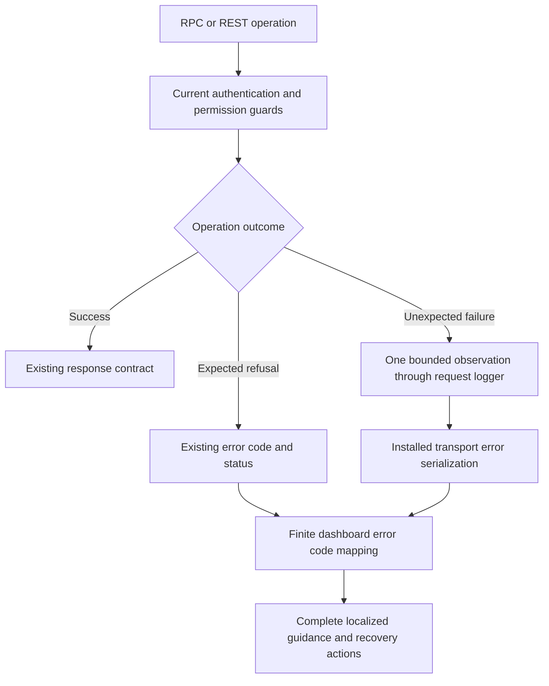

# Authorization errors and dashboard feedback

Issue #14 is implemented and locally validated on `codex/sanitized-authorization-errors`. Pull-request delivery and exact-head CI remain pending.

## Boundaries

The shared organization guard keeps current session/API-key admission, organization activity, operation classification and compound permission checks. Missing permissions still produce `FORBIDDEN` with HTTP 403. Its fixed server message is English; browser language selection does not alter authorization. Unknown private operations fail closed, including inherited object names such as `constructor`, `toString` and `__proto__`; only own entries of the operation catalog are classified.

Unexpected errors must never be logged as arbitrary objects. The request logger receives one fixed message with a finite error category, transport and API major. Output-validation observations may include a capped issue count, never issue contents. Error names, codes, messages, causes, stacks, provider responses, query parameters, request URLs and credentials are not diagnostic fields. Logging is best effort and must not replace the original failure or fall back to raw console output. Expected 4xx refusals do not emit this error observation; existing bounded authentication admission logs remain unchanged.

The production runtime factory is shared by every supported API major and both transports. Observation belongs to matched procedure execution; unmatched routing and malformed codec input keep the installed oRPC behavior. Deliberately constructed oRPC service errors retain their existing public contract. This change does not claim to sanitize all logging in workers, native authentication, providers or unrelated services.

## Dashboard behavior

Covered RPC paths use a finite error-code mapping rather than displaying server `message` or arbitrary details. Permission, expired-session, missing-resource, invalid-input, conflict, rate-limit and generic failures receive complete EN, FR and nl-BE guidance. Retry controls and personal account navigation remain available. Structured indexing diagnostics retain their existing domain mapping.

Several catalog conflicts currently share a plain `CONFLICT` code without structured reasons. Their safe localized guidance describes refreshing state and checking limits or references; it does not repeat free-text server detail. Native authentication forms and broader licensing-page localization remain outside this slice. API-key mutation permissions and issuance semantics remain unchanged; browser API-key controls stay automated-only at the user's request.

No schema, migration, environment setting, DTO or API revision change is required. Integration entry points: [`permissions.ts`](../packages/routers/utils/src/permissions.ts) and [`authorization-error.ts`](../packages/routers/utils/src/authorization-error.ts) own fixed denial/normalization; [`runtime-factory.ts`](../apps/api/src/api-versioning/runtime-factory.ts) and [`error-observation.ts`](../apps/api/src/api-versioning/error-observation.ts) wrap matched procedures for the registry; [`request-errors.ts`](../packages/dashboard-core/src/lib/request-errors.ts) selects finite keys; [`request-error-state.tsx`](../apps/web/components/request-error-state.tsx), the [permission provider](../apps/web/contexts/vectorix-permissions.tsx) and [catalog page](../apps/web/components/rag/catalog-page.tsx) render localized recovery. Catalog action/query consumers, API-key RPC dialogs/list and the license query branch reuse that mapping. A failed API-key list refresh suppresses stale rows and mutation controls.

## Acceptance recipe

1. Run native RPC and REST permission denials against owned disposable `_test` databases. Verify the unchanged status/code, fixed English server message, organization isolation and unchanged domain/audit snapshots. Exercise an unknown private operation through the real guard without exposing a diagnostic endpoint in production.
2. Use a test-only loopback server with the production runtime factory and actual RPC/REST transports. Throw controlled unexpected errors containing sentinels in message, cause and metadata, and trigger real output-validation failures. Verify generic unexpected-error responses, one bounded request-logger observation and absence of sentinels. Cover a failing logger and native null/primitive/unauthorized normalization.
3. Verify finite dashboard mappings and dictionary rendering, including unknown errors with sensitive-looking messages that must never be displayed.
4. Browser prerequisite: fresh owned infrastructure, production web/API builds, one ordinary synthetic account and organization created through native HTTP. Sign in normally while the organization is active. A separate reviewed fixture helper may then reduce only that exact organization's activity from true to false, retaining the existing session. It must not restore activity, change a role, grant access or create a key.
5. Open the collection dashboard directly. Verify localized permission-denied guidance and retry, personal account access and EN/FR/nl-BE persistence through reload. Record actual console observations separately from automated privacy assertions. Sign out, restore the display language and clean only owned resources and private login captures.

## Actual validation

The final local pass succeeds with a frozen install, 24 workspace type checks, 24 lint tasks, 116 API tests, 11 utility tests, 279 disposable catalog/integration tests, four production builds and all six Docker images/infrastructure checks. The catalog includes three new native-cookie permission journeys; the socket tests use actual loopback RPC/REST transports and the production runtime factory. All 36 request-error dictionary renderings pass with 12-key parity across EN, FR and nl-BE. Existing lint warnings remain. Initial TypeScript package-boundary and numeric-style failures are corrected through an explicit utility export and value-preserving style change before the passing final checks. No schema or migration changes are involved.

Production browser run `21111031f914` uses fresh owned infrastructure and an ordinary synthetic owner/organization created through native HTTP. Normal login opens the usable active collection dashboard. After the reviewed one-shot reduction of that exact organization's activity, the existing session sees localized denial, English retry, working personal-account navigation and EN/FR/nl-BE persistence through reload. Four read-only observations corroborate active state followed by the three denied locale states, unchanged owner membership and empty business data. No browser key issuance, role restoration, credential change or organization reactivation occurs.

The first web process exits with code 143 after the active observation; its bounded log contains no error/OOM marker, without establishing the cause. An unchanged-helper web restart allows the journey to finish in a fresh tab with the existing session. That tab's captured console has zero warnings/errors; the original network-error tab's console is not captured. French is restored and normal logout visibly returns to sign-in. The replacement web subsequently exits with code 143 and SMTP exits successfully with zero captured messages. The formal signed-out observer then refuses in its independent process-liveness guard **before** writing an intent or querying data; it remains `FAILED_PRE_INTENT`.

A separately archived and independently reviewed one-shot diagnostic verifies the same source/build/runtime/helper/migration pins and all four exact owned stores, then uses the exact loopback `_test` database in a bounded read-only RepeatableRead transaction. Its distinct `SUPPLEMENTAL_POST_STOP_ONLY` result confirms zero sessions, unchanged ordinary owner membership, the inactive organization, saved French locale and zero documents, collections, keys, groups, invitations, credentials or audit records. It neither restarts services nor replaces the failed formal observer, and does not determine browser acceptance.

Cleanup reaches `CLEANED_EVIDENCE_RETAINED` with zero owned containers/volumes; the remaining identity-checked API process exits successfully. The private login fixture and empty mail directory are removed, with safe screenshots and metadata evidence retained. Recovery tab 48 is closed. Closing original tab 47 is refused by the browser tool's policy after it navigates to a network-error `data:` page; no bypass is attempted, and its documented automatic turn-end cleanup is still pending at this checkpoint. These harness limitations are not counted as successful checks.

Independent product, interface/test and supplemental-diagnostic reviews identify no actionable P1/P2. Five documents pass formatting, 162 local Markdown links resolve, and the Mermaid diagram parses; `git diff --check` passes. The preceding organization-selection delivery is [PR #68](https://github.com/SimonLoir/vectorix/pull/68). Full capacity remains deferred until the requested compute upgrade, and live hosted-provider credentials remain deferred.
