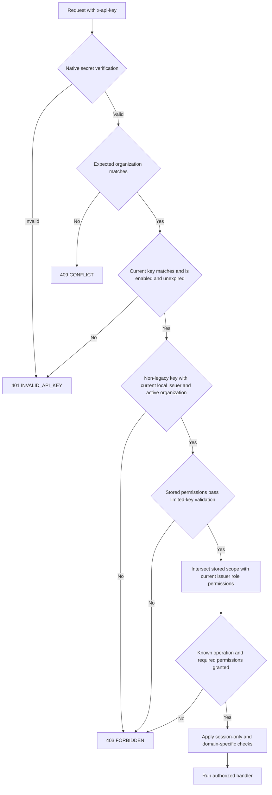

# Organization API-key authorization

Organization API keys delegate a limited set of permissions from their issuing member. Authentication of the secret alone does not preserve permissions after that member's access changes. The API resolves the current key record, issuer membership and organization role definitions on each admission.

This security fix uses the existing schema and V1 contract. It adds no migration or public DTO. The recipe below describes the complete manual journey; the actual browser and automated coverage are recorded separately at the end and in the [build log](build-task-log.md).

## Effective permissions and admission

For a valid, non-legacy key with an organization-local issuer binding:

```text
effective permissions = stored key permissions ∩ issuer's current role permissions
```

Multiple current roles contribute their union before this intersection. Promotion cannot expand a key beyond its stored scope. Revoking a delegated permission denies subsequent operations requiring that permission; restoring it can restore those operations without rewriting the key. Losing `apiKey.create` alone does not revoke a business permission the issuer still holds.

Every admission also requires the following:

- Native verification authenticates the secret for the `org` configuration. The current database row must still match the verified organization and configuration, be enabled and not be expired.
- `ApiKeyPrincipal` must bind this key to a current member in that same organization. The current membership ID must match the bound ID; another membership or a new invitation cannot substitute for it. The organization must be active.
- Stored permissions must pass the existing limited-key validation. Missing, malformed, reserved or overly broad permissions fail closed.
- The operation must appear in the private permission registry, and both its ordinary and compound permission requirements must be satisfied. An unknown operation remains forbidden.
- Domain checks still apply. RAG separately rechecks current actors, collection member/group grants, explicit key collection scopes, source access and transaction-time mutation authority.



A key remains a key principal: `context.key` is present, while `context.user` and `context.session` remain `null`. Supplying a session cookie alongside `x-api-key` cannot impersonate the issuer or rescue a revoked key. Notifications, current-member access, scoped key management and superadmin routes retain their session restrictions.

An expected-organization header pins the authenticated tenant; it never selects another organization. `INVALID_API_KEY` now carries HTTP 401 explicitly instead of inheriting the custom error's previous HTTP 500 default. Issuer, principal and stored-permission failures return sanitized HTTP 403 without exposing tokens, stored permission payloads or parser diagnostics.

These are admission checks for subsequent requests. They do not cancel requests already admitted or promise a linearizable authorization snapshot across unrelated concurrent writes. Existing domain transactions and post-I/O authorization checks remain necessary.

## Existing keys and supported reissue

Historical keys without `ApiKeyPrincipal`, keys whose issuer membership was removed, and keys marked `vectorixLegacyFullAccess` are rejected. The API does not infer an issuer from the current session, an organization owner, native metadata or the organization reference. Permission updates do not attach an issuer to an unbound key. Removing a member cascades its principal and collection scopes; rejoining the same user does not revive the old key, even if its hashed key row remains.

Use the supported reissue path:

1. Sign in as the intended current issuing member, with permission to create keys and to delegate every requested action. Open **API keys** at `/dashboard/account/api-keys` and choose **Get new key**.
2. Select explicit limited permissions and, for RAG content, organization-local collection scopes that the issuer currently holds. Save and copy the newly generated secret once into the consuming application's secret store.
3. Verify the new key with the intended operation, then update the consumer. An authorized organization member can delete the old entry from the API-key list. Restricting an old entry does not make a missing issuer recoverable.

The API equivalent is the session-authenticated `admin.organization.apiKeys.create` operation, exposed as `POST /api/v1/admin/organization/api-keys`. Native key creation and native permission-update bypasses remain forbidden. Existing supported issuance binds the member even when `collectionScopes` is empty, so this fix does not require a backfill or migration.

## Implementation entry points

| Boundary                                              | Entry points                                                                                                                                                                                                                                                                                                                                |
| ----------------------------------------------------- | ------------------------------------------------------------------------------------------------------------------------------------------------------------------------------------------------------------------------------------------------------------------------------------------------------------------------------------------- |
| Native secret verification and key/session separation | [Authorized middleware](../packages/routers/utils/src/authorized.ts), [auth plugin configuration](../packages/auth/src/auth.ts)                                                                                                                                                                                                             |
| Current key, issuer and permission intersection       | [API-key access service](../packages/routers/utils/src/api-key-access.ts), [current role resolution](../packages/auth/src/permissions/resolve.ts)                                                                                                                                                                                           |
| Limited delegation and operation requirements         | [Permission validation](../packages/auth/src/permissions/access-control.ts), [private operation registry](../packages/auth/src/permissions/operations.ts), [middleware permission checks](../packages/routers/utils/src/permissions.ts)                                                                                                     |
| Supported creation and updates                        | [Scoped issuance](../packages/routers/organizations/src/api-keys/create-api-key.ts), [permission updates](../packages/routers/organizations/src/api-keys/update-api-key-permissions.ts), [issuer/scope binding](../packages/routers/rag/src/services/api-key-scopes.ts), [native key policy](../packages/auth/src/permissions/key-hooks.ts) |
| Dashboard controls                                    | [API-key page](../apps/web/app/dashboard/account/api-keys/page.tsx), [role editor](../apps/web/app/dashboard/settings/roles/role-editor-dialog.tsx), [member role/removal controls](../apps/web/app/dashboard/settings/members/components/member-line.tsx)                                                                                  |
| Retained RAG and session-only boundaries              | [RAG actor and grants](../packages/routers/rag/src/services/access.ts), [notification session guard](../packages/routers/notifications/src/notification-session.ts)                                                                                                                                                                         |
| Focused HTTP regressions                              | [Issuer revocation journeys](../apps/api/src/api-key-issuer-revocation.ts), invoked by [core integration tests](../apps/api/src/integration.test.ts)                                                                                                                                                                                        |

## Dashboard acceptance recipe

Use an isolated environment with a disposable `_test` application database, initialized permissions, running web/API, and two synthetic accounts in one active organization: an owner and an issuer. Keep separate browser sessions. No embedding provider or document upload is required. Use a fresh synthetic key and the same key bytes for every check below; do not publish the secret or record it in logs/screenshots.

1. As owner, open `/dashboard/settings/roles`. Create `key-reader` with `dashboard.read`, `settings.read`, `apiKey.create` and `apiKey.read`, plus `key-restricted` with the same permissions except `settings.read`. In `/dashboard/settings/members`, assign the issuer to `key-reader`. The built-in `member` role retains `settings.read`, so switching to it would not test revocation of that permission.
2. In the issuer session, select the organization and open `/dashboard/account/api-keys`. Create a key granting only `settings.read`, with no collection scopes. Record its ID and keep the one-time secret privately. A key-only `GET /api/v1/admin/organization/` must return HTTP 200 with this organization's ID. Key-only `/api/v1/admin/organization/access` and notification requests must remain HTTP 403.
3. In the owner dashboard's member list, change the issuer to `key-restricted`. Repeat the same organization request with the unchanged key: expect HTTP 403. Restore `key-reader` and expect HTTP 200 again without editing or replacing the key.
4. Keep the member assigned to `key-reader`, then edit that role in `/dashboard/settings/roles` and remove **Settings → Read**. Repeat the key request: expect HTTP 403. Restore that permission and expect HTTP 200. This checks live role-definition changes independently of membership role assignment.
5. In the owner member list, remove the issuer and confirm. The unchanged key must now return HTTP 403 even though its key entry may remain listed. Reinvite the same user and accept with `key-reader`: the old key must still fail. Create a fresh key through the issuer dashboard and verify that the supported reissue succeeds.
6. Verify that the owner and another organization's session still work normally, that a mismatched expected-organization header cannot select a foreign tenant, and that errors contain no secrets. Inspect the final browser console and remove the synthetic keys, memberships, roles, accounts and owned preview resources.

The focused HTTP suite additionally covers multi-role unions, scope ceilings, malformed and historical database fixtures, disabled keys, cross-organization principals, native issuance bypasses and unclassified operations. Such fixtures belong only in isolated tests; do not manufacture them in an application database. Execute `pnpm test:catalog` through its disposable runner and record actual outcomes separately from the manual recipe.

## Actual validation — 22 October 2026

The disposable catalog runner passed all 128 core/RAG HTTP tests, including seven new issuer-revocation journeys, fresh migrations, upgrade preservation, repeat deployment and schema parity. The new tests use real PostgreSQL and HTTP transports, supported scoped issuance and native role/member changes. They cover permission removal and restoration, multiple roles, promotion without scope expansion, generic scope ceilings independently of RAG guards, historical/unbound keys, malformed permissions, disabled/invalid keys, tenant/principal mismatches, session-only and unknown operations, native bypass attempts, member removal, fixture membership re-addition and fresh reissue. No migration was added.

The 23 workspace type checks, 23 lint tasks, 23 backend regressions, four production builds and all six production image/infrastructure checks passed. Independent runtime, test and documentation review found no remaining P1/P2 issue. An initial catalog run exposed only an overlong synthetic reissue-key name; the corrected fixture and complete final run passed. A host restart interrupted the next run and erased temporary logs; the final catalog, image and workspace checks were rerun with durable ignored-cache logs.

Browser verification used production web/API with a private disposable `_test` organization, two synthetic accounts, and no documents, collections or provider credentials. Initial setup created the issuer's narrow `settings.read` key through the supported session-authenticated API. In the owner dashboard, removing **Settings → Read** from the issuer's custom role changed fresh, cookie-free organization requests with the unchanged key from HTTP 200 to 403; restoring that role definition returned 200. Changing the issuer's membership to a custom role without `settings.read` returned 403 again. The session-only organization-access operation remained 403 throughout. The owner's dashboard access remained available.

After the host restart, the saved synthetic membership was still restricted and fresh key-only requests again returned 403. Automatic browser approval review required action-time confirmation before restoring the original membership role. The user chose to leave that remaining control to automated tests. The browser did not subsequently restore permissions, remove/reinvite the issuer or create another key; member removal, direct fixture membership re-addition and supported fresh reissue are covered by the completed isolated HTTP suite, not claimed as manual browser acceptance. Invitation delivery/acceptance was not tested in this change. The final reloaded browser console had no warnings/errors. Its temporary tab, the two owned preview processes and four owned infrastructure containers were removed. No application database, external invitation or live embedding provider was used.
