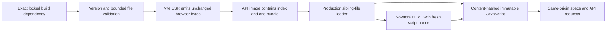

# Local API playground and browser policy

Status: **implementation, automated validation and read-only browser acceptance complete** for issue #54. This slice keeps the API playground available at `/` and packages its browser dependency locally. It does not change the public DTOs, API revision, authentication, trusted origins, database schema or migrations. Optional browser credential/mutation cases were not performed; their automated coverage is recorded separately. Owned-resource cleanup is complete.

## Build and deployment

`apps/api/package.json` pins `@scalar/api-reference` to `1.75.1` as a build-only devDependency. `scalar-bundle.ts` resolves the exported package entry without importing browser code, verifies the package name/version and reads its regular `dist/browser/standalone.js` file within an 8 MiB bound. The installed input is 4,627,502 bytes. Preserve its bytes, license banner and lockfile integrity when upgrading.

`apps/api/vite.config.ts` emits those bytes as `dist/scalar-api-reference.js`, enables SSR asset emission explicitly and defines the private compile constant `__VECTORIX_PACKAGED_SCALAR__`. Source development/tests resolve the installed devDependency. The compiled production branch reads only the file beside `dist/index.mjs`; it cannot fall back to an installed package or a CDN. Deployment environment variables cannot select the branch or a filesystem path.

The existing API Dockerfile copies all of `dist` and isolated production dependencies. The approximately 49.5 MB Scalar package and its transitive build dependency graph are excluded from that runtime; only the 4.6 MB standalone file is added. No new Docker asset-copy path, build tool or browser framework is needed in the runtime. The unused `vue-demi` postinstall compatibility switch is explicitly disabled in `pnpm-workspace.yaml`; copying the already built UMD does not execute Vue modules or require that switch. Frozen-lockfile installation preserves existing authentication/Next dependency resolutions rather than attaching newly introduced optional peers to those consumers.

## Response policy

The page has a fresh cryptographic nonce in its HTTP CSP, its two script elements and Scalar's `csp-nonce` meta hook. Executable scripts have neither an `unsafe-inline` nor an `unsafe-eval` exception. Scalar currently requires inline CSS attributes/theme styles, so `style-src` explicitly permits inline CSS. This exception does not authorize JavaScript.

The CSP starts at `default-src 'none'`; connections, fonts and ordinary images are confined to the same origin, with data images allowed. Base URLs, objects and framing are refused. HTML is `Cache-Control: no-store`, with `nosniff`, a no-referrer policy and framing protection. The favicon is local. Default web fonts, telemetry, persisted authentication, developer tools and remote agent/MCP features are disabled; no proxy or external plugin is configured. The policy intentionally prevents the playground from contacting a different API server or external spec reference.

Only the exact current `/_playground/scalar/<sha256>.js` identity is served. SHA-256/ETag and SHA-384 SRI derive from the actual served bytes. The asset has JavaScript MIME, `nosniff`, immutable caching and conditional GET support. Unknown hashes, encoded aliases and extra path segments cannot choose an arbitrary filesystem path. A cold syntactically valid hash can trigger the bounded read of the one fixed bundle before comparison. Missing, oversized or read-time-changing files produce a sanitized finite failure during loading; successfully loaded bytes stay cached until process restart. No file path or alternate origin is exposed, and other API operations remain available.

Registry-derived relative specifications and current/deprecated major selection are retained. Configuration is escaped before insertion into the initialization script. No user-controlled request value chooses a file, script source, CSP nonce or API origin.

## Authentication and runtime configuration

The playground does not change fetch credentials or inject a CSRF marker. A sessionless scoped API key retains its existing issuer, membership and scope checks. If the browser also carries Cookie, unsafe requests remain subject to [cookie CSRF protection](http-cookie-csrf.md), even with a key or bearer. The API origin is not trusted implicitly: an operator who wants cookie-authenticated playground mutations must add that exact origin to `TRUSTED_ORIGINS` at startup. No production-disable flag or new environment variable is introduced.

## Entry points and validation

- `apps/api/src/api-versioning/scalar-bundle.ts`: bounded source/build and packaged runtime loaders.
- `apps/api/vite.config.ts`: build-only input, compile branch and single emitted asset.
- `apps/api/src/api-versioning/scalar.ts`: registry configuration, escaped HTML and CSP.
- `scalar-page.ts`, `scalar-asset.ts` and `scalar-icon.ts` in that directory: focused public handlers composed by `apps/api/src/app.ts`.
- `apps/api/src/scalar-playground.test.ts`: loader/admission/response regressions.
- `scripts/test-docker.sh`: deployed byte equality, CSP/cache and absence of the build dependency in the API runtime, alongside the existing six-image checks.

Automated validation passes: 68 Node tests (eight focused playground cases), 11 utility tests, 23 type-check tasks, 23 lint tasks, four production builds and 246 disposable catalog HTTP/database tests with fresh/upgrade/repeat migration and schema parity. All six images and isolated infrastructure pass the production smoke, including exact served-byte/SRI/hash/cache verification and absence of Scalar from runtime dependencies. Existing lint warnings remain. The automated cookie/key authorization matrix is separate from the browser observations below.

## Actual browser result and limits

Run `252d136ba941` uses frozen product `d6e531c` and fresh owned stores. In the production web interface, a synthetic owner signs in and out normally in French. The local Scalar page renders API v1/revision 1.19.0; searching `groups` selects the POST operation and displays its schema. Expanding the health operation's documented 200 response shows the `ok` constant. An actual Scalar `GET /api/v1/health` returns HTTP 200 and the JSON string `"ok"`. Its displayed 7 ms is a single functional observation, not a latency benchmark.

The observed playground resource inventory contains only the local hash-named JavaScript, v1 specification, favicon and health request. The playground tab's console contains zero warnings/errors; the web tab's console is not checked. The automation tool's attempt to toggle `Show Schema` times out, so that checkbox interaction is not validated; the response-expansion button does work.

Automatic approval review rejects the private scoped-key helper before execution because creating a `settings.read` credential requires explicit user authorization. It also rejects the proposed group-creation browser action before any field is filled or request sent; the empty UI example is unchanged. Neither action establishes a browser 403 or a successful key request. The authorization question remains unanswered, and those optional browser cases are deferred to the automated matrix for this delivery. No scope, authentication or trusted-origin policy is changed to bypass the refusals.

If separately authorized later, the additional browser recipe is to verify the expected Cookie-bearing POST refusal while the API origin is untrusted, then sign out normally and verify a sessionless scoped-key GET. These two cases are explicitly untested in the browser; the completed automated matrix is not relabeled as browser evidence.

Cleanup completes at 16:08 UTC on October 23, 2026: three owned application processes, four store containers and four new store volumes are removed, and only the two created tabs 37–38 are closed. State is `CLEANED_EVIDENCE_RETAINED` with zero resource entries. Private `playground-get-health.png` and `browser-observation.json` evidence remains in the owned run directory; the screenshot is visually checked and contains a safe placeholder, not a real key. No key helper or POST mutation was executed.
