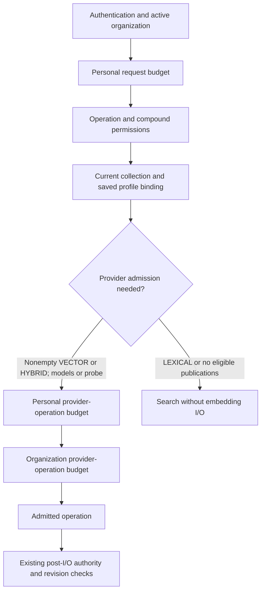

# Versioned API request budgets

Every authenticated organization operation on `/rpc/v1/*` and `/api/v1/*` built on [`authorized`](../packages/routers/utils/src/authorized.ts) receives a personal anti-loop budget after authentication and active-organization validation. It runs before operation permissions, so denied loops are throttled. Shared provider-operation admission waits until the service has checked current resource access and its saved embedding binding. An unauthenticated request or inactive organization never reaches these budgets.

## Admission order and scope

[`enforceApiRateLimit`](../packages/routers/utils/src/api-rate-limit.ts) consumes only the personal budget. The middleware attaches an optional `AuthorizedContext.admitProviderRequest` callback after operation permissions. [`models.ts`](../packages/routers/rag/src/services/indexing/models.ts) and [`search.ts`](../packages/routers/rag/src/services/indexing/search.ts) call it after their collection/profile and binding checks. The callback memoizes both success and refusal for that HTTP request. Each stage stops at its first refusal: a personal refusal cannot spend a shared organization budget, and a permission/resource denial cannot spend either provider-operation budget.

These are **request admission budgets**, not usage accounting or billing. Listing models and probing are admitted operations: a Voyage catalog listing performs no provider I/O, while a probe may make several native calls. Nonempty VECTOR/HYBRID searches are admitted immediately before query embedding; LEXICAL and searches with no eligible publications skip provider admission. A later native failure or authority revocation does not refund an admitted request. Existing post-I/O checks, durable quotas and native telemetry remain authoritative for their separate purposes.

## Configuration and windows

| Bucket                          | Scope                                | Default per minute | Server variable                                            |
| ------------------------------- | ------------------------------------ | ------------------ | ---------------------------------------------------------- |
| Personal anti-loop              | Organization + API-key ID or user ID | 600                | `VECTORIX_API_RATE_LIMIT_PER_MINUTE`                       |
| Personal provider operation     | Organization + API-key ID or user ID | 60                 | `VECTORIX_API_PROVIDER_RATE_LIMIT_PER_MINUTE`              |
| Organization provider operation | Organization                         | 300                | `VECTORIX_API_ORGANIZATION_PROVIDER_RATE_LIMIT_PER_MINUTE` |

Each configured value must contain decimal digits representing a safe integer from **0 through 1,000,000**. Only `0` disables its bucket. Missing or blank settings use defaults; malformed, negative, fractional or oversized values fail startup without printing their raw values. Session requests share the user's organization budget, while each organization API key has its own personal budget. Restart API replicas after changing these server settings.

API counters use [`consumeRateLimit(..., 'FIXED')`](../packages/queues/src/rate-limit.ts): a 60-second window begins with its first allowed hit. Later allowed or refused hits do not refresh that deadline, and refused hits do not increment the counter. Atomic Redis scripts share counters among API replicas. API counters use the `vectorix:rate-limit:fixed:v1:` namespace; the native authentication default remains `LAST_ALLOWED` with its unchanged `vectorix:rate-limit:v2:` namespace and Lua behavior. Native allowed hits renew their window; rejected hits do not. The policies never reuse a counter.

If Redis is unavailable, a bounded local store preserves the selected window policy separately for each process. It holds at most 10,000 live entries across both policies, scans at most 64 entries per admission and denies new keys when saturated rather than evicting live security budgets. This is not a distributed limit during an outage. Requests attempt reconnection at most once per five seconds; only one fixed sanitized warning is emitted. Redis and fallback counts are not reconciled on recovery, so limits must not be presented as exact cumulative usage. Shutdown must call `closeRateLimitStore()`.

## Responses and dashboard recipe

An exhausted bucket returns HTTP 429 with code `TOO_MANY_REQUESTS`, `data.retryAfterSeconds` and a `Retry-After` header on RPC and REST. [`ResponseHeadersPlugin`](../apps/api/src/api-versioning/runtime-factory.ts) preserves the response header. OpenAPI revision `1.20.0` declares 429 and its header for every operation except public health. The dashboards use their existing localized `rateLimited` feedback without exposing server details.

Use a disposable instance with an already authorized saved collection and an available test embedding endpoint. Configure personal admission at 600/minute, personal provider admission at 1/minute and organization provider admission at 300/minute before starting the API. Open the collection without invoking discovery, choose English, click **Verify saved model** once, then once more within the same window. Expect a successful verification followed by the localized rate-limit alert. Wait for natural expiry and repeat in French and Belgian Dutch; after another expiry, verify successfully once more. Confirm account navigation, restore the original language and log out. Never edit counters to obtain recovery. This bounded recipe uses seven explicit Probe clicks and requires no browser credential, API-key, role, grant or document mutation. API-key isolation and denied-resource admission are covered separately by disposable automated tests.

## Disposable tests and frozen acceptance workflows

[`pnpm test:catalog`](../scripts/test-catalog.sh) supplies **1,000,000** for each bucket. This is a finite test configuration, allowing bulk functional journeys while retaining observable counters. The focused native fixture first proves an owner search increments the organization counter and controlled embedding call count, then proves settings-only keys, missing collection grants and personal exhaustion do not spend the shared budget. To produce 429, the fixture seeds only one freshly issued synthetic key's exact personal Redis counter to its configured maximum, with a bounded TTL. This trigger does not alter database rights, clocks or task state. Its business rows and objects belong to disposable stores; uploads, indexing and searches use the normal application paths. The shared controlled-provider fixture temporarily sets generous organization quotas and restores their previous values; this is not production or capacity evidence.

The quality and capacity launchers under `tests/acceptance/` use closed environment construction and pinned state. They **do not inherit shell exports** of these variables. This change does not alter their frozen sources, policies, archived outcomes or environments. A future run needing different limits must explicitly add them through a separately reviewed preparation/configuration change and fresh source/state pins. Existing states must not be adopted or guards relaxed to make a load pass. Historical or future capacity outcomes are not established by these functional tests.

## Verification and exclusions

- [`api-rate-limit.test.ts`](../apps/api/src/http/api-rate-limit.test.ts): each setting's safe bound, sequential and memoized admission, isolation and real oRPC RPC/REST header serialization with controlled counters.
- [`rate-limit.test.ts`](../packages/queues/src/rate-limit.test.ts): both policies' clocks, isolation, bounded saturation and sanitized unavailable-Redis fallback.
- [`rate-limit.integration.ts`](../packages/queues/src/rate-limit.integration.ts): real isolated Redis concurrency, last-allowed renewal, fixed-window expiry and separate namespaces.
- [`rag-tests/api-rate-limit.ts`](../apps/api/src/rag-tests/api-rate-limit.ts): native authenticated middleware/service admission and controlled embedding fixture, operation/resource denial and RPC/REST 429 responses.

Monthly organization usage budgets and their dashboard/superadmin views remain unimplemented. No database schema, migration, public DTO or endpoint path changes. Local validation passes frozen installation, dummy Prisma generation, four scoped type/lint tasks, 171 API/backend tests, 11 utility tests, five real Redis tests, all 320 disposable catalog tests and four production builds. The initial catalog stops at 315/316 before the four new admission cases because eight worker scans do not establish activation among retained generations. Only the fixture wait changes to bounded real scans; the fresh complete pass proves all four cases without changing guards, task dates or completion state. Production code has an independent CLEAR review; final delivery review and CI remain pending. The protected admin declaration is restored byte-for-byte with its original mode. No actual browser credential/key action, hosted-provider measurement or full-capacity result is claimed.

A second integration combines the reviewed PR76 authentication transport/cooldown and PR77 discovery candidates (`e367834845b3932e7e1b3988e07bf2d5845164b9`). The merge preserves native LAST_ALLOWED Lua and its Redis namespace byte-for-byte, while retaining FIXED in its separate namespace, all native auth tests and the discovery ownership boundaries. A new frozen install/generation, all 24 workspace type and lint tasks, four uncached unit tasks (10 discovery, 189 API/backend, 56 chunking, 146 embedding and 11 utility cases), all six real Redis-runner cases, all 321 disposable catalog tests and four serial API/workers/web/admin production builds pass. Both declarations are restored to their exact initial bytes and modes. This is local candidate validation; the prior 320-test pass and initial 315/316 fixture-wait failure remain separate history. Actual-main alignment, the localized dashboard refusal/recovery journey and new exact-head CI remain pending. No counter or worker-task timestamp is modified to obtain this integration result.

## Completed controlled dashboard acceptance

On October 24, 2026, isolated run `25120d1ff094` tests the corrected production builds at `733a0f1f3464899d23ff146f4a8bffb124d83dcc`. Normal native HTTP setup creates one ordinary owner, one organization and one empty platform-bound collection. A bounded synthetic Ollama endpoint supplies the native tags/show/embed protocol; no real model weights, hosted provider or relevance result is claimed.

All seven explicit browser clicks follow the recipe: four accepted verifications and three localized refusals (EN/FR/nl-BE), with successful recovery after real Redis expiry. Thirteen ordered read-only proofs independently retain the same owner/profile/creator grant, zero API keys/credentials/documents/index work and sixteen native synthetic requests: four per accepted operation, none for refused operations. DB/Redis/provider observations are sequential, not an atomic snapshot. Browser response headers/status are not captured; separate native RPC/REST integration tests prove HTTP 429 and `Retry-After`. Browser console observation contains zero warnings/errors.

The account remains accessible. Its initial saved language (`en`) is restored and normal logout leaves zero sessions. The owned tab, three processes, four containers and four volumes are gone; private setup secrets are removed after safe evidence retention. The private helper sources return to their reviewed disabled bytes. No shell counter reset, database authority change or clock/task mutation is used.

The branch then aligns to verified main `531d705379ef65f5e747f934da91da917007b339`, the squash of PR77 after catalog run 40094905153 and six-image run 40094905166 pass. Only two appended delivery-documentation paragraphs differ from the already integrated dependency candidate; all tested product code and dependency inputs remain unchanged. The earlier pending statements above describe their recorded checkpoints. New exact-head catalog and six-image CI remain required before merging this PR.
