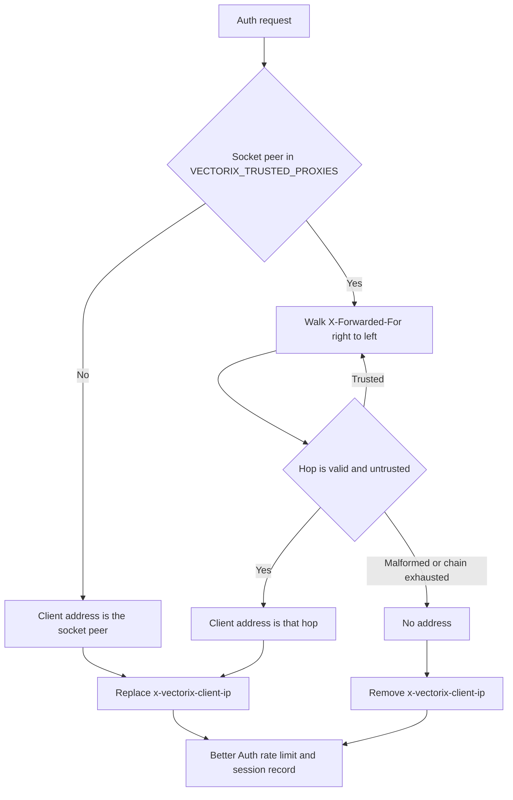

# Authentication rate limiting and client addresses

This page covers issue #55. Better Auth's limiter protects `/api/auth/*` sign-in, sign-up, second-factor and password-reset endpoints. Before this change, its counters lived in each API process, and the client address came from a client-controlled `X-Forwarded-For` header.

## Shared counters

[`authRateLimitStorage`](../packages/auth/src/rate-limit.ts) implements Better Auth's atomic `consume` storage contract with [`consumeRateLimit`](../packages/queues/src/rate-limit.ts). The complete framework-canonical client/path key is SHA-256 hashed before storage, so native token-bearing paths and raw addresses do not appear in Redis keys. All replicas use `vectorix:rate-limit:v2:auth:<digest>`; earlier fixed-window keys expire naturally.

One Lua script preserves the installed Better Auth window semantics: an allowed request increments the count and refreshes its deadline; a rejected request neither increments the count nor extends the deadline. For example, three allowed sign-in attempts at 0, 9 and 9.5 seconds remain blocked at 10 seconds, until the cooldown after the last allowed attempt ends. The connection uses the existing `REDIS_URL` / `REDIS_PASSWORD` settings and opens lazily on the first counted request.

If Redis is unreachable, each process keeps at most 10,000 local budgets with the same window semantics. Active budgets are never cleared to make room; at capacity, new keys are denied until expired entries can be reclaimed. Each sweep examines at most 64 entries. This outage mode is per process: it cannot guarantee the global budget across replicas or across restarts, and a transition from Redis to local storage can admit an additional local allowance. Deploy Redis for shared enforcement; do not treat the fallback as strict global fail-closed availability.

Connection attempts have a two-second timeout and commands a 500 ms timeout. There is no background reconnect or offline command queue; a request can start one new connection attempt per five seconds. An attached error listener suppresses raw library errors, and one fixed warning is emitted per process without keys, URLs, error messages or stacks. Shutdown disconnects the client and prevents further attempts. Better Auth enables its limiter only when `NODE_ENV=production`, as before.

Effective budgets per canonical client address and path:

| Path                                                            | Window      | Max | Source                      |
| --------------------------------------------------------------- | ----------- | --- | --------------------------- |
| `/sign-in/*`, `/sign-up/*`, `/change-password`, `/change-email` | 10 s        | 3   | Better Auth default         |
| `/request-password-reset`, `/send-verification-email`           | 60 s        | 3   | Better Auth default         |
| `/two-factor/*`                                                 | 10 s        | 3   | Installed two-factor plugin |
| `/reset-password`                                               | 300 s       | 5   | Vectorix                    |
| `/get-session`, organization reads                              | not limited |     | Vectorix                    |

There are no Vectorix overrides for second-factor verification. Its native plugin rule is preserved; a longer custom window would replace that rule rather than add another budget.

## Client addresses

The API derives the address in [`resolveClientIp`](../apps/api/src/http/client-ip.ts) and passes it to Better Auth only through the internal `x-vectorix-client-ip` header, which it always overwrites or removes ([`app.ts`](../apps/api/src/app.ts)):

- With `VECTORIX_TRUSTED_PROXIES` empty (the default), forwarded headers are ignored. Use this when clients reach the API directly.
- Behind a reverse proxy or load balancer, set `VECTORIX_TRUSTED_PROXIES` to the comma-separated IP addresses or CIDR ranges of the proxies that connect to the API (for example `10.0.0.0/8`). Each proxy must append the address it received the connection from to `X-Forwarded-For`. An invalid entry fails API startup with its position, never its value.
- Without trusted proxies, every request behind a proxy carries the proxy's address. All clients then share one budget, so configure the proxy range in production.
- The same address is stored on sessions and shown in new sign-in notifications, so those can no longer be forged with a header.

## Verification

- `apps/api/src/http/client-ip.test.ts`: peer precedence, trusted-hop walking, malformed chains, IPv4-mapped peers, startup validation and header replacement.
- `packages/auth/tests/rate-limit.test.ts`: opaque canonical-key hashing, exact rule forwarding and preservation of the installed second-factor rule.
- `packages/queues/src/rate-limit.test.ts`: local cooldown refresh, non-clearing saturation, expiry reclamation, result validation and sanitized outage handling.
- `packages/queues/src/rate-limit.integration.ts` (run by `pnpm test:queues` on disposable authenticated Redis): 20 concurrent consumers with `max: 5` get exactly 5 grants, expiry works, allowed hits refresh the real TTL, and rejected hits do not.
- `apps/api/src/http/auth-rate-limit.integration.ts`: two separate native HTTP processes share the unchanged second-factor admission budget despite spoofed headers. These requests intentionally have no valid challenge and prove admission, not successful second-factor authentication. A native reset callback also proves that stored auth keys remain opaque.

The corrected worktree passes frozen installation, client generation, type checks and lint for queues/auth/API, 170 API/auth/backend unit tests, 11 utility tests and all five isolated Redis-runner tests. The Redis tests include actual concurrent Lua admission and deadline reads. The native HTTP case uses two separate processes and the real Better Auth two-factor middleware with in-memory account adapters; it intentionally has no challenge cookie and verifies three native 400/401 responses followed by 429 per verification path. It does not establish successful TOTP enrollment, account authentication or a dashboard journey.

The PR author's earlier manual two-process sign-in observation is separate. The corrected worktree also passes all 316 disposable catalog tests (210,744 ms) and four serial API/workers/web/admin builds. The build wrapper preserves the exact initial Next declaration state: web was absent and is absent again; admin was present and its bytes and mode are restored. No primary-workspace declaration is touched. Corrected six-image checks, final-base validation and exact-head CI remain pending; the original head's catalog failed in vector-store startup, while its six-image job passed.

## Reproduce and deploy

From a checkout with the supported Node/pnpm versions, run `pnpm install --frozen-lockfile`, `pnpm db:generate`, `pnpm test` and `pnpm test:queues`. The last command owns and removes one disposable, authenticated loopback Redis, then starts and stops its two synthetic HTTP processes. It does not read `.env`, use an application database or contact an external identity provider. Do not run these admission probes against real users or a production authentication endpoint.

For your instance, retain the normal server-only `REDIS_URL` / `REDIS_PASSWORD` configuration and run the API with `NODE_ENV=production`. Leave `VECTORIX_TRUSTED_PROXIES` blank for direct connections; behind a proxy, configure only its exact connecting addresses or necessary CIDRs and make it append the peer address. Restart the API to apply configuration changes. There is no new schema, migration or rate-limit environment toggle. Existing session address records are historical and are not rewritten.

A normal dashboard sign-in should still open the account, and new session/sign-in records should show the derived client address. Second-factor enrollment and successful challenge behavior are covered separately by the existing native tests, not the new two-process admission probe. Do not claim a fresh browser verification unless that journey is actually performed.

After integration of verified main `1aebd954f0295fb2f64bb353137381cf06993ecc`, frozen installation/generation, all 24 workspace type and lint tasks, 176 API/auth/backend and 11 utility tests, five real Redis cases and API/worker builds pass again. The prior-base 316-test catalog is not presented as a new final-base local run. Generated Next declarations are restored to the saved bytes, modes and absence; a post-build wrapper assertion and its correction are recorded separately from the successful builds. Final-head catalog and six-image CI are pending.
