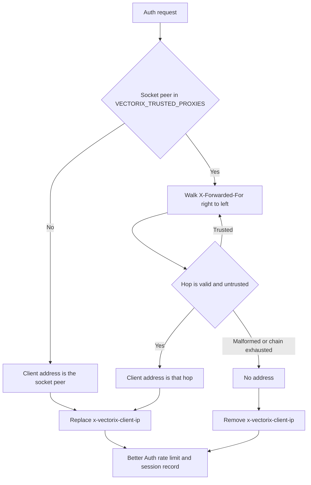

# Authentication rate limiting and client addresses

This page covers issue #55. Better Auth's limiter protects `/api/auth/*` sign-in, sign-up, second-factor and password-reset endpoints. Before this change, its counters lived in each API process, and the client address came from a client-controlled `X-Forwarded-For` header.

## Shared counters

[`authRateLimitStorage`](../packages/auth/src/rate-limit.ts) implements Better Auth's atomic `consume` storage contract with [`consumeRateLimit`](../packages/queues/src/rate-limit.ts). A Lua script runs `INCR` and `PEXPIRE` in one step under `vectorix:rate-limit:auth:<address>|<path>`, so every API replica shares one fixed window per client address and path, and a restart no longer resets the budget. The connection uses the existing `REDIS_URL` / `REDIS_PASSWORD` settings and opens lazily on the first counted request.

If Redis is unreachable, each process falls back to a bounded in-memory window (at most 10,000 keys) and logs one sanitized warning. Limits then degrade to per replica instead of disappearing. Better Auth enables the limiter only when `NODE_ENV=production`, as before.

Effective budgets per client address:

| Path                                                            | Window      | Max | Source              |
| --------------------------------------------------------------- | ----------- | --- | ------------------- |
| `/sign-in/*`, `/sign-up/*`, `/change-password`, `/change-email` | 10 s        | 3   | Better Auth default |
| `/request-password-reset`, `/send-verification-email`           | 60 s        | 3   | Better Auth default |
| `/two-factor/*`                                                 | 10 s        | 3   | two-factor plugin   |
| `/two-factor/verify-totp`, `verify-otp`, `verify-backup-code`   | 300 s       | 10  | Vectorix            |
| `/reset-password`                                               | 300 s       | 5   | Vectorix            |
| `/get-session`, organization reads                              | not limited |     | Vectorix            |

## Client addresses

The API derives the address in [`resolveClientIp`](../apps/api/src/http/client-ip.ts) and passes it to Better Auth only through the internal `x-vectorix-client-ip` header, which it always overwrites or removes ([`app.ts`](../apps/api/src/app.ts)):

- With `VECTORIX_TRUSTED_PROXIES` empty (the default), forwarded headers are ignored. Use this when clients reach the API directly.
- Behind a reverse proxy or load balancer, set `VECTORIX_TRUSTED_PROXIES` to the comma-separated IP addresses or CIDR ranges of the proxies that connect to the API (for example `10.0.0.0/8`). Each proxy must append the address it received the connection from to `X-Forwarded-For`. An invalid entry fails API startup with its position, never its value.
- Without trusted proxies, every request behind a proxy carries the proxy's address. All clients then share one budget, so configure the proxy range in production.
- The same address is stored on sessions and shown in new sign-in notifications, so those can no longer be forged with a header.

## Verification

- `apps/api/src/http/client-ip.test.ts`: peer precedence, trusted-hop walking, malformed chains, IPv4-mapped peers, startup validation and header replacement.
- `packages/queues/src/rate-limit.test.ts`: the per-process fallback when Redis is unreachable.
- `packages/queues/src/rate-limit.integration.ts` (run by `pnpm test:queues` on disposable authenticated Redis): 20 concurrent consumers with `max: 5` get exactly 5 grants, and the window expires.
