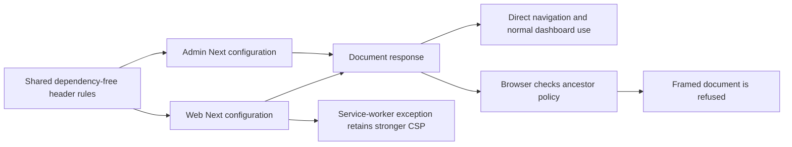

# Dashboard framing protection

Issue #27 adds one shared response policy to the web and administration applications. Local runtime and browser validation are complete; pull-request delivery is recorded in the [build log](build-task-log.md#issue-27--protect-dashboard-pages-against-framing).

| Header                    | Value                    | Purpose                                                                               |
| ------------------------- | ------------------------ | ------------------------------------------------------------------------------------- |
| `Content-Security-Policy` | `frame-ancestors 'none'` | Reject embedding by any ancestor, including the same origin.                          |
| `X-Frame-Options`         | `DENY`                   | Supply the framing restriction to older clients.                                      |
| `X-Content-Type-Options`  | `nosniff`                | Require the declared content type rather than MIME sniffing.                          |
| `Referrer-Policy`         | `no-referrer`            | Avoid forwarding document URLs, including proof/reset query parameters, as referrers. |

## Implementation and deployment

[Shared rules](../packages/dashboard-core/src/config/security-headers.mjs) are plain ESM, with an [explicit type entry](../packages/dashboard-core/src/config/security-headers-types.d.mts) for TypeScript consumers. The declaration has a distinct basename so TypeScript also checks the ESM implementation through `allowJs`/`checkJs`. Import `@repo/dashboard-core/config/security-headers` from Next configuration; it does not load React, authentication, environment variables or database code. Each call returns fresh rules so application exceptions cannot mutate another consumer's policy.

[Web configuration](../apps/web/next.config.mjs) installs the general rule first, followed by the existing `/sw.js` rule. Next uses the last matching value for a header: the worker therefore retains `default-src 'none'; script-src 'self'` and adds the ancestor restriction. Its JavaScript MIME, no-cache/no-store behavior and root `Service-Worker-Allowed` scope remain explicit. [Admin configuration](../apps/admin/next.config.ts) consumes the same general rules. The existing API playground nonce CSP remains separate.

Rebuild and deploy web/admin to change these static policies. They contain no deployment origin, private value or new runtime setting. Reverse proxies must preserve the delivered headers. If the edge adds a second CSP, browsers enforce both; replacing a policy or appending contradictory directives can alter behavior and must be verified on the public endpoint.

Configure HSTS at the HTTPS termination layer according to the deployment's domain and subdomain policy. The application cannot infer that policy from a forwarded request header. This change does not add automatic HSTS or claim that a plain HTTP preview proves HTTPS/HSTS behavior. The framing CSP is deliberately limited to ancestor checks; it is not a complete script/style/XSS policy.

## Response boundaries

The installed Next.js implementation applies configured headers before files and preserves them on the existing authentication proxy redirects. Its configured/automatic trailing-slash redirect branch can return without those headers. Tests distinguish real auth redirects and final protected documents from an unsupported guarantee about every redirect, early framework failure or edge-generated response. No new error route or routing bypass is introduced solely for testing.

The application still enforces authentication, current organization/collection permissions and CSRF independently. Framing protection does not replace those checks. Ordinary API fetches keep their browser `Origin`; withholding a referrer does not create an authorization grant. Source preview dialogs and normal dashboard navigation continue to work directly.

## Acceptance recipe

Use production API/web/admin builds and a fresh disposable `_test` environment. An owned loopback page may contain only fixed iframes targeting the saved frontend origins and `/sign-in`, web `/dashboard` and admin `/` paths. It must not accept arbitrary target URLs, proxy requests, collect cookies or submit forms.

1. Check actual frontend responses for the four headers: sign-in documents, unauthenticated native auth redirects and their final sign-in responses, an authenticated document, missing static-file responses, and loaded JavaScript/CSS assets. Check status/MIME as well as headers; a redirected HTML login page is not a successful asset test.
2. Verify web `/sw.js` retains its stronger CSP, JavaScript MIME, cache policy and root worker scope, and manifest/icons still load. Observe any framework redirect limitation explicitly rather than loosening the policy assertion for a document.
3. Open the owned framing page in a browser. Exercise web/admin sign-in and dashboard targets. Require visible browser framing refusals plus corresponding HTTP headers. Record security diagnostics when the browser capture exposes them; otherwise state that limit. A cross-origin DOM access exception or an iframe `load` event alone does not establish protection.
4. Navigate directly to each frontend. Verify normal sign-in UI, language changes, production assets and a normal authenticated web dashboard journey. The anonymous admin sign-in page has no language selector: select the shared display locale through the web sign-in UI, then reload admin. Admin transport/framing checks without a global administrator do not establish an admin-authorized product journey. Do not promote a user, create API keys or change authentication credentials for this security slice.
5. Keep expected framing violations separate from the direct-navigation console. Restore the display locale, sign out and clean only owned previews, framing server, stores and tabs. Record actual outcomes and unrun cases below.

## Actual validation

On October 23, 2026, frozen installation, all 24 type-check and lint tasks, 101 API tests, 11 utility tests and all four production builds pass. The new plain ESM implementation remains type-checked and linted; its declaration uses a separate basename because an adjacent same-name declaration masks the JavaScript file from the TypeScript project service. No schema, migration, external dependency version or lockfile change is required.

`pnpm test:docker` passes all six images and infrastructure checks. The [deployed HTTP regression](../tests/dashboard/security-headers.mjs), wired into [the existing smoke runner](../scripts/test-docker.sh), independently asserts the four literal headers on both sign-in documents, genuine auth `307` redirects and final documents, real missing-static `404` responses, and 23 web/14 admin JavaScript/CSS assets. It also verifies web worker/manifest/icon behavior and native-session protected HTML `200` responses. Those native accounts receive no role promotion; an admin shell response proves transport, not global-admin authorization. Existing API, worker, migration and private-storage checks remain in the runner.

The isolated production-build browser run `7ac48d9be613` observes:

- Normal synthetic owner sign-in, a usable web dashboard, French-to-English selection with English retained after reload, direct reload after framing refusal, restoration to French and sign-out. Direct web console capture contains no warning/error.
- Anonymous admin sign-in rendered directly in French and English, using the shared display cookie selected through web. Direct anonymous admin `/` returns to sign-in. Direct admin console capture contains no warning/error. No administrator is seeded or promoted.
- All four fixed iframe attempts refuse the target: authenticated web `/dashboard`, anonymous web `/sign-in`, anonymous admin `/sign-in`, and anonymous admin `/` with its authentication redirect chain. Each target subframe shows Chromium's `chrome-error://chromewebdata/` refusal and the accessibility message that the host does not allow the connection; the explanatory parent remains visible. The captured framing console is empty, so this is not a claim of a captured CSP console message. Independent reads of the six anonymous documents/redirect responses pass all 24 header assertions; Docker separately covers sessionful document headers.

Two automation targeting errors are corrected using fresh accessibility state: an unmatched popup role selector and an expired menu target. Neither is an application exception. Screenshots and safe observations are retained privately under `node_modules/.cache/vectorix/vectorix-issue27-browser-7ac48d9be613/`; raw credentials/cookies are not published. Source/build/helper pins match before cleanup. The five owned processes, four containers, four volumes and three owned tabs are closed/removed. No browser key creation, role modification or authentication-credential change occurs.

Hosted TLS/HSTS, a full script/style CSP and global API hardening are outside this frontend framing change. The large capacity run still waits for the requested higher-capacity VM; this security validation does not replace it.
