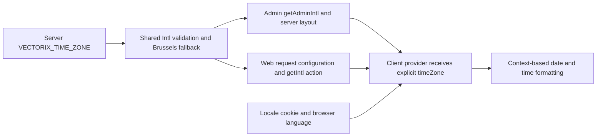

# Dashboard time zones

The web and administration applications share one time-zone resolver, and administration explicitly supplies its validated result to `NextIntlClientProvider`. This removes administration's reliance on the host's implicit time zone for provider-based date formatting. It does not change stored timestamps, authentication, API DTOs or database schemas.

## Runtime configuration

Set `VECTORIX_TIME_ZONE` on each web/admin server deployment. The server trims the value and validates it with `Intl.DateTimeFormat`; identifiers accepted by that runtime are supported. A valid value is kept after trimming, without rewriting an accepted alias. `UTC`, `Europe/Brussels` and `Pacific/Honolulu` are examples.

Missing, empty, whitespace-only or invalid values use the existing default `Europe/Brussels`. In particular, an invalid configured value does not select the machine's implicit zone. An explicit `VECTORIX_TIME_ZONE` is independent of the process `TZ` setting and of the user's display language. Locale still comes from the supported locale cookie, weighted `Accept-Language`, then English; changing EN/FR/nl-BE changes messages and formatting conventions while keeping the configured zone.

Read configuration on the server at runtime. Forward only the validated public time-zone value with locale/messages to client providers. No `NEXT_PUBLIC_*` variable, private environment value or deployment-time build replacement is introduced. The same production build can run with a different zone after restarting its deployment consumers. Reload open pages after a change because an existing client provider may retain its loaded configuration.

## Implementation entry points

- [Shared resolver](../packages/dashboard-core/src/i18n/time-zone.ts), exported through [dashboard-core's public subpath](../packages/dashboard-core/package.json), owns validation and the `Europe/Brussels` constant. It accepts an argument and never reads the environment itself.
- [Shared locale resolver](../packages/dashboard-core/src/i18n/locale.ts) owns EN/FR/nl-BE selection independently of the zone.
- [Administration request configuration](../apps/admin/src/i18n/request.ts) reads `VECTORIX_TIME_ZONE` on the server in `getAdminIntl()` and returns the validated zone alongside locale and messages.
- [Administration layout](../apps/admin/src/app/layout.tsx) forwards that result to [Providers](../apps/admin/src/app/providers.tsx). The client component requires `timeZone` and explicitly passes it to `NextIntlClientProvider`.
- [Web request configuration](../apps/web/i18n/request.ts) and [getIntl server action](../apps/web/i18n/actions.ts) reuse the shared resolver. The [web client provider](../apps/web/contexts/intl.tsx) retains its existing propagation and language-change behavior. Moving the helper out of web preserves its validation/fallback semantics.
- [Administration audit list](../apps/admin/src/components/audit-log-list.tsx) formats stored instants with `useFormatter`, making it a concrete acceptance surface for the configured provider zone.

This change supplies the shared provider context; it does not migrate every date formatter. The [web notification list](../apps/web/components/notifications/notification-list.tsx) still explicitly formats in `Europe/Brussels`. Other legacy formatting and remaining localization work belong to the separate issue #22/M7 follow-up. A correctly configured provider is not evidence that every component now uses the deployment zone.

## Production acceptance recipe

Use production API/admin/web builds and private disposable `_test` infrastructure. Bootstrap only a synthetic superadmin through the existing operator script. Prepare an owned audit fixture with a known UTC instant and no secret-bearing details; keep the stored instant unchanged throughout the checks. These steps require no application-data changes or external provider.

1. Run administration with `TZ=Pacific/Honolulu` and `VECTORIX_TIME_ZONE=UTC`. Open its audit journal and compare the fixture's displayed date/time with its stored UTC instant. For an illustrative fixture at `2026-01-15T00:30:00Z`, the expected UTC clock time is January 15 at 00:30, rather than January 14 at 14:30 in Honolulu. This distinguishes the explicit provider configuration from the process zone.
2. Switch English, French and Belgian Dutch. Confirm translated labels and locale-appropriate date/number formatting, with the same instant and UTC zone. Reload and confirm the selected language and clock time persist.
3. Restart only the owned administration preview using the same production build, still with `TZ=Pacific/Honolulu`, but select an invalid `VECTORIX_TIME_ZONE`. The fixture must now use the Brussels fallback: the illustrative January instant is January 15 at 01:30. Verify the same result with an empty or absent setting if those cases are exercised. Record which cases actually ran.
4. Restore a valid explicit configuration. A whitespace-padded valid value should resolve to its trimmed zone. If a second valid zone is tested, record its expected date/time and the unchanged stored instant; do not infer success merely from the absence of a warning.
5. Inspect a fresh administration tab's browser console and server output for the previously observed next-intl `ENVIRONMENT_FALLBACK`; record any remaining warnings rather than claiming a clean console without inspection. Confirm that the required provider prop remains present after reload.
6. Smoke-test production web with the shared resolver: open an authenticated dashboard, change language and reload. If an existing fixture exposes a provider-based timestamp, compare it with the configured zone. Do not use the notification list's explicit Brussels formatter as proof that web-wide zone propagation is complete.
7. Restore the intended configuration and locale, then remove only owned previews, tabs, fixtures and disposable infrastructure. Record actual outcomes separately from this recipe.

## Actual validation — 22 October 2026

Final local checks passed: 23 workspace type checks, 23 lint tasks, 44 backend regressions, 150 disposable core/RAG HTTP tests with fresh/upgrade/repeat/schema parity, four production application builds and all six image/runtime/infrastructure checks. Independent source review found no actionable P1/P2. The resolver body is unchanged apart from location/JSDoc, so no implementation-mirroring unit test was added for this move. The affected installed Next.js server/client and environment documentation was read before changing either application.

Actual browser acceptance used production API/web/admin and four private disposable infrastructure services. A synthetic superadmin and an explicitly synthetic audit fixture were prepared in the owned `_test` database. Its stored instant remained `2026-03-29T01:30:00.000Z`, at the Brussels daylight-saving transition. With process `TZ=Pacific/Honolulu` and runtime `VECTORIX_TIME_ZONE=UTC`, the admin journal rendered **Mar 29, 2026, 1:30 AM**, **29 mars 2026, 01:30** and **29 mrt 2026, 01:30** in English, French and Belgian Dutch. Reload retained Belgian Dutch and 01:30; the browser console was empty.

Only the owned web/admin previews were restarted with an invalid configured zone, using the same builds and unchanged API/database/fixture. Admin then rendered **29 mrt 2026, 03:30**, proving the Brussels fallback across the DST transition. Restoring the initial English locale rendered **Mar 29, 2026, 3:30 AM**. Empty/missing/padded values retain the resolver's existing behavior; they were not separately exercised in the browser during this run.

Production web opened its authenticated dashboard in the shared Belgian Dutch locale and reloaded into English after the preference was restored. Both final browser consoles had no warnings/errors. Both initial and invalid-setting web/admin server logs contained zero `ENVIRONMENT_FALLBACK` occurrences. This web smoke establishes the shared resolver import/provider journey; it does not establish that the legacy notification formatter or every date component uses the provider zone.

The three previews, four owned containers and two temporary tabs were removed. No application database, external mail recipient or embedding provider was used. This closes the recorded admin provider/timezone follow-up; the component-specific issue #22/M7 work described above remains planned.
