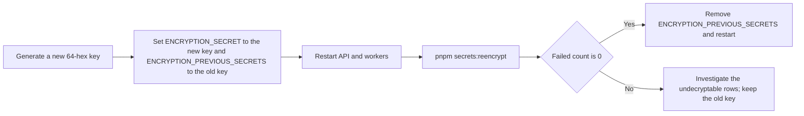

# Encryption key rotation and row binding

This page covers issue #60. [`encrypt()` and `decrypt()`](../packages/routers/utils/src/utils/encryption.ts) protect recoverable provider secrets (organization S3 and embedding-provider credentials) and Web Push subscriptions with AES-256-GCM. The original `iv:tag:data` format had no key identifier, so `ENCRYPTION_SECRET` could not be rotated, and no associated data, so a ciphertext copied to another row or organization still decrypted.

## Format and binding

New values use `v2:<keyId>:<iv>:<tag>:<data>`:

- `keyId` is the first 16 hex characters of the key's SHA-256 fingerprint. It identifies the key without revealing it, so rotation needs no extra key-ID configuration.
- Every call passes a context that becomes GCM associated data. A ciphertext then only decrypts for the same binding:
    - organization credentials: `vectorix:credential:<organizationId>:<credentialId>:<field>` (`accessKeyId`, `secretAccessKey` or `apiKey`);
    - Web Push subscriptions: `vectorix:push-subscription:<organizationId>:<endpointHash>`.
- Credential IDs are now generated before insertion, so a new credential's secrets are bound to their own row.
- Legacy values still decrypt (current key first, then previous keys) and are re-sealed by the command below or by the next update of that field.

## Rotating `ENCRYPTION_SECRET`

1. Set the new key as `ENCRYPTION_SECRET` and the old key in the comma-separated `ENCRYPTION_PREVIOUS_SECRETS` on both API and workers, then restart them. New writes use the new key; values sealed with either key remain readable.
2. Run `pnpm secrets:reencrypt` (`--dry-run` reports without writing). [`reencryptStoredSecrets`](../packages/routers/utils/src/utils/secret-reencryption.ts) walks every registered encrypted column in batches. It re-seals legacy and retired-key values with the current key and their binding, and prints per-column counts, never values. Each write compares against the old ciphertext, so a concurrent credential update is never overwritten. Rerunning the command is safe and resumes where it stopped.
3. When the command reports `failed 0`, remove the old key from `ENCRYPTION_PREVIOUS_SECRETS` and restart.

Source receipts are HMAC-signed with a key derived from `ENCRYPTION_SECRET` and expire after 15 minutes. Rotating the secret invalidates outstanding receipts; clients search again to get new ones.

Values that cannot be decrypted with any configured key are left untouched and counted as failed. They already fail closed when read.

## Not included

The command reports to standard output rather than writing an audit row, because the CLI runs without a signed-in actor. Key material stays in environment variables; no external key-management integration is added.

## Verification

- `packages/routers/utils/src/utils/encryption.test.ts`: row-binding mismatches, tampering, unknown keys, legacy reads, rotation with previous keys, and invalid previous-key configuration.
- `apps/api/src/rag-tests/credentials.ts`: a v2 ciphertext copied to another credential does not decrypt there. A legacy row stays readable. Rotation with a previous key, a dry run, a batched re-encryption, an idempotent second run (0 re-encrypted) and removal of the previous key all leave the real stored credentials readable.
