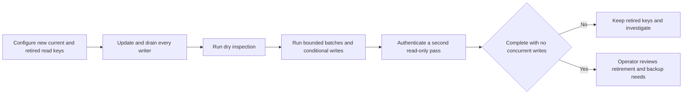

# Encryption key rotation and row binding

Recoverable provider secrets and Web Push subscriptions use AES-256-GCM. New ciphertexts include a key fingerprint and associated data; legacy `iv:tag:data` rows remain readable until they are converted. This is an operator security foundation, with no schema, permission, public DTO or dashboard credential action.

## Format and read behavior

New values use `v2:<keyId>:<iv>:<tag>:<data>`. The key ID is sixteen lowercase hex characters from the key's SHA-256 fingerprint. IVs and authentication tags must each contain exactly sixteen bytes; ciphertext must be whole hex bytes. Trailing junk, odd hex and truncated tags are refused before decoding. Authenticated empty plaintext remains supported.

Associated data binds organization credentials to organization ID, credential ID and field name (`accessKeyId`, `secretAccessKey`, `apiKey`); push data is bound to its organization and endpoint hash. IDs are generated before sealing new credentials. Legacy rows have no associated data and cannot gain row protection until re-encrypted. They are never described as already bound.

`ENCRYPTION_SECRET` is the exact current 64-hex key. `ENCRYPTION_PREVIOUS_SECRETS` accepts at most sixteen comma-separated retired keys, with a 4,096-character configuration bound. Surrounding whitespace on retired entries is ignored; current-key bytes are never trimmed. Only the latest raw configuration is cached. Invalid configuration and a missing identified key have distinct fixed errors. A legacy authentication failure is conservatively treated as possibly missing an old key, because that format carries no key ID.

Configured RAG credentials retain their sanitized conflict behavior and never fall back to another credential. Push key-configuration or unavailable-key failures enter normal bounded delivery failure handling without changing subscription ciphertext, version or revocation. If an earlier device has already accepted the push, a later key failure stops that batch and preserves its success instead of retrying the accepted device; with zero successes, the normal durable retry remains. A malformed or invalidly authenticated v2 row with its selected key available still follows the existing corrupt-subscription handling.

## Initial deployment of the v2 format

Legacy read compatibility is one-way: the new code can read old ciphertext, but a pre-v2 binary cannot read new writes. An old worker can interpret a valid v2 subscription as corrupt and revoke it. Do not use an uninterrupted rolling deployment across this format boundary.

1. Plan a maintenance window and stop/drain **all old readers and writers**, including APIs, workers and operator tools, before allowing any v2 write. Keep durable tasks and notification deliveries in PostgreSQL; do not fabricate completion or cleanup.
2. Deploy v2-capable readers everywhere with the existing correct keyring. Keep new requests/writes paused until every old process has stopped and every reader can handle both formats.
3. Resume APIs/workers and normal writes only after that coordinated deployment. New writes use v2; old rows can then be converted with the procedure below.

Rollback to a pre-v2 binary is not automatic or safe once any v2 ciphertext exists. A separate compatible data/key restore plan is required; this tool does not convert data back into the old format. Subsequent key rotation between already-v2-capable processes is a different operation.

## Rotation procedure

1. Preserve the old key securely. Configure the new current key and required retired keys on **every** API, worker and operator process; restart/drain old writers. Do not run mixed old-current writers during retirement verification.
2. Run `pnpm secrets:reencrypt --dry-run`. This authenticates current-key rows too and reports candidates without writing. `DRY_RUN` is not completion. `--help` performs no operation; unknown or repeated arguments refuse before importing a database client.
3. Run `pnpm secrets:reencrypt`. It walks the seven fixed encrypted tables in validated batches of 1–1,000 (default 100), using `id > lastId` keysets. Deleting the last row of an earlier page does not end the scan. Each field rewrite compares its exact old ciphertext; concurrent edits are preserved and counted as conflicts.
4. The command authenticates all observed values again in a separate read-only pass. It reports failed authentication, failed verification, CAS conflicts and remaining old-key values explicitly. Any such blocker produces `INCOMPLETE` and a nonzero exit. Current-key prefixes are never trusted without authentication. Rerun after resolving blockers; do not remove keys based on `failed 0` alone.
5. `COMPLETE` describes the observed passes, **not an atomic database snapshot or future write barrier**. Keep writers quiescent during final verification and independently confirm every writer uses the new current key. Inserts/updates occurring after a verification cursor has passed cannot be ruled out by this scan. Only then review removal of retired keys from active configuration and restart the services.

Never destroy keys still required by retained backups. An older database bundle can contain legacy or retired-key ciphertext even after the live database is converted. Keep those keys through the backup retention/restore policy, or verify a separately converted backup before retiring its keys. Source receipts use an HMAC key derived from `ENCRYPTION_SECRET`; rotation invalidates their outstanding fifteen-minute signatures, so clients must search again.

## Evidence and limitations

The CLI prints fixed column names, numeric counters and finite diagnostics. It never prints ciphertext, plaintext, caught error messages, causes, stacks or connection URLs. It does not write an audit actor, alter credential revisions, grant permissions, change provider destinations or call a provider. It does update encrypted database fields, so operator execution remains an explicit production action.

Focused pure tests cover strict envelopes, unavailable/configuration errors, deletion of a page boundary, current-key corruption, lost CAS, insertion behind a write cursor, dry runs, invalid batches and closed/sanitized command behavior. The corrected isolated catalog passes all 319 tests, including real stored legacy/current credentials, idempotent rotation, zero-success device preservation and a two-device/different-key partial-success case. The push sender remains explicitly controlled; these cases do not establish external push delivery. All four production builds pass after 24 type checks, 24 lint tasks and 174 API/backend plus 11 utility tests; targeted API/workers checks also pass after the final partial-success correction. No operator command has been run on application data, and no live provider, browser rotation or backup restore result is claimed by these tests.
