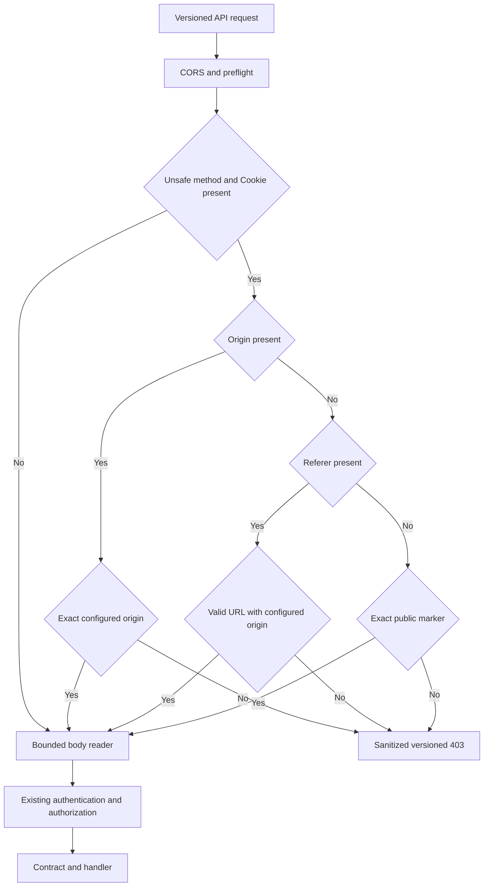

# Cookie CSRF protection for RPC and REST

Status: **implemented, automated checks passed and production dashboard verified** for issue #57. V1 revision 1.19.0 records the transport policy. No Prisma schema, migration or public input/output DTO changes are needed.

## Request admission

CORS controls which browser origins may read responses. It does not prevent a simple HTML form from sending a request. SameSite cookies also do not separate sibling origins on the same site. The application therefore checks unsafe cookie-bearing requests before authentication, body reading and RPC/REST parsing.

The guard covers both transport prefixes of every supported major from `apps/api/src/api-versioning/registry.ts`. Prefix boundaries are exact. GET, HEAD and OPTIONS remain unchanged; the installed oRPC strict-GET plugin continues to reject mutations invoked through GET. Better Auth's own `/api/auth/*` origin policy is unchanged.

| Unsafe request carrying Cookie                             | Admission                                           |
| ---------------------------------------------------------- | --------------------------------------------------- |
| Origin is present                                          | Require an exact allowed HTTP(S) origin             |
| Origin is absent, Referer is present                       | Require a valid HTTP(S) URL whose origin is allowed |
| Both headers are absent                                    | Require exactly `Vectorix-CSRF: orpc`               |
| Present Origin or Referer is empty, malformed or untrusted | Refuse; no marker fallback                          |

A present rejected Origin takes precedence over a trusted Referer or marker. A rejected Referer takes precedence over a marker when Origin is absent. `Origin: null`, wildcard origins and Fetch Metadata such as `same-site` never establish trust. A Cookie header remains protected even when the caller also sends an API key or bearer: adding an unverified header cannot establish which authentication mechanism will ultimately authorize a route.

The marker is public and carries no secret or user authority. Simple HTML forms cannot attach it; a browser script needs CORS preflight permission to send it cross-origin. Explicit hostile origins remain refused even when the marker is present. Requests without Cookie retain the current API-key/bearer rules, including invalid-key rejection without session fallback, issuer/scopes, organization suspension and superadmin restrictions.

Refusals return a constant sanitized `FORBIDDEN` 403 in the appropriate RPC/REST envelope with the matched major's version headers. They do not disclose configured origins, cookies or authentication state. The guard does not access or cancel a refused body. The installed Node HTTP adapter disposes unread network input after sending the response, with bounded draining; middleware cancellation can otherwise break an unstarted multipart encoder. The existing bounded-body guard still applies to accepted requests.



## Deployment and client updates

`TRUSTED_ORIGINS` is the shared CORS/CSRF allowlist. Use comma-separated serialized HTTP(S) origins, such as `https://app.example.com,https://admin.example.com`; no wildcard, path, query, fragment or credentials. Whitespace around entries is ignored. The current localhost ports 3000 and 3006 are defaults only when the variable is absent. An explicitly empty or malformed configuration fails startup with a bounded configuration error. Deployment origins remain runtime configuration; nothing is baked into a frontend build.

No request URL, Host or proxy header, `API_URL`, or `BETTER_AUTH_URL` silently adds an allowed origin. If Scalar should make mutations with cookies from the API origin, include that origin explicitly. Its third-party script/dependency policy is a separate issue; this change does not establish trust in externally hosted scripts. `ROOT_DOMAIN` expands cookie sharing and should only include trusted sibling deployments. SameSite settings alone do not solve sibling-origin CSRF.

Web and admin send the public marker and retain `credentials: 'include'`. Web server rendering reconstructs outgoing RPC headers from only Cookie, Authorization, x-api-key and Vectorix-Expected-Organization-Id, then supplies its own marker. It does not forward incoming navigation Origin/Referer, Fetch Metadata, Host, proxy or body metadata. An external navigation therefore does not masquerade as the origin of a subsequent server-to-server RPC. The admin's browser-only authenticated query behavior is retained.

For an originless cookie CLI request, add the marker without printing or pasting the cookie into logs:

```sh
curl --cookie private-cookie-jar.txt \
  --header 'Vectorix-CSRF: orpc' \
  --header 'Content-Type: application/json' \
  --data '{"json":{}}' \
  https://api.example.com/rpc/v1/admin/organization/get
```

This example assumes an operator-created private cookie jar. It does not create credentials or bypass authorization. Do not supply a fake Origin to bypass deployment configuration. API-key/bearer automation should omit Cookie when it does not intend to use a session. Cookie automation that previously sent neither Origin nor Referer must adopt the marker when upgrading; public DTOs and major URLs remain unchanged.

## Entry points and acceptance

- `packages/api/src/transport-security.ts`: client-safe constants, separately exported without loading the router.
- `apps/api/src/http/trusted-origins.ts`: exact startup configuration shared with CORS.
- `apps/api/src/http/cookie-csrf.ts`: pure request decision and registry-aware middleware.
- `apps/api/src/app.ts`: CORS, CSRF, body limits, then handlers.
- `packages/dashboard-core/src/lib/orpc-headers.ts`: explicit SSR header projection.
- `apps/web/contexts/orpc.tsx` and `apps/admin/src/contexts/orpc.tsx`: credentialed clients.
- `apps/api/src/cookie-csrf-integration.ts`: HTTP/database checks on the disposable core fixture.

Completed automated coverage includes trusted, hostile, missing, null and contradictory headers; exact prefix/major boundaries; body-read refusal; RPC multipart and REST forms; real database immutability after denial; session/API-key/bearer/superadmin behavior; GET mutation rejection; SSR header projection; CORS and version envelopes. The cohesive pass succeeds with 60 Node tests, 11 utility tests, 23 type-check tasks, 23 lint tasks, four production builds and 246 catalog HTTP/database tests on owned disposable stores. Two real socket cases verify native multipart refusal before parsing and disposal of incomplete input. Existing lint warnings remain.

Dashboard acceptance prerequisites: packaged production web/admin/API/workers, an owned isolated `_test` database, Redis and private RustFS, synthetic user/organization and superadmin fixture, and explicitly allowed web/admin origins. From the web dashboard, upload TXT, wait for extraction, preview its source and perform a legitimate catalog mutation. From another local port on the same site, submit a multipart request using the browser's ambient cookie and verify rejection without a database change. Return to the legitimate dashboard and verify it remains usable; open it through an external navigation to exercise header separation. In admin, perform a permitted reversible mutation and verify persistence. Save actual screenshots, console results and cleanup evidence. Actual acceptance is recorded below.

## Actual dashboard acceptance

Run `e9b470c2da61` freezes product commit `7cab9aa` and the four existing production artifact trees. Four fresh owned PostgreSQL/vector PostgreSQL/Redis/RustFS containers and four new volumes hold only synthetic data; the web, admin, API and hostile page have separate loopback origins. Only web and admin are allowed. Existing migrations are deployed without generation. Normal authentication creates the fixture; the synthetic superadmin promotion is confined to the empty disposable database. No application database, hosted credential or model service is used.

In French, the owner creates one group and uploads a 215-byte TXT through the web dashboard. The worker finishes extraction, and all 215 source characters are visible. A native multipart HTML form from the other local port sends the browser's ambient same-host cookie to the group-create RPC. Its iframe shows the exact sanitized `FORBIDDEN` 403. Read-only before/after snapshots agree: one unchanged group-row hash, four audit rows and one document. Returning to the real dashboard shows only the legitimate group. The synthetic superadmin then changes the organization's name from admin, reloads and sees the saved value; a read-only query confirms persistence. All three browser consoles have zero recorded warnings/errors.

The initial API and admin foreground sessions stop without a recorded application error before these content checks. Both are restarted through the unchanged identity-checked helper; the web's temporary `ECONNREFUSED` page recovers. This is functional acceptance, not uninterrupted-process evidence. A long file-chooser control-plane wait occurs before the explicit upload submission; no latency or throughput result is derived from it. External-navigation header separation is covered by automated projection tests, but a real external-navigation journey, English/Belgian Dutch and original download are not rechecked in this trial.

Screenshots, private source/build pins, database snapshots and browser records are retained locally. Cleanup reaches `CLEANED_EVIDENCE_RETAINED` with zero resource entries at 15:14–15:15 UTC on October 23, 2026: all five owned processes, four containers and four volumes are removed, and only the three created browser tabs are closed. The local user-owned admin type-import preference is preserved and excluded from commits. This security acceptance does not complete the pending large-capacity, concurrent-load or broader outage matrix.
