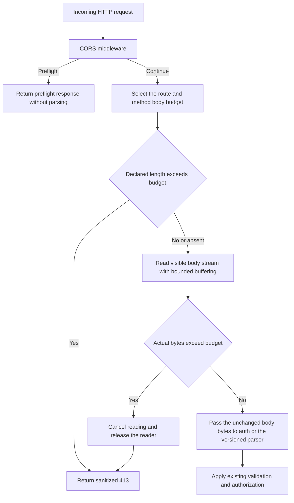

# HTTP request body limits

This transport security change implements issue #10 without a schema, migration or public DTO change. The final automated and dashboard results are recorded below; PR delivery is tracked in the [build log](build-task-log.md).

The API applies a bounded body guard before Better Auth and the versioned RPC/REST parsers. Ordinary requests have a 1 MiB limit (1,048,576 bytes). The existing document upload/replacement routes retain a 26 MiB transport envelope (27,262,976 bytes), allowing the 25 MiB original-file contract plus multipart metadata.

## Route policy

The larger envelope applies only to POST requests at the following routes for a supported API major. The supported prefixes come from the API version registry.

| Transport | Operation   | V1 path                                         |
| --------- | ----------- | ----------------------------------------------- |
| RPC       | Upload      | `/rpc/v1/admin/rag/documents/upload`            |
| RPC       | Replacement | `/rpc/v1/admin/rag/documents/replace`           |
| REST      | Upload      | `/api/v1/admin/rag/documents/uploads`           |
| REST      | Replacement | `/api/v1/admin/rag/documents/{id}/replacements` |

Other methods, auth endpoints, ordinary RPC/REST operations, unsupported prefixes and unrelated paths keep the smaller limit. A transport envelope is not permission to upload: authentication, organization/collection access, file validation, quotas, idempotency and durable storage binding remain mandatory. A file over 25 MiB can still violate its contract inside a request below 26 MiB.

## Admission flow

`Content-Length` is an early-rejection hint; a small or absent value cannot bypass actual counting. Chunked bodies are counted before JSON or multipart parsing. Oversize failures return a static sanitized HTTP 413 response without reflecting body content, credentials or parser diagnostics. Versioned failures preserve the resolved major/revision headers; CORS remains available for browser clients.

CORS preflight handling remains unchanged and does not invoke a body parser. Bodyless GET/HEAD requests remain valid. The installed Node HTTP adapter does not expose GET/HEAD bodies, and maps TRACE to a bodyless Fetch Request; this guard cannot claim to count bytes that the adapter does not expose. It bounds the body streams consumed by the application parsers, rather than acting as a reverse-proxy bandwidth or connection limit.

## Deployment and dashboard acceptance

No environment variable or migration is required. Keep reverse-proxy limits at least 26 MiB for the four document actions, and retain independent connection, timeout and deployment memory controls. The application guard is an additional boundary; it does not provide global concurrency control or an upload-rate policy.

Use a disposable `_test` application database, private S3/RustFS, web/API/workers, and a synthetic organization with library-management access. From **Documents**, upload a valid TXT/Markdown original above 1 MiB and below 25 MiB. Expect the ordinary upload, extraction, preview and original-download journey to remain usable. Replacement uses the same larger envelope. Test an oversized ordinary/auth request and a body above 26 MiB through direct HTTP, with no cookies or credentials where admission should happen before authentication. Expect 413 before application mutations. Record actual results and clean owned resources.

The focused automated suite covers exact byte boundaries, understated declared length, actual chunked HTTP, stream cancellation, path/method selection, all four real upload/replacement transports, a 25 MiB original and unchanged persisted state on rejection. Actual outcomes belong in the [build log](build-task-log.md).

## Implementation entry points

- [Application middleware order](../apps/api/src/app.ts) installs CORS, the ingress guard, Better Auth and the versioned transports in that order.
- [Request body guard](../apps/api/src/http/request-body-limit.ts) owns budgets, strict method/path selection, bounded buffering, cancellation, byte-preserving request reconstruction and sanitized errors.
- [Supported API registry](../apps/api/src/api-versioning/registry.ts) supplies the supported major prefixes; [response headers](../apps/api/src/api-versioning/headers.ts) applies their version metadata to early failures.
- [Focused transport tests](../apps/api/src/http/request-body-limit.test.ts) include a real loopback Node HTTP server with chunked bodies. [Integration journeys](../apps/api/src/request-body-integration.ts), registered in the [core suite](../apps/api/src/integration.test.ts), use disposable PostgreSQL and private RustFS.

## Actual validation — 22 October 2026

All 132 disposable core/RAG HTTP tests passed, including four new body-admission journeys, fresh migrations, upgrades, repeat deployment and schema parity. Each of the four genuine multipart upload/replacement actions accepted a 2 MiB file. A 25 MiB original fit its multipart envelope and was durably queued without document extraction in the request. Oversized auth, RPC, REST, unmatched and upload bodies returned 413 without creating users, sessions, verification records, documents, versions or ingestion tasks. Near-miss paths/methods retained the 1 MiB budget, and the existing original-file limit still rejected a file above 25 MiB. Accepted integration fixtures were deleted and durably purged before test teardown.

The nine focused tests passed, including a real loopback Node HTTP server receiving chunked data, early declared-size rejection, actual counting despite absent/understated lengths, exact boundaries, signal propagation, sanitized read failures, reader release and cancellation that does not await a never-resolving source hook. The 23 workspace type checks, 23 lint tasks, 32 backend regressions, four production builds and all six production image/infrastructure checks passed. Independent final review is recorded in the build log.

Actual browser acceptance used production web/API/workers and separate private PostgreSQL/vector/Redis/RustFS. A synthetic manager uploaded `http-limit-original.md` through the dashboard, waited for real worker extraction, inspected its bounded plain-text preview and downloaded the original. The manager then replaced it with `http-limit-replacement.md` through the dashboard's replacement form, waited for publication and downloaded version 2. Both originals contain exactly 1,310,720 bytes (1.25 MiB), above the ordinary body limit. Full downloaded SHA-256 values matched their respective inputs:

| Version | Input/download SHA-256                                             |
| ------- | ------------------------------------------------------------------ |
| 1       | `375d516d1385298d43eb31a5d6340aba4ad29bd5808549486ff18939803caff0` |
| 2       | `45cbbcd6d7e6f5ec62ac12f0d1a2944664eb6228eb97647e306fe24bfd0d48fb` |

Version 2 remained ready and published after reload, with the replacement marker in its preview and no browser console warnings/errors. The old version retained the normal seven-day cleanup delay; this change does not claim a retention soak. Separate unauthenticated HTTP requests against the production preview returned sanitized 413 before any body bytes were sent for oversized auth, RPC, REST and upload declarations. CORS headers remained present; versioned replies carried major 1/revision 12 and RPC used its decodable error envelope. The complete actual-chunked and no-mutation cases are established by the focused/integration suites, not by the browser alone.

The three owned previews, four owned infrastructure containers, temporary browser tab and two checksum-verified downloads were removed. No application database, external invitation or embedding provider was used. This validation does not establish raw-wire limits for adapter-hidden methods, slow-client timeouts, global concurrency limits or reverse-proxy policy.
