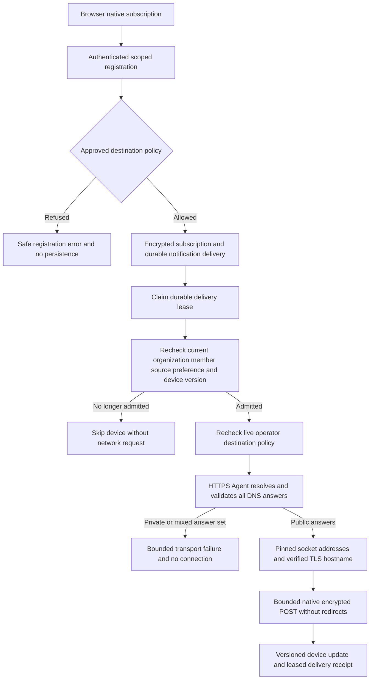

# Web Push destination and delivery policy

Issue #18 is implemented on `codex/push-destination-policy`, based on the [PR #69](https://github.com/SimonLoir/vectorix/pull/69) squash. Local automated validation and the push-disabled dashboard recipe pass. PR delivery and exact-head CI remain pending; live vendor push delivery has not been tested.

## Destination approval

The old subscription input admitted arbitrary HTTPS destinations. Web Push is disabled by default, and exploitation additionally required a current member session, enabled personal PUSH preference, valid subscription keys and configured VAPID/encryption. Those prerequisites did not make arbitrary worker destinations safe.

Registration now applies the dependency-free [`@routers/utils/push-endpoint-policy`](../packages/routers/utils/src/utils/notifications/push-endpoint-policy.ts) policy before encryption or persistence. Without an operator override, it trusts Google's exact `fcm.googleapis.com` hostname and the following vendor-controlled DNS namespaces, including their apex and properly separated subdomains:

- `push.services.mozilla.com`
- `notify.windows.com`
- `push.apple.com`

These are approved namespaces, not a claim of universal browser/provider compatibility. [Chromium's production constants](https://chromium.googlesource.com/chromium/src/+/refs/tags/148.0.7734.4/components/push_messaging/push_messaging_constants.cc) identify FCM. [Mozilla's endpoint documentation](https://mozilla-services.github.io/autopush-rs/http.html), [Microsoft's WNS overview](https://learn.microsoft.com/en-us/windows/apps/develop/notifications/push-notifications/wns-overview) and [Apple's Web Push presentation](https://developer.apple.com/videos/play/wwdc2022/10098/) document their native service destinations. Preserve the full opaque endpoint: path and query tokens must not be reconstructed or inferred from examples.

`VECTORIX_WEB_PUSH_ALLOWED_ORIGINS`, when supplied, **replaces** the native policy with comma-separated exact HTTPS origins. An example is `https://push.example.com`; use an actual trusted public service in deployment. No wildcard or tenant-level configuration is accepted. Leave the variable unset to use the native defaults. A blank or malformed supplied value fails closed, with no fallback to the defaults. Configuration is bounded to 8,192 characters and 32 distinct origins. Configure the same policy on web, API and workers and restart them after changing it.

Endpoints are bounded to 2,048 characters and require unambiguous ASCII DNS authorities, HTTPS and port 443. Userinfo, fragments, IP literals, alternate ports, whitespace/control characters, backslashes, trailing-dot hostnames and malformed DNS labels are refused. Explicit `:443` is supported. The original endpoint bytes remain the subscription identity used for hashing/encryption; its raw path/query are retained for dispatch, including percent encoding and dot segments. This avoids WHATWG URL normalization silently changing an opaque capability URL.

The existing V1 input/output DTOs and error codes remain unchanged. Rejected registration returns fixed safe `BAD_REQUEST` guidance without echoing an endpoint or policy configuration. This is a security restriction on previously accepted destinations. A valid existing subscription outside the new policy remains stored and removable; destination/configuration failure does not mass-revoke devices.

## Worker dispatch

[`push-admission.ts`](../apps/workers/src/notifications/push-admission.ts) reads a bounded consistent application snapshot immediately before each candidate device. It requires the exact PROCESSING delivery, current lease token and future expiry, current active organization, current recipient membership/source, enabled PUSH preference and the same active/unexpired subscription version. The saved lease and device expiry instants are checked again against the live clock after the transaction and before dispatch. It takes no authorization from a previous device's snapshot. No provider I/O runs inside this transaction. [`push.ts`](../apps/workers/src/notifications/push.ts) bounds candidates to the existing twenty-device registration limit, validates the live operator policy for each device and retains versioned provider-404/410 revocation.

[`push-transport.ts`](../apps/workers/src/notifications/push-transport.ts) retains installed `web-push` encryption/VAPID request generation but owns the HTTPS request. The Agent's actual DNS lookup validates the complete answer set and gives those same addresses to the socket. It never performs a safe preflight followed by a separate unchecked lookup. Private, link-local, loopback, documentation, transition and conservative special-purpose ranges are blocked by [`push-address-policy.ts`](../apps/workers/src/notifications/push-address-policy.ts), using a conservative policy reviewed against the official [IPv4](https://www.iana.org/assignments/iana-ipv4-special-registry) and [IPv6](https://www.iana.org/assignments/iana-ipv6-special-registry) special-purpose registries. Mixed public/private answers are refused entirely. This is conservative address classification, not proof of actual routing or service ownership. Private-network custom push services are unsupported.

TLS verification and the approved hostname/SNI remain enabled; no custom CA, identity-check override or proxy is configured. Redirects are not followed. The previously installed `web-push` sender already did not follow redirects; this change additionally owns its request/response limits rather than claiming to remove an existing redirect feature.

| Boundary                          | Limit                               |
| --------------------------------- | ----------------------------------- |
| DNS answers                       | 64, all valid and approved          |
| Logical DNS deadline              | 5 seconds                           |
| Overall request/response deadline | 10 seconds                          |
| Response headers                  | 16 KiB                              |
| Response body                     | 16 KiB                              |
| Admission transaction             | 1-second acquire, 15-second runtime |
| Candidate devices per delivery    | 20                                  |

The OS `getaddrinfo` operation cannot itself be canceled; late completion is ignored after the logical deadline and cannot open a connection. Request/response handles, timers and the per-dispatch Agent are cleaned on completion or failure. Raw destinations, DNS answers, headers, credentials, provider bodies and nested errors are not logged or persisted as diagnostic text. Existing bounded outbox retries and at-least-once semantics remain. A state change after an admission snapshot cannot recall an already dispatched request or establish exactly-once provider billing/delivery. Provider acceptance also does not prove a visible device notification.

[`process.ts`](../apps/workers/src/notifications/process.ts) retains durable claim/CAS behavior and checks organization activity before external delivery. PUSH additionally rechecks each individual device using the exact delivery lease. These changes do not grant access to removed/suspended recipients or bypass personal delivery preferences.

## Dashboard recovery

The [focused push controls](../apps/web/components/notifications/notification-push-controls.tsx) explain approved services and expose localized unavailable/reload states. The server-only [configuration route](../apps/web/app/api/notification-push-config/route.ts) keeps its existing `{ enabled, publicKey }` response and disables new registration when policy configuration is invalid; it exposes no private key or operator origin list. Registration failures use finite localized guidance: `BAD_REQUEST` can also mean an expired/invalid subscription or an existing subscription limit, so the UI does not assert policy is always the cause.

The [action helper](../apps/web/lib/notification-push-actions.ts) revokes an existing scoped server receipt **before** attempting local unsubscribe, without re-registering it. Confirmed server revocation and browser cleanup are separate outcomes. Failed or false/unknown unsubscribe and unconfirmed/stale server revocation preserve the required retry evidence. An optional local-only `serverRevoked` receipt field permits retrying local cleanup without repeating a confirmed server revocation; it changes no server DTO. Cleanup remains available for known receipts/subscriptions even when registration configuration, browser support or permission is unavailable. The complete action is guarded against repeated concurrent clicks. Browser inspection/cleanup does not request a new notification permission.

## Acceptance recipe and actual status

Final local validation passes frozen installation, 24 workspace type checks, 24 lint tasks, 149 API/backend tests, 11 utility tests, all 309 disposable catalog tests, four production builds and all six image/runtime/infrastructure checks. Lint includes the new dispatch function's complexity warning; no suppression is added. Initial type/style failures are corrected before these passing results. Dictionary validation renders 63 push messages across EN/FR/nl-BE with key parity and no ICU errors. Two independent final static reviews find no actionable P1/P2 issue. The user's protected admin declaration remains byte-identical.

1. Pure policy tests cover native namespaces, boundary spoofing, invalid authorities, exact override/no fallback, bounds and unchanged opaque path/query identity. Native RPC/REST tests use ordinary scoped sessions and disposable `_test` data to verify safe refusals without mutation, retained endpoint hashes, API-key session restrictions, isolation and versioned revocation under changed policy.
2. Worker tests verify address classifications, complete mixed-answer refusal, one-shot pinned lookup, late callbacks, deadlines, response limits, TLS/no-proxy options and redirect refusal. Controlled positive transports are distinct from a real local TLS-listener negative proving zero TCP connections for private DNS answers. Neither establishes live vendor delivery.
3. Disposable database tests exercise actual durable delivery/source/preference/subscription reads with a controlled sender. Revoke, rotate, expire, suspend, remove membership, change preferences or lose the lease between device dispatches; no later device may reuse earlier admission. Separate controlled-delay cases retain a genuine database admission, wait for natural lease/device expiry without changing the clock, and require zero dispatches afterward. Historical blocked destinations remain unchanged and never reach the sender. Test provider-404/410 and retry handling separately.
4. Pure browser action tests cover receipt-first ordering, no re-registration, scoped storage, finite errors, partial cleanup, retry and concurrent-action behavior. Run type/lint/backend/catalog/build and all six image checks after the cohesive implementation.
5. Browser prerequisite: fresh owned infrastructure, production API/web builds, an ordinary native account and organization. Open `/dashboard/notifications/preferences` with push disabled. Verify unavailable/service-policy guidance and Check again in EN/FR/nl-BE through reload, with personal channel settings still visible. Navigate to the personal account and back; restore French and log out normally. Do not fabricate a browser subscription/receipt or grant notification permission to turn an unsupported state into success. An invalid operator override is a separate automated case, not the configuration used in this browser recipe.
6. A complete live push journey separately requires a secure context, real PushManager/service worker, explicit browser permission, a shared valid VAPID pair and vendor network access. If available and authorized, enable the device and PUSH preference, sign in normally, observe the device notification, open its account action and disable it. This journey is not claimed by mock tests or unavailable-state browser acceptance.

Actual production browser run `d5ccc8a57254` passes this push-disabled recipe in owned tab 49. All three languages retain the localized unavailable state, approved-service explanation and Check again through reload. The ordinary channel form stays visible without saving changes; personal account navigation and return work. One premature reload interrupts an initial French selection; repeating the normal selection after confirming its completed UI state succeeds and survives reload. Five bounded read-only checkpoints corroborate the same ordinary owner/active organization and saved locale, with one session until logout and zero afterward. They show no push subscription, preference write, content, API key, credential, group, invitation or audit addition. Browser console warnings/errors and captured mail are both zero. No notification permission is granted and no worker/provider is started.

Cleanup confirms all three owned processes stopped, all four containers and four volumes removed, and tab 49 absent. The synthetic login fixture and empty mail directory are removed; safe screenshots and aggregate proofs remain private. This establishes the disabled-state dashboard journey, not successful enable/disable, invalid-policy browser configuration or live vendor delivery. Those limits are not replaced by the controlled sender/socket tests.

No migration or new public API revision is introduced. Full capacity still waits for the user's compute upgrade; hosted embedding credentials remain deferred. The user's browser API-key control remains automated-only.
