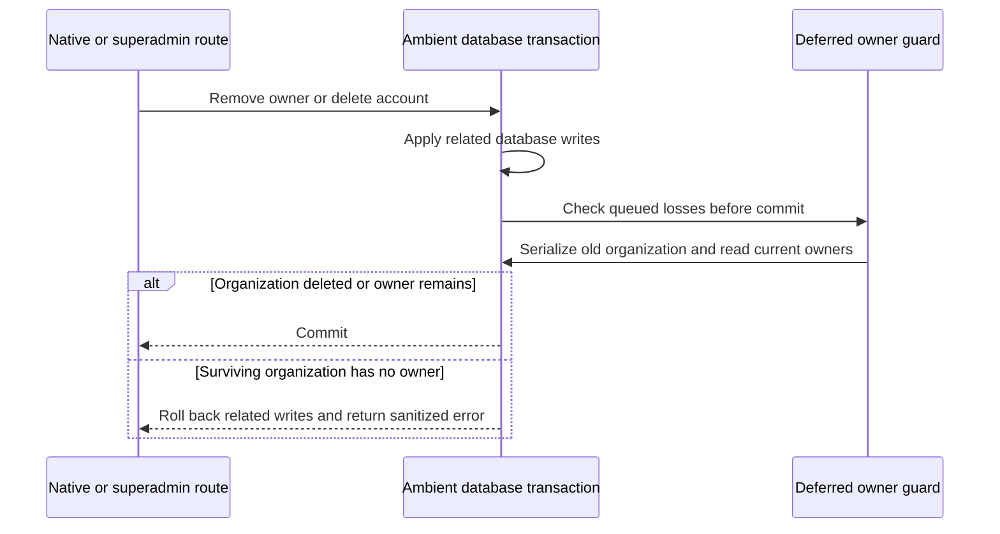

# Organization owner guard proposal

**Design for review only; not implemented or validated.** This is the separate native/global ownership follow-up to [superadmin mutation transactions](superadmin-transactions.md) and issue #20. It adds no runtime code, schema, migration or executed database DDL. The current superadmin transaction slice does not close issue #20.

## Intended invariant and compatibility

When an existing owner membership is deleted, loses its owner role, or moves to another organization, the old organization must either disappear in the same transaction or retain an owner at commit. This applies to native member removal, role changes, leaving, account-deletion cascades, superadmin operations and ordinary database DML.

An owner is an exact, case-sensitive `owner` token after splitting the stored role on commas and trimming each token with the same semantics as the application. `admin, owner` counts; `coowner`, `Owner` and `owner-admin` do not. The SQL helper must explicitly match ECMAScript `String.trim()` whitespace, including tabs, line breaks and Unicode whitespace; default SQL `btrim()` alone is insufficient. Role interpretation must not depend on database collation or locale.

This is an ownership-loss invariant, not a requirement that every newly created organization already have an owner. Existing superadmin creation of an empty organization remains supported. Adding the first owner, invitation acceptance and a same-transaction ownership transfer remain possible. Existing ownerless organizations require an explicit rollout decision below; no owner is fabricated automatically.

## Installed behavior that constrains the design

The following facts come from installed Better Auth **1.6.33**, resolved in [the lockfile](../pnpm-lock.yaml), and require rechecking on dependency upgrades:

- Native member removal, role updates and leaving perform owner reads separately from the member write in `better-auth/dist/plugins/organization/routes/crud-members.mjs`. Those reads cannot alone serialize all competing writers.
- Native `deleteOrganization` in `better-auth/dist/plugins/organization/adapter.mjs` already uses `runWithTransaction`, deleting members, then invitations, then the organization. An immediate last-owner trigger would reject that valid members-first sequence.
- Native `internalAdapter.deleteUser` in `better-auth/dist/db/internal-adapter.mjs` deletes database sessions and credential accounts before deleting the user, without enclosing those steps in its own transaction. A late member-cascade rejection could otherwise preserve the user while losing credentials or sessions. Both direct and token-callback account deletion use this method.
- Native database hook helpers use `getCurrentAdapter`, allowing database operations to join Better Auth's ambient transaction. [The auth configuration](../packages/auth/src/auth.ts) already enables Prisma adapter `transaction: true`; retain it.
- A plugin `init` replacement of `internalAdapter.deleteUser` alone is insufficient: `better-auth/dist/context/helpers.mjs` recreates `context.internalAdapter` after plugin initialization. The exact post-initialization wrapping seam still needs a supported-lifecycle proof; no wrapper has been validated.
- [The RAG deletion guard](../packages/db/prisma/migrations/20261026000000_rag_indexing/migration.sql) can reject organization deletion after native member deletion. Its failure must continue to roll back that native transaction. [The existing cleanup preflight](../packages/auth/src/permissions/organization-deletion.ts) remains useful but does not replace the database guard.

## Proposed persistence protocol

Use a `VOLATILE` function and a row-level **`AFTER DELETE OR UPDATE` constraint trigger**, `DEFERRABLE INITIALLY DEFERRED`, on `member`. Schema-qualify the table and function; the trigger name itself is unqualified. Filter actual ownership-loss events using `OLD` and `NEW`; an owner move checks `OLD.organizationId`. Do not bypass cascades, use trigger-depth exemptions, or skip checks because the actor is a superadmin. PostgreSQL supports transaction-end constraint triggers; forcing them immediate may reject an otherwise valid multi-statement transfer. [PostgreSQL trigger semantics](https://www.postgresql.org/docs/18/sql-createtrigger.html).

For each queued loss, the proposed trigger function would:

1. Serialize losses against the old organization by writing an existing **non-key** field without changing its value. Illustrative SQL only, not a migration:

    ```sql
    UPDATE public.organization
    SET "isActive" = "isActive"
    WHERE id = old_organization_id
    RETURNING id;
    ```

2. If the organization genuinely no longer exists, allow the loss. Permission failures or rows hidden by a future visibility policy must not be mistaken for deletion.
3. After obtaining that write serialization, issue a separate current-state query for at least one matching owner in the old organization. If none exists, raise a static `23514` error with a dedicated constraint name such as `organization_owner_required`.
4. Let any failure abort the complete caller transaction, including audits and member-dependent records. Preserve an organization's suspended state; never assign `isActive = true`.

The non-key write is intended to serialize losses while remaining compatible with foreign-key and existing RAG `FOR KEY SHARE` locks. It creates row versions and can contend with organization updates; these costs require measurement. PostgreSQL documents that non-key updates and key-share locks are compatible. [PostgreSQL row locks](https://www.postgresql.org/docs/18/explicit-locking.html).

At `READ COMMITTED`, the proposal relies on the volatile function's separate owner query obtaining a fresh snapshot after a competing loss commits. At `REPEATABLE READ` and `SERIALIZABLE`, a conflicting row change must abort a stale transaction rather than permit a stale owner count. This is a design argument requiring controlled concurrent tests, not proof of the proposed SQL. [PostgreSQL function snapshots](https://www.postgresql.org/docs/18/xfunc-volatility.html).

Different organizations can be visited in different orders during multi-organization user deletion. Deadlocks and serialization failures must safely abort; do not claim deadlock freedom. Prove adapter error mapping for `40P01`, `40001`, Prisma equivalents and the named ownership constraint. Retry only complete database units with bounded attempts and no external side effects; otherwise return a sanitized retryable conflict.

## Native account-deletion atomicity

The trigger and account-deletion wrapper must ship together. Wrap the complete original native `internalAdapter.deleteUser(userId)` database sequence using Better Auth's own `runWithTransaction` and current-adapter context. A separate Prisma transaction around unrelated calls, or an owner-count preflight, does not establish that boundary. Preserve native hooks and both deletion entry points; do not reimplement only the final user deletion.

Select and prove a wrapping seam after native internal-adapter construction, covering HTTP handlers and direct `auth.api` use. Do not rely on the overwritten plugin-init approach, repeated per-request global mutation, or an unawaited initialization race. If no reliable supported seam exists, review a narrowly pinned adapter/dependency patch before implementation.

Current configuration has no external secondary session store. Future external cache deletion, mail, cookies and other non-database effects cannot be rolled back by PostgreSQL; explicitly review their ordering. User/account/session rows, membership cascades and hook writes participating in the transaction must roll back on a deferred failure; queued after-commit hooks must not run after rollback. Existing outer native route steps also need acceptance checks rather than an assumption that the entire HTTP request is transactional.



## Rollout and database-role boundary

Before authoring a migration, run a read-only deployment data audit: ownerless organizations, malformed role tokens, duplicate memberships and owner-account relationships. Distinguish intentional empty organizations from unexpected legacy ownerless data. Decide whether to repair, quarantine or explicitly grandfather each category; the loss-only proposal does not repair or forbid unrelated writes to existing ownerless organizations.

The migration role installs the function/trigger; runtime roles must have the required visibility and execution rights without the ability to disable triggers, change replication behavior or truncate protected membership data. A row trigger does not protect `TRUNCATE`, disabled triggers or privileged operators. Review actual grants and any future RLS. Prefer invoker semantics with verified rights; a security-definer alternative needs fixed `search_path`, qualified objects and narrowly reviewed privileges.

Keep the native deletion transaction, RAG organization key-share admission and RAG cleanup guard unchanged. Deployment must not expose the deferred guard before account-deletion atomicity is ready. Audit and rollback the rollout as one reviewed change; removing the guard would reopen the race.

[AGENTS.md](../AGENTS.md) requires: “Prepare schema changes for review; migrations are generated manually after review.” This includes a SQL-only trigger migration even if no Prisma model changes. Migration generation and execution await explicit review; this document authorizes neither.

## Planned entry points and validation

| Area                   | Proposed location and required work                                                                                                                                       |
| ---------------------- | ------------------------------------------------------------------------------------------------------------------------------------------------------------------------- |
| Database               | A reviewed new migration under `packages/db/prisma/migrations/`; owner-token helper, deferred guard and stable error identity. No generated migration exists.             |
| Authentication         | `packages/auth/src/auth.ts` plus a proposed `packages/auth/src/native-user-deletion.ts`; prove initialization ordering, ambient transaction use and error translation.    |
| Superadmin             | Reuse `packages/routers/superadmin/src/superadmin-transaction.ts`; retain current scoped reads, audit atomicity and retry bounds.                                         |
| HTTP and dashboard     | Native member/account error mapping and existing web/admin controls; localized English, French and Belgian Dutch ownership/conflict states.                               |
| Disposable integration | A proposed `apps/api/src/organization-owner-integration.ts`, registration in `integration.test.ts`, and migration upgrade/parity assertions in `scripts/test-catalog.sh`. |

| Required scenario          | Expected evidence before delivery                                                                                                                                                                                                     |
| -------------------------- | ------------------------------------------------------------------------------------------------------------------------------------------------------------------------------------------------------------------------------------- |
| Token parity               | CSV combinations, duplicates, empty tokens, tabs and Unicode trim; reject substring/case lookalikes.                                                                                                                                  |
| Native and mixed races     | Two native removals, leave/role changes, native versus superadmin and direct DML; force both old predicates before writes and retain one owner.                                                                                       |
| Isolation and SSI          | Repeat barriers at Read Committed, Repeatable Read and Serializable; exercise commit-time conflicts, bounded retry/exhaustion and complete loser rollback.                                                                            |
| Transfers and moves        | Same-transaction replacement succeeds; owner move validates the old organization; bulk loss on a surviving organization fails.                                                                                                        |
| Organization deletion      | Clean members-first deletion succeeds; deliberately late RAG rejection restores members, principals and scopes. Suspension is never cleared.                                                                                          |
| Account deletion           | Direct/callback sole-owner deletion preserves user, accounts and sessions and returns the named owner error; another owner permits deletion. Use clean non-superadmin fixtures so audit foreign keys cannot produce a false positive. |
| Multi-organization and ABA | One account owns multiple organizations; concurrent replacement/removal or deletion/recreation of memberships and reused email/identifiers cannot authorize stale deletion. Cover opposite lock order and safe deadlock rollback.     |
| Creation and legacy data   | Native creation, invitation acceptance, empty superadmin creation and first-owner assignment work; approved legacy policy is explicit.                                                                                                |
| Roles and deployment       | Exercise actual runtime DB role, visibility, trigger metadata/deferral, fresh/upgrade/repeat deployment and schema parity; test sanitized native HTTP errors.                                                                         |
| Dashboard                  | Disposable users perform leave, demotion, removal and account deletion through real controls; inspect localized errors, surviving access and successful transfer/deletion.                                                            |

No SQL, wrapper, migration, concurrency test or dashboard acceptance in this proposal has been executed. The native wrapping seam needs a prototype and independent review before seeking migration approval. Review of the design and unresolved rollout choices precedes implementation.
