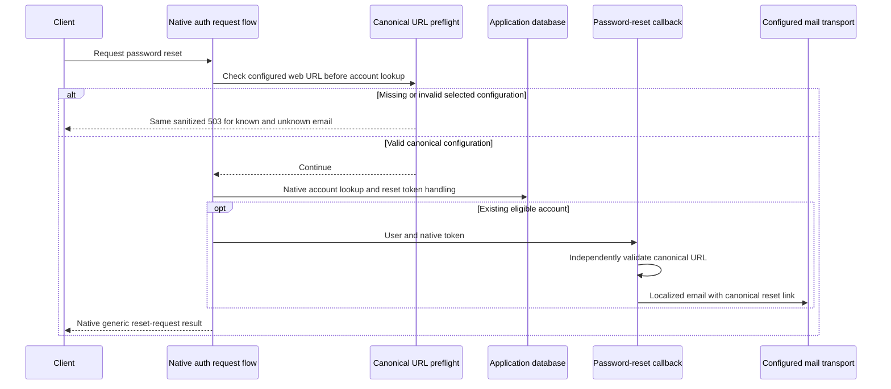

# Canonical password-reset links

This security change implements issue #17. Final automated and browser acceptance are recorded below. It requires no schema, migration or public DTO change. Outbound mail configuration consistency and verified email-address changes remain separate work.

Password-reset links must use a web URL controlled by the deployment operator. Request `Origin`, `Referer`, `Host` and forwarded headers cannot choose the destination. These headers may still participate in native request security and locale selection; that does not make them a trusted link base.

## Configuration and admission

The first non-empty trimmed value in this order is authoritative:

1. `VECTORIX_WEB_URL`.
2. Legacy `WEB_URL`.
3. Legacy `APP_URL`.

The selected value must be an explicit absolute HTTP(S) URL with an authority. User information, query/fragment delimiters (including empty `?`/`#`), raw C0 control characters, DEL, backslashes and whitespace inside the value are rejected. An invalid higher-priority value fails; the resolver does not silently select a lower-priority variable. An absent configuration does not fall back to a request header or implicit localhost. Local development remains supported by explicitly setting `VECTORIX_WEB_URL=http://localhost:3000`, as in `.env.example`.

The configured path prefix is preserved: `https://app.example.test/tenant-ui` produces `https://app.example.test/tenant-ui/reset-password?token=...`. The token is encoded as a query parameter. The operator remains responsible for serving that configured path and controlling its domain/TLS; syntax validation is not a live deployment check.

Better Auth catches mail callback errors after its handler creates a token. Callback validation alone would therefore be too late to guarantee the missing/invalid-configuration response. The exact `/request-password-reset` before hook validates first, before the native reset-account lookup or token creation. The mail callback independently validates again before resolving mail credentials or rendering/sending email. Configuration failures use a static HTTP 503 `PASSWORD_RESET_UNAVAILABLE`, without echoing an email address, configuration value or token. The shared web form renders a translated temporary-unavailability message in English, French or Belgian Dutch.

Native origin/redirect validation, rate limits, reset expiry, single-use redemption and session revocation remain in force. The preflight validates the link destination, not mail-provider availability. This change does not promise email delivery or make the request/preflight/callback a single transaction across concurrent deployment configuration changes.

## Implementation entry points

- [Canonical URL resolver and builder](../packages/auth/src/password-reset-url.ts) owns precedence, validation, path preservation and token encoding.
- [Auth before hook](../packages/auth/src/auth.ts) validates the reset-request path before native account/token work.
- [Password-reset email callback](../packages/auth/src/password-reset-email.ts) rechecks the server URL and preserves the existing localized message and selected transport.
- [Shared forgot-password form](../packages/dashboard-core/src/components/forgot-password-form.tsx) handles temporary unavailability; web [English](../apps/web/messages/en.json), [French](../apps/web/messages/fr.json) and [Belgian Dutch](../apps/web/messages/nl-BE.json) dictionaries supply its messages.

## Dashboard acceptance recipe

Use production web/API with a disposable `_test` database, a synthetic account and a loopback-only controlled SMTP capture accepting only synthetic recipients. Configure the explicit web URL and synthetic mail credentials on the API. From **Forgot password**, request a reset and expect the generic success state. Inspect the privately captured message and verify that its link uses the configured origin/path and the actual native token. Do not put a token in screenshots, logs or documentation.

Send a separate cookie-free reset request with attacker-controlled Origin/Referer/Host/forwarded values where the native HTTP server allows them. Verify the captured link still uses the configured URL; native CSRF/redirect rejection is a separate valid outcome and does not by itself establish canonical-link construction.

Restart only the disposable API with all three web URL variables absent. Repeat known/unknown requests and expect the same sanitized 503, unchanged token/mail state and a localized error instead of a success screen. Test an invalid selected high-priority value with a valid legacy lower-priority value; it must remain unavailable. Keep native rate limits in mind and use controlled restarts or wait for the actual window when exercising multiple cases. Token redemption, expiry and session revocation can be established in isolated automated tests without changing a password through the browser. Record actual outcomes and clean owned processes, captures and infrastructure.

## Actual validation — 22 October 2026

The final disposable catalog passed all 136 core/RAG HTTP tests, including four new reset journeys, seven-migration fresh installation, upgrades, repeat deployment and schema parity. The new journeys use real application auth handlers and PostgreSQL: missing/invalid authoritative configuration, including BEL/DEL, gives the same 503 for known and unknown accounts without verification growth or email delivery. Captured rendered HTML uses the configured prefix and an actual stored native token despite hostile request headers. Native redemption changes only the intended account, invalidates both existing sessions, cannot be reused, and an expired owned test token cannot change the password or sessions. Mail delivery in these automated journeys is mocked at `MailService.sendMail`; it is not presented as SMTP/provider acceptance.

Six focused tests passed for configuration priority, forbidden URL components, empty suffixes, raw control characters (including NUL in direct resolver objects), path/token encoding, independent callback validation, locale-only request headers and the installed native memory-adapter flow. Node truncates NUL in `process.env`, so HTTP invalid-control fixtures use BEL/DEL while direct object tests cover NUL. Final checks also passed: frozen offline installation, 23 workspace type checks, 23 lint tasks, 38 backend regressions, four production builds and all six production image/runtime/infrastructure checks. A first global type/container pass exposed Next.js's weak `ProcessEnv` assignability; explicit reads of the same three keys fixed it without a cast, and final types/catalog/build/images passed. Independent reviews found no remaining P1/P2 issue.

Actual browser verification used production web/API, a private disposable `_test` organization/account and a bounded loopback SMTP capture accepting only `example.test` recipients. The English **Forgot password** form reached its generic success state and the SMTP server received the message. A separate cookie-free HTTP request with forged Origin, Referer, Host and forwarded headers also returned 200 and delivered a locally captured message. Both captured links used `http://localhost:3100/reset-password`, and their privately inspected query tokens matched unexpired native verification records for the synthetic account. No token, full token-bearing URL or raw mail content was published.

Restarting only the disposable API with all three canonical variables absent made known-account English, unknown-account French and known-account Belgian Dutch form requests fail with the translated temporary-unavailability message, without a success screen. Verification rows, sessions and SMTP messages remained respectively 2, 1 and 2. A further controlled API restart selected an invalid primary URL while retaining a valid legacy fallback: known/unknown cookie-free HTTP requests returned the identical sanitized 503, with the same unchanged counts. This proves fail-closed destination configuration; it is not a production rate-limit/timing benchmark.

The form's locale survived reloads, the initial English locale was restored, and the final reloaded browser console had no warnings/errors. No password was changed through the browser; one-time/expired redemption and account/session effects were verified by the isolated HTTP suite. The web/API/SMTP previews, four owned infrastructure containers, temporary tab and private raw SMTP capture were removed; only token-free verification metadata and screenshots remain in the ignored test cache. No application database, external mail recipient or hosted embedding provider was used.

The focused [URL/callback tests](../packages/auth/tests/password-reset-url.test.ts) are part of the API test script. The [reset HTTP journeys](../apps/api/src/password-reset-integration.ts) are awaited by the [core suite](../apps/api/src/integration.test.ts) under its disposable database guard. The explicit API test-only `@repo/emails` workspace dependency keeps capture at the public mail package boundary; runtime delivery dependencies are unchanged.
