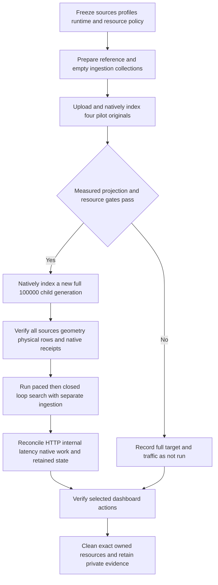

# M7c.3 — Native capacity acceptance

Status: **2,000 native children and the functional dashboard journey verified; full capacity acceptance incomplete**. The [reference-quality baseline](rag-reference-quality.md) is independently verified and delivered in PR #45. Its 181 children across three collections are a separate experiment. The finite policy below was fixed before the native attempts. The formal pilot observer failed; supplemental read-only proof establishes the completed 2,000-child generation without granting full-run admission. The 100,000-child generation, concurrent traffic and internal-p95 acceptance remain unrun or unmeasured.

This slice changes no application model, migration, public API contract, workload quota or provider timeout. The compatible revision remains `1.18.0`. The [reproducible operator workflow](../tests/acceptance/capacity/README.md) and `pnpm test:capacity:guards` are separate from actual native measurements; relocated helpers have not had a native retest.

## Workload and finite gates

The primary corpus has 200 deterministic artificial TXT originals. The real versioned TOKEN_WINDOW planner produces 500 searchable children and 125 parents per original: exactly 100,000 children and 25,000 parents. The first four unchanged originals form the separate 2,000-child/500-parent pilot. All prepared child inputs have distinct frozen hashes. Original bytes total 134,438,400; prepared input bytes total 157,500,000. These are logical quantities, not observed disk or native-throughput measurements.

The saved profile remains target/minimum/maximum/overlap 512/128/768/64, parent maximum 2,048, empty custom preparation, cosine/float32/DISKANN and native `EMBEDDING_GEMMA`. Ollama `embeddinggemma:latest` must verify weights `85462619ee721b466c5927d109d4cb765861907d5417b9109caebc4e614679f1` and full 768 dimensions. The actual probe must permit at least 1,608 context positions under the existing conservative byte guard. The tag alone cannot attest to its weights.

The full frozen manifest is `c99db8842d4ab7a52457c8e81926389f7d66b49d569db026ed548fe841f01a67`. All 100,000 children belong to a **new** full generation and receive normal native embedding work. The already indexed pilot is not counted as part of that full indexing timer.

| Stage          | Fixed bound and prerequisite                                                                                                                                                            |
| -------------- | --------------------------------------------------------------------------------------------------------------------------------------------------------------------------------------- |
| Baseline       | Organization B's unchanged 24-source reference index and two empty ACTIVE ingestion collections; 20-minute setup bound                                                                  |
| Pilot          | Four normal uploads, saved associations/metadata, native probe and indexing; 20-minute workflow bound                                                                                   |
| Full admission | Actual pilot index milliseconds multiplied by 50 must fit within 7,200,000ms; exact native/physical reconciliation, zero retry/error, safe resources and unchanged resource-policy hash |
| Full sources   | Remaining 196 originals through normal upload/extraction; separate 20-minute source-import bound                                                                                        |
| Full indexing  | New collection/generation for all 200 sources; at most 120 minutes from client start call to observed ACTIVE                                                                            |
| Traffic        | One paced 180-second phase, then one closed-loop 180-second phase; each has a 300-second request/ingestion/telemetry drain bound and at most 10,000 searches                            |
| Safety         | At least 4GiB observed free space, bounded resource sampling, exact process/container identities and no OOM/process loss                                                                |

An unmet pilot projection leaves the full target and traffic **NOT_RUN at these limits**. Passing the projection only admits an attempt: index growth, contention and ANN construction need not scale linearly.

## Separate stores and actual observations

A fresh `vectorix-m7c-load-{12hex}` fixture owns two `_test` databases, five containers, four new store volumes, a private bucket, three synthetic users and two organizations. The explicitly selected existing model volume is mounted read-only and preserved. No application `.env`, hosted credential, invitation, superadmin or API key is used. The complete source/build/image/corpus inventory must be frozen and reviewed before preparation. An incomplete invocation is retained and never replayed by deleting its journal.

| Container              | Preselected limit                     |
| ---------------------- | ------------------------------------- |
| Application PostgreSQL | 2 CPU, 2GiB                           |
| Vector PostgreSQL      | 2 CPU, 4GiB                           |
| Redis                  | 1 CPU, 256MiB                         |
| RustFS                 | 1 CPU, 1GiB                           |
| Ollama                 | 4 CPU, 6GiB, one native parallel slot |

API, workers and client run as owned foreground production processes on the same host. Other host activity and measurement overhead must be recorded. Container limits are configured maxima, not observed use or a dedicated-host guarantee.

The Linux cgroup-v2 sampler records bounded actual process RSS, container memory/CPU/OOM observations, progress and filesystem available bytes. Its reported peak is the maximum sampled sum of process RSS and container current memory, including cache and possibly shared pages. It does not establish unique physical RAM use or an unobserved continuous peak. Model warm state remains UNKNOWN at sampling start. Reference-collection indexing and native probes precede the pilot and can warm the model; this is not a cold-start experiment.

Independent read-only receipts record application/vector database bytes and scoped relation bytes before and after each workflow. PostgreSQL database size excludes WAL and private object storage. Physical volume/RustFS bytes remain UNKNOWN unless an independently verified measurement is added; source bytes and free-space deltas cannot substitute for them. Separate-store observations are not a distributed atomic snapshot.

Normal APIs create documents, profiles, associations and metadata. A separately guarded read-only observer reconstructs every child/parent from frozen canonical content and compares source tuples, prepared hashes, publication manifests, physical child vectors and accounting. Parent rows never have vectors. Native INDEX_TOKEN observations use an exclusive stable cohort with exact validated-vector/prepared-byte reconciliation; physical counts alone do not establish native work. Saved immutable receipts prevent later ingestion from being attributed to an earlier generation. Best-effort telemetry is not a critical accounting ledger or a billing receipt.

## Concurrent search and ingestion

Organization A searches the immutable full collection; B searches its unchanged reference collection. Each has five client slots. The paced phase offers five searches per second per organization, 900 each. Late/busy offers are recorded as drops without a catch-up queue. The closed-loop phase has ten clients total. At least 100 samples per organization and retrieval mode are required.

A's unfiltered variant uses an empty filter object and admits all 100,000 children; selective variants report their eligible cardinalities separately. A correctly shaped empty search response is successful and counted explicitly, alongside nonempty and underfilled responses. Every returned passage must match canonical content, filters and the unchanged generation. All six organization/mode cells must supply a nonempty result with a verified source or source coverage is INCONCLUSIVE. B's eligible same-language frozen EXACT lexical controls must contain a relevant child span; a miss fails that separate control. These controls do not introduce an ANN recall or rank threshold.

The trace distinguishes actual HTTP start-to-body completion from later response validation and occupied client slots. Configuring ten clients, or retaining ten validation tasks after their bodies finish, does not prove ten concurrent HTTP requests. Client HTTP percentiles, provider-inclusive service duration and internal search latency remain separate measurements. A search error stays in the outcome and denominator.

Each phase also uploads six new tiny FR/EN originals, three per organization at offsets 30/80/130 seconds, into the two separate serving ingestion collections. The primary/reference collections stay unchanged. The common libraries grow only by the declared originals. Upload preparation, HTTP duration and client-validated acceptance timestamps remain distinct; accepted-to-READY/published ages start at the validated upload response, not at local intent or an inferred server commit time.

All phase documents must become READY and currently published, with no unresolved extraction/index/native cost work at the 300-second drain. Normal supersession or recovered ingestion failures/retries remain visible in total work and end-to-end ages. Current document counts cannot replace that history. Legitimate future retention/cleanup and retained candidates may remain with exact physical/publication/accounting reconciliation; no grace deadline is advanced. An unresolved FAILED cleanup with physical/ledger work outstanding prevents an overall phase PASS, while independent search/latency results remain recorded. Resolved historical failures stay visible. These observations stay separate from the exact error-free SEARCH/QUERY cohort gates.

Internal p95 uses additive 16-bin histogram/count/sum differences from an exclusive cohort. It requires exact observed search/native counts, stable producer identity, no gap/overflow/pruned hour and two matching final snapshots at least one recorder interval apart. It never subtracts maxima, percentiles or query-embedding time. A p95 bucket upper bound strictly below 1,000,000µs establishes the declared internal target for that cohort; an upper bound exactly at one second is INCONCLUSIVE. Missing trustworthy coverage is UNMEASURED. Post-phase physical proof has a separate bounded observation budget and never extends the request/ingestion drain.

## Dashboard acceptance and results

Before opening extra search traffic, complete the relevant measured cohort and telemetry drain. Use the production dashboard with the private synthetic owner. Inspect saved model/profile, source versions, task progress and exact child/parent counts; open selected originals/previews and compare search generation/source receipts. After an admitted full run, verify primary/reference hybrid searches and filters, current ingestion publications, Operations/Usage, locale changes and reload. If the full gate refuses, record the actual pilot or failure journey without claiming a full-capacity dashboard result.

| Evidence                                              | Current status                                    |
| ----------------------------------------------------- | ------------------------------------------------- |
| Frozen corpus and real-planner preparation            | Verified offline                                  |
| Owned runtime/import/observation unit tests           | 200 tests and one negative CLI check pass offline |
| Actual native 2,000-child generation                  | Verified by separate read-only supplemental proof |
| Formal pilot measurement and full-run admission       | INCOMPLETE / NOT_GRANTED                          |
| Actual new native 100,000-child generation            | NOT_RUN                                           |
| Ten concurrent HTTP searches and concurrent ingestion | NOT_RUN                                           |
| Internal-p95 target                                   | UNMEASURED                                        |
| Functional pilot dashboard acceptance                 | PASS; no full-capacity claim                      |

Configuring DISKANN does not establish ANN recall or the actual plan taken by a selective query. Unfiltered and selective workloads must be distinguished. Hosted-provider connectivity remains pending as previously agreed. Interrupted-process and dependency-outage acceptance is a separate M7c journey; none is established by this preparation.

The first isolated attempt, `6bfa16b98e99`, passes infrastructure/schema/bucket preparation and starts the production API/workers, but stops before the first baseline journal. Its generic diagnostic leaves the cause UNKNOWN. Read-only inspection confirms zero documents and collections; one new authentication session has an active organization. The attempt therefore supplies no native indexing or capacity result. Independent review finds a fractional-timer pacing defect in the test transport, for correction before a fresh attempt. Its five containers and four new volumes are removed, its private evidence is retained, and the existing model cache is preserved. The incomplete invocation is never replayed.

### Completed native generation with an incomplete formal observer

Fresh run `b53a06a45e8b` uses product commit `3ba97dbd7768fd9cbdc6e294f88dedde0f7d2ef0`, a new source inventory and unchanged corpus/profile/resource gates. Normal setup completes in 318,543ms: B's 24 reference originals and serving collection, plus the two empty ingestion collections. Four normal pilot uploads and associations lead to 14 confirmed mutations, including index admission. A timer in the test observer then wakes before its required two-second interval. Its finite diagnostic is `IMPORT_PILOT / LOAD_CLOCK_NOT_ADVANCED`; the formal outcome remains **INCOMPLETE / UNKNOWN**. Accepted worker work continues normally. The invocation, journal and pins are retained unchanged; no indexing request is replayed.

A separately reviewed, read-only observer subsequently reconstructs all frozen canonical children/parents and verifies the completed generation: four published source versions, **2,000 physical searchable children, 500 parents**, exact prepared-input hashes and native receipts. The exclusive native cohort records 32 started/validated/finished batches, 2,000 vectors, no retries/errors/gaps and 1,051,662 known provider input tokens. These observations are not billing evidence. The proof SHA-256 is `9fab0ea9992a1311ffedf28c6725d704a9e55a769e418c25ec104f549db581d6`; its physical-manifest digest is `0e9c1deaa606d597133911feb82978158e829d3efdc15c5b8106c10c8bfbfa93`. Supplemental verification does not repair the failed formal pilot or grant full-run admission.

Server generation creation at 08:04:59.999 UTC and activation at 08:14:49.008 UTC on 2026-10-23 span **589,009ms**. This server lifetime is not the missing formal client `indexMs`. Multiplying it by 50 gives roughly eight hours as a planning estimate; no full-run duration is measured or guaranteed. The original two-hour gate is unchanged, and full indexing/traffic remain **NOT_RUN**. A future longer or different-profile experiment needs its own predeclared policy and fresh run.

Only ten resource samples over 21,949ms precede the observer failure. Their maximum sampled sum is 2,444,275,712 bytes and minimum available filesystem space is 21,016,776,704 bytes. These short observations do not establish the whole generation's peak, full-run disk requirement or resource admission.

### Actual pilot dashboard verification

After the supplemental native cohort is closed, the production dashboard shows the saved Ollama/768-dimensional profile, four documents, 2,000 active children, five COMPLETE tasks with one attempt each and zero retained/reserved children. The chunk preview is bounded to 25 rows; the selected child spans UTF16 offsets 0–1,488 and its parent 0–5,398. An unfiltered hybrid query and FR/TXT/numeric `document_no = 4` filters each return three verified results. The exact-source dialog displays version 1 and the bounded canonical page 1–20,000 of 651,625 UTF16 units. The original download link is available but is not clicked in this run.

Usage shows four documents and 5.13MiB logical storage for A. Native observations including the two dashboard query embeddings are 34 batches/2,002 vectors with zero failures, distinct from the generation's 2,000 searchable children. Operations shows no pending or failed ingestion, cleanup or indexing tasks. Reactive English labels, Belgian Dutch after reload and restored French are verified; the final console has zero errors. The two displayed search durations, 976ms and 144ms, are functional observations, not a latency benchmark or internal-p95 result. Screenshot/acceptance records remain private with the synthetic fixture.

Exact-owned cleanup reaches `CLEANED_EVIDENCE_RETAINED`: the API, workers and web stop, five containers and four new store volumes are removed, and the existing model cache and private evidence remain. Only the created browser tab is closed. Timer corrections add absolute elapsed-time checks and bounded early-wake handling without changing polling, resource, traffic or admission limits. The cohesive post-correction pass runs 200 tests plus one negative CLI check, all passing, without application/infrastructure calls. These regressions are separate from native acceptance; neither old attempt is rerun or relabeled.
