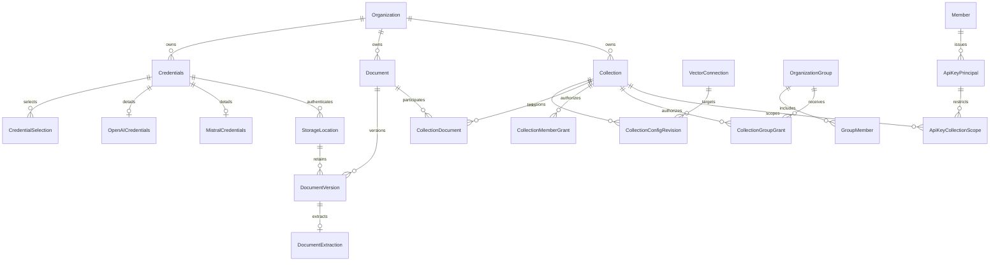

# RAG catalog and access — backend foundation

The original phase 2 implements the stable catalog, provider configuration, access control, and quota policy APIs. The [M1 catalog dashboard](rag-dashboard.md) now completes the user-facing configuration and access milestone. Uploads, extraction, embedding calls, vector provisioning, indexing, and the playground will each ship with their interface in subsequent milestones.

## Schema review

The schema is in `packages/db/prisma/models/rag.prisma`, with inverse relations added to the existing organization, member, and API-key models. All persisted entities are new tables. Existing application records are retained; no existing API key receives an issuer or collection scope automatically. The schema was reviewed and approved before generating `packages/db/prisma/migrations/20261022000000_rag_catalog_access/migration.sql`. The migration is additive and has no data backfill or automatic permission grants.

Document, collection, group, member, and credential references use organization-scoped composite foreign keys. API-key access additionally revalidates the native key's organization against its issuer binding on every request. Member and group grants use separate tables, making a mixed principal impossible. Provider-specific credential child tables preserve the original credentials design; their secret columns contain AES-256-GCM ciphertext. A provider has one explicitly selected active credential per organization.

`StorageLocation` records endpoint, bucket, region, and addressing mode independently of the active S3 selection. Original versions and extracted objects retain that location and their object keys. A credential or vector connection referenced by a configuration revision cannot be deleted. A referenced credential's destination cannot be changed: create a new credential for new writes instead. Secret rotation remains possible. Collection deletion is logical and preserves shared documents and immutable configuration history. Retention foreign keys use `NO ACTION`, with `DEFERRABLE INITIALLY DEFERRED` added in the SQL migration because Prisma cannot express deferrability. This protects referenced destinations while permitting a complete organization cascade to finish before checking the references.

Document models establish ownership, storage provenance, and version identities. This phase exposes only authorized document metadata; no upload/extraction or search state is presented as implemented. Index generations, chunks, durable ingestion/outbox processing, and physical cleanup are introduced with their processing workflows in later work packages.

## Access rules

Organization permissions are always prerequisites. Built-in owners and administrators can manage catalog metadata and grants through explicit RAG permissions. Collection content requires an explicit member/group `read` grant even for those roles. `manageDocuments` and `administer` are independent grants. Library managers with `ragLibrary.readAll` can read all library documents; other readers need an authorized collection association.

Session-only operations manage credentials, groups, collection configuration, grants, quotas, and audit. A group manager adding members to a group that already confers collection access must also be authorized to manage those collections' grants.

API keys have explicit collection scopes and a retained issuing member. Effective access intersects the key permissions, key collection scope, issuer's current organization permissions, and issuer's current member/group grants. Removing a member or group membership, revoking a grant, disabling a key, or suspending the organization removes the corresponding access on subsequent requests. Historical keys without an issuer binding have no RAG access; create a new scoped key instead of silently upgrading one.

List filters are applied in PostgreSQL before pagination. Direct identifiers use the same organization and access filters. Catalog mutations recheck access within a serializable transaction and record non-secret audit details in the same transaction.

## Credentials and configuration revisions

Provider resolution in `packages/routers/rag/src/services/credential-resolution.ts` selects complete organization configuration before the complete environment fallback. Existing credentials without an active selection, corrupt ciphertext, and invalid configuration produce explicit errors. No provider key is combined with another configuration's endpoint. This phase makes no outbound provider requests; endpoint network policy and provider capability validation are implemented alongside the adapters.

Collections snapshot provider, model, dimensions, numeric representation, metric, index type, endpoint, credential reference/revision, text preparation, and chunking parameters in immutable revisions. Model and index compatibility is validated further by the provider/vector adapters before indexing. The saved credential binding is used for existing revisions, even after another credential becomes active. Secret rotation at that destination is allowed; a changed platform endpoint requires a new configuration revision. There is only a platform-managed PostgreSQL connection in this phase; remote connection administration is not exposed.

New API operations live under `/api/v1/admin/rag` and `/rpc/v1/admin/rag`. The compatible API revision is incremented. Contracts are explicit in `packages/api-contracts/src/v1/rag/`; focused handlers and shared services are in `packages/routers/rag/src/`. Existing API-key creation/permission endpoints accept optional `collectionScopes` and return only safe scope metadata.

## Quotas and audit

Defaults are 20 collections, 5,000 library documents, 25 MiB per original, 10 GiB stored objects, and 100,000 searchable chunks per collection. Deployment variables can override the defaults; `OrganizationQuota` provides per-organization overrides. Only platform administrators can update those overrides through the versioned superadmin API.

Collection creation enforces the collection quota transactionally, including concurrent requests. Storage usage includes retained original and extraction bytes; logical deletion alone does not pretend those bytes have been removed. Upload byte reservations and chunk quota enforcement accompany their respective later workflows. Credential and group catalogs are bounded at 50 and 100 entries per organization.

Sensitive writes append `RagAuditLog` records using whitelisted identifiers, revisions, and scalar permissions. Secrets, ciphertext, request bodies, and provider responses never enter these records.

## Dashboard completion

- [x] Manage masked credentials and active selections from the organization dashboard, without implying live provider validation.
- [x] Create, inspect, revise, and delete collection catalog entries; display configuration history and explicit unavailable indexing/search states.
- [x] Manage groups, membership, and member/group collection grants, including revocation.
- [x] Configure collection scopes in the existing API-key interface while respecting issuer permissions.
- [x] Display quota policies, recorded usage, and safe audit entries; edit organization quota overrides in platform administration.
- [x] Complete the M1 browser recipe with two organizations, distinct member permissions, reloads, direct URLs, and quota enforcement; retain automated API isolation coverage.

The [dashboard recipe and verification results](rag-dashboard.md#browser-acceptance) record the M1 product acceptance work separately from the original backend checks below. Later document, provider, and search capabilities must extend the dashboard in the same delivery as their processing paths.

## Backend validation checklist

- [x] The merged phase 1 infrastructure suite passes on the upgraded local VM, including HNSW/DiskANN, database role boundaries, private S3 operations, and restart persistence.
- [x] Review schema changes, then generate and inspect the additive migration.
- [x] Test fresh migration deployment, repeat deployment, and upgrade from the existing catalog in isolated test databases.
- [x] Exercise two organizations, distinct groups, direct identifiers, API-key delegation/revocation, library filtering, secret masking, credential fallback/rotation, concurrent quotas, and transactional audit over real PostgreSQL and HTTP transports.
- [x] Validate the Prisma schema, contract/runtime parity and version metadata, types, lint, backend tests, builds, and all six Docker images.
- [x] Validate English documentation, local links, formatting, and Mermaid syntax.
- [x] Commit and push the review branch.

The reproducible acceptance command is `pnpm test:catalog` (see `scripts/test-catalog.sh`). It creates fresh PostgreSQL/Redis containers on random loopback ports, uses only `_test` databases, deploys migrations twice for both fresh and upgrade paths, checks migration/schema parity, and runs the core and catalog API suites before cleanup. `tests/catalog/upgrade-seed.sql` and `upgrade-check.sql` verify existing data and the absence of implicit grants. `apps/api/src/rag-tests/` exercises authorization and catalog behavior through the same HTTP transports as clients. `.github/workflows/catalog.yml` runs these checks on PRs and main.

## Compatible dashboard API additions (1.2.0)

Revision 1.2.0 adds paginated collection configuration history, authorized member/group candidates, safe grant display names, and a superadmin read of effective organization quotas. Candidate selection remains session-only. Configuration DTOs explicitly project public fields, excluding Prisma relations and secrets. Metadata access recognizes explicit collection administration or document-management grants; it never grants content reading implicitly. REST query coercion uses the Zod 4 adapter, preserving numeric pagination and bounded validation for the handwritten V1 contracts. No database migration is required.

## OpenAI and Mistral catalog providers (1.3.0)

The reviewed schema expansion adds `OPENAI` and `MISTRAL` to `CredentialProvider` and two optional one-to-one credential detail tables, `OpenAICredentials` and `MistralCredentials`. Each has the existing credential ID as its primary key and cascading foreign key, an endpoint, and an encrypted API key. Existing credentials, selections, and collection revisions remain unchanged. No existing field or table is removed. The approved additive migration is `20261023000000_openai_mistral_credentials`; deployment precedes the application update. Verification uses disposable `_test` databases only.

Both providers follow the existing organization-first resolution and saved collection binding rules. Catalog support means credentials and profiles can be saved and inspected; native embedding calls and model capability validation remain in the indexing milestones. Standard API base endpoints are `https://api.openai.com/v1` and `https://api.mistral.ai/v1`. Future adapters must use provider-specific dimension parameters rather than assuming their APIs are interchangeable. See the [OpenAI embedding guide](https://developers.openai.com/api/docs/guides/embeddings) and [Mistral embedding API](https://docs.mistral.ai/api/endpoint/embeddings).
