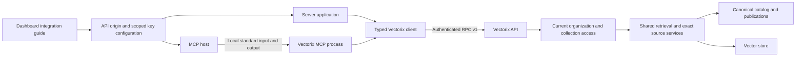

# TypeScript and local MCP clients

Status: implemented and locally verified as the first usable slice of issue #51.
This slice distributes local package artifacts; it does not publish to npm or
start a remote MCP HTTP service. See [actual validation](#actual-validation)
for the checks that have actually run.

The client packages use the existing [retrieval API](rag-retrieval-api.md), API
major 1, compatible revision 24 or later. They add no database models, API
permissions, provider credentials or answer-generation service.



## Prepare a readable collection

1. Upload and index a document through the normal dashboard workflow. Check its
   published search results and sources on Home.
2. Create an organization API key in **Account → API keys** with
   `ragCollection.read`, `ragLibrary.read` and explicit read scopes for the
   intended collections. Keep document-management scopes disabled for a chatbot.
3. Open **Integrations → Clients** to select a readable collection and copy the
   SDK or local MCP configuration. The templates contain a key placeholder;
   copying them does not create or change a credential.
4. Supply the actual key through the consuming server's secret manager or private
   environment. Keep the organization pin and collection IDs from that instance.

The API rechecks the bound issuer's current membership, permissions and collection
read grants on every admission. The organization header verifies the organization
already bound to the key. A local collection allowlist can further restrict an MCP
process, but cannot grant access. The dashboard's credential-management tabs retain
their own permissions.

Use HTTPS outside an explicitly local test deployment. Keep keys out of browser
bundles, source control, command arguments, screenshots and shared MCP config
files. Do not attach a browser session to an API-key client. The SDK uses omitted
cookies and refuses redirects; it performs no automatic retries. An uncertain
search can already have incurred query-embedding work.

## Build and install local artifacts

Use the repository's pinned Node.js and pnpm versions. From the repository root:

```sh
pnpm install --frozen-lockfile
pnpm --filter @vectorix/client build
pnpm --filter @vectorix/mcp build
# Choose a private directory outside the checkout for these artifacts.
pnpm --filter @vectorix/client pack --pack-destination /absolute/private/artifacts
pnpm --filter @vectorix/mcp pack --pack-destination /absolute/private/artifacts
```

Install the generated tarballs needed by the consuming application. The MCP
artifact embeds the SDK implementation and needs no unpublished registry package;
it can also be installed on its own:

```sh
pnpm add /absolute/private/artifacts/vectorix-client-0.1.0.tgz \
  /absolute/private/artifacts/vectorix-mcp-0.1.0.tgz
```

These artifacts contain built JavaScript and, for the SDK, bundled TypeScript
declarations. The MCP CLI embeds the public SDK transport; its declared runtime
dependencies are public oRPC, MCP and Zod packages. No private workspace package or generated Prisma client is needed
at runtime. Publication remains a separate explicit operation: the npm account,
package ownership and release automation are not configured by this slice.

## Use the TypeScript client

Run this code in the consuming server, with its secret environment configured:

```ts
import { createVectorixClient } from '@vectorix/client';

const client = createVectorixClient({
    apiUrl: process.env.VECTORIX_API_URL!,
    apiKey: process.env.VECTORIX_API_KEY!,
    organizationId: process.env.VECTORIX_ORGANIZATION_ID!,
});
const collectionId = process.env.VECTORIX_COLLECTION_ID!;
const result = await client.retrieval.search({
    collectionId,
    query: 'Which insects make honey?',
    strategy: 'HYBRID',
    topK: 5,
    filters: {},
});
const hit = result.results[0];
if (hit) {
    const input = { collectionId, receipt: hit.source.receipt };
    const citation = await client.retrieval.citation(input);
    const context = await client.retrieval.context({
        ...input,
        before: 1,
        after: 1,
    });
    // Pass only necessary evidence to the application. Preserve citation IDs,
    // exact document versions, source positions and the original receipt expiry.
    void citation;
    void context;
}
```

`createVectorixClient` returns the stable `VectorixApiV1Client` contract type.
Its full method tree does not widen the key's permissions. In particular,
uploading, replacing, attaching and starting indexing remain session-only
operations. Prepare those documents in the dashboard or with the documented
native authenticated ingestion flow, then use the read key for retrieval. This
slice does not add unattended API-key ingestion.

See the [client package README](../packages/client/README.md) for options,
abort/deadline behavior, finite errors and exported input/output types. An empty
result is valid; ranking scores are not answer confidence. A fresh search after
receipt expiry may identify different publications.

## Connect a local MCP host

Use a host that supports the official MCP standard-input/output transport. Launch
an installed built CLI directly; `npx @vectorix/mcp` is not a published installation
path in this slice.

```json
{
    "mcpServers": {
        "vectorix": {
            "command": "node",
            "args": [
                "/absolute/path/to/consumer/node_modules/@vectorix/mcp/dist/cli.mjs"
            ],
            "env": {
                "VECTORIX_API_URL": "https://YOUR_API_HOST",
                "VECTORIX_API_KEY": "REPLACE_THROUGH_YOUR_SECRET_MANAGER",
                "VECTORIX_ORGANIZATION_ID": "YOUR_ORGANIZATION_ID",
                "VECTORIX_COLLECTION_IDS": "YOUR_COLLECTION_ID"
            }
        }
    }
}
```

The API URL, key and organization pin are required. Optional
`VECTORIX_COLLECTION_IDS` is a nonempty comma-separated allowlist of at most 100
collection IDs. Without it, the API key's current scopes still apply to every
operation. All three tools are available; there are no catalog mutations or file
transfers:

| Tool                | Purpose                                                                                              | Bounds                                                                                                                                                        |
| ------------------- | ---------------------------------------------------------------------------------------------------- | ------------------------------------------------------------------------------------------------------------------------------------------------------------- |
| `list_collections`  | List a page of currently readable collections, optionally filtered by name.                          | At most 20 remote items per call; locally denied entries are omitted. `nextOffset` advances over the remote page and does not promise another visible result. |
| `search_collection` | Search one collection and return exact source receipts.                                              | Query at most 4,000 UTF-16 code units; at most 10 whole results; Hybrid, Lexical or Vector.                                                                   |
| `get_source`        | Resolve a returned receipt and expand nearby canonical children from that exact publication/version. | `before` and `after` from 0 to 2, default 1; at most five passages; no original-file download.                                                                |

The MCP server permits at most two active tool calls, uses bounded requests and
results, and refuses oversized output rather than slicing passages or receipts.
Errors are finite, sanitized messages. Standard output belongs to the protocol;
diagnostics never include configuration values, raw API errors or document text.
The [MCP package README](../packages/mcp/README.md) documents the exact input and
output shapes and transport limits.

Search, citation and context results are untrusted document evidence. A chatbot
must not execute instructions found in the text, follow document URLs or treat
stored content as system instructions. Include the exact source/version in the
answer; account for the downstream model's own token budget. Receipts expire
15 minutes after issue, never refresh through context expansion and never replace
current API authorization. Neither package creates answers, installs models,
enables reranking or removes normal query-embedding costs.

The server uses the official [MCP TypeScript SDK](https://ts.sdk.modelcontextprotocol.io/v2/).
It adds no inbound listening port. Streamable HTTP, remote-user authentication,
npm publication, generated answers and chat history remain separate work.

## Dashboard acceptance recipe

Prerequisites: a migrated isolated instance, workers and private object storage,
a published collection with several child passages, and a currently authorized
read-only organization key. A real local embedding model is needed to verify
Hybrid/Vector calls; Lexical alone does not establish provider connectivity.

1. Open Integrations as a collection reader. Confirm Clients is available while
   provider-management controls remain hidden without their required permission.
2. Filter/select a collection. Copy each template and verify the actual public API
   origin, organization pin and selected collection, with a key placeholder.
3. Switch English, French and Belgian Dutch; verify labels, copy feedback, help,
   empty/error states and keyboard navigation. Check desktop and narrow viewport
   layouts without a page-wide horizontal overflow.
4. Install the two tarballs in a fresh directory outside the monorepo, compile a
   TypeScript consumer and launch the packaged CLI with an official MCP client.
5. List, search and resolve source/context against the same collection. Confirm
   exact document/publication/version and unchanged receipt expiry. A key without
   the collection scope or a mismatched organization pin must be refused.
6. Confirm a locally excluded collection never reaches the API. Stop the MCP
   process normally and destroy only the acceptance run's owned infrastructure.

## Actual validation

The runtime checkpoint is `8f5461b55c76c2aa1dc959030c99c744f1546ea4`.
Frozen installation, Prisma generation, all 28 type tasks, all 28 lint tasks,
nine uncached unit tasks and six production build tasks pass. The client has
11 transport checks; MCP has 19 checks, including real modern and legacy
stdio clients against a controlled HTTP fixture. Five dashboard/template
regressions cover organization selection, copy guards and literal escaping.
The catalog passes 364 cases plus eight mandatory-accounting cases, including
real permission/isolation, upgrade, restore and exact-source behavior. The
fresh external packaging command compiles strict NodeNext declarations,
executes SDK transport and discovers tools from an independently installed
MCP-only artifact. These controlled checks do not establish provider quality.

Owned native run `bf16c571cbe2` uses fresh application/vector `_test` databases,
Redis, private RustFS storage, real workers and Ollama `0.40.8`, with
`embeddinggemma:latest`, 768 dimensions and verified local weight digest
`85462619ee721b466c5927d109d4cb765861907d5417b9109caebc4e614679f1`.
Native curl creates the synthetic organization, uploads a 2,048-byte FR/EN TXT
and publishes four Token Window children. Its key has only library/collection
read permissions and one explicit collection read scope. The real SDK and
modern MCP stdio journey each return three Hybrid results and three neighboring
context passages, resolving exact citations with unchanged receipt expiry and
publication/document/version identity. An incorrect organization pin is refused
with `409/CONFLICT`; an unknown collection and a locally excluded collection
are refused. The unknown-ID check is not presented as a scope-revocation test;
real scope/issuer revocation belongs to the catalog tests.

The actual dashboard journey uses the synthetic owner session: Integrations →
Clients, disabled copy before selection, bounded collection filtering and its
empty state, authorized selection, current API origin/organization/collection
in both key-free templates, successful copy feedback, native keyboard tab
navigation and access/setup help. English, French and Belgian Dutch headings,
labels and examples react to language changes. Dark desktop and a 390×844 mobile
viewport pass: page width is 375 CSS pixels, the code area scrolls internally
(309-pixel viewport for 558-pixel content), and the collection dialog is
358×388 pixels. Direct read-only-member browser admission and live permission
revocation were not exercised; their API authorization and selection/copy guards
are covered by the automated checks. No browser upload, download or credential
mutation was used. Normal Logout returns to sign-in; the initial NL-BE preference
and default viewport are restored and the temporary tab is closed.

All three owned processes are stopped, the five containers and four fresh
volumes are removed, and the read-only model-cache volume is retained. Helper
gates are restored. No developer `.env` or application database is used; private
synthetic captures remain protected. The desktop proof SHA-256 is
`6c322438aebce648c221d1571c1ab93160b4e7806ba6c44b2b8d159c5e525284`.
This small-corpus journey is functional evidence, not hosted-provider quality,
launch-scale capacity, npm publication or third-party MCP-host compatibility.
Exact-head CI and delivery are recorded in the pull request and
[build log](build-task-log.md).
