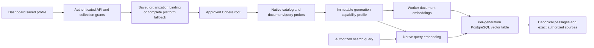

# M5a — Native Cohere embeddings

Delivered in [PR #28](https://github.com/SimonLoir/vectorix/pull/28), squash-merged as `9715138` after both CI checks passed, and verified through controlled native-wire API/dashboard journeys. The Ollama journey and zero-downtime rebuild are implemented; this slice adds Cohere through the same collection, worker, search and exact-source flow. Live Cohere validation remains pending organization test credentials. [M5b Voyage](rag-voyage-embeddings.md) is implemented with controlled dashboard acceptance complete; [M5c OpenAI](rag-openai-embeddings.md) is also implemented with controlled dashboard acceptance complete. [M5d Mistral](rag-mistral-embeddings.md) is implemented with automated validation and controlled dashboard acceptance complete.

## Configuration and capabilities

Configure a **Cohere** organization integration with base endpoint `https://api.cohere.com` and a test API key. The endpoint is the provider root, without `/v1` or `/v2`: discovery calls `/v1/models` and embeddings call `/v2/embed`. Approve this exact root in `VECTORIX_EMBEDDING_ALLOWED_ENDPOINTS` on both API and workers, unless it is their configured `VECTORIX_DEFAULT_COHERE_ENDPOINT`. Provider-specific defaults authorize only that provider's destination. Organization configuration takes precedence; a configured invalid key never falls back to the platform key. Existing revisions retain their saved credential and endpoint binding.

Alternatively, configure the complete platform fallback at container startup:

```dotenv
VECTORIX_DEFAULT_COHERE_ENDPOINT=https://api.cohere.com
VECTORIX_DEFAULT_COHERE_API_KEY=
```

Supply the secret through deployment configuration; do not commit it or include it in frontend configuration. An organization key belongs in its integration form. Discovery/probes and indexing/search can contact the paid service; begin with small synthetic documents and the provider's own usage limits.

The initial supported model catalog is intentionally explicit:

| Model                     | Dimensions                       | Declared context | Language scope                             |
| ------------------------- | -------------------------------- | ---------------- | ------------------------------------------ |
| `embed-v4.0`              | 256, 512, 1,024, 1,536 (default) | 128,000 tokens   | Multilingual                               |
| `embed-multilingual-v3.0` | 1,024                            | 512 tokens       | Multilingual, including French and English |
| `embed-english-v3.0`      | 1,024                            | 512 tokens       | English                                    |

These capabilities come from [Cohere's model documentation](https://docs.cohere.com/v2/docs/cohere-embed). Newer or differently named models are not automatically executable. A model appearing in discovery is not proof of successful embedding; verification probes document and query roles and checks actual vector dimensions before a generation is accepted. The UI identifies hosted catalog discovery separately from installed Ollama models. [Native model listing](https://docs.cohere.com/v2/reference/list-models) uses bounded results and filters the supported catalog.

Document requests use `search_document`; queries use `search_query`. The adapter requests float vectors, `truncate: "NONE"` and the selected supported output size, with bounded batches and responses. Overlong inputs fail explicitly. The native roles supply retrieval semantics; use the **Generic** preset, without EmbeddingGemma prompts. Optional preparation remains a literal shared prefix. The input byte ceiling is conservative and does not promise the full declared model context. These request semantics follow [the native Embed API](https://docs.cohere.com/v2/reference/embed).

## Identity and retained generations

Ollama generations retain their schema-version-1 snapshot and native manifest digest. Cohere generations use a separate schema-version-2 capability profile. Its fingerprint records the supported model/configuration contract; it is **not a hosted weight digest** and cannot detect an undisclosed provider weight change. The compatible V1 `digest` field remains an identity alias; new optional `identityKind` and `discoverySource` fields let consumers label it accurately. Indexing/search match provider, canonical model, dimensions, preset and saved fingerprint together.



Saving a Cohere draft does not change an active Ollama generation. Use **Review and rebuild** to compare both profiles and accept the new generation. Keep the old model and endpoint available through activation and retained cleanup. The compound grants, snapshot/catch-up, quota accounting, failure/discard and source retention rules remain those in [M4](rag-index-rebuild.md).

## Dashboard acceptance recipe

1. Configure the organization integration and exact endpoint approval on API/workers. Upload a small French/English Markdown or text PDF, wait for extraction, and attach it to a collection.
2. Choose **Cohere**, `embed-v4.0`, **Generic**, 256 dimensions and document-structure chunking. Save, discover the supported hosted model and verify the saved profile. Inspect the capability fingerprint label.
3. Start initial indexing or rebuild an existing Ollama collection. Check progress, explicit failure/retry states and the active profile. During rebuild, existing searches continue using the previous provider.
4. Query in French and English using vector/hybrid search, inspect exact sources, and compare keyword-only retrieval. A keyword-only request should not call Cohere. Change dimensions through another reviewed rebuild.
5. With a synthetic invalid organization credential, verify an explicit sanitized provider failure and no platform fallback. Restore it and retry eligible work. Verify organization/collection reading boundaries still apply.

## Validation status

The October 22, 2026 browser run used production web/API/workers, real PostgreSQL/vector/Redis/private RustFS infrastructure and the original real CPU Ollama/EmbeddingGemma setup from [the reproduction guide](rag-ollama-embeddinggemma.md). **Cohere itself was a controlled loopback HTTP fixture**, accepting the native catalog/embed protocol and returning deterministic synthetic vectors. No paid endpoint or key was contacted, and these results do not establish hosted availability, embedding quality or production latency.

- A real Ollama 256-dimensional generation indexed one bilingual Markdown into two passages. Switching the unsaved provider selected Cohere's supported local catalog, compatible dimensions and Generic preset without making a provider request. Saved discovery listed the three reviewed models; choosing multilingual v3 constrained dimensions to 1,024 and hid stale discovery results. Cancel preserved the saved v4/512 profile.
- The saved Cohere probe checked both retrieval roles and displayed a capability-profile fingerprint with the hosted-weight limitation. While only indexing was paused, rebuild acceptance retained the serving Ollama generation and an actual French hybrid query/source still worked. Resuming real workers activated the 512-dimensional Cohere generation. The previously captured Ollama source reopened/downloaded after activation with matching SHA-256.
- New French hybrid and English vector searches used the Cohere generation and returned exact authorized Markdown sources. Before/after fixture counters were identical across keyword-only search, proving no embedding request. A newly selected invalid synthetic credential caused an explicit provider rejection for a new collection; the existing active collection kept its original saved credential and remained searchable. Fixture counters confirmed zero platform-fallback calls.
- English/French/Belgian Dutch model/profile/verification labels and number formatting passed. An existing provider error translated reactively when changing to French. Belgian Dutch persisted in a newly opened tab, whose console had no warnings/errors. This covers the stated flows and language switching, not every state in every language.

Automated validation passed: 49 controlled HTTP embedding tests (21 legacy Ollama, 28 Cohere), 101 disposable core/RAG integration tests, 23 workspace type checks, 23 lint tasks with non-blocking warnings, 23 backend regressions, four production application builds and six-image runtime/infrastructure checks. The final API/workers bundles were rebuilt after the reviewed catalog compatibility hardening. Fresh/upgrade/repeat migration and schema parity checks still use the existing seven migrations; M5a adds none. Catalog tests cover all four v4 dimensions, native roles/truncation, saved and invalid credentials, endpoint approval, authorization, revision races, exact sources and failed/retried cross-provider rebuilds. Independent review found no remaining P1/P2 blocker.

Catalog metadata is bounded but optional fields may be absent/null. Unknown/unnamed or explicitly non-embedding entries are skipped; a reviewed named model with omitted optional endpoint metadata may rely on the fixed native `endpoint=embed` query. Actual document/query probes remain required. Controlled regressions cover incomplete unrelated entries and malformed non-null metadata; an incomplete provider entry cannot invent model readiness.

No live Cohere key is available in this session; the user will configure organization credentials later. Live-provider acceptance remains pending. Reference-corpus relevance, full context/chunking combinations and operational/capacity acceptance remain later milestones.

Temporary product/provider processes, owned infrastructure containers and browser tabs were removed after acceptance; the named Ollama model volume was retained. No application database was used.
