# Collection setup and compact dashboard

This change implements the collection-creation experience requested in issue #86 and makes collection pages shorter. Application checks and the complete create/index/search/edit/rebuild dashboard journey pass at source checkpoint 205bce1. Final environment cleanup is complete. The pull request records delivery and exact-head CI status. Earlier provider and indexing guides retain their own historical results.

## Three focused steps

Open **Collections → Create collection**. The dialog keeps its title, progress navigation and action footer visible while its content scrolls inside the viewport.

1. **Details:** enter the name and optional description, and choose the explicit creator read grant.
2. **Profile:** new collections start in **Simple** mode. Choose a provider and reviewed local model configuration, then inspect its recommended dimensions, index, preset and chunking summary. Optional technical details expand on demand. **Advanced** exposes separate Embedding, Chunking and Metadata sections.
3. **Review:** inspect the complete applicable configuration, then save once. The normal create or optimistic-revision update operation persists the profile. Navigating between steps and sections does not save or call an embedding provider.

The editor holds one controlled draft independently of mounted fields. Switching sections or stepping back preserves unsaved values. Existing custom or unsupported profiles open in Advanced mode with their saved values; opening the form must not reinterpret a historical Generic profile as the EmbeddingGemma retrieval preset. Simple/Advanced and step selection are local UI preferences and are not persisted in the collection or API.

```mermaid
flowchart LR
    DETAILS["Details and explicit read grant"] --> PROFILE["Simple profile with reviewed local choices"]
    PROFILE --> ADVANCED["Optional Advanced sections"]
    ADVANCED --> PROFILE
    PROFILE --> REVIEW["Review the complete draft"]
    ADVANCED --> REVIEW
    REVIEW --> SAVE["One existing create or revision-checked update"]
    SAVE --> BINDING["Saved provider binding and profile revision"]
    BINDING --> VERIFY["Discover and verify the saved profile"]
    VERIFY --> INDEX["Index or review a rebuild"]
    INDEX --> SEARCH["Search and inspect exact sources"]
```

## Reviewed choices and dimensions

The browser imports the dependency-free [@repo/embeddings/profiles](../packages/embeddings/src/profiles.ts) subpath. Its recommendations share the [reviewed-models.ts](../packages/embeddings/src/reviewed-models.ts) policy with native adapters. The browser does not import the Node-only embeddings package root.

| Provider | Local model choice                            | Recommended dimensions | Recommended preset |
| -------- | --------------------------------------------- | ---------------------- | ------------------ |
| Ollama   | embeddinggemma or embeddinggemma:latest       | 768                    | EMBEDDING_GEMMA    |
| OpenAI   | text-embedding-3-small                        | 1,536                  | GENERIC            |
| OpenAI   | text-embedding-3-large                        | 3,072                  | GENERIC            |
| Mistral  | mistral-embed or mistral-embed-2312           | 1,024                  | GENERIC            |
| Cohere   | embed-v4.0                                    | 1,536                  | GENERIC            |
| Cohere   | embed-english-v3.0 or embed-multilingual-v3.0 | 1,024                  | GENERIC            |
| Voyage   | voyage-4, voyage-4-lite or voyage-4-large     | 1,024                  | GENERIC            |

Recommendations use cosine similarity, float32 vectors and DiskANN. In particular, the natural 3,072-dimensional OpenAI large configuration must not be silently shortened to fit HNSW. Float32 HNSW admits at most 2,000 dimensions; Advanced mode can explicitly select it with a compatible size. Reviewed OpenAI shortening ranges, finite Cohere/Voyage sizes and fixed Mistral dimensions remain authoritative for their respective choices.

Ollama's two EmbeddingGemma names are explicit local recommendations, not a static capability catalog or a weight identity. The selected server must actually host a compatible model. Its retrieval preset prepares document and query inputs differently; it is never inferred later from an arbitrary model name or applied to hosted providers. Existing collection revisions retain their saved preset.

The initial chunking recommendation remains document structure, target 512, overlap 64, minimum 128 and maximum 768 estimated tokens. Parent context is off, with a retained size setting of 2,048; the retained semantic percentile is 90. Advanced mode can change these settings. Token estimates are not the model's native tokenizer and do not replace the verified prepared-byte limit.

These are local product choices. Listing or selecting them sends no provider request and verifies neither credentials nor model availability. A newly created collection must first have a saved provider binding before the existing model discovery and **Verify saved model** operations can use that binding and revision. Those operations may call the provider. Organization configuration still precedes platform defaults, invalid configured credentials never silently fall back, and existing revisions retain their recorded binding.

Provider setup and native verification remain documented in [Ollama/EmbeddingGemma](rag-ollama-embeddinggemma.md), [Cohere](rag-cohere-embeddings.md), [Voyage](rag-voyage-embeddings.md), [OpenAI](rag-openai-embeddings.md) and [Mistral](rag-mistral-embeddings.md). Saving this editor does not establish any live provider result.

## Advanced settings and intentional replacement

Advanced mode separates embedding configuration, chunking and declared metadata rather than stacking every control in one form.

- **Embedding:** dimensions, index, preset and literal preparation. A saved profile can also use discovery tied to its saved provider, model and revision.
- **Chunking:** strategy and size bounds. The semantic threshold and work explanation appear for semantic chunking; the parent-size control appears when parent context is enabled.
- **Metadata:** bounded typed keys with duplicate/key-format validation.

Changing a provider/model or returning a customized draft to Simple mode can replace dimensions, preset, chunking and other settings. The editor must show the actual old/new differences and require confirmation before that replacement. **Keep my settings** cancels it. Confirming changes only the unsaved draft; final review and Save are still required. Unsupported saved models remain visible in Advanced mode instead of silently becoming the first catalog entry.

Client validation uses finite localized errors for metadata keys, model dimensions, HNSW bounds, presets and chunk-size relations. It directs the user to the relevant step/section. The server remains authoritative for permissions, provider compatibility, quotas, current revision and transactions. An in-progress or unfinished generation continues to lock profile changes as before.

No API contract, database model or migration is added. Simple mode submits the same complete profile shape as Advanced mode. Existing profile updates still create a draft revision; an active generation continues serving its own saved configuration until an explicit, reviewed rebuild publishes the replacement.

## Compact collection navigation and color

The shared catalog header and collection cards use the dashboard's blue primary color and teal accents in light and dark themes. Text, icons, borders and focus styling communicate actions and sections alongside color. The [dashboard layout](../apps/web/app/dashboard/layout.tsx) places the dashboard scope marker on the shared sidebar wrapper. Dashboard CSS sets tokens on the body while that marker exists, so body-mounted dialog portals inherit the same palette; the existing class-based theme on the HTML element selects the dark overrides. Leaving the dashboard removes this scope.

The collection list has separate **Active collections** and **Deleted collections** views. The deleted list is mounted only when selected; its existing server filters, pagination, cleanup inspection and operation guards remain intact. The active query is disabled while viewing deleted collections.

| Collection tab    | Content                                                                                                                |
| ----------------- | ---------------------------------------------------------------------------------------------------------------------- |
| Overview          | Model/provider, chunking, dimensions and saved revision; the full configuration and binding receipts expand on demand. |
| Indexing & search | Existing index controls, documents, chunks and search playground.                                                      |
| Access            | Existing member/group grants, visible only with the same administration and operation permissions.                     |
| History           | Existing saved-revision history.                                                                                       |

Detail panels remain mounted while hidden, preserving their current query and interaction state when switching tabs. Tab visibility does not grant content access; existing server authorization remains unchanged.

## Appearance

Open the sun/moon **Appearance** menu at the top right of the web dashboard and choose **Light**, **Dark** or **System**. System is the default and follows the device's color preference. On small screens the button shows only the icon and retains its localized accessible label; the menu keeps text labels and a checked radio choice.

The existing next-themes provider saves this choice in local browser storage for the current origin. It survives reloads in that browser; it is not an account or organization preference and does not synchronize to another origin or the administration application. The administration application's existing dark presentation is unchanged.

The shared [ThemeSwitcher](../packages/dashboard-core/src/components/theme-switcher.tsx) accepts explicit labels and uses the existing theme-provider API. The web [localized wrapper](../apps/web/components/theme-switcher.tsx) supplies EN/FR/nl-BE messages, and the [dashboard layout](../apps/web/app/dashboard/layout.tsx) places it beside notifications. Its constant trigger and initially closed radio menu avoid theme-dependent server markup.

## Compact document workspace

A document keeps its identity, extraction status, diagnostic and original-download action above three focused views. **Source** shows the currently published TXT/Markdown preview or PDF/DOCX source navigator. **Versions** contains the existing replacement, deletion, retention and version history workspace. **Collections** contains the existing attachment controls.

Versions and Collections retain their current management and operation guards. A reader is not granted management access by a tab, and a permission loss returns an inaccessible selected view to Source. Panels remain mounted while hidden to preserve paging, source navigation, mutation feedback and confirmation state. A failed replacement continues to expose the previously published source, using the existing version and preview guards.

Text previews are limited to 50% of the dynamic viewport height and scroll internally; their existing 20,000-character page limit and server pagination are unchanged. The normal original-download action remains available to authorized users, but acceptance automation transfers files through curl only.

## Code map

- [collection-form.tsx](../apps/web/components/rag/collections/collection-form.tsx) owns step navigation, controlled identity fields, draft review and the single catalog mutation. [collection-editor-chrome.tsx](../apps/web/components/rag/collections/collection-editor-chrome.tsx) and [collection-editor-profile.tsx](../apps/web/components/rag/collections/collection-editor-profile.tsx) render progress, focused fields, profile panels, review and the footer without taking ownership of draft state.
- [profile-draft.ts](../apps/web/components/rag/collections/profile-draft.ts) owns draft creation, recommendation comparison and public-profile validation. [profile-fields.tsx](../apps/web/components/rag/collections/profile-fields.tsx), [embedding-fields.tsx](../apps/web/components/rag/collections/embedding-fields.tsx) and [metadata-fields.tsx](../apps/web/components/rag/collections/metadata-fields.tsx) render focused controls.
- [profile-draft-summary.tsx](../apps/web/components/rag/collections/profile-draft-summary.tsx) and [profile-reset-dialog.tsx](../apps/web/components/rag/collections/profile-reset-dialog.tsx) show draft summaries and explicit replacements.
- [collections-manager.tsx](../apps/web/components/rag/collections/collections-manager.tsx), [collection-detail.tsx](../apps/web/components/rag/collections/collection-detail.tsx) and [collection-overview.tsx](../apps/web/components/rag/collections/collection-overview.tsx) provide list views, tabbed navigation and saved-profile inspection.
- [document-detail.tsx](../apps/web/components/rag/documents/document-detail.tsx) composes guarded document tabs; [document-preview.tsx](../apps/web/components/rag/documents/document-preview.tsx) and [document-sources.tsx](../apps/web/components/rag/documents/document-sources.tsx) bound the extracted-text viewport without changing source pagination.
- [dashboard/layout.tsx](../apps/web/app/dashboard/layout.tsx) forwards the dashboard scope marker through SidebarProvider to its DOM wrapper; [catalog-page.tsx](../apps/web/components/rag/catalog-page.tsx) and [dashboard.css](../apps/web/app/dashboard.css) share the scoped visual treatment. Existing UI primitives retain keyboard and dialog behavior.
- The rag.editor namespace, collection-navigation labels and rag.documents.workspace labels in [en.json](../apps/web/messages/en.json), [fr.json](../apps/web/messages/fr.json) and [nl-BE.json](../apps/web/messages/nl-BE.json) localize complete messages and ICU values.

## Dashboard acceptance recipe

### Prerequisites

Use production application builds and owned disposable application/vector PostgreSQL, Redis and private S3 stores. Use an ordinary owner in a synthetic organization with normal collection, library and indexing permissions. Configure a compatible, allowed embedding endpoint and enough passage/storage quota for one document and one rebuild. Record whether the provider is a deterministic native-protocol fixture or a real provider/model; a fixture cannot establish live model availability or retrieval quality.

Prepare a small text-based document with known passages. Transfer files through native HTTP with curl, using an authorized least-privilege API key where supported and a native session for session-restricted operations. Do not upload or download files through browser automation, broaden key permissions or use direct database writes to make the recipe pass.

### Create, index and search

1. Open Collections and Create collection. At the desktop viewport and a narrow mobile viewport, check that the dialog fits and its content scrolls while navigation/actions remain reachable.
2. Enter a name in Details. In Profile, leave Simple selected, choose the configured provider/model and inspect dimensions, DiskANN, preset and default chunking. For OpenAI large, explicitly check 3,072 dimensions; for EmbeddingGemma, check its retrieval preset.
3. Move back and forward with pointer and keyboard. Name and model must remain unchanged. Review and save; reload the collection and inspect the saved values in Overview and its expandable configuration.
4. Transfer the document with curl, wait for extraction and attach it through the normal dashboard journey. Open Indexing & search, discover/verify the saved model and start initial indexing. Wait for an active generation.
5. Search for a known passage, inspect its source and record the serving generation. A configuration save or mocked-provider check alone does not complete this journey.

### Customize, confirm and rebuild

1. Edit the profile, select Advanced and open Chunking. Change target size from 512 to 384, keeping other default sizes consistent. Switch to Embedding and Metadata, then back to Chunking; 384 must remain.
2. Choose Simple or another reviewed model. Inspect the before/after confirmation. Cancel once and confirm that 384 survives; repeat and explicitly confirm the recommended replacement. Return to Advanced, set 384 again, review and save.
3. Reload and confirm that the customized profile opens in Advanced with 384 intact. The old generation must continue serving searches until a rebuild is reviewed and started.
4. Use **Review and rebuild**, inspect both saved profiles, start the rebuild and wait for activation. Search again and inspect the exact source.
5. Inspect Access and History, switch back to Indexing & search and confirm navigation did not discard local state. Check active/deleted collection views and permission/error states.
6. Repeat representative create/edit/confirmation/error labels in English, French and Belgian Dutch; inspect localized numbers and plurals, tab keyboard navigation, focus movement, Escape and long-content scrolling. Check light/dark presentation and the browser console.

### Document views

Using the same curl-uploaded document, open its detail page and verify Source, Versions and Collections separately. The file name, status and original action must remain visible above the tabs. Attach from Collections, return to Source and confirm that the text remains readable inside its bounded scroll region. Navigate with keyboard arrows between tab triggers, inspect a source/preview page, switch away and back, and confirm local navigation is retained. Check Versions for the existing retention and replacement controls without executing a destructive action solely for presentation testing. Repeat a representative narrow-viewport and localized view. A long document must not push the other workspaces below the entire extracted text.

### Actual results

The collection-redesign results below were executed at source checkpoint 205bce1 on October 25, 2026, before the Appearance control was added, with production builds, an ordinary synthetic organization and owned disposable stores. Embeddings used the real local Ollama EmbeddingGemma server, with verified manifest digest 85462619ee721b466c5927d109d4cb765861907d5417b9109caebc4e614679f1, matching the [reproduction guide](rag-ollama-embeddinggemma.md).

| Journey                      | Observed result                                                                                                                                                                                                                                                                                                                                                                                                                      |
| ---------------------------- | ------------------------------------------------------------------------------------------------------------------------------------------------------------------------------------------------------------------------------------------------------------------------------------------------------------------------------------------------------------------------------------------------------------------------------------ |
| Simple creation              | Mouse and keyboard Continue actions stayed on Review until explicit Create. Revision 1 retained embeddinggemma:latest, 768 dimensions, DiskANN and the EmbeddingGemma retrieval preset.                                                                                                                                                                                                                                              |
| Document workspace           | A 2,048-byte TXT uploaded through native curl became READY. Source/Versions/Collections tabs worked with keyboard arrows; attachment succeeded and Source retained its published text. The preview scrolled internally at an observed 360-pixel maximum, matching 50dvh.                                                                                                                                                             |
| Initial search               | Generation G1 became ACTIVE with one document and one chunk. Dashboard hybrid search returned the expected passage and its exact source; three scoped key/curl reads confirmed the original bytes.                                                                                                                                                                                                                                   |
| Advanced edit and rebuild    | Target 512→384 survived section changes. Semantic and parent controls appeared conditionally. Canceling Simple reset kept 384; confirming applied 512. A model-change cancellation retained Ollama/384. Explicit review saved revision 2; reload reopened Advanced with 384 while G1 still served. Reviewed rebuild G2 activated revision 2, followed by a successful dashboard hybrid search and exact-source/original-byte checks. |
| Locales, keyboard and mobile | EN/FR/nl-BE editor and reset messages, a French name error and tab keyboard navigation were checked. At 390×844, the dialog measured 358×812 at position 16,16; actions remained reachable with no horizontal overflow.                                                                                                                                                                                                              |
| Palette and exit             | Dark dashboard primary was #2f6fed with one scope marker. Authentication had no marker and retained its neutral palette before and after normal French logout. The browser reported zero warnings/errors; its owned tab was closed and viewport reset.                                                                                                                                                                               |

The two observed hybrid requests took 127 and 188 milliseconds; these are individual functional observations, not a performance benchmark. The six scoped key/curl reads across both generations confirmed the 2,048-byte original, SHA-256 ec7e2086bed47651af1bdd76a1f8d22678db13fbda17e7c5b5ead04083cd74cf. No browser file transfer occurred.

Two earlier incomplete browser attempts exposed and corrected real UI defects: a missing dashboard scope marker left the palette neutral, and a Continue action's native submit behavior could bypass the required review. Those attempts were cleaned up. The final run repeated the affected navigation with mouse and keyboard before completing indexing, rebuild and search.

Validation passes 25 workspace type checks, 25 lint tasks, root unit checks including 151 embedding cases, nine draft cases, and four production builds. Web types, lint and production build passed again after the two browser fixes. The offline guard and final source checks pass after restoring ordinary public fixture modes (0755 directories/0644 files); fixture content and source pins are unchanged. Documentation formatting, local links, Mermaid and locale/ICU checks pass separately.

Limits: no hosted-provider calls or paid credentials were used. OpenAI large's 3,072-dimensional choice was inspected locally in the final French editor; the Mistral 1,024-dimensional choice was inspected in the first attempt. In that 205bce1 run, light mode was not browser-verified; only selected palette contrast pairs were calculated at 4.5:1 or higher, which is not a complete accessibility audit. Current UI permission-revocation transitions were reviewed in source rather than exercised in this browser run. Full catalog and Docker suites were not rerun locally for this UI change; the pull request records the required catalog/image CI results. Final cleanup confirmed all three application processes and five owned containers absent and removed the four fresh volumes; the existing Ollama model cache and private test captures were retained, and helper gates were restored. Normal logout was observed; no separate zero-session database assertion is claimed.

### Appearance follow-up validation

The production web journey passes at source checkpoint f25045e on October 25, 2026, in a fresh synthetic organization and disposable environment. The administration application remains unchanged.

| Check                         | Observed result                                                                                                                                                                                                                                        |
| ----------------------------- | ------------------------------------------------------------------------------------------------------------------------------------------------------------------------------------------------------------------------------------------------------ |
| Manual choice and persistence | French Appearance offered Light/Dark/System radio choices. Light applied the HTML light class, primary #245bd4 and background #f5f8fc; Dark applied the dark class and primary #2f6fed. Each choice, including System, remained selected after reload. |
| Keyboard and small screens    | Home focused Light and Enter selected it. At 390×844, the icon-only trigger retained its accessible label, the menu remained usable and no horizontal overflow appeared.                                                                               |
| Application view and exit     | The collection editor's Review step was inspected in Light. The browser console had zero warnings/errors, followed by normal French logout, owned-tab closure and viewport restoration.                                                                |

French labels were exercised in the browser; the four English and Belgian Dutch labels were checked statically. An operating-system theme change was not simulated. The earlier 205bce1 light-mode limitation remains a historical result, separate from this successful manual Light check.

Frozen installation, shared dashboard-core/web types and lint, root units and the web production build pass. An initial lint fallback-style failure was corrected before the passing checks. API/workers code was unchanged and their existing runtime artifacts were reused; no new backend build is claimed. Final cleanup confirmed three application processes, five owned containers and four fresh volumes absent, with the existing model cache unchanged, private captures retained and helper gates restored. Exact-head CI and delivery status are recorded in the pull request.

### Audit journal verification

No audit product code changed in this follow-up. A normal dashboard collection creation followed by a name-only rename produced two journal rows: update before create, with the expected user actor, collection target and configuration revision 1. The case-insensitive action filter COLLECTION retained both rows; an absent-action filter returned none, and clearing it restored both. With only two rows, both UI pagination buttons were correctly disabled.

A separate session-authenticated native HTTP check used limit 1 with offsets 0 and 1 to establish distinct, correctly ordered pages with total 2, exact actor/target/details and an empty unmatched filter. Its normal finalizer signed out. Nine existing offline guard/error cases pass. This does not claim multi-page button navigation, role changes, permission revocation or cross-organization browser coverage; PostgreSQL isolation/permission integration tests were not repeated locally and remain part of PR CI.

The [audit list](../apps/web/components/rag/audit-list.tsx) uses the shared [catalog pagination](../apps/web/components/rag/catalog-controls.tsx). The existing [audit route](../packages/routers/rag/src/audit.ts) applies organization filtering and stable descending date/ID ordering after the session-only audit-read guard in [access.ts](../packages/routers/rag/src/services/access.ts). The [page shell](../apps/web/app/dashboard/settings/audit/page.tsx) retains its operation check.
