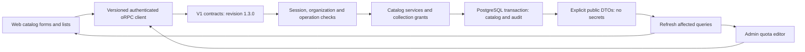

# Catalog dashboard — M1

M1 exposes the existing RAG catalog as usable web and administration workflows. It stores configuration and permissions; it does not upload documents, call embedding providers, build vector tables, or offer search. Those actions were outside M1. The [document library](rag-document-library.md), [rich extraction](rag-rich-documents.md) and [M3 indexing/search journey](rag-first-search.md) are now implemented; [M4 profile changes/rebuilds](rag-index-rebuild.md) have a separate implementation and acceptance record. [M5a native Cohere](rag-cohere-embeddings.md) is implemented with controlled dashboard acceptance complete; [M5b native Voyage](rag-voyage-embeddings.md) is implemented with controlled dashboard acceptance complete. Live paid-provider verification, OpenAI/Mistral and M6/M7 remain in the [delivery plan](rag-implementation-plan.md#9-dashboard-testable-delivery-milestones).

## Entry points

| Surface | Route                                                      | Workflow                                                                                                                                                                 |
| ------- | ---------------------------------------------------------- | ------------------------------------------------------------------------------------------------------------------------------------------------------------------------ |
| Web     | `/dashboard/settings/integrations`                         | Create and edit S3, Ollama, Cohere, Voyage, OpenAI, or Mistral credentials; select an active configuration; retain blank edit secrets; delete only unreferenced entries. |
| Web     | `/dashboard/collections` and `/dashboard/collections/{id}` | Create, inspect, revise, or delete a collection; inspect saved profiles and history; manage member/group grants.                                                         |
| Web     | `/dashboard/settings/groups`                               | Create, rename, or delete groups; add and remove organization members.                                                                                                   |
| Web     | `/dashboard/account/api-keys`                              | Configure explicit collection scopes intersected with the key permissions and issuer's effective access.                                                                 |
| Web     | `/dashboard/settings/usage`                                | Read recorded usage and effective quota policies.                                                                                                                        |
| Web     | `/dashboard/settings/audit`                                | Inspect filtered, paginated catalog events without secrets.                                                                                                              |
| Admin   | `/organizations/{id}`, **RAG quotas** tab                  | Read deployment defaults or organization overrides and edit collection, document, original-size, storage, active-passage and temporary-passage limits.                   |

Use the normal account/organization setup in [README](../README.md#local-development). A superadmin account is required for the admin panel. Creating a collection requires an available organization or environment configuration for its embedding provider. Saving configuration does not verify provider connectivity or model availability.

Catalog screens, page headings, dashboard navigation, home cards, and API-key scope controls use `next-intl` messages in English, French, and Belgian Dutch. Counts use ICU plurals and numbers follow the selected locale. The admin quota editor, organization tabs, and navigation use the same languages and a language selector. Both applications share cookie/header locale resolution from `packages/dashboard-core/src/i18n/locale.ts`. M3 also localized the core admin workflows. The historical M1 results below cover only the catalog journey; later milestones record their own locale and error-state checks.

## Interaction and access rules

Lists and principal selectors use server-side filters and pages of 25 records. Page shells wait for the current organization's permissions before mounting private queries. Mutation dialogs retain errors, disable duplicate submission, and invalidate affected query variants after success. Shared dialogs bound their height and scroll internally. Collection forms preserve optimistic revision checks; history is immutable configuration, not evidence of a built index.

Organization credentials take precedence over deployment defaults only for new bindings. A collection retains its recorded credential binding. Invalid configured credentials never silently fall back. Secret edit fields start empty; leaving them empty preserves the stored secret. Ollama key removal is an explicit choice. Changing an unreferenced credential's service URL (or an S3 bucket) makes the dialog require every secret again, because the stored secret would otherwise be sent to a destination its editor never authorized; the API enforces the same rule. Referenced destinations cannot be edited or deleted in ways that break retained profiles or files.

Catalog administration and content reading are separate. Global catalog managers can manage metadata; a member with an explicit administration or document-management grant can inspect the relevant metadata when their organization permissions also allow it. Content reading still requires explicit read access. API keys cannot use session-only principal selectors, cannot exceed their issuer's rights, and remain bound to current membership. Historical keys without an issuer binding need replacement to receive RAG scopes.

M1 introduced collection-count enforcement. The later library/indexing journeys also enforce document-count, original-size, retained-storage and active/temporary passage quotas. Capacity remains charged until physical cleanup is acknowledged. Reducing a quota does not delete existing records. Audit writes remain in the catalog mutation transaction.

## Code map

- `apps/web/components/rag/catalog-page.tsx`, `catalog-controls.tsx`, `catalog-action.tsx`, `catalog-dialog.tsx`, and `principal-picker.tsx` provide shared access/loading/error, pagination, mutations, dialogs, and principal selection. Feature components are split under `collections/`, `credentials/`, and `groups/` and mounted by the page shells under `apps/web/app/dashboard/`.
- `apps/web/app/dashboard/account/api-keys/components/collection-scope-editor.tsx` extends the existing key-permission dialog. `apps/admin/src/components/organization-rag-quota.tsx` extends the organization workspace.
- `packages/api-contracts/src/v1/rag/` adds bounded history and principal reads; `v1/superadmin/rag-quota.ts` adds effective quota reads. `packages/api/src/versioning.ts` advertises compatible revision 1.3.0 through the existing global major registry.
- `packages/routers/rag/src/services/principals.ts`, `collection-view.ts`, and `access.ts` own scoped selection, public profile projection, and metadata/content access. Individual handler files remain composed in the router index.
- `packages/routers/superadmin/src/get-rag-quota.ts` and `set-rag-quota.ts` share effective policy resolution through `@routers/rag/quotas`.
- `apps/api/src/api-versioning/runtime.ts` uses oRPC's Zod 4 coercion adapter for REST query parameters. RPC still uses the typed contract. Numeric REST pagination and invalid bounds are covered by catalog integration tests.

## Browser acceptance

Executed on October 21, 2026 using production application builds, disposable PostgreSQL/Redis, two synthetic organizations (Atlas Lab and Orbit Lab), and owner/reader accounts. The web server used Next.js standalone output. No application database or real provider credentials were used.

| Journey                                                                              | Observed result                                                                                                                    |
| ------------------------------------------------------------------------------------ | ---------------------------------------------------------------------------------------------------------------------------------- |
| Create an active Ollama credential, reopen and rename it with a blank secret field   | Persisted revision 2; secret remained masked; connection explicitly marked unverified.                                             |
| Create a collection, enable parent/child mode, change dimensions, reload             | Saved 768 then 1,024 dimensions; two profile revisions remained visible with their binding.                                        |
| Create a group, add the reader, grant collection read access                         | Reader saw the collection; configuration navigation was hidden and the direct integrations URL was denied.                         |
| Remove the group grant and sign in as the reader again                               | Collection disappeared; its direct URL returned an explicit not-found state with retry.                                            |
| Switch the owner to the second organization                                          | Empty collection list; the first organization's direct collection URL was denied.                                                  |
| Create a key with collection-read permission and one explicit scope                  | The key list showed one authorized collection; API integration tests additionally verify key use, isolation, and revocation.       |
| Set collection quota to one in admin, inspect web usage, attempt a second collection | Admin showed an organization override; web showed 1/1 and rejected creation without losing the form.                               |
| Inspect catalog audit and try deleting referenced credentials                        | Audit included configuration, group, scope, and quota events; credential deletion was rejected with its retained-reference reason. |

Automated validation also passes types, lint (existing warnings), 22 backend tests, four application builds, and 24 catalog/core HTTP tests. The isolated catalog command verifies fresh migrations, upgrade preservation, repeat deployment, and schema parity. `apps/api/src/rag-tests/dashboard.ts` covers sanitized history, bounded same-organization principals, session restrictions, grant-only metadata access, and superadmin quota reads. The original M1 dashboard did not require a migration; the subsequent OpenAI/Mistral provider expansion adds credential tables and enum values. The final production build also verifies translated RAG permission labels and the key dialog: it fits within a 720-pixel-high viewport, scrolls internally, and closes with Escape.

These checks do not demonstrate live S3, Ollama, Cohere, Voyage, OpenAI, or Mistral connectivity. The six-image Docker suite remains configured for PR CI and was not rerun locally for this UI/API change. Future milestones must extend this browser recipe with their real document and processing flows.

The localization follow-up was verified in English, French, and Belgian Dutch on standalone web/admin builds against a fresh disposable database. Switching language updates navigation, page headings, form labels, confirmations, and notifications; numbers, dates, and group plurals follow the selected locale. Collection creation and admin quota updates persist after reload, as does the language preference. Credential and API-key scope dialogs were also inspected. Neither browser console reported warnings or errors. Types, lint, 22 backend tests, all four builds, message-key parity, and ICU formatting were rerun successfully for this follow-up; the catalog integration and Docker suites were not repeated because backend behavior and containers are unchanged.

The OpenAI/Mistral follow-up adds both providers to integration and profile selectors. Browser acceptance created both integrations with synthetic keys and their standard base endpoints, reloaded the list, renamed OpenAI without replacing its secret, and saved collections using `text-embedding-3-small` with 1,536 dimensions and `mistral-embed` with 1,024 dimensions. Both profiles retained organization credential bindings; the Mistral detail survived reload. The browser console was clear. The updated integration suite passes 26 tests, including encryption, rotation, isolation, fallback, retained bindings, and the 1.3.0 contract metadata. These checks establish catalog configuration only; they do not validate the keys or call live embedding APIs.
