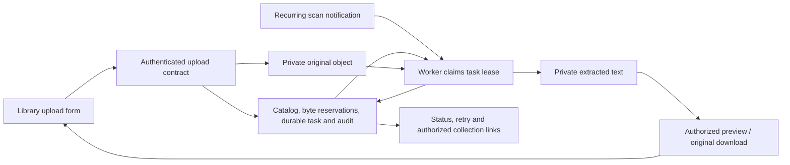

# Document library — M2a.1

M2a.1 implements a first dashboard journey for TXT/Markdown: private original upload, durable extraction, plain-text preview, authenticated download, and collection associations. The [M2a.2 lifecycle](rag-document-lifecycle.md) adds replacement and deletion/retention controls; it is implemented and browser-verified. PDF/DOCX remain M2b. No embeddings or vector tables are created by this journey.

## Schema review

The approved additive schema adds a `DocumentIngestion` task per document version, with an organization-scoped request ID, requesting user, upload/processing status, extraction byte reservation, bounded retry count, availability time, fencing token/lease, and a sanitized error code. It also adds nullable `storedAt` and `discardedAt` timestamps to `DocumentVersion`; existing rows remain unchanged. Redis schedules scans and is not the task source of truth. No existing field or table is removed. The user approved generation and disposable database testing. Migration `20261024000000_document_ingestion` contains only the additive enum, version columns, task table, indexes and foreign key. Deploy it before the application update.

The upload API reserves original and extracted-text capacity in a serializable transaction before writing S3. The original version's bytes count as reserved storage until the object is stored or its absence/cleanup is confirmed. Incomplete uploads are reconciled by workers; stale extraction leases can be reclaimed. Extraction has a deterministic object key and publishes only with the current lease token. Quotas include retained originals and extraction reservations independently of vector storage. Terminal processing failures retain their extraction reservation because an interrupted S3 write may already exist; retry reuses it without double counting. Confirmed absent or discarded original uploads release both reservations. M2a.2 adds user-directed deletion and durable cleanup; retained bytes are released only after required storage deletes succeed. New requests require current library manager permissions; preview/download and associations reuse current library/collection access checks.

API and workers resolve S3 credentials from the storage binding, preserving organization configuration before environment defaults. Organization endpoints must be explicitly allowed by the operator; the configured platform endpoint is allowed automatically. Secrets and object keys are never returned to the browser. Preview renders text, not executable Markdown/HTML.

## Acceptance recipe

Use disposable PostgreSQL/Redis/RustFS, two organizations, and manager/reader accounts. Upload FR/EN `.txt` and `.md` files, reload while processing, inspect extracted text and download identical original bytes. Attach a document to two collections; grant and revoke reader access and check direct preview/download URLs. Exercise invalid UTF-8, empty text, quotas, idempotent requests, transient S3 failure, expired upload/processing leases, duplicate processing, and retry. Record actual results before marking this slice complete.

## Implementation entry points

- `packages/api-contracts/src/v1/rag/documents.ts` defines compatible V1 revision 1.4.0 additions. Existing document list/get DTOs remain unchanged.
- `apps/api/src/app.ts` limits multipart uploads to 26 MiB and exposes binary response headers. `packages/routers/rag/src/documents/` contains one handler per operation; `services/documents/` owns scoped transactions, retained storage bindings, previews, associations, retries and extraction.
- `packages/storage/src/index.ts` wraps S3 with an operator endpoint allowlist, fixed credentials, timeouts, bounded reads and sanitized errors. Original keys and credentials never appear in public DTOs.
- `apps/workers/src/index.ts` schedules a documents scan every five seconds using `packages/queues/src/index.ts`. `processDocumentIngestions` claims at most ten durable tasks per scan with a three-minute fenced lease. Upload leases last five minutes. Failures back off up to five minutes and stop after five attempts; a manager can explicitly retry.
- `apps/web/app/dashboard/documents/` mounts focused components in `apps/web/components/rag/documents/`; messages live in the three existing locale dictionaries. Query invalidation refreshes library, associations, quota and audit after writes.
- `scripts/test-catalog.sh` owns disposable PostgreSQL, Redis and RustFS. `apps/api/src/rag-tests/document-library.ts` exercises the real HTTP transports, object store and worker processor. It never loads the developer's `.env`.

Uploads and links are session-only manager operations. Readers and explicitly scoped API keys can list, inspect, preview and download only currently authorized documents. Downloads recheck current access after object reads. Each original version is immutable. M2a.2 readers use the highest READY version while a replacement is pending or failed; the manager lifecycle workspace shows the latest attempt separately. UTF-8 extraction verifies its SHA-256, rejects invalid encodings, NUL bytes and whitespace-only documents, normalizes line endings and stores plain text privately. It does not detect language or create source-page metadata; these remain future extraction work.

## Validation status

The approved migration passes fresh deployment, upgrade with retained document/credential fixtures, repeated deployment and Prisma schema parity on disposable databases. The HTTP/storage suite passes 35 core/RAG tests, including real private RustFS uploads and downloads, UTF-8 extraction, duplicate processing, expired leases, transient invalid S3 credentials, quota races, current access checks, API-key scopes and binding preservation.

Browser acceptance uses production web/API/worker builds and separate disposable PostgreSQL, Redis and RustFS. A manager uploaded a FR/EN Markdown fixture, reloaded its completed extraction, inspected inert HTML text, linked two collections and downloaded an original with the same SHA-256. The reader saw the authorized document without manager actions. Locale changes rendered English, French and Belgian Dutch and persisted after reload. After grant removal, the direct document URL shows a localized error with no content or download action. Invalid UTF-8 shows a sanitized failure, disables collection attachment, and can be resubmitted through the retry button. A fresh tab on the corrected build had no console warnings/errors after language switching and reload.

The six-image local Docker suite passed production runtime and infrastructure checks. A subsequent web-only correction passes the runtime timezone through the existing locale provider and avoids repeated query retries hiding access errors; its standalone rebuild/browser checks are recorded separately. These recorded results cover M2a.1. The M2a.2 implementation and its separate acceptance status are documented in [Document replacement and deletion](rag-document-lifecycle.md). No live embedding calls, vector indexing or PDF/DOCX extraction is claimed.
