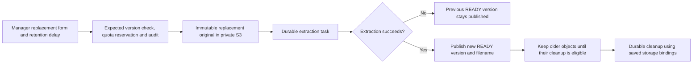
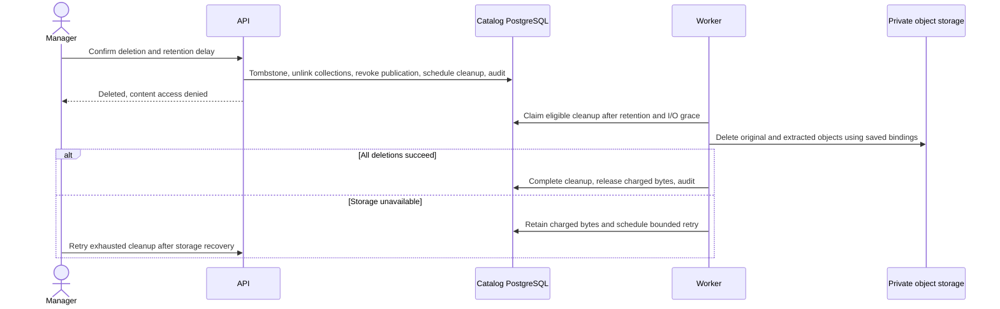

# Document replacement and deletion — M2a.2

M2a.2 adds dashboard replacement, version history, deletion, retention delays and durable private-object cleanup to the [TXT/Markdown library](rag-document-library.md). The implementation is complete and browser-verified against production application builds and disposable infrastructure. [PDF/DOCX extraction](rag-rich-documents.md) is implemented and browser-verified; the [first Ollama index/search slice](rag-first-search.md) is implemented and browser-verified.

## Schema and deployment

The user reviewed and approved the additive schema. Migration `20261025000000_document_lifecycle` adds the nullable version filename, the cleanup status enum and a `DocumentCleanup` record per version. Cleanup records retain the organization, reason, requesting actor, retention deadline, next availability, attempts, lease token/expiry, sanitized failure and completion timestamp. Existing document versions remain unchanged; their displayed filename falls back to the document name until it is saved during replacement.

Deploy this migration before updating API and workers. API additions are compatible V1 revision `1.5.0`; URLs remain `/rpc/v1` and `/api/v1`. The existing private S3 configuration and operator endpoint allowlist apply to replacement and cleanup as well as initial upload. Both API and workers need access to each retained storage destination. The worker must remain running for extraction, cleanup and quota release.

Archived version metadata, document tombstones and audit records remain after physical cleanup. Archived versions intentionally keep their storage-location and credential references for provenance; purging their objects does not make the referenced credential deletable. This milestone does not implement restoration or migration of historical storage bindings.

## Replacement and publication

A library manager selects **Replace document**, chooses another supported file of at most 25 MiB (TXT/Markdown in M2a, with [PDF/DOCX support](rag-rich-documents.md) added by M2b), and selects a whole-day retention delay from 0 through 365 days. Replacement defaults to seven days. Its deadline starts when the replacement request is accepted, rather than when extraction finishes. A subsequent replacement applies its selected delay only to versions that have not already been scheduled for cleanup; earlier cleanup schedules are preserved.

The request includes an expected latest version and an organization-scoped idempotency key. A stale dialog, concurrent replacement or attempt to start another replacement while the latest one is processing receives a conflict. Original and extraction capacity are reserved before the immutable original is written using the selected organization or platform S3 binding. A replacement does not consume another document-count slot.

The highest READY version remains published during upload, processing and failure of its replacement. Its filename, preview, original download and collection associations remain available through current permission checks. Successful extraction publishes the new version transactionally and updates the document filename. The manager version list distinguishes the latest attempt from the published version; failed current extraction can be retried without charging its reservation twice. Cleanup protects both the latest live attempt and the last published READY version, even after their retention deadlines pass.

## Deletion, retention and quota accounting

The deletion dialog confirms the document and its removal from every collection. It accepts a 0–365 day retention delay, defaulting to zero. The deadline starts when deletion is accepted. Zero means cleanup becomes eligible after active I/O safety windows; it does not promise synchronous object deletion.

A later replacement does not extend an existing version’s cleanup deadline. Deletion may accelerate pending cleanup, but never postpone its earlier deadline or revoke an in-flight cleaner’s lease. The retention setting applies to newly scheduled cleanup and cannot restore files whose deletion has already started.

One transaction tombstones the document, removes collection associations, revokes ingestion publication tokens, marks versions deleted, schedules their cleanup and writes audit. Normal list, details, preview and download operations deny access immediately, including to readers and scoped API keys. Retention preserves private objects temporarily; it does not restore content access and there is no undo or restore action. Managers can inspect retained version metadata and cleanup status through the **Deleted documents** view.

Every scan claims at most ten cleanup tasks. Each claim has a 180-second lease and fencing token. Cleanup waits until the retention deadline and any preceding ingestion lease plus a 60-second I/O grace period. S3 calls have bounded timeouts; token checks fence PostgreSQL publication and completion. A late original or extraction write that cannot publish schedules reconciliation, including recharging retained capacity if cleanup had already completed.

Cleanup deletes the original and possible extracted text from their saved storage bindings, including an extraction whose S3 write occurred before its metadata was committed. It releases capacity only after all required delete calls succeed: the original and extraction are marked discarded, version content becomes PURGED, and the ingestion reservation is zeroed in the same transaction as cleanup completion and audit. Extraction metadata now remains for immutable index provenance; discarded rows do not count toward retained bytes. Exact-version source holds defer physical cleanup while an index or bounded source read still uses the version. Partial storage failure keeps the bytes charged. Authorization for the accepted deletion or retirement remains valid after requester removal or organization suspension.

Failures use bounded backoff, capped at five minutes, and stop after five attempts. The version list displays the sanitized failure; after fixing the retained destination or credentials, a current library manager can retry cleanup. Retry preserves its retention deadline and does not release unconfirmed capacity. Restarts or duplicate scans can reclaim expired leases and repeat idempotent S3 deletes.

## Implementation entry points

- `packages/db/prisma/models/rag.prisma` and `packages/db/prisma/migrations/20261025000000_document_lifecycle/migration.sql` define the approved additive persistence.
- `packages/api-contracts/src/v1/rag/documents.ts` defines replacement, deletion, manager lifecycle/history, deleted listing and cleanup retry DTOs. `packages/api/src/versioning.ts` owns revision `1.5.0`.
- `packages/routers/rag/src/documents/` contains one handler per operation. Shared `services/documents/replace.ts`, `delete.ts`, `lifecycle.ts` and `retention.ts` own current access, version checks, retention scheduling and audit.
- `services/documents/transfer.ts` and `ingestion-state.ts` share original transfer, publication fencing and failure handling. `read.ts` and `access.ts` select the current READY version and recheck access after object reads.
- `@routers/rag/cleanup` exports `processDocumentCleanups` from `services/documents/cleanup.ts`. `apps/workers/src/index.ts` invokes ingestion then cleanup on the existing five-second document scheduler; PostgreSQL remains the source of truth.
- `apps/web/components/rag/documents/` splits the lifecycle workspace, replacement/deletion dialogs, retention input and bounded version list into focused components. The existing document list exposes the manager deleted view. User-facing messages use all three locale dictionaries.
- `apps/api/src/rag-tests/document-lifecycle.ts` extends the real PostgreSQL/RustFS HTTP journey suite. `scripts/test-catalog.sh` owns its isolated databases and services.

## Dashboard acceptance recipe

Prerequisites: production web/API/worker builds, disposable PostgreSQL/Redis/private RustFS, a library manager, a collection reader and a second organization. Do not use application data.

1. Upload a FR/EN TXT/Markdown file, wait for READY and attach it to two collections. Grant the reader access to one collection.
2. Replace it with a distinguishable filename and content. Set seven days of retention, reload, and verify the previous original and preview remain readable until the replacement becomes READY. Then verify the replacement filename/content, preserved collection associations and both version records.
3. Submit invalid UTF-8 as another replacement. Verify the explicit failure and extraction retry while the previous publication remains readable. Submit a valid replacement and inspect the resulting publication and cleanup schedules.
4. Delete the document with a short or zero delay. Verify the confirmation, immediate reader/direct-URL denial, removal from normal lists, and manager access to retained metadata in the deleted view. Verify there is no restore action.
5. Observe cleanup pending, processing and complete, and confirm retained storage usage drops only after objects are removed. Use a future deadline to verify retention prevents early removal. For deterministic backend checks, advance only fixture task deadlines rather than changing a real deployment clock.
6. Exercise unavailable S3, exhausted attempts and cleanup retry after restoring the saved credentials. Repeat processing and reclaim an expired lease; verify no double quota release. Delay a PUT across deletion and verify no publication or permanent object remains.
7. Switch English, French and Belgian Dutch, reload, and inspect localized forms, dates, statuses, permission/error states, keyboard operation and the browser console.

## Validation status

Prisma generation and validation passed. Fresh deployment, upgrade, repeated deployment and schema parity passed on disposable databases, preserving historical documents and an active ingestion task. All 19 workspace type-check and 19 lint tasks passed with non-blocking warnings, as did 22 backend regressions, 42 core/RAG integration tests and all four application builds. The integration suite includes seven lifecycle scenarios: publication and retention, failed replacement/retry, concurrent replacement conflicts and isolation, immediate deletion denial, storage failure/exhaustion/retry, expired cleanup leases with organization suspension, and a delayed PUT arriving after cleanup completion. The last case reopens cleanup, recharges capacity and removes the late object on the next successful cleanup. Backend quota assertions verify storage release and prevent double release.

Browser acceptance used production web/API/worker builds with separate disposable PostgreSQL, Redis and private RustFS. A manager uploaded a FR/EN Markdown file and attached it to one collection. With the worker paused, the manager submitted a replacement with seven-day retention; the reader continued seeing version 1 without manager actions. After resuming the worker, the reader saw version 2, and its downloaded original matched the replacement file's SHA-256. An invalid UTF-8 version 3 and its extraction retry both left version 2 published. English, French and Belgian Dutch switching was exercised, including Belgian Dutch persistence after reload; this does not claim every workflow state was exercised in every locale.

Deletion with zero-day retention preserved manager metadata and immediately denied the reader's live document URL and deleted-metadata route. Stopping RustFS produced an explicit cleanup failure. To shorten this isolated browser test, fixture attempt counters were advanced to four before the next failed attempt. Restarting the test container changed its random host port, so a temporary loopback forwarder restored the saved test endpoint. The manager retried cleanup of all three versions from the dashboard and the workers completed them. Including the subsequent cache-guard fixture, all four version cleanup records reached COMPLETE. Real S3 listing returned no remaining organization objects, database retained-original/extraction/reservation usage was zero, and the dashboard recorded zero documents and 0 MiB of storage. These fixture controls and endpoint repair are test setup, not product actions or a simulated storage success.

All six local Docker images and their infrastructure/runtime checks passed. A later web-only correction prevents a previously cached live document from rendering management controls on the deleted page: its scoped type/lint checks and standalone rebuild passed, and a second disposable document verified the warm-cache → delete → loading → tombstone browser path. The final fresh test tab had no console warnings/errors, including after the warm-cache deletion check. Nine Mermaid diagrams, local documentation links, all 80 document messages across three locales, formatting and whitespace checks passed. Temporary test tabs, web/API/workers, the S3 loopback forwarder and all three preview infrastructure containers were stopped. The tested branch is prepared for PR delivery; see the [build log](build-task-log.md). No application database was migrated, and no live embedding or PDF/DOCX check is claimed.
