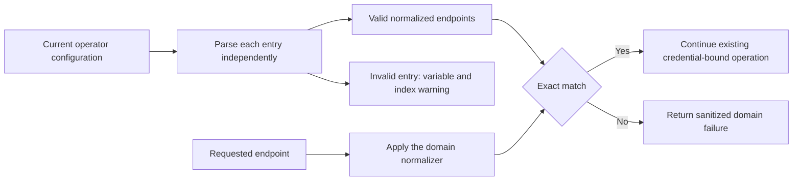

# Storage and embedding endpoint allowlists

Status: delivered in [PR #72](https://github.com/SimonLoir/vectorix/pull/72), with local automated, six-image and production dashboard validation complete. Both exact-head CI checks pass before the authorized squash merge. No schema, migration or public API revision change is required.

An invalid operator entry must authorize nothing without preventing a later valid entry from matching. Previously, one parsing exception escaped the complete `some()` operation, so ordering changed whether an approved organization endpoint could be used.

API and workers both require the applicable environment configuration:

| Policy             | Automatically approved endpoint                                                                   | Additional exact endpoints             |
| ------------------ | ------------------------------------------------------------------------------------------------- | -------------------------------------- |
| S3                 | `VECTORIX_DEFAULT_S3_ENDPOINT`                                                                    | `VECTORIX_S3_ALLOWED_ENDPOINTS`        |
| Embedding provider | `VECTORIX_DEFAULT_{OLLAMA,COHERE,VOYAGE,OPENAI,MISTRAL}_ENDPOINT`, for the selected provider only | `VECTORIX_EMBEDDING_ALLOWED_ENDPOINTS` |

Comma-separated additional entries are trimmed and parsed independently. Blank segments authorize nothing and produce no warning. Malformed nonblank entries produce a server warning containing the environment variable name and the original one-based segment index, never the entry, URL parsing error, credential or stack. A malformed default endpoint is reported against its own variable at index 1. Parsing covers all entries, including those after a successful match, so diagnostics do not depend on ordering. A malformed requested target is simply refused through the existing sanitized domain error.

Each fixed policy retains only its latest raw default/list snapshot and normalized set. There are six policy instances: storage and the five supported embedding providers. Admission rereads the relevant environment variables; a change replaces the previous snapshot and grants no historical permissions. Repeated calls with the same snapshot reuse parsing and do not repeat its warnings. Restart API and workers after deployment configuration changes; this cache does not provide cross-process configuration synchronization.

The dependency-free parser/cache is [storage's endpoint allowlist helper](../packages/storage/src/endpoint-allowlist.ts). The [S3 guard](../packages/storage/src/index.ts) supplies the storage normalizer; [embedding profile resolution](../packages/routers/rag/src/services/indexing/embedding-profile.ts) supplies the embedding normalizer and five provider-specific instances. [Pure and storage-guard tests](../packages/storage/src/endpoint-allowlist.test.ts) and [disposable catalog journeys](../apps/api/src/rag-tests/endpoint-allowlists.ts) cover these entry points.

## URL and credential boundaries

The policies deliberately keep different existing URL normalizers. Storage compares WHATWG `URL.href` after removing one final slash. This change does not add an HTTP-only storage policy: for example, `ollama:11434` is parseable as an opaque URL by WHATWG, although it is not a usable S3 HTTP destination. Embeddings require HTTP(S) with no username, password, query or fragment. Scheme, non-default port and complete API base path remain significant. In particular, an approved OpenAI or Mistral `/v1` base does not authorize another path. URL canonicalization still equates ordinary hostname case, default ports and the existing final-slash forms.

Allowlisting never selects credentials or combines their fields. Complete organization configuration precedes environment fallback; an invalid configured binding must fail explicitly. Existing document storage locations and collection revisions keep their saved destinations when the current selection changes. A valid entry for one provider does not import another provider's default endpoint. These checks approve configured endpoints; they do not provide DNS pinning, a network sandbox or protection against every redirect behavior of an upstream client.

## Acceptance and actual validation

Automated checks cover malformed-before-valid and valid-before-malformed lists, invalid-only and unmatched refusal, original segment indexes, cache replacement, sanitized warnings, storage URL equivalence and provider-specific defaults. Both existing domain normalizers are independently reviewed as unchanged. Disposable integration tests remove the matching platform defaults after preparing the organization binding; otherwise automatic default approval masks the original regression. They exercise private upload/extraction/download and controlled native-protocol indexing/search with current permissions and saved bindings. Controlled vectors do not establish live-model quality.

Dashboard acceptance recipe: use a fresh synthetic organization whose S3 binding is preconfigured through one native credential-create operation, with the platform S3 endpoint absent and a malformed entry before the exact approved S3 endpoint. Sign in normally, upload a small FR/EN text document, inspect its READY preview and download the original; verify that the downloaded bytes match the input. No browser API-key, role or credential modifications are part of this recipe. A platform-default-only smoke is insufficient evidence. Record actual browser observations, bounded read-only corroboration and cleanup separately.

Actual host validation passes frozen installation, 24 type checks, 24 lint tasks, 159 API/backend and 11 utility tests, all 316 disposable catalog tests and four production builds. All six image/runtime/infrastructure checks pass. Ten focused helper/storage-guard tests and three catalog journeys cover the regression; the protected admin declaration remains byte-identical. Independent runtime, integration and documentation reviews are clear.

Production browser run `f3a033c5ced8` passes normal sign-in, TXT upload to READY, all 318 canonical characters, an actual original download, EN/FR/nl-BE selection and reloads, account/return and French logout. The download is exactly 327 bytes with SHA-256 `b587cf49f2315b0050cea03aaad56a33e58b673be6dd11b476d1feb8f7cd2d59`. Six bounded read-only checkpoints corroborate one unchanged ordinary owner, active organization and saved S3 credential, document/version progression 0→1, two exact private objects (654 bytes), zero remaining ingestion reservation, persisted locales and session 1→0. These checks recheck metadata after I/O; they are neither atomic cross-store snapshots nor browser proof by themselves. No collection, embedding provider, API key or browser security operation is involved. Embedding recovery is established by the controlled automated journey, with no live hosted-provider claim.

The file chooser returns after 40,370 seconds; the same four live process handles and source/build/resource pins are revalidated before upload, with no restart. The download tool takes 115 seconds. Neither wait is an application benchmark. The last document-page console capture has zero warnings/errors; no post-logout console capture is claimed after the temporary tab closes during a turn interruption. Normal French logout and the final zero-session checkpoint both complete before that interruption. All four foreground processes, four containers and four volumes are removed, and tab 51 is confirmed absent. One 530-byte native sign-in email remains local to the capture during testing; its file and the synthetic login fixture are removed after hash verification. Safe screenshots and projected proofs remain private.

Exact head `14096471019b44c052b9f3f226096fe4e2605dc5` passes [catalog CI](https://github.com/SimonLoir/vectorix/actions/runs/40086948132) and [six-image CI](https://github.com/SimonLoir/vectorix/actions/runs/40086947993). PR #72 is squash-merged as `b59a14b07870e22601bcdd29f926abd70737ae3a` at 10:53:57 UTC on October 24, 2026, after a fresh unchanged head/base/main and CLEAN check. Fetched main and squash/PR content trees match. Independently reviewed PR #73 duplicates this change and is closed without merging its unbounded historical-configuration cache. Registry publication is not established by these PR checks.
