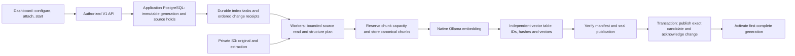
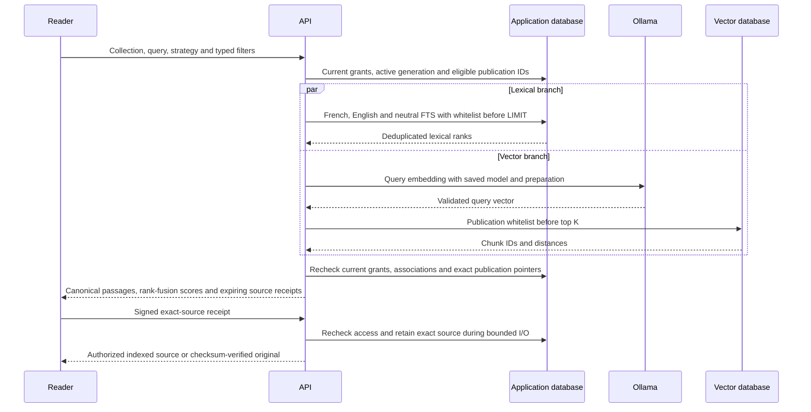

# M3 — First collection index and hybrid search

Implemented and browser-verified on `codex/rag-first-search`, with the production dashboard acceptance and checks recorded below. The extraction milestones and this slice are merged; PR #7 passed both catalog and six-image checks and was squash-merged as `7143a44`. The [M4 profile-change/rebuild journey](rag-index-rebuild.md) is implemented and browser-verified. [M5a native Cohere](rag-cohere-embeddings.md) extends this flow with controlled dashboard acceptance complete. [M5b native Voyage](rag-voyage-embeddings.md) is implemented with controlled dashboard acceptance complete. [M5c native OpenAI](rag-openai-embeddings.md) is implemented with controlled dashboard acceptance complete. Live paid-provider verification remains pending for all hosted providers. [M5d native Mistral](rag-mistral-embeddings.md) is implemented with automated validation and controlled dashboard acceptance complete. [M6a token windows](rag-token-windows.md) are implemented and browser-verified. [M6b semantic indexing](rag-semantic-planning.md) is implemented with automated validation and real Ollama production-dashboard acceptance complete. M6c parent/child context and M7 remain planned parts of the agreed V1. Customer-managed remote vector databases and OCR remain outside V1.

## Executable scope and prerequisites

The original M3 slice connects Ollama, document-structure chunking, one collection's first index, automatic document updates, filtered French/English hybrid retrieval and exact authorized sources. The current runtime also supports native Cohere through [M5a](rag-cohere-embeddings.md), Voyage through [M5b](rag-voyage-embeddings.md), OpenAI through [M5c](rag-openai-embeddings.md) and Mistral through [M5d](rag-mistral-embeddings.md), using the same durable indexing, rebuild and source flows. The current runtime also executes [token-window profiles](rag-token-windows.md) and [semantic profiles](rag-semantic-planning.md) across the five native providers. Parent/child expansion remains an inspectable draft with an explicit execution gate. The historical M3 results below use real Ollama; they do not claim live hosted-provider validation.

Deploy `20261026000000_rag_indexing` before API/workers. Run the application database, independent vector database, Redis and private S3, then API, workers and web. Configure `VECTOR_DATABASE_{URL,PROVISIONING_URL,SCHEMA}` on workers; API needs the runtime URL/schema only. Workers initialize vector ledgers lazily, so unavailable vector configuration does not prevent unrelated notification or extraction work. Provisioning and runtime roles retain their separate permissions.

Provide a complete organization Ollama integration or `VECTORIX_DEFAULT_OLLAMA_{ENDPOINT,API_KEY}`. Add each organization destination's exact base URL to `VECTORIX_EMBEDDING_ALLOWED_ENDPOINTS` on both API and workers; the platform endpoint is approved automatically. Saved collection bindings take precedence over current selections. Invalid configured credentials fail explicitly and never fall back.

Install an embedding-capable model in the selected Ollama server before discovery/probing. The dashboard does not download models. Select the explicit `EMBEDDING_GEMMA` preset for EmbeddingGemma's distinct query/document input prefixes; `GENERIC` adds neither. The model probe checks the native manifest, embedding capability and requested dimensions. An immutable digest and capability snapshot bind the generation. Alias normalization adds `:latest` without discarding a namespace. Native embedding requests set `truncate:false`; changed digests, wrong counts, dimensions or non-finite values fail before publication. Manifest checks cannot detect a model changed away and back between checks; operators must treat serving model digests as immutable.

## Ownership and publication

`IndexGeneration` fixes the configuration revision, vector destination fingerprint, generated table name, chunker version and verified model identity. `GenerationDocument` tracks each document's desired source and published candidate. `IndexedDocument` is an immutable build attempt; a detach/reattach creates a new candidate ID and increasing build revision. Canonical `Chunk` text, immutable source spans and French/English/neutral lexical indexes remain in application PostgreSQL. Vector rows never supply authoritative text or access decisions.

Attach/detach, successful extraction publication, collection metadata updates and deletion share the collection row fence. Each accepted change receives a monotone `CollectionChange.sequence`, exact source/metadata snapshot and per-generation receipt. A watermark advances only through a contiguous acknowledged prefix. First activation requires all desired documents and changes through the current sequence to be published or acknowledged. Each generation’s configuration remains immutable. M4 now lets the latest saved profile become a draft for a second generation while the active generation remains searchable. Name/description edits remain available; a building or failed candidate blocks further profile edits until activation or discard. See [draft profiles, activation and cleanup](rag-index-rebuild.md).

Tasks use PostgreSQL leases, tokens and monotone epochs. Provider, S3 and vector I/O occur outside application transactions. Chunk planning completes within bounded limits before capacity is reserved. Materialization precedes vector writes; sealing validates the complete manifest before the catalog pointer can change. Publication rechecks the current desired source, association, organization, requesting member and collection management grant. An explicit authorized retry can transfer unfinished processing to the current manager. Accepted destructive cleanup remains valid after requester removal or organization suspension.

## Limits and accounting

Initial limits are 5,000 indexed documents and 100,000 searchable chunks per collection. Organization overrides can change the chunk allowance; the document bound is explicit in `indexing/limits.ts`. Structure chunking respects PDF page boundaries, DOCX story/section/headings and Markdown headings. Token counts and token-size settings are labeled estimates (`ceil(UTF-8 bytes / 3)`); an independent conservative model byte cap protects context length. Native rejection remains authoritative. Canonical source offsets use UTF-16 code units and never split a surrogate pair. An empty/unprocessable source fails rather than publishing a fabricated chunk.

Let `A` be active chunks, `R` retained materialized chunks and `U` unmaterialized reservations. Admission requires `A + R + U + new <= activeLimit + temporaryAllowance`; each generation's projected target must also fit `activeLimit`. Materialization moves capacity from `U` to `R`. Publishing an active replacement moves its chunks from `R` to `A` and the old publication from `A` to `R`. Only acknowledged physical vector/chunk cleanup frees retained capacity. Failures remain charged. `VECTORIX_DEFAULT_RAG_TEMPORARY_CHUNKS_PER_COLLECTION` defaults to 100,000; admin **RAG quotas** exposes the effective allowance and override. Original/extraction byte quotas remain independent.

## Retrieval and exact sources

Search captures one generation and applies document IDs, language, MIME type, tags, document creation dates and declared typed metadata predicates before either branch's candidate limit. DATE values normalize to UTC. Numeric/date ranges reject incompatible field types. Metadata is collection-specific and published with the candidate, so pending edits do not silently mutate old searchable vectors.

The lexical branch fuses French, English and neutral ranks; hybrid search then combines lexical and vector ranks using reciprocal rank fusion (`1 / (60 + rank)`). Scores are ordering aids, not probabilities. Explicit lexical-only and vector-only modes are available. A required branch failure fails the whole hybrid request. Small collections use exact vector search; larger ones use bounded native ANN scans and report possible underfill. Search is bounded to 60 seconds, at most 50 returned passages and 200 candidates per branch. Canonical chunk responses expose at most 64 provenance spans and an explicit truncation flag; complete provenance remains stored.

Reading requires both organization library/collection read permissions and a current member/group collection grant, intersected with API key issuer permissions/scopes. Global catalog management never implies content reading. Provider I/O is followed by another authorization check. Detach, document/collection deletion, member removal, suspension or scope revocation immediately denies further content, including previously issued receipts.

Receipts bind organization, collection, generation, publication, chunk, exact source version, extraction and 15-minute expiry with a domain-separated HMAC. They are references, not access grants. Original downloads follow the version's saved storage binding and SHA-256, never the library's latest-version endpoint. Retired publications retain their sources for at least 17 minutes (search, receipt and I/O grace). Source I/O renews the same fenced source/candidate state used by cleanup; cleanup cannot acquire a destructive claim while that read is protected.

## Cleanup and organization deletion

Version content follows `AVAILABLE → DELETING → PURGED`. A source hold and physical cleanup write the same `DocumentVersion.contentFence` before external deletion. The winning destructive claim rejects later holds. Retired/failed candidates retain chunk charges until vector tombstoning is acknowledged; only then are chunks and source holds released. Document cleanup keeps extraction/version metadata with discard markers for exact provenance and credential retention, without charging physically purged objects. A delayed PUT recharges a reservation and schedules cleanup without reviving purged content.

Deleting a collection hides its content immediately and schedules durable vector cleanup; shared library documents survive. **Deleted collections** exposes bounded cleanup task inspection/retry without search, content access or restoration. Native organization deletion is rejected while original/extraction/reservation, cleanup or generation work remains. Database parent locks and a final deletion trigger prevent concurrent descendant insertion from bypassing that guard. Better Auth's Prisma adapter uses transactions so a late guard rejection also rolls back prior member/invitation removal. Empty or actually cleaned organization metadata can still cascade.

## Integration entry points

- Schemas: `packages/db/prisma/models/rag{,-indexing}.prisma`; approved migration `20261026000000_rag_indexing`.
- Public API revision `1.7.0` introduced this slice; the current compatible revision is `1.14.0`: `packages/api-contracts/src/v1/rag/{indexing,indexing-types,collections}.ts`; one handler per file in `packages/routers/rag/src/indexing/`.
- Shared services: `packages/routers/rag/src/services/indexing/{start,changes,metadata,task-state,accounting,index-document,publication-state,cleanup-index,process}.ts`.
- Retrieval: `services/indexing/{access,filters,lexical,search,views,receipts,sources,source-holds}.ts`; native packages `packages/{chunking,embeddings,vector-store}/`.
- Scheduling: `packages/queues/src/index.ts` and `apps/workers/src/index.ts`; Redis carries identifiers and scan scheduling only.
- Dashboard: `apps/web/components/rag/indexing/` and collection page tabs; deleted collection cleanup under `collections/deleted-collections.tsx`. Admin quotas: `apps/admin/src/components/organization-rag-quota.tsx`.

## Dashboard acceptance recipe

Use production builds and disposable `_test` application/vector databases, Redis and private S3. Start a real Ollama model with a known digest. Create a manager, explicit collection reader and another organization. No application data is used.

1. Save an Ollama/document-structure profile, discover installed models, choose explicit preset/dimensions and probe. Attach bilingual documents from the library.
2. Start indexing. Observe durable progress, published document versions, charged chunks and a complete active generation. Reload and inspect bounded canonical chunks and source spans.
3. Set collection-specific language, tags and declared string/number/boolean/date metadata. Observe catch-up. Run FR/EN hybrid, lexical and vector queries with each filter and inspect ranks, passages and exact sources/original checksum.
4. Pause processing, replace a document and confirm the old indexed source remains available. Resume and confirm publication switches only after vectors seal. Old receipts still identify their retained exact source while authorized.
5. Verify a reader's search/source access; revoke collection grants/key scopes and check immediate denial. Verify foreign organization IDs and catalog-only management cannot read chunks or sources.
6. Exercise provider/vector failure, durable retry and capacity rejection. Recover the destination and retry through the dashboard; no partial hybrid success or uncharged retained material is accepted.
7. Detach/delete and confirm immediate content denial. Inspect deleted collection cleanup/retry, then confirm vector rows/chunks/holds and source objects are physically cleaned before quota release. Verify library documents survive collection deletion.
8. Switch EN/FR/nl-BE and reload. Inspect a fresh browser tab for warnings/errors. Stop temporary servers, browser tabs and disposable infrastructure afterward.

## Actual validation

The approved additive migration passed isolated fresh installation, upgrade preservation, repeat deployment and Prisma schema parity. Frozen installation, Prisma generation/validation, all 23 workspace type-check and lint tasks, 23 backend regressions, seven deterministic chunking tests, 21 controlled native embedding HTTP tests and 11 real isolated vector-adapter tests passed. The complete catalog suite passed all 88 core/RAG integration tests against disposable application/vector PostgreSQL, Redis and RustFS. It covers the outbox/watermark, quotas, interrupted work, source-hold/destructive-cleanup races, deletion transactions, legacy V1 input compatibility, current permissions and key scopes, filter-before-limit search, exact receipts, and RPC/REST/spec revision parity. All four applications built and all six container images passed production runtime/infrastructure checks. Existing non-blocking lint and PostgreSQL client warnings remain.

The installed Prisma Zod generator serialized native BigInt defaults as strings. A narrow locked pnpm patch now emits bigint literals; generated-output regression tests verify defaults without modifying generated files or database defaults. All five service Dockerfiles copy that patch before frozen installation. Independent protocol and patch reviews found no remaining P1/P2 blocker. These reviews are distinct from executed tests.

Production browser acceptance used isolated `_test` databases, Redis, private RustFS and real API/workers/web/admin builds. The live provider was official `ollama/ollama:0.40.8`, CPU-only with two CPUs and a 3 GiB container limit, serving original `embeddinggemma:latest` (digest `85462619ee721b466c5927d109d4cb765861907d5417b9109caebc4e614679f1`). The standalone live script verified 128/256/512/768 dimensions; the dashboard collection used the explicit EmbeddingGemma preset, 256 dimensions, DiskANN and structure chunking. The [Ollama reproduction guide](rag-ollama-embeddinggemma.md) contains the setup, native requests, organization credentials and exact script recipe.

A manager discovered/probed the real model, uploaded bilingual PDF and Markdown, attached them and activated a five-passage index. Chunk previews preserved PDF pages and three Markdown heading boundaries. Real FR/EN hybrid, lexical-only and vector-only searches returned expected passages; a language/MIME/tag/typed-string filtered hybrid query ranked the refund passage first in both branches. Exact PDF page and DOCX paragraph navigation worked. Downloaded Markdown originals matched their immutable source checksums: version 1 `e95637a944592606aac0914e81eb7c28c6c2f1d4fefbfa6ac2014dba18aa2336`; version 2 `bb0d0dbeeaf6f5d7d1a11ceb6c6183684cce38a0d67ef27ed97b243b0fa0c2f2`.

Only the indexing queue was paused for replacement. The library published Markdown version 2 while search/source still read indexed version 1, even with zero-day library retention. Resuming the queue published version 2 and its new policy code. A DOCX attachment then hit a real chunk-quota rejection without changing existing active/retained charges. Increasing the quota in admin and retrying from the dashboard published its two passages; the final active index contained three documents and six passages. A read-only member could search and open PDF page 2 without management controls. Revoking that grant while a source was open removed the source/results on refresh; a fresh direct URL returned Not Found. Another organization's direct collection URL also returned Not Found. Retired receipt validity after replacement, API-key scope/issuer revocation, provider/vector branch failure and cleanup retry races are integration-test evidence; they were not all repeated in the browser.

Dashboard collection deletion immediately denied its direct URL and retained all three shared library documents. The deleted-collection screen exposed cleanup tasks without content. To shorten this isolated acceptance test, only already-retired hold deadlines and pending cleanup availability timestamps were advanced; no completion, counters, leases, object state or vector state was fabricated. Real workers tombstoned all four publications, dropped the vector table, removed all nine application chunk rows, released four source holds and reduced active/retained/reserved passage counters to zero. Deleting the synthetic Markdown document with zero-day retention then completed both version cleanups; real S3 HEAD checks confirmed both originals/extractions absent and both version content states PURGED. The unrelated PDF/DOCX library objects remained available.

English, French and Belgian Dutch headings, index controls, admin quota labels and locale persistence after reload were checked. The admin's existing core pages/forms were also moved to complete localized messages with locale-aware dates/numbers; the temporary passage quota accepts and persists zero. A final clean web tab returned real version-2 hybrid results, completed deletion/cleanup journeys and had no console warnings/errors. Tests cover representative actions/states rather than every screen in every locale. A temporary chunk-loading error caused by rebuilding underneath an already-running preview was resolved by restarting the final standalone build and using a fresh tab; it is not counted as a passing check. Temporary application processes, tabs and disposable infrastructure are cleaned after acceptance; the named Ollama model volume is retained for later milestones.

No paid-provider request, reference-corpus quality result, 100,000-passage load/concurrency benchmark, zero-downtime full rebuild, other chunking strategy or parent context is claimed here. Those were outside M3 acceptance. M4’s rebuild implementation and separate acceptance record are documented in [Change a profile and rebuild](rag-index-rebuild.md); provider, chunking/context and final operational acceptance remain M5–M7. M3 does not complete the agreed V1.
