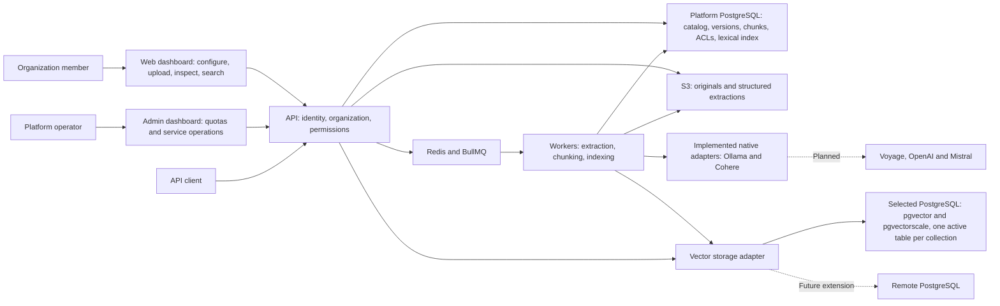
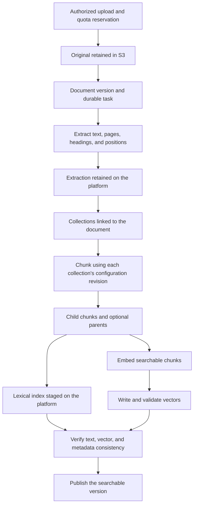
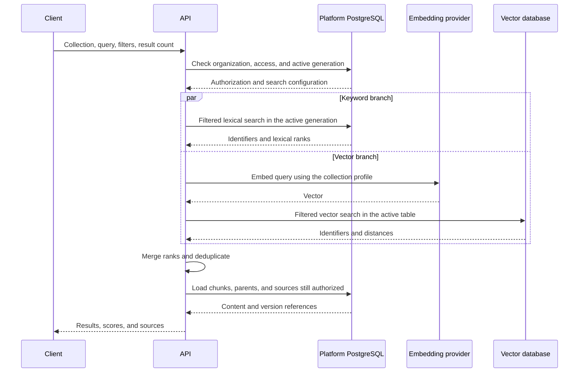
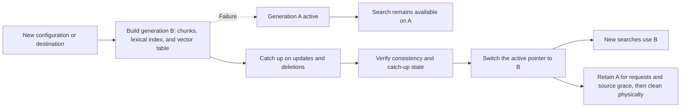
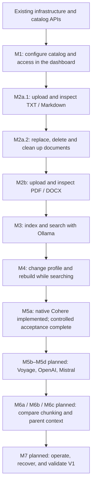

# RAG implementation plan — V1

Prepared on October 21, 2026; delivery sequence revised to require a usable dashboard journey at every product milestone. [Phase 1 infrastructure](rag-infrastructure.md) and the [original phase 2 catalog and access APIs](rag-catalog-access.md) are implemented as technical foundations. The [M1 catalog dashboard](rag-dashboard.md) is implemented and browser-verified. The [M2a.1 TXT/Markdown upload and inspection slice](rag-document-library.md) is implemented. The [M2a.2 replacement/deletion implementation](rag-document-lifecycle.md) is complete and browser-verified. The [M2b PDF/DOCX extraction journey](rag-rich-documents.md) is implemented and browser-verified. The [M3 first Ollama index and search journey](rag-first-search.md) is implemented and browser-verified. The [M4 profile-change/rebuild journey](rag-index-rebuild.md) is implemented and browser-verified. [M5a native Cohere](rag-cohere-embeddings.md) is implemented, with controlled dashboard acceptance complete and live paid-provider verification pending. M5b–M5d, M6 and M7 remain planned and required for the agreed V1; delivery evidence is tracked in the [build log](build-task-log.md). The proposed initial limits below are configurable and must be validated on the selected infrastructure.

## 1. Agreed scope

- Passage retrieval with source references, available through an API and a web playground.
- Organizations own collections and a shared document library. A document can feed several collections with different configurations.
- Initial formats: text-based PDF, DOCX, TXT, and Markdown. Supported languages: French and English. OCR comes later; explicitly report files without usable text and pages that could not be extracted.
- Originals use S3-compatible storage: organization credentials take precedence, with platform environment configuration as the fallback.
- Restore the `Credentials` mechanism: organization ownership, provider-specific data, encrypted secrets, and masked values in the interface.
- Several native embedding adapters in V1: Ollama, Cohere, Voyage, OpenAI, and Mistral. Embedding credentials follow the same organization-first, environment-second resolution order.
- Three chunking strategies: token windows, document structure, and semantic similarity. Parent/child mode can be combined with these strategies: search child chunks and return parent context.
- Collection-specific permissions assigned to organization members or groups.
- Document managers can access the entire library. Readers can access only documents linked to at least one collection they are authorized to access.
- Hybrid keyword and vector search, with filters, against one collection per request.
- Start with PostgreSQL, pgvector, and pgvectorscale. Each collection has one active vector table in its selected connection. A second temporary table is allowed for reindexing without interrupting search.
- Prepare the architecture for remote connections; customer configuration of remote databases will ship in a later phase.

## 2. Architecture and data ownership

Original files, extracted content, chunks, source positions, and versions remain under platform control. Vectors and the lexical index are derived data that can be rebuilt. Deleting a collection does not delete its documents from the library.

The application database and vector database can initially share a server. Configuring them separately from the outset allows separation testing before remote database management is exposed to users.

The keyword index remains in the application database alongside the chunks. It uses PostgreSQL full-text search and a GIN index. Language configuration must be explicit both when indexing and when querying. [PostgreSQL documentation](https://www.postgresql.org/docs/18/textsearch-tables.html)

The vector table contains chunk identifiers, the index generation, vectors, and metadata required for filtering. It is not the authoritative text store. The platform generates table identifiers and resolves them through its catalog after checking organization ownership; arbitrary client-supplied table names never enter SQL.

Dynamic tables live in a dedicated schema, separate from tables managed by Prisma migrations. The provisioning account has permissions limited to that schema. Installing extensions remains an infrastructure operation.

## 3. Proposed data model

| Area          | Main entities                                                         | Responsibility                                                              |
| ------------- | --------------------------------------------------------------------- | --------------------------------------------------------------------------- |
| Integrations  | `Credentials`, S3 and embedding credentials, `StorageLocation`        | Resolve access configuration and retain storage destinations                |
| Library       | `Document`, `DocumentVersion`, `DocumentExtraction`                   | Original file, fingerprint, version, structured text, pages, and provenance |
| Collections   | `Collection`, `CollectionDocument`, `CollectionConfigRevision`        | Document associations, settings, and configuration revisions                |
| Indexing      | `IndexGeneration`, `Chunk`, `IngestionTask`, durable events           | Parent/child chunks, progress, retries, and index publication               |
| Connections   | `VectorConnection`                                                    | Vector destination, capabilities, and extension versions                    |
| Authorization | `OrganizationGroup`, `GroupMember`, `CollectionGrant`, API key scopes | Member/group access and API client restrictions                             |
| Operations    | Usage counters and audit log                                          | Bytes, tokens, vectors, requests, errors, and sensitive operations          |

Prisma continues to manage application data. SQL operations specific to extensions and dynamic tables are encapsulated in the vector adapter, using Prisma SQL primitives. Migrator migrations cover the stable catalog; provisioning collection tables is a retryable application operation.

Each file retains its storage destination and object key. Changing S3 configuration affects new writes; moving existing files requires an explicit operation. Credentials still referenced by files or collections cannot be deleted without replacement or migration.

A new document version keeps the previous published version available while processing. Each document–collection association records the version currently searchable. Updates propagate to the affected collections after successful extraction.

## 4. Credentials and embedding profiles

Resolve configuration for the requested provider: use organization credentials when present, otherwise use platform environment configuration. Missing configuration can fall back; a configured but invalid key produces an explicit error. Do not combine an organization's key with an endpoint from a different configuration.

Explicitly select an active configuration for each purpose and provider to avoid arbitrarily choosing between several credentials. Retain the references and revisions used by each collection.

A collection's versioned profile fixes the provider, model, dimensions, numeric type, distance metric, and any text preparation instructions. Key rotation does not change that profile. Changes to the model, dimensions, text preparation, or an endpoint that may serve a different model require a new index generation.

The implemented Ollama/Cohere interface exposes document embedding, query embedding, supported dimensions and context limits, with bounded batches and validated vector outputs. Token counts remain explicitly labeled estimates where no exact tokenizer is available. Adapters translate those operations into each native API. Cohere uses native query/document roles; the planned Voyage adapter must preserve the same distinction. [Cohere](https://docs.cohere.com/reference/embed), [Voyage](https://docs.voyageai.com/reference/embeddings-api)

Inputs that exceed the length limit are split again or explicitly rejected, with silent truncation disabled where the API supports it. Validate the returned vector count, dimensions, and values before writing anything. External calls have bounded timeouts and retries. Validate custom endpoints; private destinations needed for Ollama must be explicitly allowed by the operator.

Configure the default provider and model during deployment. Do not embed keys or assume model availability in code. Suggest the model's native dimensions by default, subject to compatibility with the selected index.

M5a supports the reviewed Cohere v4/v3 text-model catalog with the Generic preset through native discovery, probes, document/query embedding, indexing/rebuilding and search. The provider base is the root `https://api.cohere.com`, without a version path. Local Ollama snapshots retain their verified manifest digest; hosted Cohere snapshots record a versioned capability fingerprint that cannot attest to hosted weights. API revision `1.9.0` adds compatible identity/discovery metadata and a saved-revision discovery check. See [native Cohere setup and validation boundaries](rag-cohere-embeddings.md). Controlled provider checks and the completed controlled dashboard acceptance are distinct from the pending live paid-service journey.

## 5. Ingestion, chunking, and publication

Uploads validate the organization, permissions, actual file type, size, and quota. Parsers have memory, runtime, and decompressed-size limits. Sanitize HTML previews. Extracted text retains page references for PDFs and section/position references for other formats; do not invent page numbers for DOCX or text files.

BullMQ tasks contain identifiers, without secrets or files. Their durable state remains in PostgreSQL. A transactional outbox event allows a task to be retried even if enqueueing in Redis fails after the database write. Steps are idempotent; retries do not publish duplicate chunks. Deduplication and caches are scoped to the organization and include extraction and configuration versions.

Semantic chunking groups sentences or small blocks by similarity, with mandatory size limits. It uses the collection's embedding profile by default, and its additional calls count toward usage. In parent/child mode, only children enter search; parents remain available as context on the platform.

Recheck changes and deletions that occur during a task before publication. An outdated task must never restore a deleted document or an obsolete configuration.

## 6. Hybrid search and authorization

Read the active generation once per request so both branches use the same index generation. Apply supported filters to both searches before selecting candidates. Final hydration rechecks content existence, published versions, and access; logical deletions take effect without waiting for vector cleanup.

Proposed fusion method: Reciprocal Rank Fusion (RRF), which combines ranks from the two result lists. Do not add vector distances directly to lexical scores. This approach is also described in the [pgvector documentation](https://github.com/pgvector/pgvector#hybrid-search).

V1 filters include document identifiers, language, file type, tags, and dates, plus a set of typed metadata fields declared on the collection. Validate fields and operators on the server; do not accept arbitrary SQL expressions. Metadata changes are versioned and reconciled across both indexes.

In parent/child mode, group matching children by parent, retain precise source references, and return each parent once. `topK` denotes the final result count; increase candidate retrieval within a bounded limit when deduplication reduces that count. A response may contain fewer results when filters or limits prevent filling the list.

Each result contains the matching chunk, optional parent context, document and version, pages or positions, metadata, ranking scores, and authorized access to the source. A ranking score must not be presented as a probability of truth. If either search branch fails, return an explicit error in V1 instead of presenting partial retrieval as a complete hybrid search.

Organization-level permissions remain a prerequisite; collection grants can allow reading/searching, managing documents within the collection, or administering the collection. Groups are new entities, separate from existing roles. Authorized owners and administrators manage grants; their ability to read content requires an explicit permission.

API keys receive collection scopes intersected with their owner's current permissions and organization permissions. Check access revocation on the server, including management tasks and direct document access. For downloads, the API authorizes every request and serves the private file; S3 objects are not public. Library managers have an explicit permission to read the full library, which does not automatically grant search access to every collection.

## 7. Reindexing without downtime

Implemented by [M4](rag-index-rebuild.md), extended in [M5a](rag-cohere-embeddings.md) to Ollama/Cohere document-structure profiles without parent/child expansion. Final browser acceptance and delivery are recorded separately in the rebuild document and [build log](build-task-log.md). Voyage/OpenAI/Mistral and additional chunking modes retain their M5b–M5d/M6 gates.

A generation includes its configuration revision and the document versions actually indexed. Rebuilding produces a new vector table and new chunks/lexical indexes without changing the generation being queried. Document changes are recorded in an ordered log and replayed before switching, with a short lock to finalize the catch-up point.

Publication uses an application database transaction only after both indexes confirm their writes. It does not assume a distributed transaction between the platform and vector database. Requests that started on the previous generation may finish; cleanup waits until they have expired. A failed rebuild leaves the previous generation active. The dashboard distinguishes the latest saved draft from the serving configuration, compares both before confirmation and exposes generation-specific previews, progress, retry and discard. Search filters follow the active declaration; document metadata edits use the latest saved declaration. Shared metadata keys cannot change type while a non-cleaned generation retains their old type. A building or failed candidate locks profile changes, while name/description edits remain available.

Acceptance requires a current session, organization update/document-management permissions and both explicit administration/document-management collection grants. The initiating or retrying authority is rechecked before provider work and activation. At most two non-cleaned tables per collection and one rebuild candidate per organization are admitted. Retired/discarded tables keep their charges until physical cleanup is confirmed; a failed or discarded candidate must be cleaned before another build starts.

Deleting a collection immediately revokes access and schedules cleanup of its indexes and chunks. Shared documents remain available according to their other associations. Deleting a library document invalidates its associations and schedules removal of the affected objects and indexes, with durable retries if storage is unavailable.

## 8. Proposed initial settings

These values are initial service limits, adjustable through configuration and, for quotas, per organization. They are not guaranteed infrastructure capacities.

| Setting                      | Initial value                                                                                                                                      |
| ---------------------------- | -------------------------------------------------------------------------------------------------------------------------------------------------- |
| Languages                    | FR and EN, with detection and manual correction                                                                                                    |
| Collections per organization | 20                                                                                                                                                 |
| Documents per library        | 5,000                                                                                                                                              |
| Maximum original file size   | 25 MiB                                                                                                                                             |
| Total document storage       | 10 GiB per organization, including originals and extractions                                                                                       |
| Searchable chunks            | 100,000 per active collection; a separate temporary allowance for rebuilding                                                                       |
| Default chunking at creation | Document structure, target of 512 tokens, overlap of 64 tokens                                                                                     |
| Parent/child mode            | Children of 512 tokens, parents up to 2,048 tokens                                                                                                 |
| Semantic chunking            | Target of 512 tokens, bounds of 128–768; initial threshold at the 90th percentile of distances between blocks, to be calibrated against the corpus |
| Dimensions                   | Native model dimensions by default, restricted to supported model/type/index combinations                                                          |
| Metric and representation    | Cosine and floating-point values for the first set of validated profiles                                                                           |
| Search                       | 10 results by default, maximum 50; query limit of 4,000 characters, followed by model length validation                                            |
| Hybrid candidates            | Initially 100 per branch; a cap of 500 for additional candidate retrieval                                                                          |
| Fusion                       | RRF with constant 60 and equal weights initially                                                                                                   |
| Ingestion                    | 2 active tasks per organization, 4 across the initial deployment                                                                                   |
| Rebuilds                     | 1 per collection and 1 per organization at a time                                                                                                  |
| Search rate                  | 5 requests/second/organization, burst of 10, 5 concurrent searches per organization                                                                |
| Retries                      | 5 attempts for transient errors, exponential backoff, respecting provider retry instructions                                                       |

Token limits depend on the selected model. The adapter provides exact tokenization where available; otherwise, chunking uses a conservative estimate with a margin and splits again on an explicit length error, without presenting the estimate as exact.

The lexical index uses explicit FR/EN configurations and a `simple` path for identifiers and mixed-language documents. Analyze queries with the required configurations and merge lexical candidates before hybrid fusion. Validate this behavior with bilingual queries and documents.

## 9. Dashboard-testable delivery milestones

The milestones below replace the former backend-first work packages. References to phases 1 and 2 in the infrastructure and catalog documentation describe the existing foundations, not completion of these new product milestones. There is no separate late-stage interface milestone: every feature ships with its dashboard entry point, API, persistence, necessary worker processing, permission checks, and visible result.

### Completion rule for every milestone

- A member or platform administrator can exercise the delivered capability from the appropriate dashboard after normal deployment setup, without SQL edits, curl, or API documentation as the primary user interface.
- Forms, lists, details, and actions use the real API and persisted data. Reloading, switching organizations, and opening direct URLs preserve the correct state and permissions.
- Include empty, loading, success, forbidden, validation-error, and operational-failure states. Background work exposes durable progress and safe retry actions when applicable. Do not display a placeholder as a completed operation.
- Implement authorization, audit, quotas, idempotency, and cleanup alongside the operation that needs them. The final operations milestone does not defer these protections.
- Document a reproducible browser acceptance scenario, its prerequisites, expected results, and the checks actually run in the PR and [build log](build-task-log.md). Browser verification complements automated API and isolation tests; it does not replace them.
- Keep each implementation PR focused on a complete user action. If a milestone needs several PRs, split by usable actions or supported formats/providers, each with its interface, rather than delivering all backend work before the screens. Technical prerequisites are explicitly labeled as foundations and do not close a product milestone.

### Delivery order

M1 is implemented and verified. M2a.1 upload and inspection is implemented. M2a.2 replacement/deletion is implemented and browser-verified; M2b PDF/DOCX extraction is implemented and browser-verified; M3 is implemented and browser-verified; M4 is implemented and browser-verified; M5a native Cohere is implemented with controlled dashboard acceptance complete and live paid-provider verification pending; M5b–M5d, M6 and M7 remain planned. M1 completes the user-facing portion of the existing catalog backend. The staged delivery of formats, providers, and chunking options does not remove any agreed V1 capability.

| Milestone                                                             | Complete scope                                                                                                                                                                                                                                                                                 | Dashboard acceptance scenario                                                                                                                                                                                                                                                       |
| --------------------------------------------------------------------- | ---------------------------------------------------------------------------------------------------------------------------------------------------------------------------------------------------------------------------------------------------------------------------------------------- | ----------------------------------------------------------------------------------------------------------------------------------------------------------------------------------------------------------------------------------------------------------------------------------- |
| **M1 — Catalog dashboard (implemented)**                              | Organization integrations, collection profiles, groups and grants, API-key collection scopes, quota/usage and audit views; platform quota editing in the admin dashboard. Reuse the existing catalog APIs.                                                                                     | Configure masked credentials, create and reopen a collection, edit its profile, grant and revoke group access, configure a scoped key, and change an organization quota as a platform administrator. Verify persistence and a second member's denied access.                        |
| **M2a.1 — Upload and inspect TXT/Markdown (implemented)**             | Private S3 upload, original and extraction reservations, durable tasks, previews, authenticated downloads, safe retry, and collection associations. Documents remain independent of vectors.                                                                                                   | Upload FR/EN files, reload and follow processing, inspect plain text, download identical originals, and attach one document to two collections. Verify reader denial/revocation, quota failures, invalid UTF-8 and restart recovery.                                                |
| **M2a.2 — Replace and delete documents (implemented)**                | Version replacement, document deletion, durable object cleanup, reservation release, retention controls and related dashboard confirmations/status.                                                                                                                                            | Replace an original, inspect the current version, delete it and verify immediate reader denial. Recover cleanup after an S3 outage and confirm storage quota release.                                                                                                               |
| **M2b — PDF/DOCX library (implemented)**                              | Add text-based PDF and DOCX through the same upload, extraction, version, and preview journey; retain page or section/position provenance and parser resource limits.                                                                                                                          | Upload each format and follow its source references in the preview. A scanned PDF reports that OCR is unavailable; unusable text is never reported as successful extraction. Each format can be a separate complete PR.                                                             |
| **M3 — First searchable collection (implemented)**                    | Ollama native adapter, model/dimension validation, document-structure chunking, chunk preview, durable indexing, dynamic PostgreSQL vector tables, lexical indexing, filtered hybrid API, and the dashboard playground. Include publication, update, deletion, retries, and quota enforcement. | Choose an available Ollama model, attach library documents, start indexing, inspect progress/chunks, then ask FR/EN questions with filters and open authorized sources. Replacing or deleting a document updates searchable content without exposing unpublished or stale versions. |
| **M4 — Change a profile and rebuild (implemented; browser-verified)** | Draft/serving profile comparison and confirmation, a new generation/table, source/association/metadata catch-up, atomic activation, bounded old-source retention and physical cleanup, generation previews, and visible progress/failure/retry/discard.                                        | Change model or dimensions in the collection settings, launch a rebuild, and keep searching the previous generation in the playground. Observe the successful switch; a failed rebuild leaves the old generation usable.                                                            |
| **M5a — Native Cohere (implemented; controlled acceptance complete)** | Native discovery/probes, reviewed model/dimension controls, query/document roles, credential resolution, capability-profile identity, indexing/rebuilding and search through the existing dashboard.                                                                                           | Save and verify a Cohere profile, rebuild from Ollama while searching, retrieve filtered passages and exact sources, and exercise explicit failures. Controlled HTTP/dashboard checks are separate from pending live paid-provider verification.                                    |
| **M5b–M5d — Voyage, OpenAI and Mistral (planned)**                    | One complete delivery per provider: native calls, capabilities, query/document semantics, credentials, profile controls, indexing/rebuilding and search.                                                                                                                                       | Configure each provider, index/rebuild, and retrieve passages/sources in the playground. Invalid organization credentials must fail without platform fallback.                                                                                                                      |
| **M6a/M6b/M6c — Additional chunking and context (planned)**           | Token-window chunking, semantic chunking, then parent/child mode, each with validated settings, chunk preview, usage accounting, indexing/rebuilding, and result inspection. Document-structure chunking already ships in M3.                                                                  | Change each strategy, inspect bounded chunks, rebuild, and compare search results. With parent/child enabled, inspect the matching child, deduplicated parent context, and precise authorized source. Test its combination with every supported strategy.                           |
| **M7 — Operational readiness (planned)**                              | Extend organization/admin dashboards with ingestion/search usage, latency, failures, and operational controls; evaluate the reference corpus, load, recovery, backup/restore, and all six container images.                                                                                    | Inspect real usage and failures, adjust a quota in admin and observe its enforcement in web, and retry eligible failed work. After an operator restores a backup and rebuilds derived indexes, verify documents and search from the dashboard.                                      |

M1 records configuration, not provider connectivity or search readiness: saved credentials must not be labeled as live-verified, and a collection without an index must not be labeled searchable. With M4, profile edits save a new draft while the active generation retains its immutable configuration. Building/failed candidates lock further profile changes until activation or discard; activation requires the reviewed revision and predecessor pointer. Catalog profiles already stored for capabilities not yet implemented remain inspectable, but indexing must explicitly reject them and the UI must explain availability. Only offer an executable action once its complete path exists.

### M1: implemented catalog dashboard

The following implemented screens close the catalog gap. Keep this acceptance checklist for regressions; see [implementation entry points and actual browser results](rag-dashboard.md).

- **Integrations:** list, create, edit, select, rotate, and delete S3/Ollama/Cohere/Voyage/OpenAI/Mistral credentials where permitted. Mask secrets, explain organization/environment resolution, show retained-reference restrictions, and distinguish saved configuration from live verification.
- **Collections:** list, create, inspect, revise, and delete catalog entries; display the selected provider/model/dimensions, chunking profile, platform vector destination, and immutable revision history. Link to the document library and indexing workspace. Distinguish saved profiles from the active generation; expose only the providers and strategies whose execution paths are implemented.
- **Groups and access:** manage organization groups and their members, then edit explicit member/group collection grants. Catalog administration must not imply content-reading access.
- **API keys:** extend the existing key screens with collection scopes intersected with the issuer's current rights. Explain why historical unbound keys need replacement. The dashboard manages scopes; automated API tests verify actual key use and revocation.
- **Usage and audit:** display enforced collection limits, stored quota policies, recorded usage, and safe audit entries. Distinguish measured usage and enforced original/storage/passage quotas from the later operational metrics planned for M7. Platform administrators can edit organization quota overrides in the admin interface.

Browser recipe: use two organizations and two members with distinct permissions. In the first organization, configure credentials, create a collection, save a revised profile, create a group, and assign/revoke a grant. Reload between actions and verify saved state, masked values, and the resulting audit entries. Configure a key's scopes without granting permissions the issuer lacks. Change the collection quota in admin and trigger its limit through web creation. Switch to the second member and organization to verify filtered navigation, list contents, forbidden actions, and direct URL handling. Document the actual result of each step; the existing API suite alone does not complete this checklist.

### Integration entry points and data flow

Existing entry points to reuse:

- `apps/web/components/app-sidebar.tsx` and `apps/web/app/dashboard/` provide navigation and page shells. Implemented catalog routes are `dashboard/collections`, `dashboard/settings/integrations`, `dashboard/settings/groups`, `dashboard/settings/usage`, and `dashboard/settings/audit`. Focused views live in `apps/web/components/rag/`. The `dashboard/documents` and `dashboard/documents/[id]` routes provide upload and inspection. M2a.2 adds manager replacement/deletion dialogs, version history, a deleted-documents view and cleanup retry; it is browser-verified. See [document lifecycle entry points](rag-document-lifecycle.md#implementation-entry-points).
- `apps/web/app/dashboard/account/api-keys/page.tsx` and its `components/api-key-permissions-dialog.tsx` own key configuration; reuse the existing member/role settings when selecting principals and checking organization permissions.
- `apps/web/contexts/orpc.tsx` supplies the authenticated versioned client. Forms call contracts in `packages/api-contracts/src/v1/rag/` and the existing key contracts in `packages/api-contracts/src/v1/organizations/access.ts`; handlers in `packages/routers/rag/` enforce access, persist catalog changes, and write audit records transactionally before the UI refreshes affected queries.
- `apps/admin/src/app/(dashboard)/organizations/[id]/page.tsx` and `apps/admin/src/components/organization-workspace.tsx` are the organization administration entry points. Quota changes use `packages/routers/superadmin/src/set-rag-quota.ts`.
- `packages/ui` and `packages/dashboard-core` supply shared accessible components. Ingestion and indexing actions persist tasks/change receipts in `packages/db`, enqueue identifiers through `packages/queues`, and run processing in `apps/workers`; dashboard status reads authoritative persisted state through the API. Rebuild controls and generation-aware previews live in `apps/web/components/rag/indexing/`; see the [M4 integration entry points](rag-index-rebuild.md#integration-entry-points).

Native provider protocols and versioned identity parsing live in `packages/embeddings/`; saved binding/endpoint checks and discovery/probes live in `packages/routers/rag/src/services/indexing/`. Controlled collection fields, saved model discovery and accurate fingerprint labels live in `apps/web/components/rag/{collections,indexing}/`. See [M5a integration and validation](rag-cohere-embeddings.md).

Keep shared storage, extraction/chunking, embedding, vector, and retrieval logic in focused modules reused by API and workers. Heavy parsers remain in the workers. Remote database configuration and OCR remain outside V1; when scheduled, each must include its own complete dashboard journey.

## 10. Validation throughout delivery and final V1 acceptance

Run the applicable browser journey and backend checks at **each milestone**, adding coverage as its capabilities ship. The final V1 scenario is a regression across those delivered journeys, not the first opportunity to test them from the dashboard: use two organizations and FR/EN documents, upload, attach a document to two differently configured collections, index, run hybrid search with sources and parent context, grant group access, revoke access, replace a document, and reindex without downtime.

Required validation:

- Integration tests with PostgreSQL and real extensions, Redis, and S3-compatible storage; PDF/DOCX/TXT/Markdown fixtures with expected source positions.
- Negative authorization tests for every access path: search, listing, original file, extracted content, parent context, version history, API keys, and job management.
- Worker termination at each stage; Redis/S3/vector database outages; provider 429 responses, invalid vectors, and partial responses. Verify retries and the absence of inconsistent publication.
- Reindexing during uploads, replacements, filter changes, and deletions. Verify that text and vectors belong to the reported generation.
- Mock providers for deterministic CI, plus live dashboard/contract checks with an available local Ollama model and dedicated Cohere/Voyage/OpenAI/Mistral credentials when available. Record simulated and live results separately. If credentials are unavailable, report live verification as pending; never claim that mocked responses prove a working live provider journey.
- An initial evaluation set of 40 annotated queries, half French and half English, covering exact keywords, paraphrases, filters, and parent context. Compare lexical, vector, and hybrid retrieval, then tune settings against these results.
- Initial load benchmark: 100,000 chunks in one collection, 10 concurrent searches distributed across organizations, and concurrent ingestion. Target to measure: internal search p95 below 1 second, excluding query embedding; also report total latency with each provider. These are validation targets, not achieved results.
- Back up and restore the catalog and objects, then rebuild indexes; verify deletions and cleanup of obsolete generations.

Hardware sizing, enabled models, and costs depend on hosting and available credentials. Confirm a usable local Ollama model before M3 and arrange provider credentials before the corresponding M5 live acceptance checks. These deployment prerequisites do not change the agreed functional scope.
