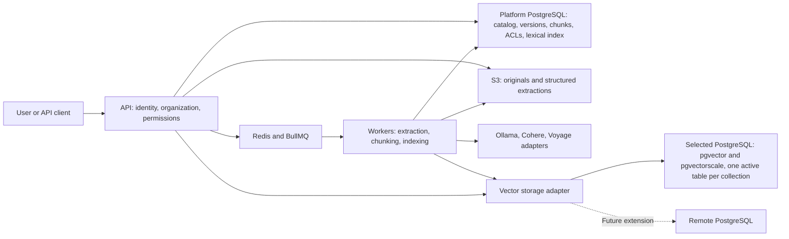
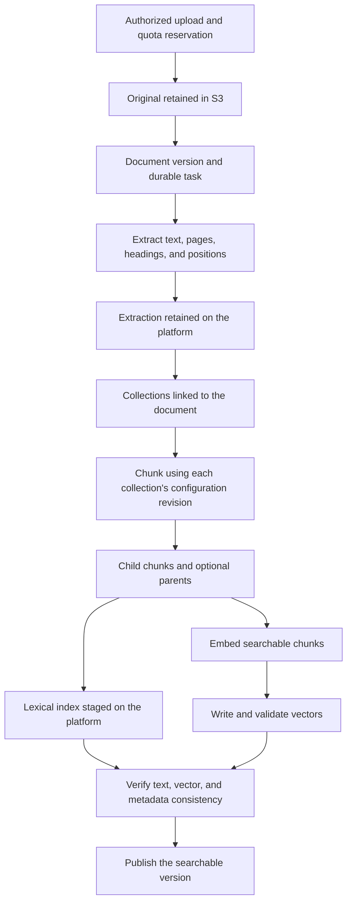
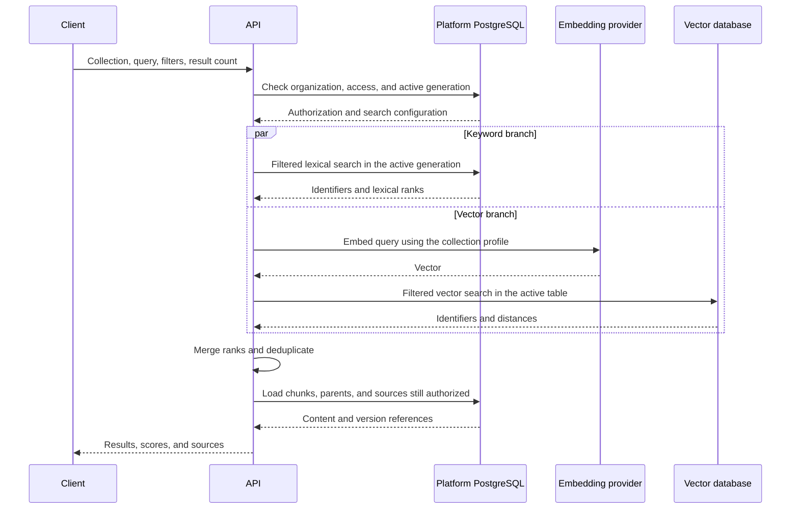
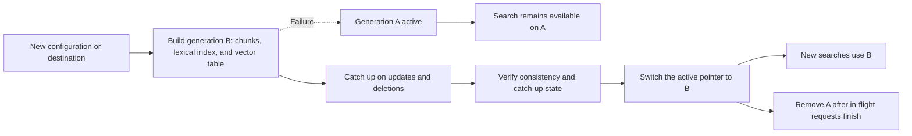

# RAG implementation plan — V1

Prepared on October 21, 2026. This document records the agreed scope and implementation sequence. [Phase 1 infrastructure](rag-infrastructure.md) and the [phase 2 catalog and access APIs](rag-catalog-access.md) are implemented. Uploads, ingestion, embedding adapters, vector indexing, retrieval, and the web playground remain planned. The proposed initial limits below are configurable and must be validated on the selected infrastructure.

## 1. Agreed scope

- Passage retrieval with source references, available through an API and a web playground.
- Organizations own collections and a shared document library. A document can feed several collections with different configurations.
- Initial formats: text-based PDF, DOCX, TXT, and Markdown. Supported languages: French and English. OCR comes later; explicitly report files without usable text and pages that could not be extracted.
- Originals use S3-compatible storage: organization credentials take precedence, with platform environment configuration as the fallback.
- Restore the `Credentials` mechanism: organization ownership, provider-specific data, encrypted secrets, and masked values in the interface.
- Several native embedding adapters in V1: Ollama, Cohere, and Voyage. Embedding credentials follow the same organization-first, environment-second resolution order.
- Three chunking strategies: token windows, document structure, and semantic similarity. Parent/child mode can be combined with these strategies: search child chunks and return parent context.
- Collection-specific permissions assigned to organization members or groups.
- Document managers can access the entire library. Readers can access only documents linked to at least one collection they are authorized to access.
- Hybrid keyword and vector search, with filters, against one collection per request.
- Start with PostgreSQL, pgvector, and pgvectorscale. Each collection has one active vector table in its selected connection. A second temporary table is allowed for reindexing without interrupting search.
- Prepare the architecture for remote connections; customer configuration of remote databases will ship in a later phase.

## 2. Architecture and data ownership

Original files, extracted content, chunks, source positions, and versions remain under platform control. Vectors and the lexical index are derived data that can be rebuilt. Deleting a collection does not delete its documents from the library.

The application database and vector database can initially share a server. Configuring them separately from the outset allows separation testing before remote database management is exposed to users.

The keyword index remains in the application database alongside the chunks. It will use PostgreSQL full-text search and a GIN index. Language configuration must be explicit both when indexing and when querying. [PostgreSQL documentation](https://www.postgresql.org/docs/18/textsearch-tables.html)

The vector table contains chunk identifiers, the index generation, vectors, and metadata required for filtering. It is not the authoritative text store. The platform generates table identifiers and resolves them through its catalog after checking organization ownership; arbitrary client-supplied table names never enter SQL.

Dynamic tables live in a dedicated schema, separate from tables managed by Prisma migrations. The provisioning account has permissions limited to that schema. Installing extensions remains an infrastructure operation.

## 3. Proposed data model

| Area          | Main entities                                                         | Responsibility                                                              |
| ------------- | --------------------------------------------------------------------- | --------------------------------------------------------------------------- |
| Integrations  | `Credentials`, S3 and embedding credentials, `StorageLocation`        | Resolve access configuration and retain storage destinations                |
| Library       | `Document`, `DocumentVersion`, `DocumentExtraction`                   | Original file, fingerprint, version, structured text, pages, and provenance |
| Collections   | `Collection`, `CollectionDocument`, `CollectionConfigRevision`        | Document associations, settings, and configuration revisions                |
| Indexing      | `IndexGeneration`, `Chunk`, `IngestionTask`, durable events           | Parent/child chunks, progress, retries, and index publication               |
| Connections   | `VectorConnection`                                                    | Vector destination, capabilities, and extension versions                    |
| Authorization | `OrganizationGroup`, `GroupMember`, `CollectionGrant`, API key scopes | Member/group access and API client restrictions                             |
| Operations    | Usage counters and audit log                                          | Bytes, tokens, vectors, requests, errors, and sensitive operations          |

Prisma continues to manage application data. SQL operations specific to extensions and dynamic tables are encapsulated in the vector adapter, using Prisma SQL primitives. Migrator migrations cover the stable catalog; provisioning collection tables is a retryable application operation.

Each file retains its storage destination and object key. Changing S3 configuration affects new writes; moving existing files requires an explicit operation. Credentials still referenced by files or collections cannot be deleted without replacement or migration.

A new document version keeps the previous published version available while processing. Each document–collection association records the version currently searchable. Updates propagate to the affected collections after successful extraction.

## 4. Credentials and embedding profiles

Resolve configuration for the requested provider: use organization credentials when present, otherwise use platform environment configuration. Missing configuration can fall back; a configured but invalid key produces an explicit error. Do not combine an organization's key with an endpoint from a different configuration.

Explicitly select an active configuration for each purpose and provider to avoid arbitrarily choosing between several credentials. Retain the references and revisions used by each collection.

A collection's versioned profile fixes the provider, model, dimensions, numeric type, distance metric, and any text preparation instructions. Key rotation does not change that profile. Changes to the model, dimensions, text preparation, or an endpoint that may serve a different model require a new index generation.

The common interface exposes document embedding, query embedding, and model capabilities: supported dimensions, context limits, batch limits, tokenization, and suitable metrics. Adapters translate those operations into each native API. Cohere and Voyage explicitly distinguish query and document inputs. [Cohere](https://docs.cohere.com/reference/embed), [Voyage](https://docs.voyageai.com/reference/embeddings-api)

Inputs that exceed the length limit are split again or explicitly rejected, with silent truncation disabled where the API supports it. Validate the returned vector count, dimensions, and values before writing anything. External calls have bounded timeouts and retries. Validate custom endpoints; private destinations needed for Ollama must be explicitly allowed by the operator.

Configure the default provider and model during deployment. Do not embed keys or assume model availability in code. Suggest the model's native dimensions by default, subject to compatibility with the selected index.

## 5. Ingestion, chunking, and publication

Uploads validate the organization, permissions, actual file type, size, and quota. Parsers have memory, runtime, and decompressed-size limits. Sanitize HTML previews. Extracted text retains page references for PDFs and section/position references for other formats; do not invent page numbers for DOCX or text files.

BullMQ tasks contain identifiers, without secrets or files. Their durable state remains in PostgreSQL. A transactional outbox event allows a task to be retried even if enqueueing in Redis fails after the database write. Steps are idempotent; retries do not publish duplicate chunks. Deduplication and caches are scoped to the organization and include extraction and configuration versions.

Semantic chunking groups sentences or small blocks by similarity, with mandatory size limits. It uses the collection's embedding profile by default, and its additional calls count toward usage. In parent/child mode, only children enter search; parents remain available as context on the platform.

Recheck changes and deletions that occur during a task before publication. An outdated task must never restore a deleted document or an obsolete configuration.

## 6. Hybrid search and authorization

Read the active generation once per request so both branches use the same index generation. Apply supported filters to both searches before selecting candidates. Final hydration rechecks content existence, published versions, and access; logical deletions take effect without waiting for vector cleanup.

Proposed fusion method: Reciprocal Rank Fusion (RRF), which combines ranks from the two result lists. Do not add vector distances directly to lexical scores. This approach is also described in the [pgvector documentation](https://github.com/pgvector/pgvector#hybrid-search).

V1 filters include document identifiers, language, file type, tags, and dates, plus a set of typed metadata fields declared on the collection. Validate fields and operators on the server; do not accept arbitrary SQL expressions. Metadata changes are versioned and reconciled across both indexes.

In parent/child mode, group matching children by parent, retain precise source references, and return each parent once. `topK` denotes the final result count; increase candidate retrieval within a bounded limit when deduplication reduces that count. A response may contain fewer results when filters or limits prevent filling the list.

Each result contains the matching chunk, optional parent context, document and version, pages or positions, metadata, ranking scores, and authorized access to the source. A ranking score must not be presented as a probability of truth. If either search branch fails, return an explicit error in V1 instead of presenting partial retrieval as a complete hybrid search.

Organization-level permissions remain a prerequisite; collection grants can allow reading/searching, managing documents within the collection, or administering the collection. Groups are new entities, separate from existing roles. Authorized owners and administrators manage grants; their ability to read content requires an explicit permission.

API keys receive collection scopes intersected with their owner's current permissions and organization permissions. Check access revocation on the server, including management tasks and direct document access. For downloads, the API authorizes every request and serves the private file; S3 objects are not public. Library managers have an explicit permission to read the full library, which does not automatically grant search access to every collection.

## 7. Reindexing without downtime

A generation includes its configuration revision and the document versions actually indexed. Rebuilding produces a new vector table and new chunks/lexical indexes without changing the generation being queried. Document changes are recorded in an ordered log and replayed before switching, with a short lock to finalize the catch-up point.

Publication uses an application database transaction only after both indexes confirm their writes. It does not assume a distributed transaction between the platform and vector database. Requests that started on the previous generation may finish; cleanup waits until they have expired. A failed rebuild leaves the previous generation active.

Deleting a collection immediately revokes access and schedules cleanup of its indexes and chunks. Shared documents remain available according to their other associations. Deleting a library document invalidates its associations and schedules removal of the affected objects and indexes, with durable retries if storage is unavailable.

## 8. Proposed initial settings

These values are initial service limits, adjustable through configuration and, for quotas, per organization. They are not guaranteed infrastructure capacities.

| Setting                      | Initial value                                                                                                                                      |
| ---------------------------- | -------------------------------------------------------------------------------------------------------------------------------------------------- |
| Languages                    | FR and EN, with detection and manual correction                                                                                                    |
| Collections per organization | 20                                                                                                                                                 |
| Documents per library        | 5,000                                                                                                                                              |
| Maximum original file size   | 25 MiB                                                                                                                                             |
| Total document storage       | 10 GiB per organization, including originals and extractions                                                                                       |
| Searchable chunks            | 100,000 per active collection; a separate temporary allowance for rebuilding                                                                       |
| Default chunking at creation | Document structure, target of 512 tokens, overlap of 64 tokens                                                                                     |
| Parent/child mode            | Children of 512 tokens, parents up to 2,048 tokens                                                                                                 |
| Semantic chunking            | Target of 512 tokens, bounds of 128–768; initial threshold at the 90th percentile of distances between blocks, to be calibrated against the corpus |
| Dimensions                   | Native model dimensions by default, restricted to supported model/type/index combinations                                                          |
| Metric and representation    | Cosine and floating-point values for the first set of validated profiles                                                                           |
| Search                       | 10 results by default, maximum 50; query limit of 4,000 characters, followed by model length validation                                            |
| Hybrid candidates            | Initially 100 per branch; a cap of 500 for additional candidate retrieval                                                                          |
| Fusion                       | RRF with constant 60 and equal weights initially                                                                                                   |
| Ingestion                    | 2 active tasks per organization, 4 across the initial deployment                                                                                   |
| Rebuilds                     | 1 per collection and 1 per organization at a time                                                                                                  |
| Search rate                  | 5 requests/second/organization, burst of 10, 5 concurrent searches per organization                                                                |
| Retries                      | 5 attempts for transient errors, exponential backoff, respecting provider retry instructions                                                       |

Token limits depend on the selected model. The adapter provides exact tokenization where available; otherwise, chunking uses a conservative estimate with a margin and splits again on an explicit length error, without presenting the estimate as exact.

The lexical index uses explicit FR/EN configurations and a `simple` path for identifiers and mixed-language documents. Analyze queries with the required configurations and merge lexical candidates before hybrid fusion. Validate this behavior with bilingual queries and documents.

## 9. Implementation work packages and acceptance criteria

| Work package                     | Work                                                                                                                                                                                          | Acceptance criteria                                                                                                                   |
| -------------------------------- | --------------------------------------------------------------------------------------------------------------------------------------------------------------------------------------------- | ------------------------------------------------------------------------------------------------------------------------------------- |
| 1 — Infrastructure               | PostgreSQL image with pgvector and pgvectorscale, pinned and tested versions; development S3; separate connection configuration; image publication to `pxdv.be` through the existing workflow | Migrations, extensions, table creation, insertion, and search work in CI on the selected PostgreSQL version                           |
| 2 — Catalog and access           | Prisma models, reviewed migrations, credentials, groups, collection grants, API key scopes, quotas, and audit                                                                                 | Two organizations and multiple groups cannot read or modify each other's unauthorized data, including through direct identifiers      |
| 3 — Library                      | Uploads, versions, extraction of all four formats, S3 retention, statuses, previews, and authorized downloads                                                                                 | Documents remain usable independently of vectors and retrievable after changing the S3 configuration for new files                    |
| 4 — Embeddings and chunking      | Native adapters, versioned profiles, capability catalog, three strategies and parent/child mode, chunk preview                                                                                | Reproducible FR/EN cases, bounded sizes, distinct query/document inputs, provider errors handled without silently changing models     |
| 5 — Indexing                     | Dynamic tables, pgvector/pgvectorscale indexes, durable tasks, updates, deletions, and rebuilding                                                                                             | Retries produce no duplicates; deleted documents never reappear; consistent switching between generations without interrupting search |
| 6 — Hybrid search                | Filtered lexical and vector retrieval, RRF, hydration, parent context, documented API                                                                                                         | Results include sources; no leaks through filters, previews, downloads, or parents; consistent bilingual behavior and versions        |
| 7 — Interface and administration | Library, collections, integrations, groups and permissions, configuration, task status, chunk previews, and search playground                                                                 | Complete flow: create a collection, add documents, track indexing, inspect results, and change configuration                          |
| 8 — Operations                   | Latency and usage metrics, quotas, load tests, backup/restore, documentation, and Docker tests                                                                                                | Reference corpus evaluated, failure recovery verified, data restorable, and all five services start with the new dependencies         |

Work packages follow this dependency order. A minimal interface accompanies packages 3–6; package 7 completes the user journeys. The first vertical slice uses one native adapter, followed by validation of the other two before V1 is considered complete.

Proposed monorepo ownership: `packages/db` for the catalog; `packages/api-contracts` and dedicated routers for documents, collections, groups, and integrations; separate shared modules for document storage, extraction/chunking, embeddings, vector access, and result fusion; `packages/queues` and `apps/workers` for ingestion; `apps/web` for user journeys; `apps/admin` for platform limits and monitoring. Heavy parsers remain in the workers.

## 10. Validation and delivery milestone

The delivery milestone is a complete journey using two organizations and FR/EN documents: upload, attach a document to two differently configured collections, index, run hybrid search with sources and parent context, grant group access, revoke access, replace a document, and reindex without downtime.

Required validation:

- Integration tests with PostgreSQL and real extensions, Redis, and S3-compatible storage; PDF/DOCX/TXT/Markdown fixtures with expected source positions.
- Negative authorization tests for every access path: search, listing, original file, extracted content, parent context, version history, API keys, and job management.
- Worker termination at each stage; Redis/S3/vector database outages; provider 429 responses, invalid vectors, and partial responses. Verify retries and the absence of inconsistent publication.
- Reindexing during uploads, replacements, filter changes, and deletions. Verify that text and vectors belong to the reported generation.
- Mock providers for deterministic CI, plus optional live contract tests with dedicated credentials before delivering adapters. Do not claim a provider has been validated live when its credentials are unavailable.
- An initial evaluation set of 40 annotated queries, half French and half English, covering exact keywords, paraphrases, filters, and parent context. Compare lexical, vector, and hybrid retrieval, then tune settings against these results.
- Initial load benchmark: 100,000 chunks in one collection, 10 concurrent searches distributed across organizations, and concurrent ingestion. Target to measure: internal search p95 below 1 second, excluding query embedding; also report total latency with each provider. These are validation targets, not achieved results.
- Back up and restore the catalog and objects, then rebuild indexes; verify deletions and cleanup of obsolete generations.

Hardware sizing, enabled models, and costs depend on hosting and available credentials. They can be decided during work package 1 without changing the agreed functional scope.
