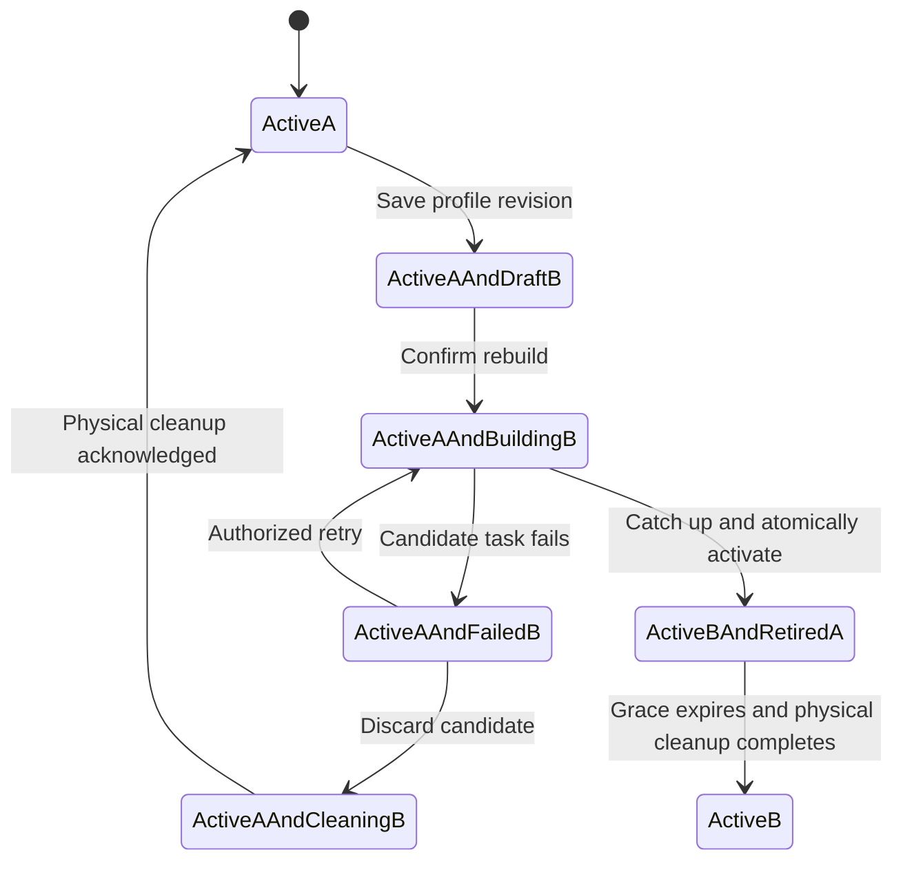
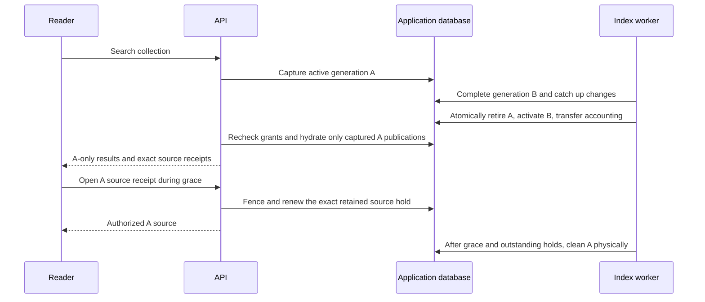

# M4 — Change a profile and rebuild while searching

Delivered in [PR #24](https://github.com/SimonLoir/vectorix/pull/24), squash-merged as `06f3366`, following the [M3 first-index journey](rag-first-search.md) delivered in PR #7. PR delivery is tracked in the [build log](build-task-log.md). The verification below uses real Ollama and isolated infrastructure. [M5a native Cohere](rag-cohere-embeddings.md) now implements a second provider through the same rebuild flow, with controlled dashboard acceptance complete and live paid-provider verification pending. Voyage/OpenAI/Mistral, additional chunking/context modes and operational acceptance remain M5b–M5d/M6/M7.

## Reviewed schema expansion

`IndexGeneration.previousGenerationId` is a nullable reference to the exact active generation observed when a rebuild is accepted. Its compound foreign key includes organization and collection identifiers; it cannot refer to another organization's or collection's generation. Existing first-generation rows remain unchanged with a null predecessor. The self-reference check rejects a generation naming itself. The NoAction reference is deferred so organization metadata cascades remain possible after physical RAG cleanup.

The nullable `authorityUserId` stores the current human authority for an unfinished rebuild, independently of later document-change actors. Historical rows fall back to `createdBy`. Only a newly authorized rebuild acceptance or explicit retry can set/transfer that authority. Once active, ordinary document updates continue to require their own document-management permissions rather than profile-administration rights.

Supplementary partial unique indexes enforce one candidate (`PROVISIONING`, `BUILDING` or `FAILED`) per collection and one rebuild candidate per organization. Initial indexes in other collections remain independent. A short organization/collection lock also checks that at most two non-cleaned generation tables are admitted per collection. Previous-generation metadata is retained after its physical table is removed.

The additive schema and generated migration `20261027000000_rag_rebuild` were independently reviewed. Isolated fresh installation, historical active-generation upgrade preservation, repeat deployment and Prisma schema parity passed. The existing authorization covers migration generation and tests on disposable databases; application databases are not migration-test targets.

## Dashboard journey

1. Save a new profile revision as a draft while the active generation keeps its immutable model, dimensions, metadata declaration and destination.
2. Compare active and draft settings, then confirm rebuilding. Acceptance probes external capabilities before a short transaction, checks revision/active-pointer expectations and persists the snapshot, exact source holds and durable work together.
3. Show the active generation's availability alongside candidate progress, errors, retry and discard. A failed candidate never replaces the active generation.
4. Dispatch accepted uploads, replacements, metadata edits, detachments and deletions to both live generations. Each projects metadata through its own declaration; incompatible shared field-type changes fail explicitly.
5. Activate only after the candidate's desired publications and contiguous change watermark match the collection. Transfer the pointer and active/retained accounting atomically.
6. Keep captured old-generation requests and signed exact-source references valid through their existing bounded grace. Then perform durable physical cleanup; release quota only after acknowledged vector/chunk deletion.

Rebuild/discard require a current session, organization profile-update and document-management permissions, and both explicit collection administration and document-management grants. The worker rechecks the initiating or retrying principal before provider cost and activation. Previously accepted destructive cleanup remains durable after member removal or suspension. Global catalog administration does not grant collection reading or satisfy these explicit rebuild grants.

Search filters use the active generation's declaration until activation. The metadata editor uses the latest saved declaration. Old and new vector dimensions, model identities or metadata fields must never be combined within one search response.

## Runtime boundaries

`generation-acceptance.ts` probes the immutable profile outside application transactions, then serializes admission through a non-key organization row write and the existing collection fence. The non-key write remains compatible with the database's organization `KEY SHARE` cleanup guards; its active-organization predicate cannot reactivate a suspended organization. Replays return the previously accepted generation without another model probe.

`activation.ts` requires the observed predecessor pointer, the latest accepted configuration revision, complete desired publications and a contiguous change watermark. The transaction retires A, activates B and transfers passage accounting together. A's manifests and publication pointers remain intact, and its live source holds become retired holds with the existing 17-minute search/receipt/I/O grace. Current grants and live document associations are still required for every read.

A never-activated candidate cannot have served search receipts. Superseding or discarding its materialized publications therefore does not create an artificial citation delay. Existing longer accepted hold deadlines are still honored. A generation that actually served searches retains its bounded grace; cleanup does not add a second full grace when processing the same generation again. Vector tombstones and confirmed chunk deletion precede retained-quota release.

Metadata declarations can add or remove keys; values are projected through each generation's own declaration. A field cannot change type while a non-cleaned generation still declares its previous type. Restoring a field after old generations are cleaned also validates existing association values in batches of 100. Saving a draft does not retarget active searches or provider credentials. While a candidate is pending or failed, only unchanged-profile name/description edits are accepted; retry never substitutes a later draft.

## Integration entry points

- Persistence: `packages/db/prisma/models/rag-indexing.prisma` and `20261027000000_rag_rebuild/migration.sql`; upgrade preservation fixtures in `tests/catalog/rebuild-upgrade-{seed,check}.sql`.
- Compatible V1 revision `1.8.0`: `packages/api-contracts/src/v1/rag/{indexing,indexing-types}.ts`, route handlers `packages/routers/rag/src/indexing/{rebuild,discard}.ts` and explicit operations in `packages/auth/src/permissions/operations.ts`.
- Admission/recovery: `services/indexing/{generation-acceptance,rebuild,discard,retry,access}.ts`; live profile validation in `services/{collections,indexing/profile-metadata}.ts`.
- Publication and cleanup: `services/indexing/{activation,changes,publication-state,source-holds,cleanup-index,task-state}.ts`. The existing worker entry point remains `apps/workers/src/index.ts`.
- Views and retrieval: `services/indexing/{views,search,sources}.ts`. Status uses a consistent database snapshot; selected chunk generations and captured search generations are explicit.
- Dashboard: `apps/web/components/rag/indexing/{rebuild-dialog,index-controls,index-generations,index-chunks,search-playground}.tsx`, with existing collection forms and EN/FR/nl-BE dictionaries.
- Integration coverage: `apps/api/src/rag-tests/index-rebuild.ts`, registered in the existing disposable catalog harness.

## Dashboard acceptance recipe

Prerequisites: apply the seven reviewed migrations, start API/web/admin/workers with isolated PostgreSQL/vector/Redis/private S3 infrastructure, and configure a reachable approved Ollama endpoint. Use the original `embeddinggemma` and the **EmbeddingGemma retrieval** preset from [the reproduction guide](rag-ollama-embeddinggemma.md). The manager needs current organization permissions plus explicit reading, document-management and administration collection grants. No paid-provider credentials are required.

1. Upload a text PDF and a Markdown document with a recognizable value such as `ORCHID-30`. Attach both to a collection, index a document-structure profile with 256-dimensional DiskANN, and confirm active generation A has four passages.
2. Search the recognizable value and open its exact source. Save a 128-dimensional draft and confirm A still serves its own profile. Review the full active/replacement comparison before accepting a rebuild.
3. To exercise failure, use admin quotas of six active passages and zero temporary passages. The replacement may publish one document and fail its other task with the explicit quota error. Confirm A remains searchable. Discard the candidate and wait for physical cleanup before accepting another rebuild; restore suitable quotas first.
4. Save another draft that adds a text metadata field such as `department`. Pause only the disposable indexing queue before accepting the next rebuild. Leave document workers running. Replace the Markdown original with `MAPLE-45` and zero-day retention, attach a newly uploaded DOCX, then set that association's language/tags and `department=finance`. A remains searchable with the previous version and its own metadata declaration.
5. Resume indexing. Confirm catch-up reaches all three documents before the 128-dimensional generation becomes active. Open the previously captured A result's source again and download its original. Its bytes must still match version 1. New searches must use the new generation and version 2; a `department=finance` filter must select the DOCX added during construction.
6. Inspect chunk previews, current/retired generations and active/retained/reserved usage. Another build must wait for the old table's physical cleanup. After the retirement grace, confirm the old table and unused source bytes are removed while the new table and current originals remain. Review the comparison and generation states in English, French and Belgian Dutch.

## Actual verification — October 22, 2026

The production-browser run used real CPU Ollama 0.40.8 and the original EmbeddingGemma model, document-structure chunking, private RustFS, separate disposable application/vector databases, Redis, and built web/admin/API/workers. It did not read the local `.env` or use application databases. The same model and endpoint setup is documented in the reproduction guide.

- A served 256-dimensional search with two documents/four passages. Saving a 128-dimensional draft preserved A. A quota-limited candidate published one document, then failed another task; live A search still succeeded. Dashboard discard triggered real cleanup of that candidate's table and charges without advancing its clock.
- The successful replacement was accepted at content sequence two. While indexing alone was paused, the Markdown replacement became library version 2, a DOCX was uploaded and attached, and its metadata was edited. A continued returning version 1 and its exact source. The draft-only field was absent from A's search filters.
- Real workers caught up through sequence five and atomically activated revision 3 at 128 dimensions with three documents/six passages. A became retired; accounting was six active, eight retained and zero reserved passages. The old A result remained visible with its previous-generation label. Reopening its exact source and downloading version 1 **after activation** succeeded; the original SHA-256 matched the uploaded version 1. A new hybrid `MAPLE-45` search returned version 2 from the replacement generation. The newly available `department=finance` filter returned the DOCX with exact paragraph provenance.
- Only after that source proof, the isolated test advanced A's already-retired generation/hold/index-cleanup deadlines. Real workers dropped A's table, tombstoned its ledger, deleted its application chunks and released its holds/charges. The unused version's document-cleanup availability was also advanced after confirming all its holds were released. No pointer, task outcome, completion flag, accounting counter or physical object/vector data was fabricated. This proves the real cleanup path, not a wall-clock 17-minute soak.
- The resulting dashboard showed six active, zero retained and zero reserved passages; the active table retained its six rows. Real S3 HEAD checks confirmed the old Markdown original/extraction absent and all three current original/extraction pairs present. English/French/Belgian Dutch profile comparison, state labels, locale-aware dates/numbers and Belgian Dutch reload persistence passed. The fresh final web tab had no console warnings/errors. Admin quota changes and persistence passed; an existing admin-list timezone fallback warning is recorded for M7 and is not claimed fixed by M4.

Automated validation passed: Prisma generation/validation; fresh, historical active-generation upgrade, repeat migration and schema parity; 23 type-check tasks, 23 lint tasks with non-blocking warnings, 23 backend regressions, four production application builds, all 95 isolated catalog/core/RAG tests, and the final six-image Docker runtime/infrastructure suite. Seven M4 integration journeys include real lock contention and suspension fencing, accepted-authority versus later source actors, revision/replay/compound-permission checks, partial-candidate cleanup without artificial delay, capture-before-switch search hydration and retained exact sources. Independent critical review found no remaining P1/P2 blocker.

The browser run covers the stated manager flow and locale switching, not every state in every locale. Delayed in-flight search, permission revocation, interrupted execution, retry and concurrency boundaries are covered by isolated integration tests. Paid-provider live checks, all additional chunking/context combinations, reference-corpus relevance and capacity/backup acceptance remain M5–M7.
