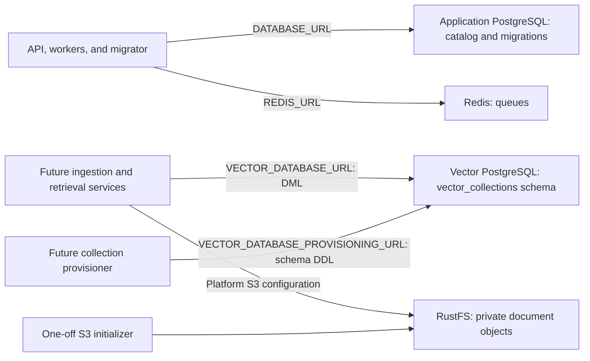

# RAG infrastructure — phase 1

This original phase 1 supplies the development infrastructure and its automated acceptance checks. Collection and credential APIs now exist in the [catalog backend foundation](rag-catalog-access.md); completing their dashboard is the next priority. Document uploads, indexing, and search remain planned as complete dashboard journeys in the revised [implementation plan](rag-implementation-plan.md).

## Services and data boundaries



The application database retains its existing service, volume, and `DATABASE_URL`. Vector storage uses a separate PostgreSQL instance and volume, allowing both connections to be tested independently. Never point the application migrator at the vector connection. This change adds no Prisma migration.

The vector image is built from `infra/postgres-vector/Dockerfile`. Its PostgreSQL base is pinned by version and digest; extension downloads are verified against committed SHA-256 checksums. Build tools remain in the build stage. The upstream PostgreSQL entrypoint initializes volume ownership before running the database as the `postgres` user.

| Component          | Pinned version        | Source                                                                                                          |
| ------------------ | --------------------- | --------------------------------------------------------------------------------------------------------------- |
| Vector PostgreSQL  | 18.6, Debian Bookworm | [PostgreSQL supported versions](https://www.postgresql.org/support/versioning/)                                 |
| pgvector           | 0.8.7                 | [pgvector release](https://github.com/pgvector/pgvector/releases/tag/v0.8.7)                                    |
| pgvectorscale      | 0.9.1                 | [pgvectorscale release](https://github.com/timescale/pgvectorscale/releases/tag/0.9.1)                          |
| RustFS             | 1.0.3                 | [RustFS release](https://github.com/rustfs/rustfs/releases/tag/1.0.3)                                           |
| Bucket initializer | AWS CLI 2.31.22       | [AWS CLI container documentation](https://docs.aws.amazon.com/cli/latest/userguide/getting-started-docker.html) |

The vector Dockerfile selects the upstream pgvectorscale binary for `amd64` or `arm64` and compiles portable pgvector code. CI validates its native Linux `amd64` build; other architectures require their own runtime validation before production use.

On x86, pgvectorscale requires AVX2 and FMA, including source builds. The image checks these CPU flags before initializing the database and exits with an actionable error on unsupported hosts. Virtual machines may need host CPU passthrough. ARM hosts require NEON. This is an [upstream requirement](https://github.com/timescale/pgvectorscale/blob/0.9.1/pgvectorscale/src/access_method/distance/mod.rs), not an optional optimization; the image never silently omits pgvectorscale.

## Local setup

Run from the repository root:

```sh
pnpm setup:env
docker compose up --build -d
docker compose ps -a
pnpm db:generate
pnpm db:migrate
```

`setup:env` preserves an existing `.env`. For an existing checkout, copy the new vector and S3 settings from `.env.example` into that file, preserving existing secrets and application connection settings. Compose has matching local defaults so its new infrastructure can start before this manual update. The `s3-init` service should exit successfully after creating or finding the bucket.

| Service                | Host endpoint           | Compose endpoint       |
| ---------------------- | ----------------------- | ---------------------- |
| Application PostgreSQL | `localhost:5432`        | `postgres:5432`        |
| Redis                  | `localhost:6379`        | `redis:6379`           |
| Vector PostgreSQL      | `localhost:5433`        | `postgres-vector:5432` |
| RustFS S3 API          | `http://localhost:9000` | `http://rustfs:9000`   |
| RustFS console         | `http://localhost:9001` | `http://rustfs:9001`   |

Published development ports bind to loopback only. Log into the RustFS console with `VECTORIX_DEFAULT_S3_ACCESS_KEY_ID` and `VECTORIX_DEFAULT_S3_SECRET_ACCESS_KEY`. The defaults in `.env.example` are local development credentials; deployments supply their own secrets and endpoints.

`docker compose down` stops the services while retaining data. Do not add `--volumes` unless intentionally deleting the local databases and document objects. Test scripts use separate project names and volumes and remove only those test resources.

## Vector connections and permissions

| Setting                            | Purpose                                                      |
| ---------------------------------- | ------------------------------------------------------------ |
| `DATABASE_URL`                     | Application catalog and Prisma migrations                    |
| `VECTOR_DATABASE_URL`              | Vector read/write connection using `vectorix_runtime`        |
| `VECTOR_DATABASE_PROVISIONING_URL` | Collection table/index provisioning using `vectorix_indexer` |
| `VECTOR_DATABASE_SCHEMA`           | Dedicated collection schema, initially `vector_collections`  |
| `VECTOR_POSTGRES_PASSWORD`         | Local vector instance administrator password                 |
| `VECTOR_PROVISIONER_PASSWORD`      | Initial password of the local schema owner                   |
| `VECTOR_RUNTIME_PASSWORD`          | Initial password of the local vector DML role                |

The new connection settings establish the deployment contract for subsequent phases; the current API and workers continue using the catalog connection and do not yet perform vector operations. A remote PostgreSQL deployment will use equivalent roles and TLS connection settings; user-managed remote connections are not implemented in this phase.

On a fresh vector volume, `10-vector-store.sql` installs the exact extension versions and creates the two non-superuser roles. `vectorix_indexer` owns only `vector_collections`, with no permission to create tables in `public` or create databases or roles. Tables it creates in that schema grant `vectorix_runtime` select/insert/update/delete access through default privileges. The runtime role cannot create or drop tables. Extension installation remains an administrator operation.

Initialization runs only on an empty volume. Changing passwords in `.env` does not rotate existing database roles. For an intentional local role-password update, recreate the service with the updated environment, then replay its bootstrap as the administrator:

```sh
docker compose up -d postgres-vector
docker compose exec postgres-vector psql -U postgres -d vectorix_vectors \
  -f /docker-entrypoint-initdb.d/10-vector-store.sql
```

This updates the two application role passwords and reapplies grants without deleting data. Rotating the administrator password requires a separate PostgreSQL administrator operation. An extension version mismatch fails explicitly instead of silently upgrading the database; review extension upgrade instructions separately.

## Private S3 storage

The platform fallback is configured through `VECTORIX_DEFAULT_S3_ENDPOINT`, `VECTORIX_DEFAULT_S3_REGION`, `VECTORIX_DEFAULT_S3_BUCKET`, `VECTORIX_DEFAULT_S3_ACCESS_KEY_ID`, `VECTORIX_DEFAULT_S3_SECRET_ACCESS_KEY`, and `VECTORIX_DEFAULT_S3_FORCE_PATH_STYLE`. Use path-style access for local RustFS. The default bucket is `vectorix-documents`.

Compose initializes RustFS with the configured local credentials. Its one-off `s3-init` service waits for RustFS health, lists buckets with authenticated S3 requests, and creates the configured bucket only when absent. Failed authentication or an unavailable server fails initialization. It never creates a public ACL or public bucket policy. Named data and log volumes preserve the runtime user's ownership.

Originals and extracted documents will use S3 in later phases independently of the vector database. Per-organization credentials, object provenance, and authorized downloads are not yet implemented. The initializer always targets the local `rustfs` Compose service, even if the future application fallback endpoint is changed to a remote provider.

## Acceptance checks and publication

```sh
pnpm test:infra
pnpm test:docker
```

`test:infra` requires Docker Compose 2.24.4 or later. It uses the same service definitions with a test override that removes every published port. It does not read the checkout's `.env`. It builds the vector image and, when no tested migrator image is supplied, the migrator image.

Checks cover:

- Catalog migrations applied twice, without installing vector extensions in the application database or Prisma tables in the vector database.
- Extension bootstrap replay, table creation, vector insertion, nearest-neighbor results, and actual HNSW and DiskANN index use.
- Real password-authenticated provisioning/runtime connections, schema restrictions, runtime DML, and denied runtime DDL.
- Repeated bucket initialization, binary object upload/download/deletion, anonymous access denial, and object persistence after restart.
- Vector persistence and query access after restarting the vector database.
- Cleanup of the isolated containers, network, and volumes on both success and failure.

The index smoke tests use 256 spatially distributed vectors and explicit search candidate limits. They validate extension functionality and actual index access, not production recall or latency; representative corpus evaluation and tuning remain part of later work packages.

`test:docker` retains its five application runtime checks and then runs the infrastructure suite using the same tested migrator. The existing GitHub Actions workflow validates all six built images on PRs. After merge to `main`, successful checks can publish `pxdv.be/vectorix/postgres-vector` alongside the five application images with shared `sha-<commit>` and `latest` tags. Publication remains skipped when registry credentials are absent. RustFS and the AWS CLI initializer use their pinned upstream images; they are not rebuilt or republished.
