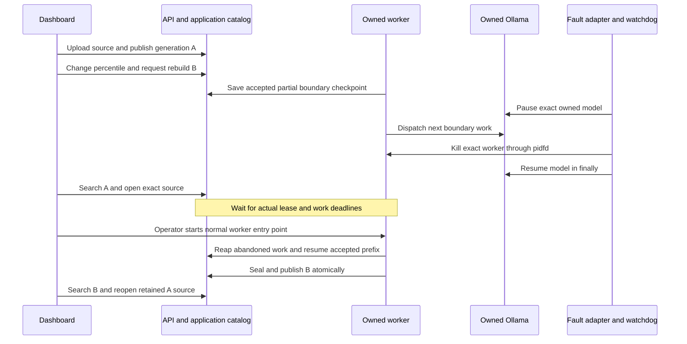

# M7c.4 — Semantic rebuild interruption

Status: **one native semantic-boundary interruption recovered and dashboard-verified; the original formal observer is INCOMPLETE**. The failed observer invocation is preserved. Separate guarded catalog, physical-store and browser observations establish the functional results below. This is one worker-crash case on one document and collection; termination at other stages and Redis, S3, vector-store or provider outages remain open. The [capacity experiment](rag-capacity-acceptance.md) is separate.

No application code, schema, migration, API revision, quota, provider timeout, lease, task row, database clock or retention deadline changes in this slice. The reusable [operator helpers](../tests/acceptance/interruption/README.md) and their corrected observer are a later source revision; they have not had a native retest. Private run files, credentials, checkpoints, receipts and screenshots are excluded from Git.

## Scenario and ownership

Run `8af698331852` used product commit `810fe339724254dee66896bc276a8415a3785915`, after PR #46. Five new loopback-only containers owned four new store volumes. The existing Ollama model volume was mounted read-only and preserved. The normal [quality topology](../tests/acceptance/quality/README.md) supplied isolated `_test` databases, least-privilege vector roles, a private RustFS bucket, synthetic accounts and production API/workers/web processes. This reuse does not make this a reference-quality measurement.

The fault adapter enrolled the fresh topology while it contained zero documents and collections. Its separate binding pins the product, builds, migrations, images, resources, model volume, helper sources and exact process identities. Normal quality admission remains unchanged and requires live workers. A separate, narrowly scoped absence admission permits read-only observations only after a completed enrolled fault, with the exact old worker absent, API alive and every dependency unpaused.

The only fault actions were pausing the exact owned Ollama container, sending SIGKILL through a pidfd to the exact recorded worker, and unpausing that model in `finally`. An independent watchdog was armed and acknowledged before the pause; its 100-second ceiling reserves 55 seconds for bounded inspection and unpause. A failed or ambiguous control operation cannot establish recovery. No helper restarts workers, retries accepted mutations or writes business/task state. The operator restarts the normal worker entry point after actual lease expiry. The trial has one original 15-minute deadline.

## Frozen source and native profile

The artificial TXT fixture contains 128 alternating English/French long paragraphs. It is deliberately useful for catching a partial boundary checkpoint, not a retrieval-quality corpus. Production extraction/unitization/preparation validate its geometry before any native call. Synthetic distance arrays in the local preflight are explicitly separate from actual model distances.

| Input                                  | Value                                                                                 |
| -------------------------------------- | ------------------------------------------------------------------------------------- |
| Original filename                      | `m7c-semantic-boundary-128-v1.txt`, retained as the model document title              |
| Source                                 | 233,383 UTF-8 bytes; 228,671 canonical UTF-16 code units                              |
| Source and canonical text SHA-256      | `9362fe4019bef7c9c744a4ba46a599523fa693b951103888e4ec1737a7227dd6`                    |
| Historical preflight SHA-256           | `879e7fc71b2074052ac978965b83bda7e2322522d89a58d70e4cd2e79d2b3c05`                    |
| Actual semantic units                  | 128; unit manifest `8a194a5cf884a97a0db80363c429960b1568691b31c4dc2c5ae8eb11d0bbf5a8` |
| Model                                  | Ollama 0.40.8, `embeddinggemma:latest`, `EMBEDDING_GEMMA`, 768 dimensions             |
| Verified native weight digest          | `85462619ee721b466c5927d109d4cb765861907d5417b9109caebc4e614679f1`                    |
| Actual dashboard probe                 | Context 2,048; same preset, dimension and verified digest                             |
| Preparation                            | Empty custom preparation; production useful-input cap 1,968 bytes                     |
| Largest boundary unit / prepared input | 1,824 / 1,872 bytes                                                                   |
| Boundary prepared inputs per plan      | 239,272 bytes before native request/history accounting                                |
| Profile                                | Semantic target/min/max/overlap 512/128/768/64; parent maximum 2,048                  |
| A → B configuration change             | Percentile 90 → 55 only, revisions 1 → 2                                              |
| Vector shape                           | Cosine, float32, DISKANN; only children have vectors                                  |

The source was uploaded, extracted, marked MIXED, associated and indexed through the dashboard. A fresh normal provider probe was inspected before index admission. The local compatibility CLI rechecks supplied public metadata but explicitly does not attest to the origin of a probe. Saved source/profile/model bindings are checked separately.

## Actual fault and supplemental recovery

A first became ACTIVE with 176 searchable children and 44 parents. Guarded physical proof verified all 176 child tuples and the sealed publication before rebuilding. B accepted 32 of 128 semantic units, 31 distances and the corresponding checkpoint while task lease epoch 2 was processing. The adapter observed a real in-flight boundary dispatch, killed the exact worker and confirmed the model resumed.

The database observation at `09:18:13.284727 UTC` preceded both unchanged deadlines, `09:20:13.121 UTC`. Before the normal restart, a separate SELECT established a UTC session, the actual `timestamp without time zone` column types and both expiry predicates against the database clock. The accepted prefix/checkpoint remained unchanged, the original worker was absent and A remained active. Neither deadlines nor persisted rows were edited.

The new owned worker naturally reaped the abandoned work as UNCERTAIN and completed B. Supplemental snapshots verify the same immutable plan/source/profile/manifest, all first 31 accepted distances and checkpoint identity, retained prior work identities, and no new logical BOUNDARY operation below the accepted 32-unit prefix. This is a statement about durable logical operations; it cannot prove exactly-once wire execution or the bill for a killed native request.

| Recovered state                                | Observed value                                                  |
| ---------------------------------------------- | --------------------------------------------------------------- |
| A                                              | RETIRED; 176 children and 44 parents                            |
| B                                              | ACTIVE; 204 children and 43 parents                             |
| B task                                         | COMPLETE; epoch 5, two attempts, three successful continuations |
| Plans                                          | Both READY with 128 units and sealed boundaries                 |
| Logical dispatched batches, A + B              | 16                                                              |
| Confirmed successful native batches            | 15                                                              |
| Uncertain abandoned attempts                   | 1                                                               |
| Known successful provider input tokens         | 214,601; incomplete for the uncertain attempt                   |
| Billing                                        | UNKNOWN                                                         |
| Reserved plan bytes / prepared bytes / batches | 0 / 0 / 0                                                       |
| Stored plan bytes                              | 29,776                                                          |

The [bounded physical recipe](../tests/acceptance/interruption/physical-proof.md) read application state, both generation tables, then application state again. The executed comparison records exact application equality. All physical child tuples, source/publication identities, manifests, 768-dimensional shapes and READY/SEALED ledgers reconcile. Parents have no vectors. These projections contain identifiers, hashes and numeric observations, not raw vector values. They are separate store reads, not an atomic distributed snapshot or independent verification of the vector values. The retained physical artifact contains one application projection and the comparison's equality declaration; an independent rereview can recompute its tuples/manifests but cannot replay the two raw application reads.

## Dashboard acceptance

Prerequisites are the owned fresh topology, the exact fixture filename/profile above, a serving A and a pending B. In this actual run the French production dashboard was used throughout. EN/nl-BE were not reverified in this interruption trial.

1. Upload the frozen TXT, inspect canonical extraction, set MIXED language, associate it and create A through normal forms. Inspect the saved native capability and ACTIVE child/parent counts.
2. Change only the semantic percentile to 55. Review the comparison dialog and request B. Run the separately enrolled one-shot fault only after a real accepted partial prefix.
3. While the worker is absent, run LEXICAL `harbor route 001`, topK 3. One deduplicated result reports A and exact version 1; open the indexed source. Actual child range is UTF-16 0–1,534.
4. Wait for natural expiry, start the normal worker and inspect B becoming ACTIVE. Repeat that lexical search: one result reports B, child 0–1,819 with parent context 0–5,399.
5. Reopen the old A result after B activation and request its previously unopened second source page. The actual fresh request returns version 1, UTF-16 20,001–40,000 of 228,671. This proves retained exact-source access beyond a cached first page. Original download was not attempted.
6. Inspect Index, Usage and Operations. Active/retained/reserved child counts are 204/176/0; native counters show 16 logical dispatches, 15 confirmed and one uncertain. Operations has zero due/failed work and one legitimate future A cleanup, not zero total pending work.

Both browser consoles contain zero errors. Displayed 82ms/71ms lexical durations are functional observations, not a latency benchmark. Source, catalog, physical and browser checks completed within the original 15-minute window. Cleanup removed only the five owned containers, four new volumes and owned preview processes, closed only created tabs 31–32, preserved the model cache and retained private evidence. Cleanup is verified at `09:33:43 UTC`; product retirement grace was not accelerated or tested through expiry here.

## Observer failure, corrected sources and evidence

The original once-only `absent-checkpoint` invocation fails with `OBSERVER_TIMESTAMP`. Its parser incorrectly required an offset on Prisma's UTC `timestamp without time zone` JSON strings. The original failed result and invocation, 17 frozen files and source manifest remain unchanged. No successful original checkpoint was stored; later stages of that formal chain were not fabricated or replayed. Its formal status remains INCOMPLETE.

The corrected portable observer permits an offset-free instant only for named Prisma fields after the same SELECT proves a UTC/Etc-UTC session and each actual column's expected type. The database clock still requires an explicit offset. Raw deadline strings are preserved. A separate corrected accounting check classifies retained published children by the retired generation, matching production activation; publications remain PUBLISHED when their generation becomes RETIRED. Focused regressions cover these proof-tool changes. They change no product behavior and have not run against a new native topology.

| Private evidence                   | SHA-256                                                            |
| ---------------------------------- | ------------------------------------------------------------------ |
| Original enabled observer manifest | `8f224bb5b5090cc056b4015c64c01dfa248a902de9df58afb2e8fe00f2347426` |
| Supplemental expiry before restart | `613e69919d94e4e2b7538c4b5ef23e3689f162f152f291cce94c48d033f4a2ce` |
| Supplemental recovered catalog     | `686b6be72c48945dd3c838c0d430f467e5ebee466d049e7307770549ca18a36b` |
| Supplemental final physical proof  | `9d3b5be5b43659493aa42678bb2d4b77a3c4beeec19812a9f97c783d605dc69d` |
| Browser acceptance record          | `0aaa355cb4bccce9fc6e137c49ef14132912d1460b99db40849de7774454d4dc` |

Hashes identify retained evidence; they are not signatures or independently reproducible runtime attestations. The helper provenance distinguishes historical native sources, subsequent corrections and relocated files. Offline tests, native model work, supplemental observations and browser checks are reported separately.

Remaining acceptance includes other worker stages and dependency outages, the full 100,000-child/ten-concurrent-HTTP workload with ingestion/fairness and internal p95, and live hosted-provider checks when organization credentials become available. The user selected a separately measured lighter capacity profile next; it cannot relabel the original long-input experiment or relax its finite admission gate.
