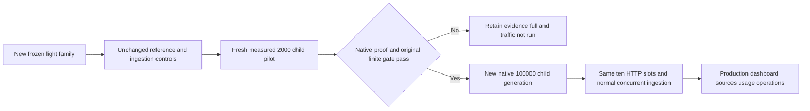

# Separate light-profile capacity experiment

Status: **offline geometry verified; native pilot/full/traffic NOT_RUN**. This is a new experiment, not a relabeling of the original long-input capacity attempt. Its purpose is to measure whether shorter embedding inputs can make a real 100,000-child run practical on the same CPU VM. No model/provider concurrency, vector dimension, timeout, resource budget or finite admission gate is relaxed.

Only primary organization A's pilot/full token-window profile changes: target/minimum/maximum/overlap 128/32/192/16, parent maximum 512. Organization B's 24-source reference collection and both tiny-ingestion controls retain 512/128/768/64 and parent maximum 2,048. Keep Ollama 0.40.8, exact verified EmbeddingGemma weights, full 768 dimensions, preset/empty preparation, cosine/float32/DISKANN and one native slot. The selected closed experiment/collection-role binding must be present in every state, profile and receipt.

## Frozen preparation

The actual local production planner verifies 500 searchable children and 125 unembedded parents per deterministic source. A final useful 48-byte record makes the source geometry exact; shorter punctuation-only tails and fewer children are not accepted. The four pilot originals are the exact first four of the full 200-source family. Full indexing starts a new generation and embeds all 100,000 children again; pilot vectors cannot be reused.

| Prepared measurement | Pilot   | Full       |
| -------------------- | ------- | ---------- |
| Original sources     | 4       | 200        |
| Source bytes         | 672,192 | 33,609,600 |
| Searchable children  | 2,000   | 100,000    |
| Derived parents      | 500     | 25,000     |

Every source is 168,048 bytes. Full prepared inputs total 42,467,532 bytes; the largest is 425 bytes. The fresh saved-profile probe must report `contextTokens >= 457` under the existing conservative byte-cap policy. This is a formatting prerequisite, not a measured tokenizer limit. Estimated native input work is 10,669,306 tokens under ceil(bytes/4), separate from chunk estimates and observed provider tokens. These are offline observations, not native throughput, physical disk usage or bills.

Family `66b2c83297a39f7e805ec5cf1fad2bc30297a0610570b8d06a6090285d8913d0`; pilot `14dd2e0bdcf31e55bff8c0ce6d018bdd42a42d12482c804cd1c9813a44b5d577`; full `5a6d27a0ffdf1acf558f327f3197257e7dcc9216e4717cd70d26de825138f0f2`. Eight pure preparation tests and deterministic generate/check pass. The original default source generator, metadata bytes and historical attempt outcomes remain unchanged.

## Native gate and separate measurements

Use a fresh owned run, databases/volumes, organizations, normal uploads, saved profiles/probes, generation and observation cohort. Establish unchanged B and two empty ingestion controls first. Report warm state UNKNOWN if baseline work/probes ran before the pilot; this is not a cold-start comparison.

The first primary-corpus index is a formal 2,000-child pilot. Keep its original 20-minute workflow bound and exact client index-start-to-ACTIVE timing. Full admission requires native/physical/source/accounting/resource evidence from that completed original invocation and `indexMs × 50 ≤ 7,200,000`, equivalent to at most 144,000 ms. This extrapolation is an admission screen, not a scaling guarantee. A failed/incomplete pilot remains failed/incomplete; server lifetime or a later supplemental proof cannot replace the timer.



After full admission, the separate source-import bound stays 20 minutes and full indexing stays two hours. Keep paced and closed-loop 180-second search phases, five slots per organization, actual HTTP-overlap evidence, six organization/mode nonempty coverage controls and bounded 300-second drains. Source/version/generation hashes and all native uncertainty/retry history remain mandatory. Internal histogram p95 is separate from client/service duration and excludes query embedding only through actual exclusive telemetry; no arithmetic subtraction is a measurement.

Dashboard acceptance follows measured phases to avoid contaminating their cohort: inspect exact saved primary/control profiles, ACTIVE counts, source versions, search/filter/parent/source receipt behavior, Usage, Operations and consoles. Record actual locales and failures. A pilot-only dashboard journey cannot establish the full 100,000-child/ten-HTTP/ingestion target.

## Operator workflow

The [shared capacity harness](../tests/acceptance/capacity/README.md) supports exactly `DEFAULT_V1` and `LIGHT_V1`. Omission selects DEFAULT_V1. Use `--experiment LIGHT_V1` on **every Python command**, including `app`, `guard`, `status` and `cleanup`. It determines the exact namespace path before reading private state. No environment variable selects a policy, and an existing run cannot change policy or adopt old receipts.

The complete descriptor hash and collection role bind new states, fixtures, reports, native baselines/final receipts and resource/store evidence. Roles are `pilotA`, `primaryA`, `referenceB`, `ingestionA` and `ingestionB`; they are independent of authenticated account roles. Unknown or inconsistent bindings refuse before resource admission. JavaScript entry points receive the exact state path, then validate its immutable policy; they cannot choose one from an arbitrary prefix or executable configuration.

Run `pnpm test:capacity:guards` for the local pure/injected suite and frozen-file checks. The new [light preparation CLI](../tests/acceptance/capacity/load-light-prepare.mjs) recomputes the production geometry in memory with `check`; it never overwrites the three tracked light metadata files. Their preparation-time NOT_RUN fields are historical preparation facts, not the current harness's activation state or native acceptance.

After a clean committed production build and independent review, create a fresh run with the explicit model cache selection:

```sh
capacity_run="$(node -e 'process.stdout.write(require("node:crypto").randomBytes(6).toString("hex"))')"
vectorix_light() {
  python3 -B tests/acceptance/capacity/load-topology.py \
    --experiment LIGHT_V1 --run "$capacity_run" "$@"
}
vectorix_light --mode prepare --model-volume YOUR_EXISTING_MODEL_VOLUME
vectorix_light --mode deploy
vectorix_light --mode verify-schema
```

Start API and workers in separate foreground terminals using the same run identifier and explicit experiment. In each terminal, set `capacity_run` to the same recorded value and define `vectorix_light` again. Seed only the fresh declared synthetic fixture before workers, as in the shared recipe:

```sh
vectorix_light --mode app --service api
```

```sh
vectorix_light --mode seed
vectorix_light --mode app --service workers
```

```sh
vectorix_light --mode ready
vectorix_light --mode app --service load --workflow pilot
```

Only the completed original pilot and its matching evidence can admit `--workflow full`; only a matching completed full report admits `--workflow traffic`. Do not retry an accepted invocation, change thresholds or repair its journals. Optional dashboard verification follows the measured cohort through `--mode app --service web`. Finish with `vectorix_light --mode cleanup`, preserving the model cache and private evidence.

Default source metadata stays in [load-v1](../tests/acceptance/capacity/load-v1/full-preflight.json); light metadata has its separate [light-v1](../tests/acceptance/capacity/light-v1/full-preflight.json) root. Both reuse the single canonical quality corpus. The [source provenance](../tests/acceptance/capacity/helper-provenance.json) separates previous default delivery, historical native attempts, new closed-policy sources and preparation files. Private native run state and credentials are excluded from Git.

## Actual native result

NOT_RUN. Shared-runtime integration, independent review and full source/build/input freezing are required before preparation. No current preparation file authorizes bypassing those gates.
