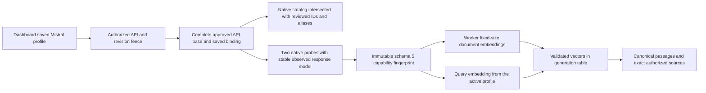

# M5d — Native Mistral embeddings

Implementation, automated validation and controlled dashboard acceptance are complete on `codex/rag-mistral-provider`, based on merged OpenAI PR #30 (`124c991`). This guide records the reviewed native contract, reproducible dashboard acceptance recipe and actual results. Earlier [Ollama](rag-ollama-embeddinggemma.md), [Cohere](rag-cohere-embeddings.md), [Voyage](rag-voyage-embeddings.md) and [OpenAI](rag-openai-embeddings.md) journeys have separate records. Live paid Mistral verification awaits the user's organization credentials.

## Configuration and reviewed capabilities

Configure a **Mistral** organization integration with complete API base `https://api.mistral.ai/v1` and a test API key. API and workers must approve the exact base through `VECTORIX_EMBEDDING_ALLOWED_ENDPOINTS`, unless it is their Mistral-specific platform default. Native relative `models` and `embeddings` routes preserve the saved `/v1` or approved proxy path prefix.

The optional platform fallback is configured at runtime on both services:

```dotenv
VECTORIX_DEFAULT_MISTRAL_ENDPOINT=https://api.mistral.ai/v1
VECTORIX_DEFAULT_MISTRAL_API_KEY=
```

Organization configuration precedes environment defaults as a complete binding. Invalid organization credentials fail explicitly without falling back. Saved collection revisions retain their original binding; selecting another integration affects new configurations. Secrets remain encrypted and masked. The browser calls Vectorix; the API and workers make provider requests with bounded I/O and current authorization checks.

The reviewed model pair is `mistral-embed` and its official dated name `mistral-embed-2312`, with **fixed 1024-dimensional float vectors** and **Generic** input. Both HNSW and DiskANN admit this size. Other models, including code embeddings with different capabilities, are not enabled by a provider listing.

The [official text-embedding guide](https://docs.mistral.ai/studio/knowledge-rag/embeddings/text_embeddings) documents the fixed size. The [model page](https://docs.mistral.ai/models/mistral-embed-23-12) describes context as **8k**. Vectorix uses a conservative **8000-token processing cap**, with the shared prepared UTF-8 byte bound and reserve, rather than claiming an independently established exact native 8192-token limit. Token counts remain estimates. The internal batch policy is at most **64 inputs** and **16000 budget units, counting prepared UTF-8 bytes plus 32 units per input**; these are Vectorix product limits, not a claim about undocumented native batch limits.

## Native protocol and saved identity

Authenticated `GET {savedBase}/models` lists account-visible IDs and aliases. Vectorix intersects reviewed native entries and their reviewed aliases with the explicit pair above; an unrelated model cannot enable itself by claiming a reviewed alias. Mistral's native model capabilities do not define an embeddings flag, so the adapter must not invent one. Listing alone does not establish embedding readiness.

`POST {savedBase}/embeddings` sends `model`, `input` as an array, and `encoding_format: "float"`. The fixed text model does not use configurable output dimensions or quantization. No invented retrieval-role or truncation parameters are sent. Document and query operations share native semantics; Generic preparation adds no model-specific prompt.

Both application-path probes capture the actual response model ID. It must belong to the explicit reviewed pair and remain identical across probes. The schema-version-5 capability snapshot records the selected model, observed `responseModel`, explicit equivalence policy, fixed dimensions and processing/batch policy. Later native calls must return that saved response ID: a reviewed-alias drift fails explicitly, while an unrelated returned model is invalid. This deterministic fingerprint identifies declared capabilities and the observed response identity; it cannot attest to hosted model weights. Snapshot versions 1–4 remain unchanged.

Responses require a complete, unique indexed permutation of inputs, exact vector dimensions, finite float32 values and nonzero norms. Restore native index order before associating vectors with passages. `usage.prompt_tokens` is provider-reported input usage; missing usage remains unknown and `total_tokens` is not separately reported billing. A failed later batch cannot return partial successful publication.

Compatible API revision `1.12.0` adds optional `responseModel` to verification metadata. Earlier provider DTOs remain readable and omit that row. OpenAI dimension ranges retain their existing semantics. No database migration is planned for this slice.



## Implementation entry points

- Native discovery, probes, batches and immutable replay: [`packages/embeddings/src/mistral.ts`](../packages/embeddings/src/mistral.ts), with schema-version-5 validation in [`types.ts`](../packages/embeddings/src/types.ts).
- Saved endpoint/credential resolution and executable profile gates: [`embedding-profile.ts`](../packages/routers/rag/src/services/indexing/embedding-profile.ts); post-I/O authorization and revision checks: [`models.ts`](../packages/routers/rag/src/services/indexing/models.ts).
- Compatible public verification metadata: [`indexing-types.ts`](../packages/api-contracts/src/v1/rag/indexing-types.ts); model/dimension form: [`embedding-fields.tsx`](../apps/web/components/rag/collections/embedding-fields.tsx); truthful probe display: [`model-verification.tsx`](../apps/web/components/rag/indexing/model-verification.tsx).
- Native protocol regressions: [`mistral.test.ts`](../packages/embeddings/tests/mistral.test.ts); isolated transport/worker/vector/source journeys: [`mistral-indexing.ts`](../apps/api/src/rag-tests/mistral-indexing.ts).

## Dashboard acceptance recipe

1. Configure an approved complete organization integration. Upload bilingual Markdown or a text PDF, wait for extraction and attach it to an authorized collection.
2. Save Mistral, a reviewed model, Generic, fixed 1024 dimensions and document-structure chunking without parent/child expansion. Discover the saved provider's native catalog and verify the saved profile; inspect the selected and observed model IDs and the fingerprint limitation.
3. Start indexing, inspect tasks/chunks, run French/English hybrid/vector searches and open/download exact sources. Verify that keyword-only retrieval makes no embedding request.
4. Save another reviewed profile, review and start a rebuild. With only indexing paused in an isolated fixture, keep searching the serving generation. Resume indexing, observe activation and reopen a source captured before the switch.
5. Select new invalid organization credentials for another collection. Native discovery/probes must fail without platform fallback; existing active generations retain their saved valid binding.
6. Check English, French and Belgian Dutch labels, error translation, numbers/dates, persisted locale and a fresh console. Remove owned previews, infrastructure, tabs and checksum-verified downloads.

## Validation status

Automated validation passed: 123 controlled native HTTP tests (28 Mistral plus 95 existing Ollama/Cohere/Voyage/OpenAI), 121 disposable core/RAG catalog tests, 23 workspace type checks, 23 lint tasks, 23 backend regressions, four production builds and all six image/runtime/infrastructure checks. Seven-migration fresh deployment, upgrade, replay and schema parity still pass; no new migration is required. The initial type pass found an obsolete dimension-one branch in the fixed-dimension fixture; it was removed. Independent review also checked the official SDK defaults: bounded cosmetic strings, absent catalog object/data and optional vector-row labels are accepted, while model/index/vector association stays mandatory. Four added native regressions and the final full validation passed. No P1/P2 remains in the reviewed slice.

Controlled browser acceptance used production web/API/workers, disposable application/vector PostgreSQL, Redis and private RustFS, and a deterministic native Mistral HTTP fixture. No Ollama or paid Mistral calls were made. The actual results were:

- In **M5d Mistral Lab**, a synthetic organization integration retained the complete `/v1` base. Configuration/form saves made zero provider calls. The model/preset/finite-dimension controls coherently offered the reviewed pair, Generic and 1024. Native discovery returned both reviewed names from a dated model card and its alias, excluding an unrelated model. Verification separately displayed requested `mistral-embed` and observed `mistral-embed-2312`, fixed dimensions, reviewed 8000 processing budget and the hosted-fingerprint limitation.
- A 562-byte bilingual Markdown original extracted and published three chunks in A, with exact character offsets. French hybrid `remboursement` returned the French passage with keyword rank 1 and vector rank 1. With only indexing paused, a revision-2 draft selected the reviewed dated name at the same fixed size. The review dialog compared profiles and an accepted replacement left A serving a fresh English vector request. This is an explicit alias/profile-change rebuild, not evidence of different hosted weights.
- Resuming indexing activated B with three chunks and retired A on its ordinary 17-minute grace. A captured old French source reopened after the switch and downloaded with identical SHA-256 `70829c0856361a6876b0e6b02937d6665657250e00fa2708caa2ba89f144ca3a`. Fresh English vector retrieval used B. Keyword-only retrieval returned two passages and left every fixture counter unchanged at 12 authenticated organization requests and zero platform requests.
- A controlled change of the provider's returned ID to the other reviewed alias caused an explicit `MODEL_CHANGED` search error and no stale/partial results. Restoring the originally observed response ID allowed a new vector search to succeed. The application did not silently reinterpret the saved identity.
- A newly selected invalid synthetic credential bound another collection. Native discovery and saved-model verification both failed explicitly with sanitized `PROVIDER_REJECTED`, without creating a generation despite a valid platform fallback. The existing B profile retained its original valid credential, successfully verified again and served a fresh filtered hybrid request. Durable final counters showed 17 authenticated organization requests, including the deliberately failed identity-drift request, two invalid-key rejections and **zero platform calls**.
- English errors translated reactively into French and Belgian Dutch; numbers and dates were localized. A fresh final tab retained Belgian Dutch, showed selected and observed model labels plus the reviewed 8.000 budget, and retrieved the French passage through a Markdown-filtered hybrid request on B with both ranks 1 and exact offsets 171–381. Its console had no warnings or errors.

All owned preview/provider processes, four infrastructure containers, three temporary browser tabs and the checksum-verified synthetic download were removed. Ports 3100, 3101, 3006 and the controlled provider port were verified unbound. A's three chunks remained on the ordinary grace at the last dashboard observation; no M5d clock advancement or physical-retirement soak is claimed.

These controlled results do not establish live paid-service connectivity or retrieval quality. Live Mistral availability, quality, latency and capacity remain pending the user's organization credentials. Documentation validation and PR delivery are recorded in the [build log](build-task-log.md).
