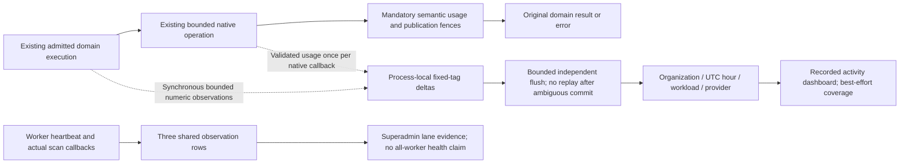

# M7b.2 — Recorded activity and worker observations

**Implemented with automated validation and real Ollama dashboard acceptance complete.** This extends the implemented [current-work triage](rag-operations.md). M7b.1 remains the authoritative current-work/recovery view. This slice adds historical recorded activity and worker observations, not billing, capacity certification or recovery mutations.

## Complete dashboard journey

An organization session with `ragQuota.read` opens Usage → Recorded activity, selects 24/168/720 hourly buckets, sees ingestion/index-claim/search outcomes, phase samples and native usage, then opens M7b.1 Operations for current failures. Generate real work, refresh and observe the current partial hour change. The admin organization page shows the same technical aggregates without collection/document details. A separate superadmin service panel shows shared worker-lane observations and explains their limits. EN/FR/nl-BE, reload, inaccessible/empty/not-tracked/partial/known-gap states and live acceptance belong in this same slice.

No query text/hash, filters, tags, document/collection/task IDs, filenames, actor/key IDs, model names/digests, endpoints, vectors or provider response bodies enter the new store. A hash of a short query is still sensitive and unnecessary. Collection drilldown remains M7b.1's current grant-scoped task view, not a new metric dimension.

## Persistence: three additive models

The proposed models are in `packages/db/prisma/models/rag-observability.prisma`. Do not modify semantic quota models or add foreign keys to members, candidates, tasks, sources or credentials. Organization-owned rows cascade on organization deletion; the existing native transaction and RAG cleanup guards must still roll back the entire deletion on a late guard failure.

### `OrganizationRagTelemetry`

One lazy-created row per organization; primary key/FK `organizationId` → Organization, `onDelete: Cascade`.

| Field                    | Concrete type / meaning                                                                                      |
| ------------------------ | ------------------------------------------------------------------------------------------------------------ |
| `organizationId`         | String primary key; same scoped organization ID as the admitted operation                                    |
| `formatVersion`          | Int default 1, immutable                                                                                     |
| `trackingSince`          | TIMESTAMPTZ(3), first successfully committed recorder flush; never a migration-time fabricated start         |
| `lastRecordedAt`         | TIMESTAMPTZ(3), throttled successful-flush time, not every search                                            |
| `knownGapReports`        | BIGINT default 0; recovered reports of discarded/unconfirmed aggregate flushes, not a count of lost requests |
| `lastKnownGapReportedAt` | Nullable TIMESTAMPTZ(3); when a surviving process could report the gap                                       |

No organization marker is eagerly backfilled. Zero gap reports never proves complete coverage: a process can die before reporting, or exhaust its bounded gap-marker capacity. Reads always state `BEST_EFFORT`. A known gap report is not assigned to an invented exact historical loss interval.

### `RagOperationalHour`

Primary key `(organizationId, bucketStart, workload, provider)`; Organization FK cascade; index `(bucketStart, organizationId)` for bounded expiry. No collection/provider-model index is needed for the maximum 720-hour read.

- `bucketStart`: TIMESTAMPTZ(3), UTC-hour aligned. It is the **database recording hour**, not an exact original request-start timestamp. A flush may combine several observations and cross an hour boundary; charts explicitly show recorded work. Compute this once in the flush transaction using the database clock after the relevant observation row lock, preventing worker clock skew/future buckets and bounding the buffered key space.
- `workload`: fixed enum `EXTRACTION`, `INDEX_STRUCTURE`, `INDEX_TOKEN`, `INDEX_SEMANTIC`, `SEARCH_LEXICAL`, `SEARCH_VECTOR`, `SEARCH_HYBRID`.
- `provider`: fixed enum `NONE`, `OLLAMA`, `COHERE`, `VOYAGE`, `OPENAI`, `MISTRAL`. Valid combinations: EXTRACTION/SEARCH_LEXICAL use NONE; the other five workloads use a native provider. This is 27 combinations, not an arbitrary label product. Known provider is taken from the saved generation/profile, not the latest draft.
- `formatVersion`: immutable Int 1; `lastRecordedAt`: database timestamp.
- BIGINT operation counters: `recordedStarts`, `recordedSuccesses`, `recordedFailures`, `recordedContinuations`, `recordedSupersessions`, `recordedDenials`.
- BIGINT native counters: `nativeStarts`, `nativeValidatedBatches`, `nativeFailedBatches`, `validatedVectors`, `dispatchedPreparedBytes`, `validatedPreparedBytes`, `validatedEstimatedInputTokens`, `knownProviderInputTokens`, `unknownProviderTokenBatches`, `unknownBilledTokenBatches`. `validatedVectors` counts successful completely validated native response rows, once per captured batch, including semantic boundary vectors and query vectors where applicable. It is observed native work, not physical active/searchable vector cardinality; existing quotas continue to describe active searchable children. No validated batch means public vector count unknown, not measured zero.
- Nullable BIGINT I/O counters with no default: `sourceReadBytes`, `artifactWrittenBytes`. SQL NULL means no successful actual byte observation; an actual observed zero is allowed. Merge each observed nonnegative delta with `COALESCE(previous,0)+delta`, leaving an unobserved field NULL. Count successfully read source bytes and successfully written extraction artifact bytes, including repeated successful I/O during retries, even if a later phase fails. Do not derive these from file metadata, declared Content-Length, plan reservations or elapsed-time samples. They provide observed throughput, not unique stored-document size; no fabricated backfill.
- `knownBilledInputTokens`: Float, nonnegative finite validated subtotal, preserving existing adapter numeric semantics. This is provider-reported token usage, not money; unknown batches remain separate and a subtotal cannot imply complete usage.
- `phaseStats`: bounded JSONB fixed-shape map described below. `failureCounts`: bounded JSONB map keyed by a reviewed finite safe failure-class enum, not raw public/provider messages. Both have database shape/integer/size checks; no arbitrary keys.

These are observations from separate clocks/boundaries. A start in one hour and completion in another do not balance. Do not require outcomes ≤ starts in the same row/hour, derive live tasks from their difference, or equate native successes to published documents. M7b.1 continues to answer current backlog.

At most `27 × 720 = 19,440` current-window rows per continuously active organization; one-provider operation uses seven combinations, at most 5,040 rows. This is a row-cardinality bound, not a disk-size/load claim. A phase payload hard cap of 8 KiB puts a deliberately conservative JSON-only upper bound around 152 MiB/organization/month across all provider combinations, before row/index/WAL overhead; normal payloads are smaller and actual measurements are required. Do not claim a fixed small physical size. Avoid per-search or per-native-batch rows entirely.

### `RagWorkerLaneObservation`

Exactly three possible global primary keys: `NOTIFICATIONS`, `DOCUMENTS`, `INDEXING`. Lazy rows; no organization/member FK and no host/PID/client-name/instance registry. Missing rows are `NEVER_OBSERVED`.

| Field                             | Meaning                                                                                                        |
| --------------------------------- | -------------------------------------------------------------------------------------------------------------- |
| `lane`                            | Fixed enum primary key                                                                                         |
| `lastHeartbeatObservedAt`         | Nullable database time when any initialized process was observed                                               |
| `lastScanStartObservedAt`         | Nullable database time of an actual scan callback starting                                                     |
| `lastScanFinishObservedAt`        | Nullable database time of an actual callback return/throw                                                      |
| `lastFinishedScanStartObservedAt` | Nullable start observation associated with that finish, not whichever other replica started last               |
| `lastFinishedScanDurationMicros`  | Nullable BIGINT from that execution's monotonic timer                                                          |
| `lastScanOutcome`                 | Nullable finite enum `RETURNED`, `THREW`                                                                       |
| `lastSafeFailure`                 | Nullable finite class `SCAN_FAILED`, `DATABASE_UNAVAILABLE`, `REDIS_UNAVAILABLE`, `UNKNOWN`; no exception text |

Finish time, associated start/duration, outcome and safe failure update atomically. Required SQL checks are precise: no finish timestamp means no outcome, associated start, duration or failure; an observed finish requires an outcome, while its associated start and duration may independently remain SQL NULL when unknown. RETURNED requires a NULL failure; THREW requires one finite failure class, using UNKNOWN when no narrower class is known. A known duration is nonnegative and a known associated start is no later than its finish. Never fabricate missing times/durations with now()/zero. Acquire the marker/lane row lock before sampling database clock_timestamp(), then use GREATEST against its prior observation. transaction_timestamp()/now() alone can regress timestamps when an earlier transaction waits behind a later reporter. Required marker/hour observation timestamps have no default; writers supply the ordered database time. Use database recording order rather than delayed process wall-clock timestamps. A later observation can describe an earlier actual callback: names must say _observed_. Heartbeats, starts and finishes are independent evidence. Multiple replicas mean the last finish cannot prove every intervening scan or every replica completed; never infer an active-process count, a universal stuck-scan flag or readiness from these three rows.

Lane recording also has a hard bound: exactly three in-memory lane slots, each holding only its latest pending heartbeat, start and atomic finish tuple, and at most one writer in flight. Slow storage must not create detached heartbeat/start/finish promise queues. Preserve a finish's own successfully recorded start receipt, or NULL if unavailable; never substitute another replica's global latest start. A lost start observation cannot block a real scan. Coalescing is snapshot observation, not complete scan history. Heartbeat cadence can be 15s per initialized lane, with each write bounded independently of task work. Scan start/finish observation occurs around each existing worker callback; a failed observation never prevents the real scan. The document lane includes extraction and cleanup; a returned scan can have handled individual task failures. Admin labels show recent/stale/never-observed timestamps, not HEALTHY/DOWN. A database outage makes evidence stale too. Current scan cadence is not a maximum completion time, so do not declare a long scan failed after one scheduler interval.

## Fixed phase representation and constraints

Use `phaseStats[phase] = {samples,sumMicros,maxMicros,buckets}` with nonnegative decimal BIGINT strings for samples/sum/buckets and fixed-length 16 noncumulative buckets. Missing phase means no sample; no zero-valued backfill. The fixed upper bounds in microseconds are:

`[1000,5000,10000,25000,50000,100000,250000,500000,1000000,2500000,5000000,10000000,30000000,90000000,300000000,null]`

The final null bound means above 300s, not infinity stored as a non-JSON number. Samples use the first inclusive bound, otherwise the last bucket. The sum of bucket counts equals samples; samples=0 requires sum=max=0. With positive samples, the maximum must fall inside the highest populated bucket. Let each integer bucket have inclusive bounds L/U (first L=0; each later L is the previous finite U+1). Using NUMERIC intermediates, require sumMicros to be at least the sum of count×L plus maxMicros minus L of the highest populated bucket, and at most the sum of count×min(U,maxMicros), with the open-tail U replaced by maxMicros. These bounds require an attained maximum and reject impossible histograms, including a tail sample with zero duration. Quantiles return sample count plus approximate lower/upper bounds (`upper:null` for the open tail), never a fabricated precise p95. Across rows, sum counts/buckets and take the largest max before deriving quantiles; do not average percentiles.

Allowed phases are finite per workload and at most eight:

- EXTRACTION: `SOURCE_READ`, `PARSE_EXTRACT`, `ARTIFACT_WRITE`, `CATALOG_PUBLISH`, `EXECUTION_TOTAL`.
- INDEX_*: `SOURCE_READ`, `PLAN`, `MATERIALIZE_SEAL`, `FINAL_EMBED`, `VECTOR_WRITE_SEAL`, `CATALOG_PUBLISH`, `EXECUTION_TOTAL`; semantic additionally `BOUNDARY_EMBED`.
- SEARCH_*: `PREFLIGHT`, `QUERY_EMBED`, `LEXICAL`, `VECTOR`, `FUSION_HYDRATE`, `SERVICE_TOTAL`, `INTERNAL_PHASE_UNION`; phases not executed in that search strategy are absent. No query embedding for empty-publication or lexical paths means zero samples, not a zero-duration native call.

Embedding-call phase durations include the existing critical admission/settlement callbacks, preparation, manifest checks and bounded native work inside that call. They are not provider-only latency. PLAN measures actual pure planning/parent-context work. Native START and dispatchedPreparedBytes describe logical dispatch intent, including manifest checks; they are not exact HTTP request or wire-byte counters. Measure via `performance.now()` in one process; do not reconstruct cross-restart durations from Date/updatedAt. Indexing continuations are separate execution samples. Lexical work overlaps query embedding: never compute internal search as total minus embedding or add parallel phase times. The existing internal p95 load target remains M7c benchmark work.

Reviewed SQL must enforce UTC bucket alignment, format immutability, valid workload/provider pairs, nonnegative counter ranges (including nullable I/O counters when present and `validatedVectors`), finite billed subtotal, exact allowed JSON keys/array length/integer values, histogram consistency, `octet_length(phaseStats::text) <= 8192` and the separate `octet_length(failureCounts::text) <= 1024` cap. All JSON counters, including maximum duration and every bucket value, use canonical nonnegative signed-64-bit decimal strings; numeric JSON alternatives are outside this fixed format. There are no state/accounting constraints relating observational counters to authoritative task or semantic-ledger totals.

## Writer, concurrency and bounded growth

The implementation uses a bounded **numeric-only process-local coalescer**: at most 256 `(organizationId, workload, provider)` deltas, ≤8 KiB phase state each, plus at most 256 gap markers. This is a hard memory cap of a few MiB, independent of request volume. No raw input or vectors survive observation. Overflow discards telemetry and marks a known gap if capacity permits; it does not block/extend a product request or task lease. Process death may lose unflushed observations and gap markers, which remains explicitly unknown.

Flush every 5s, at most 16 keys/transaction, one flush in flight per process, deterministic key order. Each transaction uses maxWait 50ms, lock_timeout 50ms and timeout 250ms. A background cycle attempts at most four transactions, including any worker-lane write, and stops launching transactions after 700ms. At most one writer is in flight; timers do not queue additional writers. A remaining backlog is bounded by the map cap. A process with many active organizations may lose observations; expose coverage, never promise full capture. Domain paths only update the process-local numeric buffer; they never await telemetry persistence.

Atomic `INSERT ... ON CONFLICT DO UPDATE` adds numeric counters and merges fixed histograms without lost increments. SQL is justified because Prisma cannot express atomic arbitrary histogram-array arithmetic. Keep one encapsulated parameterized helper and a reviewed finite format; no per-callback raw SQL assembled from labels. Do not take OrganizationEmbeddingAccounting or task locks. Create/throttle the organization marker in the same bounded flush transaction. Deterministic row order reduces deadlocks. A failed or ambiguous write is not replayed: discard that delta, report an unconfirmed-write gap later, and preserve the original product result. No receipt ledger or exact-once guarantee is introduced.

Prune at most 500 expired hour rows per maintenance pass using the time index and bounded `SKIP LOCKED` selection, outside task/semantic transactions. Multiple worker replicas must not wait on a metric bucket while holding task locks. Read APIs always exclude buckets older than the advertised 30-day window even if physical pruning is delayed by stopped maintenance. Retention is a bounded operational target, not a strict erasure SLA during an outage. Marker rows and three lane snapshots remain; no raw per-operation history exists. TTL never touches semantic plans, quota evidence, source holds or audits.

## Exact instrumentation and no double accounting

1. **Operation execution:** mark one start per admitted extraction execution, INDEX_DOCUMENT claim or authenticated captured search operation; mark its actual final outcome from the outer execution boundary. Retry/continuation is another observed execution, not another uploaded document. PROVISION, REMOVE_DOCUMENT and cleanup claims are excluded from the seven workload totals; their maintenance remains visible in M7b.1 current work and shared lane observations. SQL transaction retries are not additional executions: observation code must be outside retryable transaction callbacks. Identify workload/provider from the saved generation/profile, not the mutable draft. Denied pre-admission requests do not get tenant attribution.
2. **Native batches:** extend `@repo/embeddings` with a separate optional synchronous best-effort numeric observer; do not repurpose the critical `EmbeddingBatchObserver`. Its event contains only enum provider/kind, prepared byte/input counts, validated vector-row count, selected numeric usage, safe outcome and monotonic duration. No model/hash/text/vector fields are required. Creating telemetry-only metadata must not trigger prepared-input hashing/copying purely for observability. Capture only admitted indexing and query executions; native credential/model probes and catalog discovery remain explicitly outside these totals. A successful probe must not create an indexing/query workload observation or reported active vectors.
3. Preserve ordering: critical `beforeBatch` admission first; aborted-signal check; observe native start; execute/validate native operation; observe validated numeric success; then existing mandatory `afterBatch` settlement/checkpoint. A native failure records its own safe native outcome and preserves the original exception. A later checkpoint denial does not convert the already validated native response into a native failure. Critical callback/database errors are never swallowed by telemetry.
4. Emit native success once in the embedding wrapper's actual successful native callback path. Do not emit it again from `settleSemanticWork`, reapers, idempotent late-settlement retries, outer `embedDocuments().usage`, or document-publication success. An actual new native call after a domain retry is legitimately another observed batch, even when the document/profile is unchanged. Internal HTTP retries remain one logical native invocation; they cannot be called exact wire requests.
5. A semantic native success later denied by stale lease/current grants still contributes observed validated native usage; it cannot renew a claim, advance a plan or publish. Mandatory semantic ledger settlement remains unchanged and authoritative. Separate task outcome may be DENIED while native outcome is validated success. Native no-response/invalid response is not proof of zero paid usage.
6. Keep existing semantic cumulative usage and new hourly operational totals separately labeled; they overlap and have different retention/coverage. Never sum them. No candidate lifetime allowance, reservation or quota field changes in this feature. Late observations survive member removal/suspension but an organization deletion simply causes a fail-soft FK miss; telemetry must not recreate a deleted organization.
7. **Successful I/O bytes:** emit source-read and artifact-write byte deltas only at their actual successful bounded I/O completion boundaries, outside retryable catalog transactions. Actual byte counts come from completed byte streams/buffers, not source metadata or reserved capacity. An observed repeated successful read/write is additional work; an absent observation stays SQL NULL/public unknown. These are observed completed logical I/O bytes, not exact network traffic or hidden transport-retry counts. Failed partial I/O is outside these successful-byte totals and cannot be assumed to transfer zero bytes. Stored rows and phase samples cannot reconstruct pre-tracking throughput.

## Compatible API and permissions

Compatible revision 1.18 provides `admin.rag.telemetry.summary({window:'24H'|'7D'|'30D'})`, `superadmin.organizations.getTelemetry({organizationId,window})` and `superadmin.getWorkerObservations({})`. The organization REST operation is GET /api/v1/admin/rag/telemetry; superadmin routes are GET /api/v1/superadmin/organizations/{organizationId}/telemetry and GET /api/v1/superadmin/worker-observations. Do not widen legacy strict nested quota DTOs or mutate existing search `durationMs` semantics.

Organization summaries require current session-only `ragQuota.read`, current membership and active organization; key permissions continue to forbid ragQuota. Admin uses the current superadmin guard and explicit scoped organization existence. Admin global worker observations stay separate and unavailable to organization members. History contains no collection IDs; no new content grants, impersonation or recovery mutations.

Return `observedAt`, actual UTC `windowStart/windowEnd`, `hourCount`, `trackingSince`, `lastRecordedAt`, `retainedFrom`, `coverage:'BEST_EFFORT'`, known gap-report count/last report, bounded counters/phase summaries and at most 720 hourly points. Include observed validated vector count and successful source/artifact byte subtotals with their unknown/observed semantics; totals never substitute for current vector/storage quotas. Sum nullable byte counters over observed values only, returning NULL when every contributing value is unobserved. The earliest retained bucket is the current UTC hour minus 719 hours, matching maintenance and the 720-bucket window. Presets select the current partial UTC hour plus previous 23/167/719 hours; label them hourly buckets and show actual dates, rather than claiming exact trailing request windows. Missing retained buckets mean **no recorded activity**, pre-tracking/out-of-retention ranges are **not tracked/not retained**, and null native usage means **unknown**. A cumulative known-gap warning does not locate an exact loss interval; an unflagged window is never certified complete.

The database may inspect at most 19,440 fixed-tag rows for one organization/window. Aggregate them inside PostgreSQL; do not transfer their full JSON payloads into API memory. Return at most 720 compact hourly counter points without per-point histograms, plus at most 27 fixed-dimension phase summaries. Keep the encoded response below 2 MiB and enforce a bounded read deadline; validate the worst retained-window query and fail explicitly rather than returning a silently truncated success. Preserve exact decimal BIGINT strings. Only safe named failure classes and aggregate statistics are returned. Frontend phases state overlap/sample counts/approximate bounds. Link to existing Operations for current work; historical failure totals are not actionable task IDs.

## Review, rollout and validation

No historical backfill: do not infer successful request counts from published chunks or turn old unknown token usage into zero. New model rows start only on real observations; existing M7b.1, semantic plans and saved identities remain unchanged. A rolling old worker/API creates an explicitly unobserved gap, not reconstructed data. Document required recorder-version deployment across API/workers before interpreting coverage.

The user explicitly approved migration generation and disposable-database tests after reviewing this design and schema, as required by [the repository guide](../AGENTS.md): **“Prepare schema changes for review; migrations are generated manually after review.”** The additive 20261030000000_rag_observability migration is generated and tested; no application database was used.

Validation must cover blocked concurrent marker/lane reporters without timestamp regression, impossible histogram/max/sum combinations, bounded lane buffering under slow storage, INDEX_DOCUMENT versus maintenance scope, concurrent atomic histogram additions, provider/workload and JSON/NaN/null bounds, nullable bytes versus actual observed zero, successful I/O retries and failed partial I/O, native validated vector rows versus active cardinality, probe/discovery exclusion, UTC recording-hour boundaries and clock skew, schema fresh/upgrade/repeat/parity, native organization-deletion rollback/cascade, buffer overflow/DB outage/ambiguous commit without replay, no raw sensitive fields, no product-result/deadline changes from telemetry failure, callbacks/SQL retries/late semantic usage counted at the correct boundary, and current role/key/foreign-organization denials. Lane tests need direct nullable finish-tuple constraint violations, two replicas with out-of-order starts/finishes, heartbeat during a held scan, individual task failure with returned scan, stopped/terminated process and database outage; timestamps remain evidence, not readiness.

Real dashboard acceptance uses disposable infrastructure and available Ollama: upload/extract, index each strategy, run lexical/vector/hybrid searches, observe current-hour totals and actual nonzero phase samples after flush/reload, inspect unknown billed usage and M7b.1 recovery, then stop the owned worker and observe real stale lane evidence without forging dates. Paid-provider connectivity, p95 targets, capacity, quality and long retention-soak evidence remain separate until actually executed.

## Fixed implementation decisions

- Failure-map keys are exactly `ACCESS`, `PROFILE`, `CREDENTIALS`, `PROVIDER`, `STORAGE`, `SOURCE`, `VECTOR`, `QUOTA`, `LEASE`, `INPUT`, `PROCESSING`, `OTHER`. Map typed safe errors into those classes without copying messages/status bodies; unknown errors use OTHER. Late permission/lease denials are domain outcomes, not a second native failure.
- Public provider/billed token totals are null when every validated batch has unknown usage or there are no validated samples. If at least one batch reports a value, return its known subtotal plus the unknown-batch count; never present initialized zero as a complete measured value. Estimated prepared-input tokens keep their separate estimate label.
- All decimal counter strings are canonical nonnegative signed-64-bit values. SQL validates both syntax and numeric bound; no NaN/infinity or JavaScript rounding in JSON arithmetic. A rejected/overflowed metric delta is a gap, not a failed product operation.
- Rollup identity `(organizationId,bucketStart,workload,provider,formatVersion)` and the marker's original trackingSince are immutable after insert. Later format changes require a reviewed adapter/new format, not reinterpretation of old rows. Lane missing/null timestamps remain unknown.
- Detaching a flush must freeze its delta values so new observations accumulate separately. The 256-delta memory cap includes both active and detached/in-flight keys, including a newly opened delta for the same logical key; gap markers have their own 256 cap. Never mutate and then replay the detached batch after an ambiguous commit.
- For fairness, drain oldest buffered keys, sort the selected batch for database lock order, and allow at most four 16-key transactions per five-second flush cycle under one-second total background budget. One transaction at a time; no unbounded promise chain. This drains a full 256-key buffer in at least four cycles when storage keeps up, rather than starving later organizations behind a constantly hot key. Loss/lag under sustained excess load is explicit; no guaranteed event-capture or update-delay SLA.
- Heartbeat updates do not clear a previously observed scan error. A returned scan may atomically clear the lane's last scan error while recording its finish; it does not assert that individual tasks succeeded. Failed database recording cannot prove the dependency's recovery or preserve its exact earlier failure time.

## Current implementation status

The approved additive migration, bounded recording/read services, native observer, actual domain hooks, compatible revision 1.18 contracts and localized web/admin views are implemented. Full fresh/upgrade/repeat/parity and 238 HTTP checks pass, with 144 new constraint proofs on each disposable database and five new real concurrency proofs. All 23 types/lint tasks, 51 backend regressions, 146 controlled native tests, four production builds and six image/infrastructure checks pass. Independent final review is clear for actionable P1/P2. Actual dashboard acceptance is complete; the detailed [build log](build-task-log.md) records results and limits. No application database was used. M7c restore, relevance and capacity acceptance remains planned.

## Search phase measurement boundary

INTERNAL_PHASE_UNION is one observed sample per captured request, formed from at most five closed monotonic intervals: PREFLIGHT from service entry through branch launch; LEXICAL around the actual lexical query; VECTOR in two disjoint spans before and after embedQuery (saved identity/binding checks, then vector adapter/query); and FUSION_HYDRATE from branch settlement through final current-access/source-receipt result or bounded failure finalization. Merge overlapping intervals once. Lexical work overlapping embedding remains counted; uncovered embedding wait is excluded. The VECTOR phase itself records the sum of its two disjoint spans as one request sample.

Never union SERVICE_TOTAL or QUERY_EMBED into that internal sample, and never subtract aggregate percentiles. The existing search durationMs remains the total service duration including embedding. This new sample is observed internal phase wall time, excludes HTTP transport/authentication middleware, response serialization and uncovered embedding wait, and retains in-service collection authorization plus saved identity/binding overhead; it is not a prediction of latency under a different model or load. Missing observations remain unknown. Tests must cover overlapping branches, skipped/zero phases, failure interval closure and exact union arithmetic before any latency claim. M7c still requires actual workload measurement at the agreed scale.

## Integration entry points

- Native numeric event definitions and exact callback ordering: packages/embeddings/src/types.ts and batch-observer.ts.
- Numeric validation, finite histograms, execution phases, bounded buffering and ordered SQL persistence: packages/routers/rag/src/services/telemetry/. The telemetry-read/ sibling owns repeatable-read authorization, Prisma scalar aggregation and SQL-side JSON histogram aggregation; full retained JSON rows never enter API memory.
- Actual work boundaries: services/documents/process.ts; services/indexing/process.ts, index-document.ts, semantic-planning.ts and search.ts. Tags come from the saved executing profile, not mutable drafts.
- Explicit revision 1.18 DTOs: packages/api-contracts/src/v1/rag/telemetry.ts and superadmin/telemetry.ts. Organization summary is session-only and requires current ragQuota.read; superadmin technical summaries do not confer content access.
- API recorder timer and shutdown: apps/api/src/index.ts. Worker wrappers, 15s initialized-lane heartbeat, 60s bounded pruning and drain: apps/workers/src/observations.ts and index.ts. Graceful shutdown drains buffered observations before database disconnect; abrupt termination may lose them.
- Shared localized rendering: packages/dashboard-core/src/components/telemetry/. Web Usage and admin organization/global-service wrappers own query authorization, loading/error states and cache isolation.

Deploy the approved additive migration before the new API/workers. Upgrade both recorder-producing services before interpreting the tracking window; mixed old/new deployments leave unknown coverage. No new environment variable or external service is required. PostgreSQL holds only the aggregate observations; Redis remains the task-delivery mechanism and does not store metric history.

## Actual dashboard acceptance

Production browser run 069c2d433e61 used a shared synthetic 2,923-byte FR/EN Markdown source and real Ollama 0.40.8/EmbeddingGemma, verified local digest 85462619ee721b466c5927d109d4cb765861907d5417b9109caebc4e614679f1, retrieval preset and 128 dimensions. Structure/token/semantic generations published 7/8/10 children with parent context. Semantic planning covered 43 units and one successful continuation. Three actual search modes returned source-linked results; the indexed original download matched the upload hash exactly.

The first independent read-only snapshot matched seven successful executions, one continuation and 70 validated native vectors: 25 children, 43 semantic boundary units and two queries. Billed usage remained unknown. Pausing the owned model caused an actual bounded search timeout; resuming it produced successful hybrid retrieval without changing saved profiles or serving content. Final counts were eight successful executions, one failure, one continuation, eight validated batches/one failed batch and 71 validated vectors. Source-read bytes counted actual repeated completed work, not unique stored bytes. Failed usage did not become measured zero.

The worker was actually stopped. After 72.250 seconds, all three lane snapshots were stale and their old database tuples remained identical. The admin displayed older evidence while retaining the last returned scan outcome. A real restart advanced observations and restored RECENT/RETURNED without inventing readiness. A quota-only member could read aggregates but received Not Found for a direct collection identifier. A nonmember superadmin saw matching technical totals without content names/identifiers or recovery controls. The 24/168/720 bucket views, hourly table/disclosures, keyboard operation, EN/FR/nl-BE, Dutch reload and English restoration passed; both warning/error consoles were empty.

Four owned previews, five containers, two created tabs and one exact-path/hash-verified synthetic download were cleaned. The user's tab, local admin type-import preference and cached Ollama model volume were preserved. Five independent read-only checkpoints and actual screenshots remain ignored acceptance evidence. Controlled provider fixtures, full-retention synthetic tag-hours and functional model searches do not establish hosted connectivity, complete event capture, invoice accuracy, retention soak, global replica readiness, restore, relevance or capacity targets.
