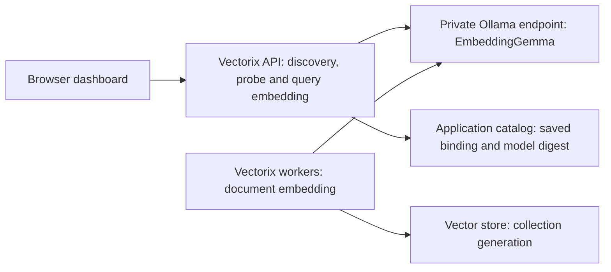

# Reproduce the Ollama and EmbeddingGemma tests

This guide reproduces the real local embedding checks used for M3 and explains how to connect the same model to your Vectorix instance. M3's integrated dashboard verification is recorded separately in [first collection search](rag-first-search.md); passing the standalone model check does not establish that the whole dashboard journey works.

The tested model is **the original EmbeddingGemma 300M**, served as `embeddinggemma:latest` by Ollama. It produces embeddings for retrieval. A Gemma chat model, such as `gemma3`, is a different model and cannot substitute for it. The observed model metadata reports the `gemma3` family/architecture; that does not change the model's embedding role. See the [Ollama model entry](https://ollama.com/library/embeddinggemma) and [Google's original model card](https://huggingface.co/google/embeddinggemma-300m).

## Configuration actually tested

| Item                                          | Observed value                                                     |
| --------------------------------------------- | ------------------------------------------------------------------ |
| Ollama image                                  | `ollama/ollama:0.40.8`                                             |
| Execution                                     | CPU only; Docker limit of 2 CPUs and 3 GiB RAM                     |
| Model                                         | `embeddinggemma:latest`                                            |
| Manifest digest                               | `85462619ee721b466c5927d109d4cb765861907d5417b9109caebc4e614679f1` |
| Model context                                 | 2,048 tokens                                                       |
| Default output                                | 768 dimensions                                                     |
| Output sizes verified against the real server | 128, 256, 512 and 768 dimensions                                   |
| Vectorix preset                               | `EMBEDDING_GEMMA`                                                  |
| Standalone test endpoint                      | `http://127.0.0.1:32768`                                           |
| Model persistence                             | A named Docker volume mounted at `/root/.ollama`                   |

These resource limits describe a small test, not a production sizing recommendation. The commands below use port **11434** for convenience; substitute your actual port everywhere. The version above is the version we executed, not a claim that it is the latest release. Model tags can move: record the manifest on your server and compare it with this digest when reproducing the result.

## 1. Start an isolated CPU server

Use Docker and `curl`. The repository's supported Node.js and pnpm versions are also required for the adapter tests in step 3. The container layout follows [Ollama's official CPU Docker setup](https://docs.ollama.com/docker), with an explicit image version, resource limits and loopback binding:

```sh
docker volume create vectorix-ollama-models

docker run -d \
  --name vectorix-ollama \
  --cpus=2 \
  --memory=3g \
  --publish 127.0.0.1:11434:11434 \
  --mount type=volume,source=vectorix-ollama-models,target=/root/.ollama \
  ollama/ollama:0.40.8

curl --fail --silent --show-error \
  --retry 20 --retry-delay 1 --retry-connrefused --retry-max-time 30 \
  http://127.0.0.1:11434/api/version

docker exec vectorix-ollama ollama pull embeddinggemma:latest
docker exec vectorix-ollama ollama list
curl --fail --silent --show-error http://127.0.0.1:11434/api/tags
```

Wait for the pull to finish. `/api/tags` must contain `embeddinggemma:latest`; its `digest` is the identity to record. The [native model-list API](https://docs.ollama.com/api/tags) returns installed model names and manifest digests. Vectorix discovers already installed models; it does not download them for you.

The example exposes Ollama only on this host's loopback address. Containerized API/workers need the network configuration in step 4 instead of this host address. A local direct Ollama test uses no API key; if your deployment uses an authenticated proxy, save its key in the integration and keep the provider on a private or appropriately authenticated route.

## 2. Check the native embedding endpoint

This sends a retrieval query with an explicit 256-dimensional output and disables truncation. The Node.js command prints only the model, vector shape and provider token count:

```sh
curl --fail --silent --show-error \
  http://127.0.0.1:11434/api/embed \
  --header 'Content-Type: application/json' \
  --data '{
    "model": "embeddinggemma:latest",
    "input": "task: search result | query: Quels insectes fabriquent du miel ?",
    "dimensions": 256,
    "truncate": false
  }' |
  node --input-type=module -e '
    let raw = "";
    for await (const part of process.stdin) raw += part;
    const result = JSON.parse(raw);
    console.log({
      model: result.model,
      vectors: result.embeddings?.length,
      dimensions: result.embeddings?.[0]?.length,
      providerInputTokens: result.prompt_eval_count
    });
    if (result.embeddings?.length !== 1 || result.embeddings[0]?.length !== 256)
      process.exitCode = 1;
  '
```

Expect one vector of length 256. The [native `/api/embed` API](https://docs.ollama.com/api/embed) accepts batched input, requested dimensions and `truncate:false`; an overlong input must fail rather than silently lose its end. `prompt_eval_count` is the provider's processed-input count, not a billing statement.

For retrieval, the original model uses different input prefixes for the two roles: queries use `task: search result | query: `; documents use `title: TITLE | text: `, with `none` when there is no title. Its documented context is 2,048 tokens and its supported reduced sizes are 512, 256 and 128 alongside the full 768. These details come from [Google's original 300M model card](https://huggingface.co/google/embeddinggemma-300m#prompt-instructions). Vectorix's explicit **EmbeddingGemma retrieval** preset applies these prefixes; leave the query text unprefixed in the dashboard to avoid applying them twice.

## 3. Run the same Vectorix adapter check

From the repository root, after the normal frozen dependency installation:

```sh
pnpm install --frozen-lockfile

pnpm --filter @repo/embeddings exec \
  node --import tsx tests/live.mts http://127.0.0.1:11434

pnpm --filter @repo/embeddings test
```

The [live script](../packages/embeddings/tests/live.mts) accepts an explicit loopback endpoint and does not load `.env`, access application databases or use paid-provider credentials. It discovers the model, verifies its native capabilities and actual output sizes, embeds three short documents and embeds the French query “Quels insectes fabriquent du miel ?”. For each of 128, 256, 512 and 768 dimensions, cosine similarity must rank the French bee-and-honey document, **Jardin**, above the unrelated English storage and football documents.

The recorded run passed at all four sizes with the digest above, 64 aggregate provider input tokens for the three documents and 16 for the query. Counts can change with model/runtime changes; use the ranking and vector-shape assertions as the executable expectations rather than hardcoding those counts.

The separate controlled HTTP suite passed **21 tests**, including malformed responses, zero/non-finite vectors, float32 overflow/underflow, dimensions/count mismatches, model replacement, bounded retries, cancellation, redirects, authentication, batching and input preparation. Those fixtures deliberately inject failures; they are not additional live model calls. See the [embedding package README](../packages/embeddings/README.md) for adapter boundaries.

This evidence covers a tiny functional corpus. It does not establish retrieval quality on your documents, 100,000-chunk throughput, concurrent-search capacity, minimum VM instruction-set compatibility or paid-provider integration. M3's real dashboard recipe and its actual results belong in [the milestone record](rag-first-search.md#dashboard-acceptance-recipe).

## 4. Connect your instance

Both **API and workers** must reach the same Ollama base URL. The browser calls Vectorix, so the browser does not need direct access to Ollama.



Choose the address from the API/worker processes' point of view:

| Runtime layout                                                          | Base URL example                                                          |
| ----------------------------------------------------------------------- | ------------------------------------------------------------------------- |
| API and workers run on the same host as the loopback-published server   | `http://127.0.0.1:11434`                                                  |
| API, workers and Ollama share a Docker network with an `ollama` service | `http://ollama:11434`                                                     |
| Ollama runs on a separate private host/proxy                            | Your reachable private DNS name and port, or authenticated HTTPS base URL |

Inside an API/worker container, `localhost` and `127.0.0.1` point to that container. They do not point to another container or to the host. For a deployment with containerized API/workers, add an Ollama service to their shared network, for example:

```yaml
services:
    ollama:
        image: ollama/ollama:0.40.8
        cpus: 2
        mem_limit: 3g
        volumes:
            - ollama-models:/root/.ollama
        # Use the same private network as API and workers.
        # No published port is needed for service-to-service requests.

volumes:
    ollama-models:
```

Start that service using your deployment's Compose files, then run `docker compose exec -T ollama ollama pull embeddinggemma:latest` with the same files. The repository's infrastructure Compose file does not add Ollama automatically. If your application uses a custom network, explicitly attach this service to it.

### Organization credentials, as used by your instance

1. On **both API and workers**, approve the exact base URL at container/process startup. For the shared-network example:

    ```dotenv
    VECTORIX_EMBEDDING_ALLOWED_ENDPOINTS=http://ollama:11434
    ```

    Multiple operator-approved URLs are comma-separated. This is an exact URL allowlist, not a hostname wildcard. Use the same scheme, hostname, port and base path in the integration. Restart API and workers after changing their environment.

2. In the organization's **RAG integrations**, add an **Ollama** credential with that service URL. Leave its API key empty for the direct private server above; provide the proxy's key if required. Select it as the active credential.
3. Create a collection after selecting that credential, or save a new supported draft configuration using it. Saved collection revisions keep their own binding. Changing the organization's active credential does not retarget an existing revision.

Organization configuration takes precedence. A configured but invalid credential, an unselected existing organization credential or an unapproved endpoint produces an error. Vectorix does not silently replace it with platform credentials or combine one configuration's key with another endpoint.

### Optional platform fallback

If an organization has no Ollama credential configured, the operator can instead provide a complete platform fallback on **both API and workers**:

```dotenv
VECTORIX_DEFAULT_OLLAMA_ENDPOINT=http://ollama:11434
VECTORIX_DEFAULT_OLLAMA_API_KEY=
```

The platform endpoint is approved automatically. Keep the explicit allowlist for additional organization endpoints. A revision saved against the fallback continues using the fallback binding; changing its destination later fails explicitly and requires a new configuration revision. Secret rotation at the same destination remains possible. See [credential resolution](../packages/routers/rag/src/services/credential-resolution.ts) and [endpoint approval](../packages/routers/rag/src/services/indexing/embedding-profile.ts).

## 5. Exercise the dashboard journey

Use a member with collection-management permission and an explicit collection grant. Reading chunks/search/sources additionally requires the current library/collection read permissions and collection reading grant. Infrastructure prerequisites and production deployment steps are in [RAG infrastructure](rag-infrastructure.md) and [first collection search](rag-first-search.md).

1. Upload small French and English TXT/Markdown, text PDF or DOCX files in the organization library. Wait for successful extraction and attach them to the collection.
2. Save **Ollama**, model `embeddinggemma:latest`, preset **EmbeddingGemma retrieval**, and **256 dimensions**. Choose document-structure chunking and disable parent/child expansion for M3. A simple starting profile is target 512, overlap 64, minimum 128 and maximum 768 estimated tokens; the independent model byte cap can create smaller chunks. Leave optional preparation empty for reproducing the model test.
3. In the collection profile, use **Discover installed models** to confirm the installed name. Save any model/profile changes before using **Verify saved model**. Check the manifest digest, 2,048-token context and actual selected dimensions.
4. Use **Start initial indexing**. Workers compute document embeddings. Inspect background tasks, document versions and **Chunk preview** until the first generation becomes active.
5. Open **Search playground** and compare vector, keyword and hybrid searches in French and English. Inspect passages and **Open exact source**, then download the indexed version's original. Keyword-only search does not call the embedding model; hybrid/vector search does.
6. To reproduce the [M4 rebuild acceptance](rag-index-rebuild.md#dashboard-acceptance-recipe), save a draft with **128 dimensions**, then select **Review and rebuild**. This action also requires an explicit administration grant and the organization profile-update permission. The 256-dimensional generation continues serving until the replacement catches up and activates. Keep its model, endpoint and credentials available through the in-flight request grace and retained-generation cleanup. The M4 browser test reused the same real Ollama image, model digest and CPU limits; it did not substitute a mock embedding server.

The preset applies document/query prompts automatically. Optional preparation is a literal shared prefix followed by a newline, not a template. Chunk token counts are estimates; model context enforcement also uses a conservative UTF-8 byte budget including every prefix/title and `truncate:false`. Existing generations retain the verified model identity. Do not replace the serving model under an active index: a different digest returns `MODEL_CHANGED` instead of mixing embedding spaces.

## Troubleshooting

| Symptom                                      | Check or corrective action                                                                                                                                                       |
| -------------------------------------------- | -------------------------------------------------------------------------------------------------------------------------------------------------------------------------------- |
| No models discovered / `MODEL_NOT_FOUND`     | Pull `embeddinggemma:latest` into the server and volume used by the saved binding. Check `/api/tags` on that exact endpoint.                                                     |
| `CREDENTIALS_INVALID`                        | Check the active/saved organization credential, complete configuration and exact endpoint allowlist on both services. Invalid organization configuration never falls back.       |
| `PROVIDER_UNAVAILABLE` / `PROVIDER_TIMEOUT`  | Check API **and** worker network reachability, service DNS, model readiness and `docker logs vectorix-ollama` (or your Compose service). A cold CPU model may need time to load. |
| Probe succeeds but indexing fails to connect | API can reach Ollama but workers cannot, or their environment/allowlist differs. Check both runtimes.                                                                            |
| `MODEL_UNSUPPORTED`                          | Select the original embedding-capable model. A Gemma chat model or an incompatible new EmbeddingGemma variant is not covered by this verified preset.                            |
| `DIMENSIONS_UNSUPPORTED`                     | Use 128, 256, 512 or 768 for the tested original model and verify the saved profile. Do not assume arbitrary dimensions or silently slice unverified vectors.                    |
| `MODEL_CHANGED`                              | Compare `/api/tags` with the saved generation digest. Restore the exact serving identity or save a new profile and review a rebuild; do not overwrite an active index in place.  |
| `INPUT_TOO_LARGE`                            | Shorten optional preparation/title/query or choose smaller chunks. Do not enable silent truncation to hide the error.                                                            |
| Index remains pending                        | Confirm workers, PostgreSQL, Redis, vector provisioning/runtime settings and private S3 are healthy; inspect the durable task error and retry after fixing it.                   |
| CPU VM is slow or the container exits        | Inspect resource usage, memory/OOM status and Ollama logs. The 2-CPU/3-GiB test limit is not a capacity guarantee; size using your own workload.                                 |

Stop the local standalone container when finished with `docker stop vectorix-ollama`; start it again with `docker start vectorix-ollama`. Removing the container with `docker rm vectorix-ollama` preserves the named model volume. Remove `vectorix-ollama-models` only when you deliberately want to discard the downloaded model cache.
