# Self-hosted open-source reranking

Status: implementation and additive migrations are ready; full integration and actual model/dashboard acceptance are in progress.

The first runtime is native Hugging Face Text Embeddings Inference (TEI). A runtime adapter is separate from a model: a TEI endpoint serves one model, while the collection pins its declared identity and the endpoint-reported metadata. The suggested multilingual models are `BAAI/bge-reranker-v2-m3` and `Alibaba-NLP/gte-multilingual-reranker-base`; bounded custom deployment identifiers are supported when TEI reports the same model. Runtime and model licenses must be assessed independently by operators. No model name or endpoint-reported revision attests to downloaded weights.

## Compatible contract extension

Revision 22 keeps all closed Cohere/Voyage DTOs and the original six-provider credential operations unchanged. New `rag.reranking.extended` operations expose open engine identifiers and score-kind metadata; new `rag.reranking.endpoints` operations manage self-hosted credentials. An older reranking operation fails explicitly before provider I/O when the selected profile is unsupported. Ordinary search remains independent. New engines must implement a native adapter; this is not arbitrary Cohere emulation.

## Reviewed schema proposal

Add `TEI` to the internal credential-provider enum, without widening legacy public credential enums. `RerankEndpointCredential` stores organization-owned endpoint metadata and an optional encrypted API key, separate from the legacy credential list. At most one row per organization/provider is active, enforced by a partial unique index. Credential operations retain the existing session-only `ragCredentials` permissions, serializable organization fencing, bounded lists, explicit secret preservation/removal and atomic audit.

`CollectionRerankConfig` gains nullable `selfHostedCredentialId` and `runtimeSnapshot`. Existing hosted rows remain byte-for-byte compatible. The composite organization/id/provider foreign key is deferred, as with other retained bindings, so native organization deletion and collection cleanup remain transactional. TEI cannot reference legacy credentials; hosted profiles cannot reference a self-hosted row or runtime snapshot. Referenced destinations cannot be retargeted, but secrets can rotate. Platform fallback occurs only when the organization has no endpoint configuration for the engine.

For an enabled TEI profile, an explicitly requested save fetches bounded `GET /info` after current session, collection-administration and destination checks, outside any database transaction. It performs no inference. A subsequent fenced transaction rechecks authority, CAS revision and credential binding before storing the immutable snapshot. Disabled profiles need no network request. The snapshot contains the protocol, model ID, reported revision, reranker type, runtime version, dtype and reported input/batch limits. TEI's reported `model_sha` is launch metadata, not a computed weight digest.

```mermaid
flowchart LR
    Credentials[Organization endpoint or complete platform default] --> Binding[Exact endpoint and credential binding]
    Binding --> Info[Explicit metadata check outside transaction]
    Info --> Save[Fenced immutable profile revision]
    Save --> OptIn[One-search explicit opt in]
    OptIn --> Check[Live metadata matches saved snapshot]
    Check --> Native[One native rerank POST without truncation]
    Native --> Usage[Validated usage and current authority]
    Usage --> Results[Same candidates and exact sources]
```

The TEI request uses `texts`, `truncate: false`, `raw_scores: false` and `return_text: false`. Every candidate must be represented exactly once. Candidate pools must fit the reported batch size; no split, retry or hidden truncation occurs. Byte limits do not prove token fit; TEI remains responsible for refusing oversized tokenized inputs. A valid optional `x-compute-tokens` value is provider usage; absent token counts and both billing fields remain unknown. The saved endpoint must serve consistent model/metadata across replicas.

The manually generated two-part additive migration expands the existing configuration/request/usage provider checks, adds the new table and constraints, and retains immutable-row guards and trusted SQL function search paths. The proposal, schemas and SQL received independent review before generation. Prisma validation/client generation passed without any database connection. Fresh and upgraded disposable databases passed 111 TEI constraint probes each. Full integration and runtime acceptance remain pending; no application database is used.

## Planned acceptance

Configure an optional-key TEI endpoint in Integrations, select the self-hosted engine and deployed model in a collection, enable a bounded profile, opt in to one search from Home and the playground, compare the same pool and open the exact source. Verify default/reset/disabled behavior, current permissions, immutable bindings, changed runtime metadata, missing usage and legacy DTO compatibility. Use native curl for document transfers and session-restricted setup; never browser file transfers. A controlled runtime is protocol evidence only. Actual TEI/model execution and hosted-provider relevance remain separate results.

## Primary sources

- [TEI native API](https://huggingface.github.io/text-embeddings-inference/)
- [TEI runtime and configuration](https://github.com/huggingface/text-embeddings-inference)
- [BGE model card](https://huggingface.co/BAAI/bge-reranker-v2-m3)
- [GTE model card](https://huggingface.co/Alibaba-NLP/gte-multilingual-reranker-base)
