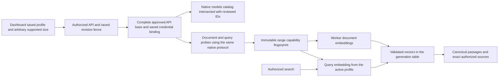

# M5c — Native OpenAI embeddings

Implementation, automated validation and controlled dashboard acceptance are complete on `codex/rag-openai-provider`, based on merged Voyage PR #29 (`bb32977`). This document records the reviewed native contract, reproducible acceptance recipe and actual results. [Ollama](rag-ollama-embeddinggemma.md), [Cohere](rag-cohere-embeddings.md) and [Voyage](rag-voyage-embeddings.md) have separate provider records. Live paid OpenAI verification awaits the user's organization credentials.

## Configuration and capabilities

Use an **OpenAI** organization integration with complete API base `https://api.openai.com/v1` and a test API key. Approve that exact base through `VECTORIX_EMBEDDING_ALLOWED_ENDPOINTS` on API and workers, unless it is their provider-specific platform default. Unlike the root-only Cohere/Voyage configurations, this saved endpoint includes the API prefix. Fixed relative `models` and `embeddings` routes are appended without dropping a proxy prefix or adding another `/v1`.

The optional platform fallback is configured at runtime on both services:

```dotenv
VECTORIX_DEFAULT_OPENAI_ENDPOINT=https://api.openai.com/v1
VECTORIX_DEFAULT_OPENAI_API_KEY=
```

Keep keys in deployment secrets or encrypted organization credentials, never in browser configuration. Organization configuration takes precedence as a complete binding; invalid configured credentials never fall back. Existing revisions retain their saved binding. The browser calls Vectorix, while API/workers make the provider requests. Discovery checks account-visible model IDs; actual probes, indexing and vector/hybrid retrieval send input to the configured provider and may incur usage.

| Reviewed model           | Natural/default dimensions | Reviewed shortening range | Documented input context |
| ------------------------ | -------------------------- | ------------------------- | ------------------------ |
| `text-embedding-3-small` | 1,536                      | 1–1,536, whole numbers    | 8,192 tokens             |
| `text-embedding-3-large` | 3,072                      | 1–3,072, whole numbers    | 8,192 tokens             |

The [official embedding guide](https://developers.openai.com/api/docs/guides/embeddings) documents the natural dimensions and native dimension reduction. The [create endpoint reference](https://developers.openai.com/api/reference/resources/embeddings/methods/create) defines a minimum dimension of one, but no explicit maximum. The ranges above are Vectorix's reviewed shortening policy, rather than a claim that an undocumented provider maximum was tested. Verification checks the exact chosen size. Newer/custom/other model IDs are not enabled automatically. HNSW is limited to 2,000 dimensions in the current vector adapter; large's full default needs DiskANN or a supported smaller size.

Native limits are 8,192 tokens per input, 2,048 inputs and 300,000 aggregate tokens per request. Vectorix uses lower request/response and conservative prepared UTF-8 byte bounds, with explicitly estimated token counts. The conservative byte ceiling does not promise full context utilization. Inputs exceeding the admitted budget fail explicitly.

## Native protocol and identity

Authenticated `GET {savedBase}/models` is intersected with the two reviewed IDs; model listing does not establish embedding readiness or advertise dimensions. `POST {savedBase}/embeddings` uses `input`, `model`, exact `dimensions` and `encoding_format: "float"`. OpenAI provides no retrieval-role or truncation field on this endpoint. Vectorix document/query entry points therefore use the same native semantics, with Generic text and optional literal preparation. No Gemma prompt, `input_type` or invented truncation parameter is sent.

Responses must identify the expected model and contain a complete, unique indexed permutation of the requested inputs. Restore input order before associating vectors with canonical passages, then validate exact dimensions, finite float32 values and nonzero norms. `usage.prompt_tokens` is provider-reported input usage; missing usage remains unknown. An estimate and `total_tokens` are not separately reported billing.

The schema-version-4 snapshot records the reviewed capability profile, selected size and range. Its deterministic fingerprint cannot attest to hosted model weights. Existing schema-version-1 Ollama, version-2 Cohere and version-3 Voyage snapshots keep their original semantics. Provider, model, dimensions, preset and saved fingerprint remain bound during indexing, rebuild and search.

Compatible API revision `1.11.0` adds optional `dimensionCapability` range metadata to models and probes. Existing DTOs remain readable: the required legacy probe `supportedDimensions` list contains the exact probed size for a range model, while the range is authoritative for other admissible sizes. The dashboard renders a numeric range input and range-aware verification, preserving unsupported saved values until explicit user changes.



## Dashboard acceptance recipe

1. Configure a complete organization integration and exact API/worker endpoint approval. Upload a small bilingual Markdown or text PDF, wait for extraction and attach it to an authorized collection.
2. Save **OpenAI**, `text-embedding-3-small`, **Generic**, **257 dimensions**, document-structure chunking and no parent/child expansion. Confirm arbitrary integer input, supported range and provider/model coherence. Discover account-visible reviewed models, then verify the exact saved profile.
3. Start initial indexing, inspect tasks/chunks and run French/English hybrid/vector searches with exact-source preview and original download. A keyword-only request must not call the embedding service.
4. Save a different dimension or the reviewed large model and use **Review and rebuild**. In the isolated fixture, pause only indexing to verify old-generation retrieval, then resume workers and check atomic activation. Reopen a source captured before the switch.
5. Select new invalid organization credentials for another collection: actual discovery/probes must fail explicitly without platform fallback. The existing active generation must keep its original saved valid binding.
6. Check English, French and Belgian Dutch labels, range formatting, errors, language persistence and a fresh console; remove owned preview resources and checksum-verified downloads.

## Validation status

Automated validation passed: 95 controlled native embedding HTTP tests (26 OpenAI and 69 existing Ollama/Cohere/Voyage), 114 disposable core/RAG catalog tests, 23 workspace type checks, 23 lint tasks, 23 backend regressions, four production builds and all six image/runtime/infrastructure checks. No Prisma schema change or new migration is required; fresh seven-migration deployment, upgrades, repeat deployment and schema parity still pass. The first integration run exposed a new test querying a document field directly on an index task instead of through its document relation; correcting the fixture and rerunning all 114 tests resolved the failure. Independent production/UI/contract review found no remaining P1/P2 issue.

Controlled browser acceptance used production web/API/workers, disposable application/vector PostgreSQL, Redis and private RustFS, and a deterministic native OpenAI HTTP fixture. This run did not use Ollama or the paid OpenAI service. The actual results were:

- A synthetic organization credential saved the complete `/v1` base in **M5c OpenAI Lab**. Form changes and saving made zero provider calls. Arbitrary 257 dimensions survived an explicit small-to-large model change and back; the reviewed numeric range and default changed with the model. Authenticated discovery returned exactly the two reviewed IDs and excluded an unsupported fixture model. The saved small/257 verification displayed the exact size, the reviewed 1–1536 range and the hosted capability-fingerprint limitation.
- A 562-byte bilingual Markdown original with three headings extracted and indexed into three published chunks in generation A (`text-embedding-3-small`, 257 dimensions). Chunk preview preserved exact character ranges. French hybrid retrieval ranked the French passage first. With only indexing paused, revision 2 changed the draft to `text-embedding-3-large`/3072 with DiskANN; the review dialog compared both complete profiles and an accepted replacement left A serving a fresh English vector request.
- Resuming indexing activated B with three chunks. A captured French hybrid result from A remained usable after the switch: its source reopened and the downloaded original matched SHA-256 `70829c0856361a6876b0e6b02937d6665657250e00fa2708caa2ba89f144ca3a`. Fresh English vector retrieval used B. A Markdown-filtered French hybrid `remboursement` search used B with keyword rank 1 and vector rank 1 on the French passage, offsets 171–381.
- A keyword-only request returned the same French passage and left every fixture counter exactly unchanged at 13 organization requests and zero platform requests. This includes the catalog, embedding, text, rejection and per-dimension counters.
- A newly selected invalid synthetic organization credential affected new configurations. Another collection's native discovery and actual saved-model probe both failed explicitly with sanitized `PROVIDER_REJECTED`, without creating a generation despite a valid configured platform fallback. The existing B profile retained its original valid credential, verified at 3072 dimensions and served another fresh hybrid request. Durable final counters showed 16 successful organization requests, two rejected invalid-key requests and **zero platform requests**.
- Errors translated reactively from English to French and Belgian Dutch; profile numbers, range metadata and dates were localized. A fresh final tab retained Belgian Dutch, showed 3.072 dimensions and retrieved the French source with localized ranks and decimal formatting. Its console had no warnings or errors.

All owned application/provider processes, four infrastructure containers, temporary browser tabs and the checksum-verified synthetic download were removed. Ports 3100, 3101, 3006 and the controlled provider port were verified unbound. A's three chunks remained retained on the ordinary 17-minute grace at the last dashboard observation. No clock advancement or physical-retirement soak was performed in M5c.

Controlled native-wire and dashboard results do not establish live paid-provider connectivity or retrieval quality. Live OpenAI availability, quality, latency and capacity remain pending the user's organization credentials. Documentation checks and PR delivery are recorded in the [build log](build-task-log.md).
