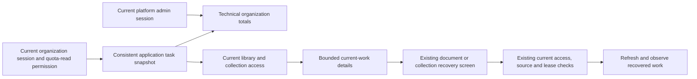

# Current organization work and recovery

**M7b.1 is implemented with automated validation and real Ollama dashboard acceptance complete.** This slice helps an organization operator find current ingestion, indexing or cleanup across the library and collections, open an existing authorized recovery screen and observe the result. It reuses persisted application tasks; no schema, migration or runtime configuration change is introduced.

M7b.2 [recorded activity and worker observations](rag-observability.md) are implemented with automated validation and real Ollama dashboard acceptance complete. M7c backup/restore, retrieval quality and capacity acceptance remain required. This page does not describe those capabilities as implemented.

## Snapshot and authorization

Organization totals require an active organization, current membership, session authentication and the existing organization quota-read permission. Totals describe technical work across the organization without names, content or hidden resource identifiers. Detail rows separately follow current library, collection metadata and deleted-cleanup access. Their visible total can differ from the organization totals. API keys cannot use this session-only view.

Global admin receives technical organization totals only. It does not gain membership, collection reading, private filenames, sources or recovery authority. Current and deleted document/collection routes retain their different access rules. A deleted collection must open its existing guarded cleanup interface rather than its normal live detail page.

The new versioned operations contract accepts a fixed category, state, bounded name query and pagination. Organization identity always comes from authenticated context. Aggregate counts, current-source predicates and authorized pagination are evaluated against one repeatable-read snapshot and a single observed time. Names and identifiers are filtered before paging, with stable ordering. Unknown stored errors are sanitized; queries never include document content, credentials or raw provider responses.

## Meaning of current work

| State                    | Evidence                                     | Interpretation                                                                                        |
| ------------------------ | -------------------------------------------- | ----------------------------------------------------------------------------------------------------- |
| Uploading                | Current ingestion is UPLOADING               | Original transfer has not finalized; its transfer deadline is distinct from a worker claim.           |
| Due for a check          | PENDING and scheduling time has arrived      | A worker may recheck the task; current source, permission, retention and capacity guards still apply. |
| Scheduled                | PENDING and scheduling time is in the future | Ordinary backoff, continuation or retention can defer work.                                           |
| Processing claim         | PROCESSING with a future lease               | A valid accepted claim exists; it does not prove the process is alive.                                |
| Expired processing claim | PROCESSING with no valid future lease        | Existing recovery checks can reclaim it; this is not a diagnosis of a dead worker.                    |
| Failed                   | A relevant current task is FAILED            | Open its existing screen to inspect and recover under current rights.                                 |

Age since acceptance includes upload, queue wait, backoff and retries. It is not extraction, embedding or indexing execution time. A future retention cleanup is scheduled work rather than an incident. Completed/cancelled history and superseded failures do not inflate the default current-work inbox.

Only the latest retained live document version can be a current ingestion recovery target. Indexing must match the exact desired source, extraction, metadata, build revision and current generation pointer. A published first-build candidate blocked at activation remains current pending work until its generation actually serves searches. Accepted removals and physical cleanup have separate receipt/lifecycle rules; a removal task need not have an indexed candidate ID. Destructive cleanup remains independent of a removed controller's later access. Unfinished original cleanup remains current even when a late PUT requeues physical deletion for a version whose content state deliberately stays PURGED; completed cleanup is excluded by task status.

Opening a link grants no permission. The existing page and mutation recheck current membership, grants, active organization, exact source/generation and lease. A stale observation cannot revive an obsolete candidate or deleted content. There is no new bulk retry, adoption or cleanup mutation.

## Integration entry points

- Versioned DTOs: packages/api-contracts/src/v1/rag/operations.ts and superadmin/operations.ts.
- Focused services: packages/routers/rag/src/services/operations/.
- Organization handler: packages/routers/rag/src/operations/overview.ts; admin handler: packages/routers/superadmin/src/get-operations.ts.
- Permission registration remains in packages/auth/src/permissions/operations.ts.
- The web Operations page opens existing collection/document recovery; admin organization details show technical totals.

## Dashboard acceptance recipe

Use owned disposable application/vector PostgreSQL, Redis, private RustFS and production web/admin/API/workers with real local Ollama. Create controlled FR/EN documents and collections through normal dashboard actions. Produce a genuine current access failure, find it from Operations, open the existing screen, adopt/retry as a current authorized manager and observe current publication plus cleared incident counts. Inspect scheduled original cleanup separately from due work.

Verify a quota-only observer receives totals without unauthorized names or identifiers; group/member grants, another organization, valid scoped keys, deleted cleanup and stale copied recovery links keep their existing isolation. Admin sees technical totals without content access. Inspect bounded paging/filtering, explicit loading/error/permission states, EN/FR/nl-BE, reload, keyboard interaction and browser console. Remove only owned previews, containers, tabs and verified downloads.

Automated checks must cover exact current/superseded candidates and activation anchors, source/removal/cleanup distinctions, scheduling and synthetic expired-lease cases, organization/current-role/key isolation, filtering before pagination, safe errors, contract/spec parity and real recovery. The actual validation below distinguishes browser evidence from automated negative and concurrency coverage.

## Actual validation

On October 22, 2026, production web/admin/API/workers used owned disposable application/vector PostgreSQL, Redis and private RustFS with real Ollama 0.40.8 and EmbeddingGemma. The verified local model digest was 85462619ee721b466c5927d109d4cb765861907d5417b9109caebc4e614679f1; both parent-enabled collections used the retrieval preset and 128 dimensions. The semantic collection and token-window collection shared one controlled FR/EN document. Both originals contained 2,814 bytes and 2,777 UTF-16 code units, with distinct version markers.

Before starting the owned workers, the uploaded first version appeared as one due ingestion task. Starting the normal workers extracted it and cleared that count. Both initial collections then served version 1. Removing only their controller's explicit document-management grants and uploading version 2 through a library writer produced two actual ACCESS_REVOKED indexing failures while the old publications remained active. The limited manager's Operations screen showed two organization failures and one authorized detail; filtering for the other collection returned zero visible rows. A quota-only observer saw the same totals with no document/collection names or recovery links.

The limited manager opened the authorized recovery workspace by keyboard, adopted synchronization and explicitly retried the failed document task. Adoption reported zero pending/running reassignments and left the failed task unchanged. Version 2 published, the organization failure count fell to one, and the manager's failed list became empty. A real hybrid search returned two version-2 contexts in 137 ms; its exact original download matched SHA-256 ee862084937b5347131ce25e5ff39592a2e7ffd3d9b5101adbbbbb7af9f6ee24. This timing is one request observation, not a benchmark.

The owner restored its own management grant on the second collection and retried its task. Both collections then served version 2, Operations showed zero current failures, and only ordinary scheduled cleanup remained: one original cleanup at the preserved seven-day delay and two retained-publication cleanups under their normal grace. Three independent read-only repeatable-read checkpoints agreed with the actual failed, partially recovered and final dashboard states, including controller/executor identities, current source tuples and access-filtered counts. The observer did not call providers, read source content or change task state.

The synthetic platform admin had no organization membership. Its Operations tab showed the matching technical totals with no private work names, document/collection identifiers, sources or recovery controls. Web and admin labels, counts and help were inspected in English, French and Belgian Dutch; Dutch persisted after reload and English was restored. Both browser warning/error consoles were empty. All four owned previews, five owned containers, two created tabs and the single exact-path/hash-verified download were removed; the user's existing tab and named Ollama model volume were preserved. No application .env/database or paid provider was used.

Automated validation passed all 229 disposable HTTP/core/RAG tests, fresh installation, upgrades, repeat deployment and schema parity; 23 workspace type-check tasks, 23 lint tasks with existing warnings, 44 backend regressions, four application builds and all six production image/infrastructure checks. Nine new HTTP journeys cover snapshot scheduling, exact-current failures, ACL filtering before pagination, sessions/keys/foreign identifiers, deleted cleanup, activation blocked after publication and a real concurrent grant revocation before the final detail-access check. Independent production and test review found no outstanding actionable P1/P2 findings. The first catalog pass had one harness failure: PostgreSQL activity text truncated before the IndexTask name. Observing the actual blocked relation lock fixed the detector; the final complete run passed 229/229.

Synthetic expired-lease, injected parser failure, stale copied identifiers, group/key isolation and concurrency negatives are automated evidence, not additional live browser claims. No retention soak, crash-loss guarantee, worker-liveness measurement, all-strategy historical usage, phase-duration measurement, paid-provider connectivity, backup/restore, relevance or load acceptance is claimed. M7b.2 observations have their own [separate acceptance record](rag-observability.md). M7c restore, relevance and capacity acceptance remain required.
