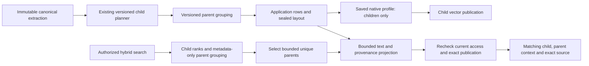

# Parent context indexing

**M6c runtime, automated validation and browser acceptance are complete; PR delivery is pending.** Parent context works with structure, token-window and semantic children across the five native providers. API revision 1.15.0 adds compatible optional context fields. The additive `20261029000000_rag_parent_context` migration received independent review and explicit user approval before generation and disposable-database testing. Production-mode browser checks verified all three strategies with real local Ollama, child/context inspection, searches, a parent-size rebuild, exact original download, locales and administration. No application database was used.

## Dashboard journey

An organization manager enables parent/child mode, keeps the child strategy and saved embedding profile, and chooses the existing maximum parent size. Indexing embeds and ranks children only. Chunk preview and search display the matched child, its canonical parent context and exact sources. Results show one representative child per parent. Saving a different parent size requires the existing reviewed rebuild; the serving generation and captured sources retain their current lifecycle.

Parents are deterministic context from the same document candidate, not another embedding model or independently authorized document. Parent context never grants access through possession of its identifier. Current collection/library permissions, API-key issuer/scopes, source holds and publication checks still apply.

## Persistence and execution identity

The reviewed [indexing schema](../packages/db/prisma/models/rag-indexing.prisma) and [additive migration](../packages/db/prisma/migrations/20261029000000_rag_parent_context/migration.sql) implement this compatible expansion:

| Model             | Field                                | Reason and legacy behavior                                                                                                                                           |
| ----------------- | ------------------------------------ | -------------------------------------------------------------------------------------------------------------------------------------------------------------------- |
| `IndexGeneration` | `parentContextVersion String?`       | Persist `parent-context-utf8-v1` for new parent-enabled generations; null for historical and parent-disabled generations. Keep the child `chunkerVersion` unchanged. |
| `Chunk`           | `startOffset Int?`, `endOffset Int?` | Record true canonical UTF-16 bounds for new layouts. Existing rows stay null; clipped source spans cannot reconstruct separators/gaps reliably.                      |
| `Chunk`           | `embeddingInputHash String?`         | Children still require their existing prepared-input hash. Context-only parents require null because no embedding input is sent.                                     |

The existing CHILD/PARENT kinds, same-candidate deferred parent FK and unique candidate ordinal are reused. No new model, provider capability variant, vector table shape, source receipt or retention mechanism is required.

Supplementary SQL enforces paired valid offsets, parent/child kind/hash/link consistency, same-candidate depth one and containment. Relationships are validated at transaction completion. Canonical text/source relationships additionally require runtime validation against the immutable extraction; SQL alone cannot read the private artifact.

For parent-enabled generations, canonical row text, bounds, provenance, kind, hashes, ordinals, parent links and derived lexical tsvectors are immutable **from insertion**. The runtime verifies the complete application layout and puts the candidate into `SEALED` before opening/sealing the external vector publication; insertion and ordinary deletion are then forbidden too. The historical null-version child-only `STAGING` to `PUBLISHED` path remains supported.

Chunk mutations serialize against sealing on the candidate row and make a real row-version change through a bounded statement-level `updatedAt` touch for each distinct candidate. A stale SERIALIZABLE sealer retries the full transaction; a writer waiting behind a completed seal rechecks state and rejects. A SELECT lock alone is insufficient for mixed-isolation snapshot visibility. Fenced `CLEANING` deletion remains allowed. Parent-enabled candidates cannot return from a later state to `STAGING`, including through retirement. Candidate/generation deletion backstops and the organization cleanup-required guard check actual remaining chunks, so bypassing a status or cached count cannot cascade away live context. Native cleanup guards and valid cleaned-metadata cascades remain supported without requiring the original requester to remain a member. There is no fabricated legacy range backfill or data deletion. Parents receive empty lexical tsvectors; only children enter FTS/GIN and vector ranking.

## Deterministic layout and bounds

The separate `parent-context-utf8-v1` layout greedily groups consecutive validated children while `text.slice(first.start, maxChildEnd)` fits `min(parentMaxTokens * 3, 49_152)` UTF-8 bytes. Existing public parent-size ranges and `parentMaxTokens >= maxTokens` stay supported. Parents are not sent to a provider and do not use its context cap. A child must fit entirely; reject an impossible layout before reserving chunks or performing final-child embedding/vector side effects. Semantic boundary embeddings necessarily precede parent grouping because they determine the sealed child plan.

Child geometry, ordinals, text and semantic boundaries remain unchanged. Parents may overlap because their children overlap. Canonical gaps/separators are retained without normalization; clip every intersecting original source, preserving the internal 5,000-source bound. Do not invent a common PDF page, DOCX section or Markdown heading. Estimates remain UTF-8 bytes divided by three, not model tokenizer counts.

Parent count cannot exceed child count. The helper validates contiguous ordinals and monotone starts, and uses the maximum child end rather than assuming every historical planner emits strictly increasing ends. Child-plus-parent materialization is bounded to 200,000 rows, 128 MiB of duplicated UTF-8 text and 32 MiB of compact JSON-serialized provenance. Incremental byte accounting and a monotone source sweep avoid repeatedly scanning the full parent text or all sources. A useful child without an intersecting source is rejected before materialization.

The SQL backstop independently bounds the same rows/text and allows 64 MiB of PostgreSQL `jsonb::text` provenance. That intentional headroom accounts for PostgreSQL's spaced JSON representation; it does not raise the runtime's 32 MiB compact-JSON admission cap. Searchable quotas and vector manifests count children only, while the additional application context storage stays under these aggregate bounds. Parents reserve no provider work or fabricated usage. The existing semantic plan/hash variant and late-usage protocol are unchanged; parent layout has its own saved descriptor.

Materialization commits parents in a disjoint ordinal suffix before starting separate child batches with same-candidate links. Retry validates deterministic row identity and complete canonical content before adopting persisted progress. Cleanup removes both kinds after the child-vector publication is tombstoned, preserving existing holds, child accounting and semantic work history.

## Search and compatible API behavior

Capture one active generation/profile/parent descriptor for the request. Filter authorized exact publications before both child ranking branches; retain current reciprocal-rank fusion and deterministic ties. For parent-enabled search, use one bounded candidate limit per branch, at most 500, without repeating native query embeddings. Group metadata-only child candidates by parent before selecting final `topK` representatives. Keep the strongest matching child and its original scores; do not sum sibling scores.

Hydrate only selected child/parent pairs. Even this must project at most 64 source spans plus a truncation flag **inside the database read**, rather than loading up to 5,000 spans per row and truncating afterward. Encapsulate parameterized SQL projection in the retrieval adapter because Prisma cannot slice this JSON field. Preserve metadata-only eligibility filters and current/exact-publication rechecks around provider I/O and content hydration. Invalid required parent data fails closed. A bounded deduplication result may underfill; report that separately from ANN underfilling without claiming corpus exhaustion.

API revision 1.15.0 keeps existing result ID, text, ordinal, scores and source receipt as the child. It adds optional `parentContext` metadata/text/range/source projection, canonical child bounds and `parentUnderfilled`; the latter is distinct from `vectorUnderfilled` and does not promise corpus exhaustion. Parent-disabled legacy output fields stay unchanged. Chunk preview remains a paginated child list with optional context, rather than mixing parent rows into its count. The source action reuses the child receipt for the exact same version/extraction; no public parent-ID read route is added.

The web interface distinguishes matched passage from context, explains parent-size estimates and deduplication, and exposes loading/error/permission states. New labels, confirmations, source hints and accessible controls are localized in EN/FR/nl-BE. Context panels remain bounded and keyboard accessible. Preview rechecks current capabilities after hydration: losing management while retaining read cannot expose a previously captured unpublished candidate or its total count.

## Rollout and protocol evidence

Apply the reviewed expansion and update/drain all API and worker readers before enabling parent profiles. Old cleanup reconstructs manifests from every candidate row and cannot safely handle newly materialized parents. Preserve historical child-only generations and unfinished PLANNING/READY semantic plans in upgrade/replay tests. The new server continues supporting the existing major-1 contract; optional additions do not make old DTO fields nullable.

The initial isolated PostgreSQL 18.6 prototype reproduced a lock-only stale-snapshot failure and passed eight proof groups with a statement-level candidate touch: both lock orders, stale SERIALIZABLE versus READ COMMITTED writers, full retry, canonical updates, frozen-row/reopen rejection, 2,000-row/two-owner touch bounds and legitimate cleanup/cascades. Its throwaway container was removed. This preparatory evidence is separate from the final migration and application checks below.

## Automated validation

The final cohesive pass completed on `codex/m6c-parent-context`:

- Fresh and upgraded disposable databases each passed 36 parent-context SQL proofs, repeat deployment and Prisma parity. Seven actual parent-layout/cleanup/organization races passed.
- All 206 catalog/core/RAG HTTP tests passed, including the 15 controlled strategy/provider combinations, child-only native inputs/manifests/accounting, partial parent materialization retry, legacy sealed semantic replay, deduplication before `topK`, current/foreign access, API-key scopes, manager-to-reader preview downgrade and real 70-paragraph DOCX projection.
- All 56 chunking tests and 138 embedding tests passed, along with 44 backend regressions, 23 type-check tasks, 23 lint tasks with existing warnings, four application builds and all six image checks.

Controlled hosted-provider responses establish native protocol and application behavior, not paid-provider connectivity or relevance quality. SQL/image/integration checks use disposable `_test` databases and infrastructure; no application database was used.

## Actual dashboard verification

Production web/API/workers, isolated application/vector PostgreSQL, Redis, private S3 and the installed local Ollama/EmbeddingGemma model indexed the same synthetic FR/EN Markdown document into three parent-enabled collections. The original is 6,400 UTF-8 bytes and 6,321 UTF-16 code units, with SHA-256 `0fe04aae5df652fe7ef8d02a1061fe8130be8f2dd14410e2c5c140fbfb0da669`.

| Observed generation        | Children / physical vectors | Parents | Actual search observation                                                                                          |
| -------------------------- | --------------------------- | ------- | ------------------------------------------------------------------------------------------------------------------ |
| Structure A, later retired | 19 / 19                     | 5       | English hybrid: 5 results, 179 ms. After rebuild admission, keyword search still served A with 2 results in 77 ms. |
| Structure B, active        | 19 / 19                     | 11      | English hybrid: 10 results, 126 ms; expanded parent range 4501–5199 with a 237-token estimate.                     |
| Token-window, active       | 19 / 19                     | 5       | French vector: 3 results, 219 ms. Child/context preview reached the final document marker.                         |
| Semantic, active           | 20 / 20                     | 5       | French hybrid: 3 results, 163 ms; expanded parent range 5114–6320 included the final marker.                       |

These durations are individual UI observations, not a latency benchmark. The structure rebuild changed the saved parent maximum from 512 to 256 estimated tokens. Independent read-only database/vector observation confirmed identical A/B child geometry, text hashes and prepared-input hashes while parents changed from 5 to 11. It also replayed all three pure plans, checked full canonical text/ranges/provenance and source bindings, exact parent links/suffix ordinals/caps, and child-only manifests/physical rows/accounting. Each generation had exactly one vector publication and no extra table rows. Parents had null embedding hashes and empty lexical tsvectors.

Semantic processing completed all 75 units through two successful continuations in one task attempt. Four successful logical native batches recorded 16,379 prepared-input bytes, 4,127 estimated input tokens and 4,447 native-reported input tokens. Persisted attempts and organization totals matched, and all unused/in-flight reservations and unresolved attempts were zero. These indexing observations do not add query usage or claim exact wire retries/billing. Stored semantic payload remains accounted independently.

The captured A source was reopened after B became active, and the original was downloaded again. Both 6,400-byte downloads matched the original SHA-256 above. Child/context/deduplication labels were observed in EN/FR/nl-BE; Dutch survived reload, then English was restored through administration and web reload. An English `harbor tide` query in the Dutch semantic interface returned five unique parents in 129 ms with localized underfill information. The admin quota view was inspected in nl-BE/FR/EN: child-only help and semantic totals matched the read-only proof, including 4,705 bytes of stored plan payload and zero reservations. All four owned browser consoles had no warnings/errors. Negative authorization, injected failure and retry scenarios were exercised by automated tests, not repeated manually in this browser run.

Cleanup stopped the four owned preview processes and removed their five containers, closed four created browser tabs while preserving the pre-existing user tab, and removed only the two synthetic downloads after exact path/checksum checks. The named Ollama model volume was preserved. A's normal retention grace remained intact at the observation point. No retention soak, clock advancement, paid-provider connectivity, relevance evaluation or load acceptance is claimed. The independent observer read only the exact owned test databases and controlled local source; it made no provider or S3 request and read no `.env`.

## Implementation and acceptance checklist

- [x] Prepare and independently review the minimal expansion and generic sealing protocol.
- [x] Obtain explicit approval before generating the migration and testing it only on disposable databases.
- [x] Implement a pure parent layout and meaningful geometry/Unicode/source/limit regressions without changing existing child versions.
- [x] Integrate generation descriptors, child-only accounting/materialization/vector work, full-layout sealing, retries and cleanup.
- [x] Add bounded metadata-first search grouping/content projection, compatible DTOs and localized dashboard/admin-facing states.
- [x] Verify fresh/upgrade/repeat/parity and direct invalid-link/containment/depth/hash/sealed-layout/cleanup/native-delete SQL cases on disposable databases.
- [x] Cover all 15 strategy/provider combinations with controlled native fixtures, including explicit proof that parent text is never embedded or included in child manifests/work counters.
- [x] Cover current/foreign identifiers, revoked membership/grants/keys, exact-source holds, rebuild cutover, duplicate callbacks/retries and parent underfill.
- [x] Run types, lint, relevant backend/primitives/catalog tests, builds and six-image checks.
- [x] Browser-test real Ollama parent-enabled structure/token/semantic collections: actual child/context preview, unique-parent FR/EN searches, sources and a parent-size rebuild retaining old results.
- [x] Finish the downloaded-original checksum, locale/admin/reload, fresh-console and cleanup observations.
- [ ] Deliver the reviewed PR with final outcomes and limitations; do not claim paid-provider connectivity, relevance quality or load acceptance from controlled fixtures.

Prerequisites for the browser recipe are isolated application/vector PostgreSQL, Redis, private S3, production web/admin/API/workers and the documented installed Ollama/EmbeddingGemma model. A synthetic multi-topic FR/EN document should span enough children to demonstrate grouping, overlap and final-tail context. Inspect both child and parent canonical positions, unchanged child vector/accounting counts, deduplication before topK and authorized old-source access after a reviewed rebuild.

## Integration entry points

Saved execution identity is resolved in `packages/routers/rag/src/services/indexing/generation-profile.ts` and `generation-acceptance.ts`. [Pure grouping](../packages/chunking/src/parent-context.ts) feeds `index-document.ts` and [parent-first materialization](../packages/routers/rag/src/services/indexing/chunk-materialization.ts); `publication-state.ts`, `accounting.ts` and `cleanup-index.ts` keep child publication/accounting and cleanup. [Metadata-only representatives](../packages/routers/rag/src/services/indexing/search-representatives.ts) and [bounded SQL projection](../packages/routers/rag/src/services/indexing/chunk-projection.ts) feed `search.ts` and `views.ts`; `sources.ts` rechecks exact child receipts. [Versioned DTOs](../packages/api-contracts/src/v1/rag/indexing-types.ts) feed the localized [chunk content](../apps/web/components/rag/indexing/chunk-content.tsx), `index-chunks.tsx`, `search-playground.tsx` and collection profile components. Focused HTTP journeys are in `apps/api/src/rag-tests/parent-*.ts`; migration proofs and races are in `tests/catalog/parent-context-*`.

[AGENTS.md](../AGENTS.md) requires: “Prepare schema changes for review; migrations are generated manually after review.” The model delta and SQL/runtime protocol received that review and a separate explicit M6c approval before generation. PR delivery remains pending as listed above.
