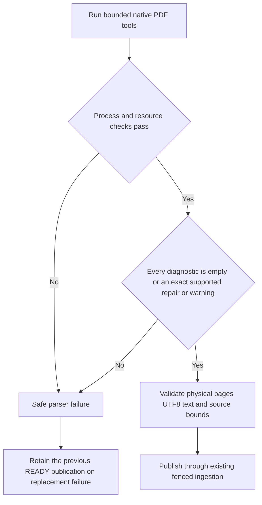

# Recoverable PDF diagnostics

[PR #71](https://github.com/SimonLoir/vectorix/pull/71), squash `c0dec633ff37dd33ef8dd1f7644e296c56e92dc0`, delivered the demonstrated cross-reference reconstruction case from [issue #16](https://github.com/SimonLoir/vectorix/issues/16). Its historical validation is recorded below. This follow-up adds the exact optional linearization-length warning, with native complete-text and mixed-corruption fixtures. Other font, hint-table and syntax diagnostics remain unsupported; a zero exit and some usable text do not establish a complete extraction.

## Diagnostic boundary

Some text-based PDFs contain an incorrect cross-reference offset while their content streams remain intact. Installed Poppler can reconstruct the index, exit zero and extract both physical pages, yet emit this diagnostic:

```text
Internal Error: xref num 1 not found but needed, try to reconstruct
```

The previous worker's generic `not found` check misclassifies this as unavailable parser infrastructure before its `Error:` check can classify it as invalid content. Accepting every zero-exit result would also admit the existing partial-corruption fixture, whose native output contains usable but incomplete text.

The worker's [diagnostic classifier](../apps/workers/src/extraction/poppler-diagnostics.ts) permits only empty diagnostics, complete recognized xref-reconstruction lines or the exact linearization-length warning below after a successful process exit. Object numbers must be bounded positive decimal integers. Prefixes, suffixes, same-line additions, other syntax warnings, syntax errors and unknown nonempty diagnostics remain failures. A recognized repair line never overrides another diagnostic, a nonzero exit, encryption, a signal, a resource limit or an expired deadline. Unknown chatter that previously escaped the broad error-expression checks is now rejected explicitly; this is an intentional compatibility tightening.



No raw native stderr, filename, path or document content becomes a public error. Existing safe error codes and retry rules distinguish unavailable infrastructure from invalid content. No new schema, API revision or extraction-artifact version is introduced.

## Invalid optional linearization length — issue #16 follow-up

The only newly accepted whole line is:

```text
Syntax Warning: Length in linearization table is invalid
```

Linearization provides optional fast-web-view hints. The tested synthetic files add `/Linearized 1 /L 0` to the first Catalog object and rebuild the classic xref offsets. Every other object, including page dictionaries, fonts and compressed content streams, remains byte-identical. Both installed native tools actually emit the warning and exit zero; their complete text, two physical pages, canonical ranges and encoded extraction artifact match the clean FR/EN baseline. A second positive fixture combines it with the existing xref reconstruction.

The exception is an exact literal, not a `Syntax Warning` prefix rule. Blank lines, repeated recognized lines and combinations of these two known diagnostics are allowed within the unchanged stderr bound. Warning-plus-corrupt-content fixtures still exit zero and print usable text, but contain `Unterminated string` and `Leftover args in content stream` errors and must fail. A recognized warning never rescues a nonzero exit, signal, encryption, launcher failure, deadline or output limit. Raw stderr is neither logged nor persisted in public artifacts.

The relevant entry points are [the classifier](../apps/workers/src/extraction/poppler-diagnostics.ts), [deterministic fixture generator](../tests/documents/fixtures/generate-linearization-warning.py), [native parser regressions](../tests/documents/parser.test.mts), [library replacement regressions](../apps/api/src/rag-tests/document-pdf-warning.ts) and [packaged parser checks](../scripts/test-docker.sh). No schema, public contract, parser artifact version, retry rule or original object changes.

### Dashboard acceptance for the new warning

Prerequisites: fresh isolated `_test` stores, production API/web/workers, installed Poppler, private S3 fallback and a synthetic library manager. Use an authenticated native curl session for uploads, replacements and reads of this unassigned library document, with secret material in private local files. API-key reading additionally requires a collection attachment, a current collection grant and matching key scopes; this library-only recipe does not create that separate setup. File transfers use curl.

1. Upload `linearization-warning.pdf` through curl. In the dashboard, wait for READY and inspect both bilingual sources and their physical page navigation. Compare original bytes through a bounded authenticated curl read.
2. Replace it through curl with `linearization-xref-partial-corrupt.pdf` and normal retention. Confirm the safe failed-replacement state and that the prior READY version remains readable with the same page text and original bytes.
3. Replace the failed latest attempt through curl with `linearization-xref-reconstructed.pdf`, retaining the normal seven-day selection. Verify READY v3, both sources and the new original bytes.
4. Check EN/FR/nl-BE states and reloads, account navigation, console feedback and normal logout. Stop only the owned services and remove their isolated stores; preserve normal application retention deadlines.

The new host checks pass: frozen installation and client generation with an unreachable synthetic database URL, deterministic regeneration of all 43 fixtures, all 60 real parser/limit/classifier cases, API/workers types and lint, the root unit command and both backend builds. All 39 historical binary fixtures and expected entries are unchanged. The first API type check caught a missing direct test dependency; an independent expected artifact avoids adding a production dependency. The first catalog run then exposed the expected artifact's JSON key order; correcting only that expectation preserves the exact 333-byte assertion. The fresh disposable catalog run passes all 329 cases, including READY warning extraction and failed replacement with the prior original/source retained. No production behavior changes after the initial classifier patch.

All six image and infrastructure checks pass in 235.634 seconds, including actual packaged-native warning emission, complete artifact equivalence and mixed-corruption refusal. Four standalone/backend production builds at `748b67d3` pass with their assets present and protected source declarations restored.

The first dashboard trial `035f41fcea81` verifies native login and the empty library, then stops during the curl helper's authentication phase before any PDF dispatch. Two native POSTs return HTTP 200; the original failure cause is not captured, and the secondary signout also fails in the helper. Source review identifies a deterministic cookie-variable TDZ that needs a regression before retrying in a fresh environment. All four processes and stores/volumes are removed, the tab is closed and disabled helpers are restored. This incomplete attempt establishes no document publication or successful logout. A pure regression using the actual cookie consumer reproduces the shadowed-binding error; the focused rename then passes all twelve helper tests. This does not establish the original unrecorded native exception. The earlier PR71 results below do not validate this follow-up.

### Current composition and actual dashboard results

After integrating PR95, checkpoint `1e47fb3b` passes a fresh frozen installation, ignored client generation, all 25 workspace type and lint tasks (zero errors, 46 existing warnings), 506 unit cases and all 60 real document cases. Four fresh serial production builds pass: API 0.601 s, workers 0.601 s, web 26.218 s and admin 23.617 s. Standalone assets are present; protected declaration files and the lockfile are restored exactly. The 329-case local catalog and six-image results above precede this main composition; final PR CI validates the composed source separately.

Production dashboard run `83745eb3e296` uses these current builds, native Poppler and private RustFS:

- Session curl uploads the warning-only PDF; v1 becomes READY. Both English/French physical pages, next-source navigation and direct source-number access work. Bounded curl reads match the original 1,092 bytes and exact source content.
- The combined warning/xref/content-corruption replacement becomes FAILED v2 after one attempt with `FILE_INVALID`. The safe dashboard explanation appears; v1's French page and exact original remain readable.
- The valid combined warning/xref replacement becomes published READY v3 with both complete pages and its own exact original bytes. The document adopts the successful version's filename. All six one-shot curl modes pass, totaling 39 native HTTP calls, with normal helper signout after each mode. No browser file transfer occurs.
- EN, Belgian Dutch and French states/reloads, personal account navigation and return, source navigation and normal French logout work. The final page shows the normal sign-in screen and successful-logout feedback. The browser console has zero warnings/errors; owned tab 72 is closed.

The formal active, ready and failed-replacement observations pass. The formal replaced observation stops at a stale private-helper assertion requiring the initial document name after a successful replacement; native ingestion correctly adopts v3's filename. That failed intent remains unchanged and is never replayed; the formal signed-out phase is not run. A separately reviewed, one-shot read-only metadata supplement confirms the three exact version identities/hashes, READY/FAILED/READY tasks, current v3 name, derived latest/published v3, unchanged v1 retention deadline and zero sessions for the ordinary French-locale owner. It performs no S3 I/O or native HTTP and does not replace the failed formal observation or establish an atomic cross-store snapshot.

Actual loopback SMTP accepts seven messages across seven connections, totaling 3,837 MIME bytes, with zero refusals or capture failure. Its seven private capture files total 6,014 bytes; those are different serialization bytes. The observer's pg 8 parallel-query deprecation warning is separate from the clean browser console. No hosted mail, embedding provider or capacity result is claimed.

Owned cleanup passes: four processes, four containers and four volumes are absent, the resource map is empty, all disabled helpers are restored and all seven entry gates are true. Private captures remain protected; no document-retention deadline is shortened and no application-level reclamation after seven days is claimed. The earlier incomplete trial remains distinct from this successful functional dashboard journey and its explicitly partial formal observation.

## Original bytes, text and source positions

The stored PDF is never rewritten. [PDF parsing](../apps/workers/src/extraction/pdf.ts) still uses a private temporary copy, trusted final page-count metadata, physical form-feed separators, fatal UTF-8 decoding and the existing canonical text construction. Sources retain UTF-16 code-unit positions in extracted text, rather than byte positions in the PDF. Existing completed extractions are unchanged.

The selected synthetic fixture changes only the first in-use xref offset by seven bytes in the two-page FR/EN baseline. Its content streams and size are unchanged. Native exploratory output has exactly the baseline's text, page count, canonical hash and source ranges. This establishes that fixture's equivalence; no parser can infer general semantic completeness solely from a repair message and a successful exit.

All production bounds remain: 25 MiB default original upload, 10 MiB rich-extraction reservation, 8 MiB text and 10 MiB complete artifact, 500 PDF pages and a shared 30-second parser deadline. Native children retain 512 MiB address space, 20 CPU seconds, 64 file descriptors, bounded stdout and 32 KiB stderr. No shell, inherited credentials, network fetch, rendering or OCR is added. Temporary cleanup on success and failure is unchanged.

## Entry points and automated verification

- [Subprocess runner](../apps/workers/src/extraction/subprocess.ts): preserve captured failure precedence and delegate native result classification.
- [Parser tests](../tests/documents/parser.test.mts) and [reproducible fixtures](../tests/documents/fixtures/README.md): exact diagnostic, canonical text/source equivalence and original-byte preservation; unchanged partial corruption and repair-plus-corruption remain rejected.
- [Native HTTP/library/index regressions](../apps/api/src/rag-tests/document-pdf-xref.ts) and [focused fixtures](../apps/api/src/rag-tests/document-pdf-xref-fixture.ts): four written cases cover real native extraction, scoped source/original reads, current grants, valid replacement, retained exact-version holds and terminal mixed-corruption failure. Embedding responses are explicitly synthetic; these tests do not establish a live embedding-provider journey.
- [Document ingestion](../packages/routers/rag/src/services/documents/process.ts): existing durable publication, retries, storage binding and reservation behavior. No provider or object I/O belongs inside application transactions.
- [Packaged worker checks](../scripts/test-docker.sh): actual bundled parser and native diagnostic, including zero-exit mixed corruption. Mocked parser success cannot establish these results.

Six bounded native exploratory candidates were tested before implementation against Poppler 26.01.0. The selected minimal first-offset mutation and a broader all-offset mutation both produce the known repair line and preserve canonical text. A startxref-only mutation has no warning and would be a vacuous positive fixture. The original partial-corruption and mixed repair/corruption cases exit zero with extra syntax errors. These are exploratory observations, not successful patched-parser, API, container or browser tests.

## Historical PR71 dashboard acceptance recipe

Use production web, API and workers with fresh isolated PostgreSQL, Redis and private RustFS, an ordinary native owner and the platform storage fallback. No browser key, role, credential or notification-permission change is needed.

1. Upload `xref-reconstructed.pdf` from the document library. Wait for READY, inspect English page 1 and French page 2, jump between sources and download the original. Its SHA-256 must match the uploaded repaired fixture, not the clean baseline.
2. Replace that document with `xref-partial-corrupt.pdf`. Wait for the safe terminal failure. The earlier READY version's preview, sources and original download must remain available, with their exact prior identity and bytes.
3. Submit another valid repaired replacement through the supported replacement flow. Wait for READY and verify the published version and source geometry. Check localized states/reload in EN/FR/nl-BE and normal account navigation, then sign out.
4. Confirm session, document/version and task metadata through bounded read-only observations. Record actual console and local-mail counts. Stop the owned processes and remove only their stores/volumes and browser tab; do not shorten application retention deadlines or claim immediate document reclamation.

The real worker also runs its native notification lane. Any account-sign-in email stays inside the bounded private loopback SMTP capture; its numeric results must be reported honestly. This recipe does not exercise hosted mail, embeddings, vector indexing or capacity. Full capacity continues to wait for the requested compute upgrade.

## Historical PR71 actual validation

Frozen installation, 24 workspace type checks, 24 lint tasks, 149 API/backend tests, 11 utility tests, all 53 document tests and all 313 disposable catalog tests pass. All 39 binary fixtures regenerate deterministically; the 37 historical inputs remain byte-identical to HEAD. Four production builds and all six image/runtime/infrastructure checks pass, including the packaged native reconstruction diagnostic, complete baseline-artifact equivalence and zero-exit mixed-corruption refusal. The initial test-helper declaration error is corrected with explicit public Prisma payload/Promise types, without changing its queries or assertions. Independent implementation reviews are clear.

Production browser run `c1853593f801`, owned tab 50, completes the recipe using real API/web/worker builds, installed host Poppler and private RustFS:

- The repaired upload becomes READY v1; both FR/EN physical pages, next-source navigation and direct source-number access work. Its browser download is exactly 1,072 bytes with SHA-256 `de5d10947c8c7bc20b69e34d6bfc74402c15c28796369ebb7d75feb383d19376`.
- Mixed corruption becomes FAILED v2 after one actual attempt. The localized safe error appears while v1's French page remains readable. A second real browser download retains the exact v1 bytes/hash.
- A repaired replacement becomes published READY v3. Browser download again matches its input; source/page geometry remains unchanged. The v1/v2 retirement deadlines stay in the future with the normal seven-day selection; no deadline or retry is forced. The failed rich-extraction reservation remains until eventual application cleanup.
- EN/FR/nl-BE labels and reloads, personal account/return navigation and normal French logout work. Five bounded read-only checkpoints corroborate the same ordinary owner/active organization, one session until logout and zero afterward, version progression 0→1→2→3 and serving progression 1→1→3. Scoped S3 HEAD/GET reads independently verify the originals, artifacts, canonical hash and source ranges, followed by a metadata recheck. They do not constitute an atomic cross-store snapshot or prove browser behavior by themselves.

The browser console has zero warnings/errors. One 530-byte native sign-in message is captured only by owned loopback SMTP, with zero refusals or capture failure. The read-only observation helper emits a pg 8 parallel-query deprecation warning; this is separate from the browser console. Two prolonged browser-tool waits occur during file selection and the first download; the same live process handles and source/build pins are revalidated before continuing, without restarting the environment. No performance/capacity inference is drawn from these waits.

Cleanup confirms all four owned processes stopped, four containers and four volumes removed, and tab 50 absent. The login fixture and captured mail are deleted; safe aggregate proofs and screenshots remain private. No browser key, role, credential, notification permission or document deletion action occurs. No application-level reclamation after the seven-day retention period, live embedding quality, hosted mail or general corrupted-PDF recovery is claimed.
