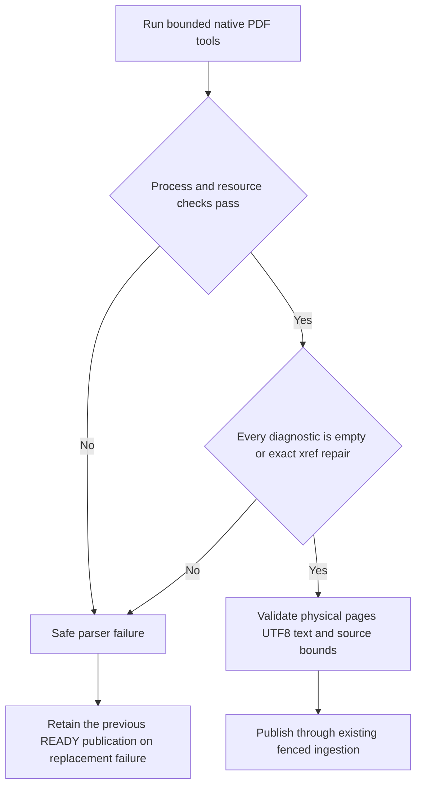

# Narrow PDF cross-reference recovery

This follow-up to [issue #16](https://github.com/SimonLoir/vectorix/issues/16) is implemented on `codex/pdf-xref-recovery`. Local automated checks and production dashboard acceptance pass; PR delivery and exact-head CI remain pending. It addresses the demonstrated cross-reference reconstruction case; arbitrary font, hint-table and other syntax warnings remain unsupported, so issue #16 stays open for that broader scope.

## Diagnostic boundary

Some text-based PDFs contain an incorrect cross-reference offset while their content streams remain intact. Installed Poppler can reconstruct the index, exit zero and extract both physical pages, yet emit this diagnostic:

```text
Internal Error: xref num 1 not found but needed, try to reconstruct
```

The previous worker's generic `not found` check misclassifies this as unavailable parser infrastructure before its `Error:` check can classify it as invalid content. Accepting every zero-exit result would also admit the existing partial-corruption fixture, whose native output contains usable but incomplete text.

The worker's [diagnostic classifier](../apps/workers/src/extraction/poppler-diagnostics.ts) permits only empty diagnostics or complete recognized xref-reconstruction lines after a successful process exit. Object numbers must be bounded positive decimal integers. Prefixes, suffixes, same-line additions, syntax warnings, syntax errors and unknown nonempty diagnostics remain failures. A recognized repair line never overrides another diagnostic, a nonzero exit, encryption, a signal, a resource limit or an expired deadline. Unknown chatter that previously escaped the broad error-expression checks is now rejected explicitly; this is an intentional compatibility tightening.



No raw native stderr, filename, path or document content becomes a public error. Existing safe error codes and retry rules distinguish unavailable infrastructure from invalid content. No new schema, API revision or extraction-artifact version is introduced.

## Original bytes, text and source positions

The stored PDF is never rewritten. [PDF parsing](../apps/workers/src/extraction/pdf.ts) still uses a private temporary copy, trusted final page-count metadata, physical form-feed separators, fatal UTF-8 decoding and the existing canonical text construction. Sources retain UTF-16 code-unit positions in extracted text, rather than byte positions in the PDF. Existing completed extractions are unchanged.

The selected synthetic fixture changes only the first in-use xref offset by seven bytes in the two-page FR/EN baseline. Its content streams and size are unchanged. Native exploratory output has exactly the baseline's text, page count, canonical hash and source ranges. This establishes that fixture's equivalence; no parser can infer general semantic completeness solely from a repair message and a successful exit.

All production bounds remain: 25 MiB default original upload, 10 MiB rich-extraction reservation, 8 MiB text and 10 MiB complete artifact, 500 PDF pages and a shared 30-second parser deadline. Native children retain 512 MiB address space, 20 CPU seconds, 64 file descriptors, bounded stdout and 32 KiB stderr. No shell, inherited credentials, network fetch, rendering or OCR is added. Temporary cleanup on success and failure is unchanged.

## Entry points and automated verification

- [Subprocess runner](../apps/workers/src/extraction/subprocess.ts): preserve captured failure precedence and delegate native result classification.
- [Parser tests](../tests/documents/parser.test.mts) and [reproducible fixtures](../tests/documents/fixtures/README.md): exact diagnostic, canonical text/source equivalence and original-byte preservation; unchanged partial corruption and repair-plus-corruption remain rejected.
- [Native HTTP/library/index regressions](../apps/api/src/rag-tests/document-pdf-xref.ts) and [focused fixtures](../apps/api/src/rag-tests/document-pdf-xref-fixture.ts): four written cases cover real native extraction, scoped source/original reads, current grants, valid replacement, retained exact-version holds and terminal mixed-corruption failure. Embedding responses are explicitly synthetic; these tests do not establish a live embedding-provider journey.
- [Document ingestion](../packages/routers/rag/src/services/documents/process.ts): existing durable publication, retries, storage binding and reservation behavior. No provider or object I/O belongs inside application transactions.
- [Packaged worker checks](../scripts/test-docker.sh): actual bundled parser and native diagnostic, including zero-exit mixed corruption. Mocked parser success cannot establish these results.

Six bounded native exploratory candidates were tested before implementation against Poppler 26.01.0. The selected minimal first-offset mutation and a broader all-offset mutation both produce the known repair line and preserve canonical text. A startxref-only mutation has no warning and would be a vacuous positive fixture. The original partial-corruption and mixed repair/corruption cases exit zero with extra syntax errors. These are exploratory observations, not successful patched-parser, API, container or browser tests.

## Dashboard acceptance recipe

Use production web, API and workers with fresh isolated PostgreSQL, Redis and private RustFS, an ordinary native owner and the platform storage fallback. No browser key, role, credential or notification-permission change is needed.

1. Upload `xref-reconstructed.pdf` from the document library. Wait for READY, inspect English page 1 and French page 2, jump between sources and download the original. Its SHA-256 must match the uploaded repaired fixture, not the clean baseline.
2. Replace that document with `xref-partial-corrupt.pdf`. Wait for the safe terminal failure. The earlier READY version's preview, sources and original download must remain available, with their exact prior identity and bytes.
3. Submit another valid repaired replacement through the supported replacement flow. Wait for READY and verify the published version and source geometry. Check localized states/reload in EN/FR/nl-BE and normal account navigation, then sign out.
4. Confirm session, document/version and task metadata through bounded read-only observations. Record actual console and local-mail counts. Stop the owned processes and remove only their stores/volumes and browser tab; do not shorten application retention deadlines or claim immediate document reclamation.

The real worker also runs its native notification lane. Any account-sign-in email stays inside the bounded private loopback SMTP capture; its numeric results must be reported honestly. This recipe does not exercise hosted mail, embeddings, vector indexing or capacity. Full capacity continues to wait for the requested compute upgrade.

## Actual validation

Frozen installation, 24 workspace type checks, 24 lint tasks, 149 API/backend tests, 11 utility tests, all 53 document tests and all 313 disposable catalog tests pass. All 39 binary fixtures regenerate deterministically; the 37 historical inputs remain byte-identical to HEAD. Four production builds and all six image/runtime/infrastructure checks pass, including the packaged native reconstruction diagnostic, complete baseline-artifact equivalence and zero-exit mixed-corruption refusal. The initial test-helper declaration error is corrected with explicit public Prisma payload/Promise types, without changing its queries or assertions. Independent implementation reviews are clear.

Production browser run `c1853593f801`, owned tab 50, completes the recipe using real API/web/worker builds, installed host Poppler and private RustFS:

- The repaired upload becomes READY v1; both FR/EN physical pages, next-source navigation and direct source-number access work. Its browser download is exactly 1,072 bytes with SHA-256 `de5d10947c8c7bc20b69e34d6bfc74402c15c28796369ebb7d75feb383d19376`.
- Mixed corruption becomes FAILED v2 after one actual attempt. The localized safe error appears while v1's French page remains readable. A second real browser download retains the exact v1 bytes/hash.
- A repaired replacement becomes published READY v3. Browser download again matches its input; source/page geometry remains unchanged. The v1/v2 retirement deadlines stay in the future with the normal seven-day selection; no deadline or retry is forced. The failed rich-extraction reservation remains until eventual application cleanup.
- EN/FR/nl-BE labels and reloads, personal account/return navigation and normal French logout work. Five bounded read-only checkpoints corroborate the same ordinary owner/active organization, one session until logout and zero afterward, version progression 0→1→2→3 and serving progression 1→1→3. Scoped S3 HEAD/GET reads independently verify the originals, artifacts, canonical hash and source ranges, followed by a metadata recheck. They do not constitute an atomic cross-store snapshot or prove browser behavior by themselves.

The browser console has zero warnings/errors. One 530-byte native sign-in message is captured only by owned loopback SMTP, with zero refusals or capture failure. The read-only observation helper emits a pg 8 parallel-query deprecation warning; this is separate from the browser console. Two prolonged browser-tool waits occur during file selection and the first download; the same live process handles and source/build pins are revalidated before continuing, without restarting the environment. No performance/capacity inference is drawn from these waits.

Cleanup confirms all four owned processes stopped, four containers and four volumes removed, and tab 50 absent. The login fixture and captured mail are deleted; safe aggregate proofs and screenshots remain private. No browser key, role, credential, notification permission or document deletion action occurs. No application-level reclamation after the seven-day retention period, live embedding quality, hosted mail or general corrupted-PDF recovery is claimed.
