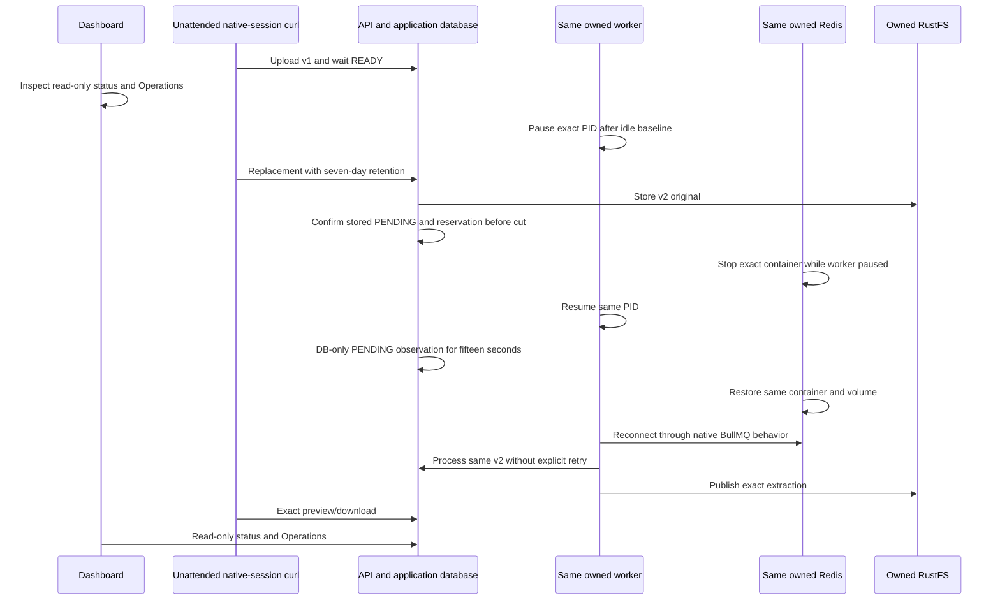

# Redis interruption and automatic document recovery

**Status: disabled tooling; focused offline checks PASS, native/browser acceptance NOT_RUN.** This bounded M7c slice exercises the existing production upload, durable ingestion and BullMQ reconnection path. It changes no application behavior, schema, permission or API contract. The earlier S3 trials and their original source/receipt inventories remain separate history.

## Scope and fault placement

The explicit protocol-2 `REDIS_V1` scenario uses a fresh `vectorix-m7c-redis-outage-<run>` namespace, four owned stores/volumes, exact `_test` databases and one normal owner/organization. One minimum `ragLibrary.read` organization key is created through the native owner endpoint with an explicit empty collection-scope list and saved issuer binding/audit. It is an isolation negative control; it does not gain access to the standalone library document. It shares the reviewed [public lifecycle](../tests/acceptance/s3-outage/lifecycle.py); it does not clone another topology. Only the selected dependency changes: S3 scenarios still stop RustFS, while `REDIS_V1` may stop only its recorded Redis ID and volume.

Normal upload/replacement commits PostgreSQL reservations, performs its bounded S3 PUT and leaves a durable PENDING task without enqueueing a per-document Redis message. The worker's recurring document scan is scheduled every five seconds by BullMQ. API admission retains its default 600-request personal budget and separate bounded Redis/local-fallback limiter. This trial neither disables nor relies on that fallback: every native HTTP file operation occurs while Redis is online. A service's lack of per-document enqueue does not establish that its HTTP admission will succeed during Redis loss.

A scan already admitted by BullMQ can continue its PostgreSQL work after Redis disappears. Therefore an idle baseline, exact worker pause and zero active document-scan count precede the Redis stop. While the worker is paused and Redis is online, unattended native-session curl fully stores the replacement. The independent `redis-staged` proof must confirm PENDING v2 before Redis can be stopped and that same worker resumed. Zero active scans is not an atomic barrier against an in-flight Redis command. The acceptance must actually observe the same stored v2 at attempts zero, no lease token, no extraction and the retained reservation for at least fifteen seconds. Any observed claim/progress during that window is **INCOMPLETE**, not a reason to retime or reset work.



## Acceptance recipe after separate activation

All twelve runtime gates remain disabled. A fresh run and exact disabled/enabled archives must receive independent review before any runtime command. Do not adopt an older state, enabled archive or proof. Copy existing standalone assets before capturing source/build/runtime/migration pins. The [shared harness prerequisites](../tests/acceptance/s3-outage/README.md#prerequisites-and-ownership) and exact owned cleanup remain authoritative.

1. Prepare `REDIS_V1`, deploy existing migrations and start SMTP, API, native seed, web and workers through the shared lifecycle. Run `transfers.mjs --mode key` before dashboard login. Native owner sign-in, active-organization selection, key creation and sign-out establish one minimum read key, its current owner-member issuer and a native `apiKey.create` audit. The key secret is written only to the fresh private 0600 sidecar; the safe proof contains IDs/scopes and its opaque file digest. No ORM write, role change, collection, provider or business credential is added.
2. Run `--mode upload-v1`. This performs ordinary owner session sign-in, one native multipart REST upload of the pinned v1 bytes, and sign-out. Sign into the dashboard normally and inspect READY/status/Operations. `--mode read-v1` checks the key's expected 404 on the isolated library document, then authenticates a temporary native owner session and verifies exact full preview/original bytes through curl. There is **no browser file selection, upload or download**, and no clipboard/credential/key action through the dashboard.
3. Emit `redis-ready` once. Enroll the independent watchdog and wait for its actual ACK. Its one 900-second monotonic deadline is never refreshed. Pause only the enrolled worker with `--transfer-ready`; this explicit machine fixture-readiness input is not a browser/DOM assertion.
4. While Redis is online and the exact worker remains paused, run `--mode replace-v2` once. A temporary native owner session submits pinned v2 multipart REST with saved v1 `expectedVersionId`, fresh request ID and seven-day retention, then signs out. Emit `redis-staged`: the current DB task must be stored PENDING, attempts/claims zero, and v1 original/extraction plus v2 original must match the frozen physical bytes; v2 extraction is absent. The observer closes before publishing the admission proof. Invoke `redis-outage` once; it must consume that fresh exact org/document/v2/source proof, check zero `LLEN bull:documents:active`, sample top-one `ZREVRANGE bull:documents:completed 0 0 WITHSCORES` metadata, then stop only the saved Redis container and resume only the saved worker. At least 120 original watchdog seconds must remain before the stop. The completed identity is hashed; capped BullMQ cardinality is not a recovery gate.
5. Emit `redis-pending`. This phase is DB-only: no S3 SDK, HTTP/curl, preview, download or dashboard readability is required while Redis is down. At least three snapshots spanning fifteen UTC and monotonic seconds must preserve that exact already accepted v2 source/binding/reservation, attempts zero, no claim or extraction. Created/stored dates must equal the precut staged tuple and precede the stop. Source readability is not asserted during this interval; its precut and postrestore physical proofs remain separate. Restore promptly after the fresh proof without inserting file/API work.
6. Restore the same Redis container/volume after the pending proof. Wait for the nonintervening watchdog final receipt and successful watchdog process exit. **Do not click Retry extraction**, enqueue work, restart the worker, edit task dates or write SQL.
7. Wait for automatic same-v2 READY; emit `redis-recovered`. Exact objects, current owner/session, unchanged bindings, one successful native extraction attempt and no `document.extraction.retried` audit are required. Observe a different latest completed scan hash with timestamp at least as recent as the pre-stop sample (or a first completion after an empty set). Scan metadata is not per-document job identity, atomic causality or billing. Run `--mode read-v2` for key isolation and exact session-curl source checks.
8. Inspect history, Usage and Operations through the dashboard. Reservation becomes extraction bytes, leaving total charge 2,284 bytes; seven-day cleanup remains future work. Normal UI sign-out, `redis-signed-out` and owned teardown finish the trial. The safe read-key metadata and its native creation audit remain unchanged through every observation, while normal native request counters may change.

Use the shared entry points with **explicit `--scenario REDIS_V1` on every command**. The five observer phases are `redis-ready`, `redis-staged`, `redis-pending`, `redis-recovered` and `redis-signed-out`. Fault modes are `watchdog`, `pause-worker --transfer-ready`, `redis-outage` and `restore`. `storage-outage` is refused for this scenario. Lifecycle setup/application/check/cleanup modes remain unchanged. The safety-only `abort-incomplete` restores enrolled resources but permanently records INCOMPLETE; it never replays the replacement or repairs proof.

## Bounds and evidence limits

The pending observer uses two-second minimum pacing, at most twelve snapshots and a local sixty-second budget intersected with the original watchdog. Nested child-guard timeouts and SQL acquisition/execution budgets use the remaining outer budget; the initial source/ownership admission precedes that observation window and retains its own finite bound. READ ONLY Repeatable Read snapshots remain bounded; lease token values are never selected. The separate precut/postrestore S3 reads retain 64 KiB/object, 256 KiB total, nine commands, a thirty-second overall budget and five-second complete GET-body deadlines. Metadata is reread afterward. Those are rechecked cross-store observations, not atomic snapshots.

The focused queue reader uses only loopback and the saved owned Redis port after source/identity admission. The active count is at most 1,000,000,000 with a 32-byte integer response. The other fixed response contains at most one 160-byte ASCII job identifier and one 32-byte decimal timestamp; fewer than 512 response bytes can be consumed in total, and the shared network deadline is four seconds. The identifier is hashed before projection. It never reads job bodies, subscriptions, application keys, credentials or payloads and performs no Redis write. Source/ownership checks before and after I/O have separately bounded lifecycle costs, additionally capped by the outer proof budget when invoked from the observer. Queue completion may follow the document commit, so the final proof polls naturally with a thirty-second local admission budget and at most ten samples; no new observation starts after its deadline.

The same Redis ID/volume and worker PID/start ticks are required throughout. No Redis flush, queue deletion, manual scanner call or reconstructed clock is used. Unknown HTTP acceptance, missing samples, source drift, worker restart or watchdog intervention remain INCOMPLETE. All actual browser, native fault, external provider, teardown and timing results remain NOT_RUN until separately executed. No capacity or hosted-provider claim is made.

## Focused validation and execution entry points

`bash scripts/test-s3-outage-guards.sh` passes 45 Python and 48 Node pure/injected cases plus fourteen Node syntax checks for the final accepted-before-loss design. The earlier private-transfer checkpoint (43 Python and 47 Node cases) remains separate history. The final delta adds mandatory precut staged admission, immutable accepted dates and the actual DB-only outage predicate. These cover all three closed scenarios, exact selected-container fault/refusal, owned queue admission before network, bounded RESP parsing, unchanged stored source/reservation, genuine monotonic pending duration, and shared remaining-time budgets. No live Redis, Docker, database, S3 SDK, application, browser or provider is used by this pass. The first focused run is retained as a failed new assertion caused by a fixture expecting the S3-only retry count; the corrected checkpoint and subsequent stricter timing/queue checks are separate receipts.

After separate reviewed activation and setup, the finite fault/observation sequence is:

```bash
# REDIS_OUTAGE_RUN must be the separately admitted fresh 12-hex run.
# After seed and all applications start, before dashboard sign-in:
node tests/acceptance/redis-outage/transfers.mjs --run "$REDIS_OUTAGE_RUN" --scenario REDIS_V1 --mode key
node tests/acceptance/redis-outage/transfers.mjs --run "$REDIS_OUTAGE_RUN" --scenario REDIS_V1 --mode upload-v1
# Wait READY; UI login is read-only.
node tests/acceptance/redis-outage/transfers.mjs --run "$REDIS_OUTAGE_RUN" --scenario REDIS_V1 --mode read-v1
node tests/acceptance/s3-outage/observe.mjs --run "$REDIS_OUTAGE_RUN" --scenario REDIS_V1 --phase redis-ready
python3 tests/acceptance/s3-outage/fault.py --run "$REDIS_OUTAGE_RUN" --scenario REDIS_V1 --mode watchdog
# Keep that foreground watchdog supervised in its own terminal; wait for ACK.
python3 tests/acceptance/s3-outage/fault.py --run "$REDIS_OUTAGE_RUN" --scenario REDIS_V1 --mode pause-worker --transfer-ready
node tests/acceptance/redis-outage/transfers.mjs --run "$REDIS_OUTAGE_RUN" --scenario REDIS_V1 --mode replace-v2
node tests/acceptance/s3-outage/observe.mjs --run "$REDIS_OUTAGE_RUN" --scenario REDIS_V1 --phase redis-staged
python3 tests/acceptance/s3-outage/fault.py --run "$REDIS_OUTAGE_RUN" --scenario REDIS_V1 --mode redis-outage
node tests/acceptance/s3-outage/observe.mjs --run "$REDIS_OUTAGE_RUN" --scenario REDIS_V1 --phase redis-pending
python3 tests/acceptance/s3-outage/fault.py --run "$REDIS_OUTAGE_RUN" --scenario REDIS_V1 --mode restore
# Wait for automatic READY and the actual successful watchdog exit; do not retry.
node tests/acceptance/s3-outage/observe.mjs --run "$REDIS_OUTAGE_RUN" --scenario REDIS_V1 --phase redis-recovered
node tests/acceptance/redis-outage/transfers.mjs --run "$REDIS_OUTAGE_RUN" --scenario REDIS_V1 --mode read-v2
# Complete read-only UI evidence and normal sign-out before the final phase.
node tests/acceptance/s3-outage/observe.mjs --run "$REDIS_OUTAGE_RUN" --scenario REDIS_V1 --phase redis-signed-out
python3 tests/acceptance/s3-outage/lifecycle.py --run "$REDIS_OUTAGE_RUN" --scenario REDIS_V1 --mode cleanup
```

## Unattended file transport and existing access boundaries

The native delegation policy forbids `ragLibrary.readAll/write` on API keys, and a read key with no scoped collection cannot read a standalone library document. This recipe preserves both restrictions. Every successful file operation uses an ephemeral, authoritative native owner cookie session through curl. The minimum key is created natively and must receive 404 for each isolated-document preview attempt; no successful key file access is claimed. No existing key acquires new rights, and native issuer/membership checks remain active.

The operator host must already provide `/usr/bin/curl`; no install is performed by these helpers. The curl binary is resolved to `/usr/bin/curl` and hashed at preparation and before requests only for `REDIS_V1`. Each invocation uses `-q` as its first option, an exclusive 0600 config/body, a closed loopback route, no inherited environment/proxy, no redirect/fallback/retry, a two-second connection bound, at most fifteen seconds per request and at most 80 KiB captured headers/body (16/64 KiB parsed limits). Sessions, key material and request bodies never appear in command arguments, public stdout, environment or logs. Temporary config/body files are removed after each child; only the separately private key file and finite redacted operation receipts persist. The child response is captured in memory, never forwarded to public stdout. A timeout or unknown acceptance consumes the one-shot intent and cannot be replayed. Sign-out is always attempted; successful proof requires confirmed sign-out, successful Prisma disconnect where used, and a final source/ownership guard. The original fixture remains immutable; the sidecar records the one new native key explicitly. These guards attest enumerated inputs/binary bytes, not every shared OS library.

After exact owned teardown and retained proof/hash review, include `redis-read-key.json` in the separately approved private secret removal alongside the original fixture/state secrets. A crashed child may leave only private `curl-<16hex>.conf`/`.body` files; these are not receipts and must not be replayed. Retain safe key/transfer proofs and original failed intents. Teardown of the disposable store removes the native key record; do not add a browser key deletion or a permission-changing cleanup action.
