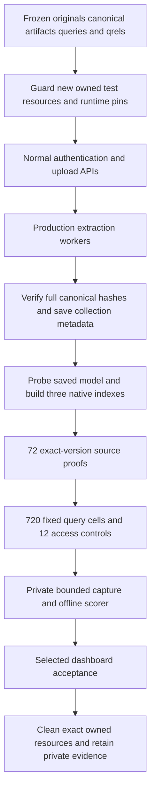

# M7c.2 — Native reference-quality acceptance

Status: **verified on the frozen artificial FR/EN corpus**. Normal uploads, three native Ollama indexes, 72 exact-source proofs, 720 scored searches and 12 access controls pass. An independent offline recomputation confirms the scores. Selected searches, filters, parents, source previews and locale changes also pass in the production dashboard. Capacity, ANN recall, internal latency and interrupted-process acceptance remain separate work.

This milestone adds reproducible acceptance tools and fixtures; it changes no application behavior, Prisma model, migration or public API contract. The compatible API revision remains `1.18.0`. The tested product commit is PR #44 squash `d7cf7c28f3aef2d2fdbcf270214504d601d836eb`. The subsequent repository placement of the tools is checked separately; it is not a second native run.

## Fixed corpus and retrieval policy

The corpus contains 24 artificial documents: 12 French and 12 English, six each TXT, Markdown, PDF and DOCX. Eight parallel fact families and four parallel near-miss families include archived editions and typed metadata. The six PDFs have three real pages each; DOCX sources retain actual paragraph and section positions. No rule in these files describes a real organization.

The 40 final queries contain 20 per language and ten each exact, paraphrase, filter and parent questions. Four queries explicitly search the other language. Eight development queries are separate and unscored. Forty-eight answer spans bind eligibility and relevance to exact canonical editions, rather than to generated chunk IDs or observed rankings.

Canonical offsets are JavaScript UTF-16 code units. Original files are hashed as original bytes; canonical text is hashed as UTF-8. Accents, combining characters, astral characters and source gaps must not be normalized away. The corpus, final queries, qrels and gates were reviewed and frozen before native rankings were inspected:

```text
cb372b53964ffe896bb4e3c3c44831db6c0949bbe622e63ce0a482607be6fdbc
```

All three collections share the same organization library and use the following saved profile:

| Setting                | Frozen value                                                         |
| ---------------------- | -------------------------------------------------------------------- |
| Provider/model         | Ollama `embeddinggemma:latest`, native `EMBEDDING_GEMMA` preparation |
| Verified weight digest | `85462619ee721b466c5927d109d4cb765861907d5417b9109caebc4e614679f1`   |
| Dimensions             | Full native 768                                                      |
| Representation/index   | Cosine, float32, DISKANN                                             |
| Child size             | Target 512, minimum 128, maximum 768, overlap 64                     |
| Parent context         | Enabled, maximum 2,048 estimated tokens                              |
| Semantic threshold     | 90th percentile                                                      |
| Custom preparation     | Empty                                                                |
| Metadata               | `region`, `policy_year`, `active`, `effective_at`, `tier`            |

The exact digest is verified by the native probe and the saved generation snapshot; the model name alone does not identify its weights. The actual run used Ollama `0.40.8` and the existing local model cache mounted read-only. See the [Ollama setup and real-instance instructions](rag-first-search.md) for configuring a normal deployment.

The exact-query gate deliberately uses quoted identifiers and an answer-bearing literal keyword, matching the current lexical AND semantics. It does not require lexical search to interpret natural-language paraphrases. This choice was made before the model run; the remaining 30 final questions were preserved.

## Data flow and entry points



| Boundary                                                                        | Concrete entry point                                                                                                                                             |
| ------------------------------------------------------------------------------- | ---------------------------------------------------------------------------------------------------------------------------------------------------------------- |
| New resources, approved migration deployment, foreground apps, pins and cleanup | [`quality-topology.py`](../tests/acceptance/quality/quality-topology.py), [`quality_topology_policy.py`](../tests/acceptance/quality/quality_topology_policy.py) |
| Private bucket and synthetic identity bootstrap                                 | [`quality-bucket.mjs`](../tests/acceptance/quality/quality-bucket.mjs), [`quality-bootstrap.mjs`](../tests/acceptance/quality/quality-bootstrap.mjs)             |
| Fixed normal-API action sequence                                                | [`collector-protocol.mjs`](../tests/acceptance/quality/collector-protocol.mjs)                                                                                   |
| Actual HTTP, cookies, source files and separate read-only generation evidence   | [`collector-runtime.mjs`](../tests/acceptance/quality/collector-runtime.mjs), [`collector-guard.py`](../tests/acceptance/quality/collector-guard.py)             |
| Relevance/provenance arithmetic and offline scoring                             | [`evaluate.mjs`](../tests/acceptance/quality/evaluate.mjs), [`score.mjs`](../tests/acceptance/quality/score.mjs)                                                 |
| Corpus and operator commands                                                    | [Acceptance-tool README](../tests/acceptance/quality/README.md), [frozen manifest](../tests/acceptance/quality/reference-v1/manifest.json)                       |

Only the fresh `vectorix-m7c-quality-{12hex}` namespace is admitted. It owns two `_test` databases, four new store volumes, five containers, a private bucket, three synthetic users and two organizations. Actual container IDs, images, labels, mounts, volume creation identities, loopback ports, process identities and complete explicit runtime configuration are checked before SDK/authentication work. The operator-selected model volume is read-only and never removed. No application `.env`, hosted key, invitation, superadmin or API key is used.

The bootstrap uses native authentication/organization operations. Its one narrowly scoped fixture transaction adds the synthetic reader membership after checking the exact empty baseline. The collector writes documents, profiles, associations, metadata and temporary reader grants only through ordinary application APIs. It never seeds chunks, vectors, task outcomes or publication pointers directly.

Each collection is indexed independently with `DOCUMENT_STRUCTURE`, `TOKEN_WINDOW` or `SEMANTIC`. A separate guarded read-only transaction binds its actual saved model identity, algorithm versions, profile and 24 published version-1 sources. The 72 unscored lexical probes immediately open fresh source receipts, verify every returned indexed source segment, and download/hash each original. Full canonical hashes come from the current version-1 library preview: gaps between indexed source segments are not invented as receipt output.

The scored matrix is `3 chunkers × 3 search modes × 40 queries × 2 repeats = 720 cells`, with ten requested results. Errors and missing cells remain in the denominators. Each collection also has four real controls: current reader allowed, foreign organization denied, revoked explicit reader grant denied and the reader's previous source receipt denied after revocation. These are newly created grants in the quality fixture; they do not touch the separately refused restored-group control or the protected issue #8 fixture.

## Predeclared gates and actual results

Each row below passed independently for both repetitions of each chunker. The worse repetition is retained; no best-run selection or threshold adjustment occurred.

| Gate                                                 | Required                    | Observed for each chunker/repeat |
| ---------------------------------------------------- | --------------------------- | -------------------------------- |
| Exact lexical Hit@5                                  | 10/10                       | 10/10                            |
| Hybrid Hit@5                                         | At least 32/40              | 40/40                            |
| Hybrid per-language Hit@5                            | At least 16/20 per language | EN 20/20; FR 20/20               |
| Hybrid MRR@10                                        | At least 0.65               | 0.9375                           |
| Cross-language hybrid Hit@5                          | At least 3/4                | 4/4                              |
| Filter hybrid Hit@5                                  | At least 9/10               | 10/10                            |
| Joint parent hybrid Hit@5                            | At least 8/10               | 10/10                            |
| Scope/version/filter/canonical/provenance violations | Zero                        | Zero                             |
| Scored request errors or missing evidence            | Zero                        | Zero                             |

Overall lexical Hit@5 is **10/40**, MRR@10 **0.25**, and fact recall **0.25**. VECTOR and HYBRID each achieve **40/40**, MRR@10 **0.9375**, and fact recall **1.0** on this corpus. These results are identical across the three chunkers and two repetitions. The lexical exact-query gate passes; the other natural-language misses remain visible. This experiment does not identify a superior chunker or show a hybrid improvement over vector search.

The actual run `2c5589639f5d` records 1,677 RAG RPC calls, including the 720 scored cells, 72 separate source probes and their source/download reads. The private capture is 1,591,112 bytes with 143 deduplicated returned passages. Final read-only catalog evidence shows 24 published documents per collection, 58 structure children, 59 token-window children and 64 semantic children, with 24 parents per collection. All generations are ACTIVE revision 1; retained and reserved children are zero.

| Immutable evidence | SHA-256                                                            |
| ------------------ | ------------------------------------------------------------------ |
| Native capture     | `456ec10b4eecd74ca56907a49a171283604c039205f9350a2424e691fee687c7` |
| Quality report     | `a4b55aaec54289a0fc8244edea8c3f1e9b22c82307547ecd895cff7c79fd89be` |

An independent audit recomputes every rank, hit, reciprocal rank, fact denominator and parent result, plus all six gates, source bindings and access outcomes. It also verifies the 14 exact helper snapshots retained privately with the run. This is an audit of captured evidence, not a second database/provider execution.

## Dashboard acceptance

Prerequisites are the existing production builds, approved migrations, the verified cached model and the isolated topology described in the [operator README](../tests/acceptance/quality/README.md). Run the collector once before opening a browser login; preserve the normal authentication rate limits. After the collector completes, start its web process and sign in with only the private synthetic fixture.

The actual dashboard journey verifies:

1. On DOCUMENT_STRUCTURE, lexical query `"ORION-30" return` returns the current TXT edition first and the archived near-miss second. Opening the first exact source shows version 1 and its complete 3,065-character canonical text.
2. On TOKEN_WINDOW, hybrid query `What is the current device return period?` with typed `policy_year = 2026` and `active = true` filters returns the current English TXT first and the current French PDF second. Its exact PDF preview identifies page 1 of three.
3. On SEMANTIC, hybrid query `Où déposer le matériel endommagé et quel formulaire faut-il joindre ?` returns the French DOCX first. Its matched child is canonical range 0–1,146. Expanding the 0–3,166 parent adds both the North reception desk and form EQ-7; the parent reports 1,106 estimated tokens. The exact DOCX viewer opens paragraphs 1 and 19 of 20; paragraph 19 contains the form requirement.
4. Search results, profile headings, context labels and source controls react to English/French/Belgian Dutch. Belgian Dutch persists after reload; the initial French selection is restored. The final captured warning/error console is empty.

The three observed request times were 185ms, 249ms and 1,030ms. They are individual functional observations, not latency benchmarks or internal-p95 measurements. The source access/foreign/revoked checks above are actual normal API controls; they were not repeated as additional browser permission mutations.

One browser download-event call stalled and reset the control session. Its returned path/hash could not be verified, and no matching synthetic PDF was present in Downloads after recovery. This extra browser-download control is **inconclusive**; the 72 actual API original-download hashes remain valid. After the real wait, the old source receipt displayed an explicit unavailable error. No clock, lease or task was edited.

## Failure history, cleanup and remaining scope

The first attempt `231136751f66` stopped before any document, version or collection was created. Its supervisor discarded the child diagnostic, so the first cause remains unknown. A possible authentication-rate collision is not treated as a confirmed cause. That exact topology was cleaned, and its saved source checksum remains intact; the exact pre-edit supervisor source was not retained. The corrected supervisor saves only a bounded private, exclusive result with fixed diagnostics, never raw output. Five focused refusal/privacy tests pass.

The successful run uses a fresh namespace and preserves the same frozen corpus/model/gates. Its exact helper bytes are archived before collection. Cleanup gracefully stops API/workers/web and removes only its five owned containers and four new volumes. Created tab 28 was closed with the first attempt; tab 29 was closed with the successful run. Private evidence and the pre-existing model volume remain. No application database, user file, existing user tab, paid provider or local admin Next type-import preference was changed.

This small artificial corpus has fewer than 1,000 searchable children per collection. Configuring DISKANN does not establish ANN recall or performance. The separate actual **100,000 native children, ten concurrent HTTP searches, concurrent ingestion/fairness, internal-p95 and interrupted-process/outage** acceptance remains required. The ignored load/latency drafts are not shipped as working capacity tooling by this milestone.
