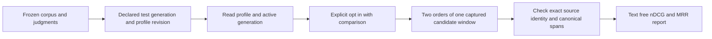

# Frozen FR/EN reranking comparison

Status: the runner and 12 offline guard/scoring tests are implemented. No hosted evaluation has run. Reranking remains off by default; this tool never enables a profile or changes a default.

[The runner](../tests/acceptance/reranking/run.mjs) reuses the byte-frozen corpus, canonical artifacts and judgments from the [reference-quality acceptance suite](../tests/acceptance/quality/README.md). It evaluates exactly the ten frozen `PARAPHRASE` questions, five French and five English, including the cross-language questions. The other 30 questions and the broader 720-cell acceptance matrix are outside this comparison.

The declared corpus digest is `cb372b53964ffe896bb4e3c3c44831db6c0949bbe622e63ce0a482607be6fdbc`. The loader checks the frozen manifest, query/judgment digest and canonical artifacts before any API call. Do not change questions or judgments after observing a ranking.



## Prepare a dedicated test instance

Use the normal API to upload all 24 originals, attach them with the declared metadata and language, and publish a collection. The [reference suite](../tests/acceptance/quality/README.md) documents that preparation; use curl for file transfers. Keep the generation fixed during evaluation. Configure a reviewed Cohere or Voyage reranking profile through the dashboard and explicitly enable it. The configured provider endpoint must satisfy the separate operator allowlist described in [optional reranking](rag-reranking.md).

Create a least-privilege organization API key for this synthetic tenant. Its issuer must retain `ragCollection.read`, `ragLibrary.read`, `ragRerank.use` and the collection read grant; the key needs the corresponding explicit permissions and collection read scope. The runner does not create keys, broaden scopes, upload files, download originals, configure providers or start services. Hosted searches may incur charges, and query embedding can also incur charges according to the saved embedding profile.

Create a private binding JSON file with these fields:

| Field                                | Required value                                                                   |
| ------------------------------------ | -------------------------------------------------------------------------------- |
| `schemaVersion`                      | `1`                                                                              |
| `corpusDigest`                       | The digest above                                                                 |
| `collectionId`, `generationId`       | The synthetic collection and its published generation                            |
| `rerankRevision`                     | The enabled immutable reranking revision                                         |
| `provider`, `model`, `candidatePool` | The exact saved reranking profile values                                         |
| `documents`                          | All 24 entries, each with `fixtureId`, its actual `documentId`, and `version: 1` |

Fixture IDs come from the [frozen manifest](../tests/acceptance/quality/reference-v1/manifest.json). They are never inferred from filenames or search order. Every actual document ID must be unique. The runner binds to these declarations, verifies returned source content against the canonical artifacts, and rejects unknown documents, other versions and other generations. It does not independently inventory every unreturned document in the installed collection.

Store the bindings and new report in a private directory. Supply the API key through your secret manager or an explicit process environment; do not put it in the binding file, command arguments or Git. The runner reads only the listed process variables and never loads `.env`.

```sh
export VECTORIX_RERANK_EVAL_RUN=1
export VECTORIX_RERANK_EVAL_TEST_SCOPE=1
export VECTORIX_RERANK_EVAL_ENDPOINT='https://YOUR_TEST_API/api/v1/admin/rag/collections/YOUR_COLLECTION_ID/reranked-search'
export VECTORIX_RERANK_EVAL_CORPUS_SHA256='cb372b53964ffe896bb4e3c3c44831db6c0949bbe622e63ce0a482607be6fdbc'
export VECTORIX_RERANK_EVAL_PROFILE_REVISION='YOUR_SAVED_REVISION'
# VECTORIX_RERANK_EVAL_API_KEY must already be present in this process environment.
node tests/acceptance/reranking/run.mjs --bindings /PRIVATE/bindings.json --report /PRIVATE/new-report.json
```

HTTPS is required except for explicit loopback HTTP test endpoints. The exact versioned reranked-search path must match the declared collection. The report path must not already exist. Curl runs with no shell, curlrc, inherited proxy configuration, redirects or automatic retries; the key and request body are sent on its standard input. Responses are bounded and stay in memory. The new report is created with mode `0600` and excludes questions, document text, source receipts, API keys and endpoint URLs.

## Interpret the report

There are exactly 12 API calls: profile and index-status preflights, followed by ten `HYBRID`, `topK: 10`, `compare: true` searches with fresh request UUIDs. Each baseline is the API's original order within the same captured candidate window. No independent ordinary search is used. Both returned orders retain source receipts; common child IDs must preserve their document version, publication, canonical text/spans and parent context. A small candidate window may return fewer than ten results. The tool trusts the API's same-window contract and cannot independently inspect hidden candidates.

The [pure evaluator](../tests/acceptance/reranking/evaluate.mjs) reports binary nDCG@10 and MRR@10 before and after reranking, their deltas, per-language means and source identity check counts. A child earns relevance only when it covers the judged canonical answer span of an eligible exact document version. Only the first qualifying child for each judged document edition earns credit, so overlapping passages do not multiply a judgment. The nDCG ideal denominator uses all eligible judged editions, including relevant editions absent from the retrieved window. Parent-context questions are excluded from this fixed subset.

`COMPLETE_OBSERVATION` means all ten responses passed the binding and source checks. It is not a quality gate or a claim that reranking improved results. Empty results score zero. A refusal, stale profile/generation, invalid source or partial matrix stops the runner without writing a complete report; no request is automatically retried. Already admitted or dispatched work remains subject to normal server accounting. The report records `hostedProviderAcceptance: NOT_ATTESTED`: an API response alone cannot attest to hosted provider identity or billing. Keep provider setup and any actual hosted verification as separate evidence.

A positive result does not establish corpus-wide recall, production quality or a reason to enable reranking by default. Repeat comparisons with the same frozen inputs and declare any changed provider, candidate window or generation separately.

## Offline verification

```sh
env -i PATH="$PATH" node tests/acceptance/reranking/evaluate.test.mjs
```

Actual result: all 12 tests passed. They cover fixed query selection, corpus/profile declarations, known nDCG/MRR values, duplicate relevance credit, exact source/version/generation checks, canonical tampering, missing comparison, explicit opt-in, curl argument secrecy, a complete injected empty-result matrix and refusal to overwrite a report. The tests make no HTTP, provider, database or Docker calls. Injected fixtures establish the evaluator's behavior only; hosted quality remains **NOT_RUN**.
