# Optional native reranking

Status: implementation in progress; hosted quality has not been measured. Reranking remains off by default.

A collection has a separate immutable reranking profile. Saving it does not rebuild embeddings. Administrators can select Cohere or Voyage, a reviewed native model and a candidate pool of up to 100 authorized children. A searcher must explicitly enable reranking for each request and hold `ragRerank.use`, collection reading and library reading. Existing API keys receive no new permissions.

```mermaid
flowchart LR
    UI[Explicit search opt in] --> Claim[Unique request and current grants]
    Claim --> Retrieval[Captured generation and filtered retrieval]
    Retrieval --> Children[Authorized canonical child text]
    Children --> Debit[Durable dispatch intent and limits]
    Debit --> Provider[One native rerank call]
    Provider --> Settlement[Settle validated native usage]
    Settlement --> Check[Recheck profile and source authority]
    Check --> Results[Parent deduplication and exact source receipts]
```

The new API operation is separate from legacy search. Comparison uses the same captured candidate pool. Reranking does not send parent context, filenames or metadata to the provider. Scores are provider relevance scores, not confidence estimates. A candidate pool smaller than topK may return fewer results; it never expands silently.

Organization credentials precede complete platform defaults. An enabled revision saves the credential identity and destination; secret rotation is allowed, destination retargeting is refused. Only exact operator-approved root URLs from `VECTORIX_RERANKING_ALLOWED_ENDPOINTS` or the corresponding `VECTORIX_DEFAULT_COHERE_ENDPOINT` / `VECTORIX_DEFAULT_VOYAGE_ENDPOINT` can receive requests. The embedding and reranking allowlists are distinct.

The request ledger reserves capacity before query embedding and rejects retained request UUID replay. It records no query or document content. Default organization limits are 500 dispatch intents per UTC day, 256 MiB prepared query/document bytes per day, four concurrent requests and 5,000 retained receipts. Dispatch intent is not proof of wire transmission or billing. Failed or ambiguous dispatches retain debit; there is no retry or fallback. Reported token/billing fields remain independently nullable. Validated late usage settles before access denial. A mandatory settlement failure returns an error and leaves an uncertain durable dispatch for operator diagnosis.

Capacity is derived from unexpired, unreleased receipts, with a database organization lock serializing admissions. Collection deletion cannot leak concurrency slots. Captured collection/configuration/generation identifiers on a receipt are not authority and do not have retention-blocking foreign keys; organization ownership preserves late settlement. Claims expire after 120 seconds; the whole search has a 60-second deadline and the native call at most 15 seconds. Worker cleanup processes bounded batches, retains receipts for seven days and numeric UTC-day aggregates for 30 days. UUID replay prevention is limited to that retention window. Immutable profile history is limited to 1,000 revisions per collection and remains until collection cleanup and keeps its credential binding referenced.

Search telemetry continues to cover shared retrieval. On opt-in paths, pre-rerank candidate preparation is covered by SERVICE_TOTAL; FUSION_HYDRATE begins after scoring. Native rerank duration and usage are separately accounted, never counted as embedding vectors.

Provider and pipeline tests use controlled native HTTP fixtures. They do not establish hosted quality or real provider billing. A frozen FR/EN corpus comparison is required before considering any future default change. The [explicit evaluation runner](rag-reranking-evaluation.md) uses the existing 24-document reference and ten fixed questions; it compares both orders in the same API response and records no text or source tokens. Its offline tests do not establish hosted quality.

## Integration entry points

- `packages/reranking/src/index.ts`: bounded native protocols, pure input validation and reported usage.
- `packages/routers/rag/src/services/reranking/`: profile, admission, settlement, search and maintenance.
- `packages/routers/rag/src/services/indexing/search.ts`: shared retrieval and exact source hydration.
- `packages/api-contracts/src/v1/rag/reranking.ts`: additive revision-22 operations.
- `apps/web/components/rag/reranking/`: collection configuration and search opt-in.
- `packages/db/prisma/models/rag-reranking.prisma`: durable revisions, requests and usage.

## Acceptance recipe

Prerequisites: an authorized reader with `ragRerank.use`, an active collection, configured Cohere or Voyage credentials and an operator-approved endpoint. Save an enabled profile in collection settings, then explicitly select reranking in the search UI. Enable comparison to inspect the baseline within the same candidate pool. Verify separate relevance scores and reported/unknown usage, exact source preview and original receipts. Disable the toggle and confirm ordinary search remains unchanged. Revoke access or change the profile during a call and confirm the result is denied after usage settlement. Hosted acceptance and browser results are pending.
