# Optional native reranking

Status: implemented and verified with isolated native integration tests and a controlled-provider dashboard journey at product checkpoint `ab289`. Hosted quality and paid-provider access remain unverified. Reranking remains off by default; exact-head CI and delivery are recorded in the pull request.

A collection has a separate immutable reranking profile. Saving it does not rebuild embeddings. Administrators can select Cohere or Voyage, a reviewed native model and a candidate pool of up to 100 authorized children. A searcher must explicitly enable reranking for each request and hold `ragRerank.use`, collection reading and library reading. Existing API keys receive no new permissions.

```mermaid
flowchart LR
    UI[Explicit search opt in] --> Claim[Unique request and current grants]
    Claim --> Retrieval[Captured generation and filtered retrieval]
    Retrieval --> Children[Authorized canonical child text]
    Children --> Debit[Durable dispatch intent and limits]
    Debit --> Provider[One native rerank call]
    Provider --> Settlement[Settle validated native usage]
    Settlement --> Check[Recheck profile and source authority]
    Check --> Results[Parent deduplication and exact source receipts]
```

The new API operation is separate from legacy search. Each accepted submission consumes the reranking and comparison selections, including failed attempts; the next search is ordinary unless explicitly selected again. Comparison uses the same captured candidate pool. Reranking does not send parent context, filenames or metadata to the provider. Scores are provider relevance scores, not confidence estimates. A candidate pool smaller than topK may return fewer results; it never expands silently.

Organization credentials precede complete platform defaults. An enabled revision saves the credential identity and destination; secret rotation is allowed, destination retargeting is refused. Only exact operator-approved root URLs from `VECTORIX_RERANKING_ALLOWED_ENDPOINTS` or the corresponding `VECTORIX_DEFAULT_COHERE_ENDPOINT` / `VECTORIX_DEFAULT_VOYAGE_ENDPOINT` can receive requests. The embedding and reranking allowlists are distinct.

The request ledger reserves capacity before query embedding and rejects retained request UUID replay. It records no query or document content. Default organization limits are 500 dispatch intents per UTC day, 256 MiB prepared query/document bytes per day, four concurrent requests and 5,000 retained receipts. Dispatch intent is not proof of wire transmission or billing. Failed or ambiguous dispatches retain debit; there is no retry or fallback. Reported token/billing fields remain independently nullable. Validated late usage settles before access denial. A mandatory settlement failure returns an error and leaves an uncertain durable dispatch for operator diagnosis.

Capacity is derived from unexpired, unreleased receipts, with a database organization lock serializing admissions. Collection deletion cannot leak concurrency slots. Captured collection/configuration/generation identifiers on a receipt are not authority and do not have retention-blocking foreign keys; organization ownership preserves late settlement. Claims expire after 120 seconds; the whole search has a 60-second deadline and the native call at most 15 seconds. Worker cleanup processes bounded batches, retains receipts for seven days and numeric UTC-day aggregates for 30 days. UUID replay prevention is limited to that retention window. Immutable profile history is limited to 1,000 revisions per collection and remains until collection cleanup and keeps its credential binding referenced.

Search telemetry continues to cover shared retrieval. On opt-in paths, pre-rerank candidate preparation is covered by SERVICE_TOTAL; FUSION_HYDRATE begins after scoring. Native rerank duration and usage are separately accounted, never counted as embedding vectors.

Provider and pipeline tests use controlled native HTTP fixtures. They do not establish hosted quality or real provider billing. A frozen FR/EN corpus comparison is required before considering any future default change. The [explicit evaluation runner](rag-reranking-evaluation.md) uses the existing 24-document reference and ten fixed questions; it compares both orders in the same API response and records no text or source tokens. Its offline tests do not establish hosted quality.

## Integration entry points

- `packages/reranking/src/index.ts`: bounded native protocols, pure input validation and reported usage.
- `packages/routers/rag/src/services/reranking/`: profile, admission, settlement, search and maintenance.
- `packages/routers/rag/src/services/indexing/search.ts`: shared retrieval and exact source hydration.
- `packages/api-contracts/src/v1/rag/reranking.ts`: additive revision-22 operations.
- `apps/web/components/rag/reranking/`: collection configuration and search opt-in.
- `packages/db/prisma/models/rag-reranking.prisma`: durable revisions, requests and usage.

## Acceptance recipe

Prerequisites: an authorized reader with `ragRerank.use`, an active collection, configured Cohere or Voyage credentials and an operator-approved endpoint. Save an enabled profile in collection settings, then explicitly select reranking in the search UI. Enable comparison to inspect the baseline within the same candidate pool. Verify separate relevance scores and reported/unknown usage, exact source preview and original receipts. Disable the toggle and confirm ordinary search remains unchanged. Revoke access or change the profile during a call and confirm the result is denied after usage settlement. The observations below cover the actual controlled-provider journey; the revocation and in-flight authority recipe remains automated coverage rather than a browser claim. Hosted quality remains unmeasured.

## Actual validation

Production browser run `fdd058d74b92` used checkpoint `ab289`, real local Ollama 0.40.8 and EmbeddingGemma at 768 dimensions, with the verified weight digest documented in the [Ollama guide](rag-ollama-embeddinggemma.md). Reranking used controlled localhost Cohere and Voyage native HTTP fixtures. These fixtures verify the application/protocol journey and reported usage handling, not model relevance or paid-provider access.

| Area                          | Observed result                                                                                                                                                                                                                                                                                                                                                                                            |
| ----------------------------- | ---------------------------------------------------------------------------------------------------------------------------------------------------------------------------------------------------------------------------------------------------------------------------------------------------------------------------------------------------------------------------------------------------------- |
| Cohesive checks               | All 26 workspace type tasks, 26 lint tasks, seven unit tasks and four production builds passed. The evaluator's 12 offline tests passed separately.                                                                                                                                                                                                                                                        |
| Native catalog                | The default run passed all 338 main cases, then stopped on a TS7022 annotation error in its accounting test entry point. After the test-only annotation fix, a separate focused run passed infrastructure, fresh/upgrade/repeat migrations, schema parity, ten HTTP journeys and eight accounting cases. The full default command was not rerun locally after that fix.                                    |
| Collection and real indexing  | The collection was created in the dashboard; a 2,048-byte TXT file was uploaded with curl, verified and indexed into eight children and two parents. Embedding revision 1 and the same active generation remained in service throughout reranking changes.                                                                                                                                                 |
| Cohere, then Voyage           | Cohere revision 1 worked in the collection playground; Voyage revision 2 worked from home without reindexing. Explicit opt-in/comparison preserved exact-source preview and parent context. The fixtures reported 123 provider input tokens and one search unit for Cohere, and 124 provider input tokens for Voyage; billed input tokens stayed unknown for both, and Voyage search units stayed unknown. |
| Default and reset behavior    | Initial ordinary search made no reranking call. The reranking opt-in and comparison flags reset after submission, including failures; the next ordinary search made no extra native reranking call. Disabling the profile at revision 3 preserved ordinary search on the same generation. Three configuration audit events were visible.                                                                   |
| Locales, layout and transfers | English/French search and Belgian Dutch overview were verified, with dark desktop and 390×844 mobile layout without horizontal overflow. Curl original access returned the exact 2,048 bytes and expected SHA-256. No browser upload/download or security mutation occurred. Normal dashboard logout reached sign-in.                                                                                      |

The first controlled Voyage responses omitted mandatory `object`/`model` fields and were correctly refused; the fixture was corrected before the successful Voyage journey. That refusal exposed embedding-specific error wording. All four reused provider availability, timeout, rejection and invalid-response messages are now neutral in English, French and Belgian Dutch. Dictionary checks and the subsequent copy-only production web build passed; those wording-only changes were not rerun in the browser.

Creation of an additional manually scoped test API key was refused by automatic approval review before a key was created. That manual check is **NOT_RUN**; corresponding automated scoped-key tests passed. No browser permission-revocation, cross-organization, console-cleanliness, hosted quality or actual billing claim is made.

Cleanup reached `CLEANED`: four application/fixture processes terminated, five owned containers and four fresh volumes were removed, the existing Ollama cache was unchanged, helper gates were restored and private captures were retained. The owned browser tab was closed and the viewport reset.
