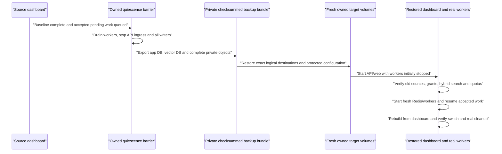

# M7c.1 — Full-store restore and dashboard rebuild acceptance

Status: the reviewed forward SQL migration, populated archive regression and complete isolated full-store restore pass. The restored dashboard, fresh-Redis replay, normal dashboard rebuild and natural retirement/deletion cleanup are verified. Exact owned infrastructure and synthetic downloads have been cleaned; protected evidence remains private. M7b.2 was delivered in PR #43 (squash `5213e9e`). [Native reference quality](rag-reference-quality.md) is verified separately; 100,000-child load and interrupted-process acceptance remain M7c work.

## Smallest complete action

Create a bounded synthetic RAG workspace through the real dashboard, take one **quiesced full-store backup**, restore it into new owned volumes, sign in to the restored dashboard, inspect/search/download the preserved exact versions, resume accepted work through a fresh Redis, then launch a normal dashboard rebuild and verify its switch/cleanup. The isolated harness owns export/restore and integrity checks; the product dashboard remains the acceptance entry point for restored behavior and recovery.

This is a reproducible disaster-recovery exercise, not a new customer-facing backup scheduler, import endpoint, online point-in-time recovery feature or arbitrary remote-vector rebinding workflow. The first exercise exposed a real SQL function lookup defect. The user explicitly approved the reviewed [forward migration and regression](rag-sql-function-restore.md); a newly captured baseline includes the correction. No captured archive or restored business state was repaired manually.

## Actual validation and failure history

The forward migration changes only the local `search_path` of 28 existing functions. Eleven migrations pass fresh, upgrade, repeated-deployment and Prisma parity checks, with 238/238 API journeys. The ordinary populated application archive restores through unmodified `pg_restore` with all rows, constraints and full normalized schema preserved. Metadata checks retain function identities, bodies, owners, grants and invoker attributes; empty-path and temporary-shadow probes and semantic/parent/telemetry concurrency checks pass.

The pure guard command passes 42 checks: 23 shared Python archive/resource tests, five catalog-target ownership tests and 14 JavaScript object tests. Prisma validation, 23 type tasks, 23 lint tasks, 51 backend tests, four production builds and all six image smoke checks pass. Existing lint warnings are unchanged. These automated checks are distinct from the actual dashboard journey below.

The earlier run `5403a35e892e` completed its source/export journey but failed during the first target COPY: a telemetry validator could not resolve its nested helper under the restore session's empty path. Its exact owned source/target/model infrastructure was subsequently removed; its complete private bundle and quarantined incomplete exports remain failure evidence. The pre-existing model cache and user resources were preserved. That failed bundle was never edited or relabeled as a corrected baseline.

## Corrected source and full-store restoration

Run `d6b75c1e97c5` uses production web/API/admin/workers, two synthetic organizations, four users and actual local Ollama `embeddinggemma:latest` with verified weight digest `85462619ee721b466c5927d109d4cb765861907d5417b9109caebc4e614679f1`. Dashboard uploads cover TXT, Markdown, PDF and DOCX. Three active parent/child collections use structure, token-window and semantic chunking at 128 vector dimensions. A restricted group can search only its granted collection; direct foreign/restricted collection identifiers return Not Found. Actual lexical, vector and hybrid searches return parent context. TXT and Markdown source downloads match their fixture SHA-256 values; PDF/DOCX previews expose their real extracted page/paragraph text. These small queries are functional checks, not a latency benchmark.

After graceful worker shutdown, dashboard actions fully upload Markdown version 2 and accept a separate PDF indexing action. The previous Markdown version remains published. The quiescent snapshot retains five versions, nine children, three parents, one PENDING extraction, one PENDING index task and the 696-byte upload/extraction reservation. No work is in flight. Semantic prepared-input/batch reservations are zero. Organization A uses its saved encrypted organization S3 credential; B uses the platform fallback.

The complete export contains 63 application tables/179 rows and six vector tables/16 rows. The normalized database manifest SHA-256 is `6a184a4abdd16c92ff9c81fac98c00a35eae41d51bd6a2c343e411901b4d06f9`. Application/vector custom-format dumps are 307,594 and 27,798 bytes, with SHA-256 `316dd5b9c46833659c1670a710d4288fc854939d7eadd3c72c840266015f54dd` and `3c50e455ac07edd06445e7646db858e7825994787f8a28e73e63a134bce23bea`. Nine private objects total 8,380 bytes, with object-manifest SHA-256 `04be210490a574aa07b72d895774765eed8bc1462a5d94297090a1360bafd07c`. Both saved credential branches and anonymous denial pass. Two stable pre-export snapshots and the post-export snapshot agree.

The source containers are stopped before distinct fresh target volumes take their exact logical ports. Both ordinary database restores and object import pass. Before any application writer starts, target verification matches the complete schema/row/role/extension/vector/object manifests and confirms the fresh Redis is empty. No target migration runs. The same protected runtime configuration, vector identity and saved S3 bindings are retained.

## Actual restored dashboard, replay and rebuild

Fresh manager and restricted-reader sign-ins succeed. Before starting workers, Markdown version 1 remains published and version 2 remains Processing; Operations shows one due ingestion, one due index and the scheduled old-file cleanup. Usage preserves semantic accounting. The technical superadmin sees two organizations, four users and old shared worker observations; opening a collection in the web app gives the no-membership onboarding screen without source content.

All four restored library originals download with the exact fixture SHA-256. PDF page and DOCX paragraph previews work. Hybrid and vector searches return the captured generation, exact Markdown version 1 and parent context. The reader retains its token collection only and can open that exact source; A's semantic collection remains denied. B retains its own TXT search and cannot access A's direct collection identifier.

Starting the normal worker on the fresh Redis replays the accepted PostgreSQL work: version 2 is extracted and published in both A collections, and the separate PDF index task completes. The version 2 original matches SHA-256 `9e68574c09c0a518397996f20eafefdc1152161bd27719864d54d81296a91ed5`. The read-only replay checkpoint verifies 18 retained/current child rows, six parents, exact preparation/chunk/physical manifests and no outstanding semantic batch/prepared reservations. This does not claim exactly-once provider requests.

The dashboard then changes the semantic collection's parent maximum from 512 to 128 and launches revision 2. A hybrid search during the pending build still uses the old serving generation and current version 2. After normal activation, search uses the successor generation, with a displayed 87-token parent instead of the former whole-document parent. The read-only checkpoint verifies 24 retained/current child rows, 12 parents and four generations. Native work and cleanup continue normally; no timestamps, leases, completion flags, fingerprints or counters are edited.

Markdown deletion through the dashboard uses a zero-day file delay. Direct document access immediately shows the access/load error without its contents. After 1,045 actual seconds since deletion (17 minutes 25 seconds), the read-only object proof at 2026-10-22 23:57:04 UTC confirms both Markdown versions PURGED, all cleanup COMPLETE, source holds released and their upload/extraction reservation zero. All four Markdown objects are absent. The exact six surviving PDF/DOCX/TXT originals and extractions total 6,292 bytes; each retains its saved binding, SHA-256/length/metadata and anonymous denial. Catalog metadata remains stable across the read. This is a live read-only observation, not an atomic distributed snapshot or a permanent late-write guarantee. An additional manual group-revocation browser control was refused by automatic approval review because specific authorization for that permission change was absent; it was not executed, and existing grants remain intact. Automated authorization regressions pass, but this additional browser revocation is not reported as tested.

The final index checkpoint verifies six actual child vectors, four parents, three ACTIVE generations and one CLEANED generation whose physical table is absent and ledger tombstoned. Active child accounting is six, with zero retained/reserved children; recorded storage equals the six objects at 6,292 bytes. The dashboard reports file cleanup complete and storage released for both deleted versions, shows the old generation Cleaned, returns PDF-only results from the rebuilt semantic collection and no results from the now-empty token collection.

Teardown gracefully stops all four owned production previews, removes only the eight source/target store containers and volumes plus the owned model container, and preserves the pre-existing model volume. Only created tabs 25–27 are closed; no action targets an existing user tab. Seven exact-path/owner/inode/size/SHA-verified synthetic downloads (5,985 bytes) are removed, while fixture originals and private bundles remain. The user's local admin Next type-import preference is unchanged and excluded from the commit. No application database or unrelated resource is used.

## Actual boundaries that must survive

| Store/configuration             | Required contents and binding                                                                                                                                                                                                                                                                                                                             | Current evidence/entry point                                                                                                                          |
| ------------------------------- | --------------------------------------------------------------------------------------------------------------------------------------------------------------------------------------------------------------------------------------------------------------------------------------------------------------------------------------------------------- | ----------------------------------------------------------------------------------------------------------------------------------------------------- |
| Application PostgreSQL          | Complete schema/data, migration history, users/member/group grants/key principals, encrypted credentials/selections, immutable configuration revisions, original/extraction metadata, generations/publication pointers, receipts/change watermarks, tasks/leases, source holds, semantic plans/attempts/accounting, audit and notification delivery state | `packages/db/prisma/models/rag*.prisma`, `rag-indexing.prisma`, `rag-semantic.prisma`; existing native organization/cleanup SQL guards                |
| Vector PostgreSQL               | Extensions at the pinned versions, vector roles/ownership/ACL/default privileges, the entire dedicated schema, generated tables/indexes, `vx_identity`, generation/publication ledgers and tombstones                                                                                                                                                     | `infra/postgres-vector/10-vector-store.sql`, `packages/vector-store/src/{connection,provision,publications}.ts`                                       |
| Private objects                 | All original and extraction objects in the owned buckets, including retained versions and unpublished/orphan objects; exact key, length, bytes/checksum, content type and SHA-256 metadata                                                                                                                                                                | `packages/storage/src/index.ts`, `services/documents/{storage,retention,cleanup}.ts`                                                                  |
| Recoverable encryption          | The exact `ENCRYPTION_SECRET` (and any `ENCRYPTION_PREVIOUS_SECRETS` still needed for unrotated values); encrypted organization credentials are unusable without it. The same value also derives source-receipt signing keys                                                                                                                              | `packages/routers/utils/src/utils/encryption.ts`, `services/indexing/receipts.ts`                                                                     |
| Runtime credential bindings     | Complete saved S3 endpoints/regions/buckets/path-style, provider bases including path prefixes, exact endpoint allowlists, fallback configuration for null/platform credential bindings; vector logical target, TLS policy and role access                                                                                                                | `services/documents/storage.ts`, `credential-resolution.ts`, `services/indexing/{embedding-profile,generation-adapter}.ts`                            |
| Authentication/runtime identity | `BETTER_AUTH_SECRET`, intended API/web/trusted/passkey origins, deployment versions, and any necessary server-managed integration secrets                                                                                                                                                                                                                 | `.env.example`, existing auth/configuration paths. Test with fresh sign-in; do not assume a restored cookie outlives its expiry                       |
| Redis                           | No authoritative RAG task data is required from Redis; queue names and schedulers are recreated on worker startup. PostgreSQL keeps accepted work/reservations/claims                                                                                                                                                                                     | `packages/queues/src/index.ts`, `apps/workers/src/index.ts`                                                                                           |
| Local model                     | The exact saved Ollama model/dimensions and verified weight manifest must remain available                                                                                                                                                                                                                                                                | Saved `capabilitySnapshot` / `modelIdentity`, native Ollama checks. A cached model volume is a prerequisite, not a newly proven weight-backup feature |

A database dump alone is insufficient. Organization credentials are encrypted in PostgreSQL, while platform fallbacks live in runtime configuration; both can be necessary for objects in the same backup. Never mix a restored organization key with a different platform endpoint. Preserve the independent current active selection and historical saved binding; changing an active integration must not retarget an old version.

### Endpoint portability is a real constraint

The vector fingerprint covers normalized host, port, database, schema and TLS details **plus** the persistent random `vx_identity`. Usernames/passwords are intentionally excluded. A dump restored at a new random address will therefore fail an old generation even if every vector is present. A new database at the old address also fails if the persistent identity was not restored.

Similarly, `StorageLocation` persists the exact non-secret S3 destination and its credential binding. `boundStorage` rejects a changed endpoint, bucket, region or path-style setting. Preserving object keys at a new URL is not enough.

For the first exercise, prefer two independently owned container networks whose service aliases/ports/database names remain logically identical inside application containers. The source and restored volumes/container IDs differ, while `vector:5432`, the `_test` database name, vector schema/TLS mode and private S3 alias/bucket remain unchanged. If host-run application previews are used instead, use a **serial** cutover: stop the source services, release only their owned loopback ports, then bind new restore containers to those exact ports. Never reuse an unrelated occupied port or rewrite catalog fingerprints to make the test pass.

Existing `prepareVectorDestination` rejects a changed bound `VectorConnection` before a dashboard rebuild is admitted. The product does not currently expose an arbitrary-new-vector-identity rebind wizard. Therefore **app database + objects only, followed by automatic recovery against a fresh vector identity is not the delivered workflow**. Test full vector identity/ledger/table restore first; a normal dashboard rebuild can then prove reconstruction from preserved canonical sources. Loss of the vector backup or relocation to different logical destinations needs a separate reviewed recovery/rebinding design.

The precise current failure for an otherwise correctly initialized fresh vector store is `VectorStoreError('DESTINATION_DRIFT')`: its new `vx_identity` produces a fingerprint different from the restored `VectorConnection.destinationFingerprint`. `prepareVectorDestination` rejects the existing binding, and `generationVectorAdapter` rejects old generations. At API boundaries `safeIndexError` maps that condition to sanitized `CONFLICT` (HTTP 409), with `data.errorCode: 'VECTOR_BINDING_CHANGED'`; workers retain the same terminal diagnostic. A store that has not been bootstrapped correctly can instead fail earlier with `VECTOR_UNAVAILABLE`, so that is not sufficient evidence for the identity-loss scenario. Library/object access and an authorized lexical-only search may still work, but neither is vector recovery, and a hybrid/vector failure must not silently downgrade to lexical success.

### Separate planned action: recover a derived index on a fresh approved destination

If M7c must prove recovery **without a vector backup**, a later complete slice must add an explicit operator/manager-approved destination-recovery action. It must validate an operator-approved destination, show the lost old-index identity and affected collections, require current collection administration/index-management rights, and compare-and-set the accepted source generation/configuration. It should create new immutable destination/generation bindings and rebuild from preserved exact canonical sources with the existing quota, source-hold, controller, model, child-only manifest and publication fences. It must never overwrite the fingerprint of an old generation to pretend the missing physical data survived.

The design must decide how to represent an unavailable predecessor, how to bound multi-collection recovery and destination admission, and when the dashboard reports search unavailable versus a successfully activated replacement. Old generations and their delayed cleanup must remain associated with the lost destination; cleanup must not target the new store by accident. Existing code assumes the `platform` connection key and rejects changed bound identities, so whether this needs an additive connection model or a carefully versioned recovery record requires a concrete schema/contract review before implementation. No new field, migration, arbitrary remote database selector or recovery API is proposed as already delivered here.

Its own acceptance would restore only application DB and objects into an owned fresh vector identity, first observe the exact `VECTOR_BINDING_CHANGED` failure, invoke the new dashboard recovery action, verify current grants and exact sources, then confirm a new identity-bound generation becomes searchable. This is explicitly **planned**, separate from the first full-store restore plus ordinary rebuild, and must not be replaced by manual catalog edits or resetting saved fingerprints to null.

## Bounded fixture

Use a new dedicated `vectorix-m7c-restore-RUN` namespace, two separate source/target container/volume identities, two organization IDs recorded from actual UI setup, and database names ending in `_test`. Never load the checkout `.env`, default AWS credentials or a saved application database.

Suggested hard bounds for the acceptance harness:

- Two synthetic organizations; three collections total: semantic with parent context and token windows in A, document structure in B. Use one real available Ollama model/digest for all three. No paid credentials are required or assumed.
- Four small FR/EN originals across PDF with text, DOCX, TXT and Markdown, at most eight versions, at most 500 searchable children and 500 parent rows. A shared document belongs to A's two collections; B is an isolation control.
- At most 128 private objects, each at most 2 MiB and at most 64 MiB aggregate; at most 64 MiB per database dump for this deliberately small fixture. Abort before an unbounded export rather than silently omitting rows/objects. These are test caps, not new product quotas.
- One manager/owner and a restricted reader/group path per organization, plus a scoped key in private test state if API recovery assertions need it. Keep real external notification transports disabled or use only an explicitly controlled local transport. Never send mail/push to external recipients from a restored clone.
- A uses an organization S3 credential; B uses the platform fallback. Use distinct private buckets on the same owned RustFS endpoint if needed. Restore both exact buckets/configurations and prove AES decryption through real authenticated object access, without printing decrypted values.

Before backup, record safe baselines: original/extraction SHA-256 and lengths, actual publication/generation IDs, child/parent/manifests/counts, native model digest, organization quota/semantic accounting and current access. Keep private raw IDs/secrets in mode-0600 fixture state. Public evidence contains only hashes/counts/booleans and safe run identifiers, never files, receipt strings, cookies or credentials.

## Backup barrier and consistency

PostgreSQL dumps are individually consistent; they are not one distributed transaction with another PostgreSQL instance and S3. Sequential online dumps/copies can otherwise combine a new application publication with missing vectors/objects, or a restored source hold with already-deleted content. The minimal acceptance therefore deliberately uses a write-free interval.

1. Complete all baseline uploads, extraction, publication and source reads. Save a fresh source receipt privately only if the short continuity check below will be attempted.
2. Pause/close the owned worker process through graceful shutdown and await its active callbacks. API, web and admin can still be used briefly to queue known **PENDING** work: accept a replacement whose original PUT fully completes, and attach a separate already-READY document to create pending indexing. Use future ordinary retention for old originals. Do not leave an upload request open across the backup.
3. Block all new ingress and close the actual browser activity. Stop the owned API/web/admin processes and wait for graceful API `server.close`; the workers must already have drained. Do not call authenticated source GETs during the barrier: source access renews PostgreSQL holds. Auth/session reads can also write state. There is no implemented application maintenance-mode switch to assume.
4. Verify no owned process can write the stores, no held synthetic request remains, no current live RAG/provider batch is in flight, and task/reservation snapshots are stable across two bounded observations. The queued work remains PENDING. A graceful-stop timeout fails this clean-baseline scenario; forcing a kill and calling it quiescent would be misleading.
5. Export application DB, vector DB and complete owned object inventory while writers remain stopped. Repeat the bounded counts/manifests after export. Only then declare the bundle's quiescent cut. Keep source writers stopped throughout restore/verification so old epochs or S3 calls cannot race their restored copies.

A later kill/in-flight recovery fixture can deliberately include a real expired claim or unresolved native result and wait for actual deadlines/reaping. It must be labeled separately: unknown external outcomes and at-least-once effects cannot become an exactly-once restore guarantee. Do not mutate leases/completions or advance a global clock to simulate success. Existing late-PUT reconciliation can legitimately leave a source PURGED while an unfinished cleanup and recharged reservation require another physical deletion; the restore bundle must retain that state.

## Export bundle and restore order

The reviewed [helper commands](../tests/acceptance/restore/README.md#explicit-commands) implement this bounded sequence. The record above distinguishes the completed execution from the separate reference-quality record and remaining capacity/interrupted-process acceptance.

1. Create a private ignored directory per run with mode 0700 and mode-0600 files. Record a safe bundle manifest: commit/image digests, database/client/extension versions, logical destination policy, snapshot times, dump hashes/lengths, exact owned bucket names, object-manifest hash, schema migration checksums and fixture bounds. Protect the synthetic runtime secret/configuration material separately; do not include plaintext secrets in the safe manifest.
2. Use the pinned PostgreSQL client and a full custom-format logical dump for each owned database. Preserve functions, constraints, triggers, parent/semantic supplementary SQL, schema owners, ACLs/default privileges, vector tables/index definitions and ledgers. Do not export only Prisma-known tables: generated vector tables are outside Prisma. Do not run the application migrator against the vector database.
3. Bootstrap the documented vector role names on the fresh target cluster. Restore into an **empty target database** with the same logical `_test` name, not a database already containing the bootstrap-created collection schema/ledgers. The cluster may initialize a separate owned bootstrap database first. Restore serially, fail on error and transactionally where supported; no ignored ownership/extension errors or blanket `--no-owner`/`--no-acl` without deliberate equivalent grants. App and vector clusters use their exact pinned version/extension libraries.
4. Enumerate every object under the exact owned test buckets with bounded pagination, including objects not currently represented by a published extraction. Copy bytes via authenticated S3 operations and retain exact key, content type, SHA-256 metadata and independently computed SHA-256/length. Do not treat ETag as a universal content hash or rely on filesystem layout of a live RustFS volume. Use flat safe artifact names plus a key manifest, not untrusted object keys as arbitrary local paths.
5. Create the same private target buckets and restore objects through S3 while API/workers remain stopped. Verify GET bytes, HEAD length/hash metadata and anonymous-access denial. An object copy does not restore all cloud policies, version history, KMS settings or multipart state; those are outside this RustFS fixture. Do not apply `sync --delete` to an unverified endpoint/bucket.
6. Reinstall the protected runtime configuration: exact encryption secret, correct saved organization/platform credentials, endpoint allowlists, complete provider bases, vector logical target/TLS and expected auth origins. Do not print configuration or embed credentials in shell arguments/logs. For tools, use a private credential file or bounded environment supplied only to the owned process, with metadata/default-credential discovery disabled.
7. Keep target workers stopped. Verify restored migration history and schema parity at the same application commit, role/DDL boundaries, persistent vector identity, child-only manifests/physical vectors, source hashes and accounting. A migration check must not silently change the test snapshot. An intentional later application upgrade is a different scenario.
8. Start restored API/web/admin and verify readiness without declaring RAG healthy from `/ready` alone. Sign in anew. Start a new empty, owned Redis and then the real worker bundle only after the pre-replay dashboard checks below pass. No Redis dump is imported in the primary recovery test.

The hashes prove byte consistency against a trusted test manifest, not authenticity against an attacker able to rewrite both artifacts and manifest. This plan does not claim encrypted/signed production backups, scheduled rotation, off-site durability, a strict retention SLA, or measured recovery objectives.

## Dashboard and source acceptance

### Before replay

- Fresh manager and restricted-reader sign-ins work with restored memberships, custom roles/groups and exact collection grants. B cannot list/read A's direct IDs or source receipts; a scoped key remains bound to its original member/current roles if included.
- Library originals and PDF/DOCX/TXT/Markdown previews/downloads match the original checksums and provenance, including the previous indexed version while a replacement is pending. Current credentials can differ from an old version's saved selection without retargeting its objects.
- Both lexical and **hybrid/vector** searches return the captured active generation and expected FR/EN passages/parent context, with exact originals/source offsets. Lexical-only success does not prove the vector database/model restored correctly.
- Usage/Operations show the preserved reservations, pending source/index work and normal deferred cleanup, without zeroing counters or calling a claim a live worker. Admin technical totals confer no source access.

### Replay with a fresh Redis

- Worker startup recreates all three scan schedulers. The accepted replacement is extracted and the already-accepted index task is processed from PostgreSQL even though Redis has no old jobs. Actual current access/controller checks still apply before native work/publication; a revoked controller remains safely blocked until the existing dashboard adoption/retry action.
- Wait for real progress; do not reset attempts/leases, set available dates to zero or fabricate COMPLETE. Confirm exact v2 publication/source, consistent desired/change watermark, no duplicate active publication/reservation release and correct semantic selected usage/uncertainty. Native work can legitimately repeat after an interrupted uncertain attempt; do not call Redis reconstruction exactly-once provider execution.
- Ordinary future cleanup deadlines stay future. No source is revived by restore beyond the recovered snapshot's actual state. A deleted source remains denied, even if retained object bytes exist until cleanup.

### Rebuild and deletion

- From the restored dashboard, change a supported chunk setting or parent maximum and launch a normal successor B. Continue searching A during the real build; observe atomic switch, exact current sources, controller state and updated context after B activates.
- Verify preserved canonical source text and native preparation bindings, child-only vector manifests/accounting, no mixed generations and source receipt behavior under current grants. Revoke a reader/group grant and prove the restored direct source action is denied after refresh; do not treat a pre-restore token as permanent access.
- Let real retirement/source-reference deadlines expire, then observe durable tombstoning/table cleanup and retained quota release through normal workers. The 17-minute minimum is real time, not a placeholder to advance. Do other validation during that interval with short polls. If time is insufficient, explicitly leave cleanup/soak pending instead of claiming success. Delete one restored synthetic document through the dashboard and verify actual private object removal only when accepted source/retention guards allow it.

Source receipts last 15 minutes and the retirement minimum is 17 minutes (`search deadline + receipt TTL + I/O allowance`). A pre-backup receipt can work after restore only if it is still unexpired, its key matches, all captured exact data/holds survived, and current permissions allow access. If the exercise takes longer, expected expiry is not a restore failure; issue a fresh receipt through restored search. Never adjust timestamps, extend token expiry or weaken MAC/grant checks to keep an old receipt alive.

## Failure controls and ownership guards

- Every helper must require the exact run ID, label, source/target container IDs, new volume IDs, exact loopback/private network destinations, `_test` database names and actual synthetic organization IDs. An application DSN, unrelated volume, unknown bucket/key prefix or outside-owned endpoint is a hard refusal. A dump or bundle path alone never grants destructive authority.
- Before restoring, prove target volumes are empty/new and differ from source volumes; retain source baseline artifacts for comparison. Before reusing a port/alias, prove source writers stopped and the port belonged to this run. Never run source and target writers concurrently against a common logical endpoint.
- Missing/corrupt dump/object/secret artifacts, model drift, target/fingerprint mismatch or absent source objects fail explicitly. Do not repair by changing immutable generations, MACs, storage bindings, chunk counts or receipt state. Restore the correct bundle/configuration or document a genuine missing recovery capability.
- Optional negative controls should use separate throwaway restore copies: a corrupted object fails the checksum; wrong encryption material cannot access encrypted organization configuration; an empty new vector identity fails binding; a denied runtime role cannot perform DDL. Stop before paid/external work. These are negative checks, not successful restore claims.
- Full application restore can roll authorization/session/revocation state back to the selected cut. Quiescing prevents changes after that cut in this exercise; a real point-in-time rollback needs an explicit security/credential/session revalidation policy. Similarly, externally delivered notifications and paid provider effects cannot be rolled back; restored receipts may lead to at-least-once effects. Keep test delivery local/disabled and report this limitation.
- Cleanup stops/removes only recorded owned processes, containers, networks, temporary secrets/downloads and source/target volumes. Do not remove a pre-existing cached model volume or the user's browser tab. Preserve a failed private bundle until root decides diagnostic retention; never attach secrets/originals/dumps to a PR.

## Tooling and evidence map

- The reviewed [isolated helper suite](../tests/acceptance/restore/README.md) owns resource manifests, quiescence, bounded bundle/object exports, restore checks and exact cleanup. `pnpm test:restore:guards` runs only its pure mocked/file checks in ordinary CI; it does not start a restore. They must ignore `.env` and use explicit owned configuration like `test:catalog`/browser harnesses. A separately invoked acceptance command is preferable to multiplying every ordinary PR's full load test.
- Reuse the production images and `apps/workers` entry points. Restore uses database/object tooling, not new product endpoints. Reuse existing dashboard start/rebuild/adopt/retry/source flows; no direct SQL shortcut for business completion.
- A read-only proof helper compares baseline/restore identities, hashes/manifests, task/controller/current-version tuples, source holds, quota/semantic counters and physical child vectors. It may record bounded private IDs; safe output contains aggregate counts/hashes/booleans only.
- Record actual dashboard prerequisites/steps/results, dump/object manifest hashes, exact versions/images and owned cleanup in this acceptance record and the build log. Mark backup scheduling/portable rebinding and unrun failure scenarios separately.

Passing this bounded scenario would establish **this version's quiesced full-store restore, preserved security/bindings, fresh-Redis durable work recovery and dashboard rebuild on the tested disposable setup**. It would not establish online multi-store snapshots, arbitrary-destination restore, production data migration, provider billing correctness, a recovery-time/data-loss SLA, relevance evaluation, 100,000-chunk throughput or every process-kill stage.
